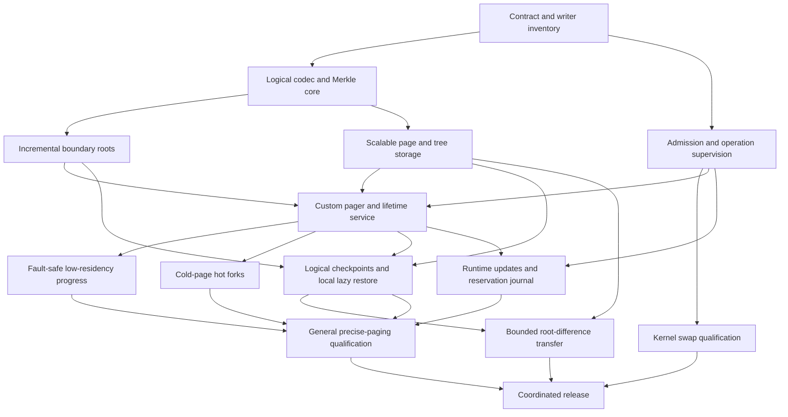

> Informative implementation plan. This preserves the initial QEMU-oriented
> work packages; it does not enable a capability. Normative release requirements
> remain in [chapter 11](../../rfcs/0021-crucible-paged-ram/11-implementation-plan.md).
> Read with the [profile roadmap](profile-roadmap.md). gem5 and KVM are specified
> future profiles, with no delivered implementation claimed here.

# Initial QEMU-SIM implementation sequence

## 1 Delivery model

This document records the initial QEMU-SIM implementation sequence. Acceptance
alone does not enable swap or advertise a new executor capability. Implementation proceeds
in reviewable work packages with explicit evidence. Staging phases are not a
backward-compatibility program: old and new incompatible contracts are never
accepted together by the deployed runtime. The final cutover is coordinated.

### Current host integration (informative)

The host implementation retains the actual Main's Source admission and node
supervisor before Source birth in both resident and controller-managed launches.
The same owner funds the fixed descriptor window and metadata overlap. Controller
endpoints, spill resources and workspace remain conditional; their absence does
not create another bank, clock or resident-only timing roster.

The current transport source contracts are:

| Surface | Current contract |
| --- | --- |
| Plugin control | Version 8; noncurrent peers are refused. |
| Shared region | ABI 33; each node slot is 768 bytes. Ordinary action return remains at offset 264; parent-Park return has a separate journal at offset 512. Constructor and clone reset paths clear both journals. The checked-in C header is emitted from the actual Rust layout. |
| Selected pre-exec Setup | Edition 5, selector `QEMU_CRUCIBLE_PREEXEC_SETUP=5`, tag `0x15`, 61-byte frame (4-byte length, 1-byte tag, 56-byte payload). |
| Setup descriptor roster | Five mandatory roles, in order: shared region, wake event, sealed plan, read-only standing publication, distinct standing cancellation event. An optional device workspace is sixth. |
| Sealed plan | `CRUCSUP8`, schema 8, containing one `CRUCPUR8` process purpose of 2520 bytes. |
| Native receiver declaration | The selected complete ELF contains one 40-byte `CRUCRCV1` record. Source activation and checkpoint ingress have separate edition fields. Startup checks Source activation independently; zero and unspecified positive activation editions refuse. The complete declaration and ELF digest remain bound to the installed Source. A declaration grants no execution authority. |
| Standing publication | Schema 3 in a 1504-byte shared file: one 8-byte sequence followed by a 1496-byte observation, accessed as atomic big-endian 64-bit words. The observation binds each action's kind, cohort, and parent-Park correlation where applicable. The host alone holds the writable mapping; the transmitted file role is read-only. |
| Sealed standing corroboration | The purpose's 1520-byte tail binds the retained publication file identity/extent and its initial 1496-byte observation. Copied fields issue no authority. |
| Standing cancellation | A separate nonblocking eventfd, with kernel event identity encoded as raw ID plus one. It is distinct from the wake event and Setup amendment event. |
| Operational durations | One exact-nanosecond roster under RAM schema 11; Host operational frames use schema 4. Configured values are positive and checked; observed expiry may be zero. |

Source publication preserves the same cap, original monotonic origin and nominal
Source subject across policy revisions. Publication commits through odd/even
atomic sequence transitions; terminal invalidation cannot be replaced by a later
live sequence. Ordinary policy changes publish new revisions without signaling
terminal cancellation. Completing Setup retains these physical owners for the
Source lifetime. Only actual child wait/reap and proven physical cleanup permit
retirement; kill, copied process identifiers and local uniqueness do not.

Execution still reserves full guest RAM and evicts at paused boundaries. The
configured Main/Source ownership path and native Root observation bodies exist,
but plugin registration still ends at explicit callback-activation refusal.
Native groups remain inactive, registry binding refuses and command-receive
custody supplies neither a live publisher/action parent nor genuine peer return.
The support declaration retains activation and ingress edition zero. Actual
activation and CPU-use issuance, complete diagnostic payload funding and native
physical-return qualification remain open. Smaller initial and steady physical
peaks and CPU/elapsed-time parity remain unproved.

The evidence below distinguishes the last complete workspace run from the
current whole-node RAM cleanup changes. Local Cargo uses the AOS toolchain with
remote builders disabled; a packaged Rust application build is not a prerequisite.
Passing historical results do not qualify the later ownership changes.

| Surface | Latest local evidence | Remaining qualification |
| --- | --- | --- |
| Workspace | All 520 test targets compile after the whole-node RAM cleanup cutover. Workspace doctests also pass after that cutover: 41 passes and 26 ignored cases. Before the cutover, the 510 non-daemon targets completed with 12,085 passes, 88 failures and 75 ignored tests. | Rerun the complete workspace after the affected integration failures are fixed. Earlier targeted tool/configuration and watcher reruns do not establish a passing workspace. |
| Affected host, daemon and test support | All 68 all-target, all-feature targets complete: 3,611 passes, eleven failures and 51 ignored tests. The daemon library passes all 1,881 active tests, including the physical 512 MiB quota case. The host library has 1,210 passes, eight guarded-helper failures and four ignored tests. | The three source-policy failures include two stale shutdown companions, subsequently repaired and rerun below. The eight helper paths still need genuine receiving and funding integration. |
| New RAM cleanup controls | All 22 cleanup controls, both registry controls and all eight whole-set teardown controls pass in the affected runtime run. The latter include actual descriptor destruction and a panicking node-field destructor that permanently refuses return. | Component success does not qualify complete native provider return, failure payload funding or lower physical peaks. |
| Source policy | All 66 specific controls pass, including the imported replay terminal route. The broad gate reports 21 paths: fourteen daemon and seven host paths, one fewer than the preceding whole-node run. An obsolete baseline entry for the relocated RAM wait was removed without a replacement waiver. | Complete the owning caller cutovers. Scanner bounds, classification and assertions remain unchanged. |
| Boundary and hygiene | All 65 unsafe/ABI/license controls pass against the current cleanup implementation. All five hygiene controls, 36 harness controls and both Rust documentation controls pass. Eight content-bound review records were refreshed after source review using the unchanged counter. | Keep original shape limits and recheck subsequent functional changes. |
| Native build | Signed source `5e6dec358c26` completes all 3,863 C compile/link actions. Twenty-five of twenty-six standalone fixtures pass, including sixteen new received-delivery lifetime scenarios. The worker inventory retains the genuinely linked RCU registration and its actual task census. | The regeneration gate fails at the unchanged mandatory launched capture lifecycle refusal. Component passes do not establish Source activation, real read/post/rearm/ACK or physical-return qualification. |
| Deferred control | The retained object has 124 private component definitions plus `main` and 28 genuine provider references. The owning runner resolves QOM support from the configured Meson build. All positive scenarios and both exact native assertion mutations pass. | Component linkage and runtime checks supply no Source activation or physical CPU-pin return evidence. |
| Native cleanup | All four changed production C units pass syntax checks; the actual generated fixture compiles and links. Ten new controls, the replacement capacity control and four independently rebuilt causal mutations pass their exact checks. | Positive RCU grace, launched capture and resource/performance qualification remain required. |
| Native Source unit | All 187 scenarios pass with matched compiled C layouts, actual worker backing charges, canonical Bridge/Child holders, RUN socket handoff, teardown semaphore entry, bounded join, control destruction and stack/storage return. The original 1 MiB budget remains an insufficient-budget negative. | Prepared-family and completion-binding enrollment remain explicitly modeled inputs. These component lifetimes qualify neither the production Rust module nor standing/Original/Source/CPU activation. Positive lifecycle qualification requires a paired normal-service flight. |
| Earlier worker and diagnostic cutovers | Before whole-node RAM changes: 2,716 passes across 43 host-resource, QEMU-host and plugin targets; campaign 448 passes; twelve owned-process diagnostic controls pass in both CLI targets. | Later host/daemon integration failures supersede the historical host-runtime pass claim. |
| Native settlement fixture | All 112 publication cases, 16 intentional waits and the control boundary pass with genuine QOM/support linkage. Exact guard deletion aborts at its blocked-count assertion. | Component success does not qualify Source or CPU activation. |

The subsequent helper-polling increment passes 1,233 QEMU host library tests,
with the same eight missing-receiver failures and four ignored probes as its
1,230-pass baseline. All host integration targets pass. Both image and setup
probe loops now borrow the actual creation Original on every iteration and cap
their sleep to its remaining slice. The receiver still saves output and the
independent post before interpreting the result. A real component child proves
successful completion under the same operation and cancellation after birth
while the live child remains owned for containment. These controls issue no
native Source, recipient or funding.

All 70 specific source-policy controls pass after that increment; the broad
gate still reports the same 21 unfinished owning paths. Its new exact contract
binds the borrowed Original through the receiver and both polling loops, and
the existing mutation runner rejects omission of those obligations or removal
of the sleep bound. All five hygiene controls, both rustdoc controls, eighteen
ABI controls and four license controls pass. This targeted run does not replace
complete workspace or native lifecycle qualification. The required application
`checks.rust.aos-test-targets` derivation also builds successfully.

The RAM gate inventory now selects the current Cargo packages from their owning
manifests. HTTP operational cases belong to `crucible-control-server`; the dense
capture case binds the current sticky original-admission control. Failed Cargo
listing and case execution print their saved diagnostics, and absent exact cases
identify the selected package, target and name. Coverage evidence paths and
component owners follow the current crate layout. The repaired store-transfer
and runtime-policy gates pass, as does the expanded supervision gate. The two
new helper controls bring the component inventory to 105 cases. The inventory
still has 149 requirements without named cases and no qualified requirements;
named cases remain distinct from native qualification.

The partial-probe increment retains stdout, stderr and observed exit status in
that same helper journal while polling. Timeout, excess output and unwind cannot
destroy an already collected prefix. The fresh-launch recipe reserves both fixed
1 MiB capture capacities before process-family sizing; the probe allocates them
before helper birth and cannot reuse that capture reservation for another probe.
The whitebox probe uses the same bound. Three new controls exercise actual probe
processes and bounded capture growth. They establish neither genuine Main funding
handoff nor native helper/Source return.

The updated host run passes 1,236 library tests with the same eight missing-receiver
failures and four ignored probes; all integration targets pass. All 70 specific
source-policy controls pass, while the broad gate retains the same 21 unfinished
paths. The moved polling removes its obsolete parent-module sleep baseline. Five
hygiene, two rustdoc, eighteen ABI and four license controls pass; the Nix hygiene
check and required application test-target compilation also pass. The expanded
supervision gate passes all ten exact cases. Coverage now binds 108 component
cases and still has 149 uncovered requirements and zero qualified requirements.
The full plugin run also passes 1,088 unit tests and every integration gate.
Native activation, complete diagnostic funding, genuine receiving ownership,
simultaneous families and CPU/wall parity remain implementation obligations.

The Main helper-funding increment moves the authentic Source host reservation to
configured-family binding, before the helper route becomes ready. Artifact
verification borrows that same retained purpose instead of reserving a second
Source window. Each helper borrows a checked control and descriptor overlap before
probe storage or process birth. The descriptor recipe includes all three stdio
pipe pairs and the pinned libstd fork/exec error-channel pair, including endpoints
that disappear before `spawn` returns. Unknown process return and unwind retain that
loan; successful image completion returns it only after observed reap. Probe
controls remain retained for their one-use capture reservation. The negative
component control verifies that an absent Main payer refuses before probe storage
or spawn. This closes the earlier ordering gap, while complete command/error
payload funding, returned-output lifetime and diagnostic allocation destruction
still require their receiving-owner cutovers.

The host funding run passes 1,237 unit tests with the same eight missing-receiver
failures and four ignored probes; every integration target passes. The new
missing-payer control passes, and all 70 specific source-policy controls pass
alongside the unchanged broad-gate refusal on 21 paths. Causal mutations cover
the Main-purpose handoff, actual control borrowing, allocation ordering and the
complete descriptor recipe. Hygiene, rustdoc, ABI and license controls, the Nix
hygiene check, and required application test-target compilation pass. Coverage
now names 109 component cases, with 149 uncovered and zero qualified requirements.
The updated hermetic supervision gate passes all eleven exact cases.

The Source control-lifetime increment replaces the weak payer facade with a
retained observer of the same authentic purpose. Its private shared-control
owner consumes every alias through `Arc::into_inner`, freeing the allocation
before dropping the extracted state and its actual Main loans. No raw Arc or
Weak observer escapes this control owner. The same recorded child reap and
returned-control checks still decide physical return; alias closure is not a
process-return oracle. The payer retains only the existing Main purpose and
adds no back-reference to the QEMU roster.

Two component controls observe actual allocator deallocation with both original
service-account charges still live, including concurrent final observers. An
independently rebuilt ordinary-Arc-drop mutation fails both controls, observing
zero original charge at deallocation instead of the retained charge. These
controls exercise the production shared owner without constructing a Native
Source. They do not qualify actual Native Source activation, every diagnostic
payload or the separate original-error controller allocation.

After that cutover, all host-resource targets pass: 258 library tests, one ignored
case and every integration target. The QEMU host again passes 1,237 library tests
with the same eight missing-receiver failures and four ignored probes; all its
integration targets pass. Seventy specific source-policy checks and the five
hygiene, two rustdoc, eighteen ABI and four license controls pass. The broad
source gate retains the same 21 unfinished paths. The hermetic supervision gate
passes all thirteen exact cases. Coverage names 111 component cases, with 149
uncovered and zero qualified requirements.

The helper receiver cutover replaces weak original-error references with the
existing Source lender's roster, slot, generation and incarnation identity.
Every resolution revalidates the active, ready and sound Source, including the
recorded process incarnation when one is bound. The helper entry point checks
that this lender resolves to the same controller before locking its journal or
performing effects. Cleanup revalidates the saved lender and actual Original;
it no longer retains a weak original-error allocation header. Nominal identity
comparison grants no helper, cleanup, funding or physical-return authority.

The negative component control exercises cloned and foreign observers without
issuing a Native Source. Missing custody cannot return either original service
loan. The original-error controller's strong allocation, diagnostic payloads
and weak roster allocation still require their own funded lifetime closure.

The nominal receiver control and all three retained-preparation daemon controls
pass, and the daemon library compiles with all features. Seventy specific
source-policy controls pass, including the updated identity and Original
omission mutations; the broad source gate retains its same 21 unfinished paths.
Hygiene, rustdoc, ABI and license controls pass. The hermetic supervision gate
passes all fourteen exact cases, and coverage names 112 component cases with
149 uncovered and zero qualified requirements. The changed Nix file passes
formatting; the whole-tree format check separately reports 405 unrelated files.

The launch controller now reserves its actual Main Source purpose and controller
loan before allocating its shared body. Family binding borrows that same purpose;
it no longer creates the controller's payer after controller birth. The roster
publishes the funded controller before its independent preparation postcheck,
retaining it and excluding slot reuse if that post refuses. Production cannot
construct an unfunded controller; mechanism-only constructors remain test-only.

Typed original-error observers and the portable lifecycle construction error use
the existing closed operational owner. The last typed or erased observer frees
that shared allocation before destroying the concrete cause and its loans. The
portable error preserves the actual concrete cause's downcast identity without
allocating a second shared control. This closes the controller allocation's
strong-observer lifetime; separately allocated diagnostics, helper first-error
controls and weak roster headers still need their own funding and closure.

Two allocator controls observe both original service charges before and after
physical deallocation, including eight concurrent typed and lifecycle observers.
Restoring ordinary Arc destruction makes the deallocation control fail: both
charges have already returned. The complete control API targets pass. The host
passes 1,238 library tests and all integration targets, retaining the same eight
missing-receiver failures and four ignored probes. Seventy specific source-policy
controls, five hygiene, two rustdoc, eighteen ABI and four license controls pass;
the broad source gate retains its same 21 unfinished paths. The hermetic
supervision gate passes sixteen exact cases. Coverage names 114 component cases,
with 149 uncovered and zero qualified requirements. All three retained-preparation
daemon controls and the required application test-target compilation pass.

Helper first-error controls now receive a distinct actual Source host loan during
controller preparation, before helper effects. The journal transfers that loan
into the closed shared first-error body before publishing independent observers.
The last observer frees that control before destroying the concrete error and
returning its loan. The public wrapper borrows the same typed cause and creates
no independent account, deadline or return authority. An unissued journal can
retain its actual local refusal without allocating a shared diagnostic.

Two paired-credit allocator controls pass, including eight concurrent observers;
they exercise the production generic cause body without issuing a Native Source.
The unfunded-journal control observes zero shared allocations, and all five
helper-journal controls pass. The complete host run passes 1,241 library tests
and every integration target, retaining the same eight missing-receiver failures
and four ignored probes. Source-policy checks bind the separate reservation,
Original verification, journal handoff and closed owner, including omission and
first-cause replacement controls. The broad gate retains the same 21 unfinished
paths. Hygiene, rustdoc, ABI and license controls pass. Coverage names 117
component cases, with 149 uncovered and zero qualified requirements. The
hermetic supervision gate passes all nineteen exact cases.

This fixed control loan does not fund an error's separately allocated payloads,
command construction, returned output storage, or weak roster headers. The final
diagnostic quarantine remains. Late helper work still needs its actual entered
Work or Restore Original and current Source incarnation; retaining the creation
Original cannot authorize that later action.

The bounded RAM-source shutdown wait now has an exact source-policy contract.
Classification requires the actual saved Cleanup, current-process check, native
join observation and independent cancellation, join and wait posts. It also
requires the real worker result, panic and uncertainty history to remain owned.
The wait is exposed again if any one of these obligations is removed, including
through the generic omission control. Nine specific mutations reject foreign
Originals, invented return, discarded history or posts, and an unbounded sleep.

All 71 specific source-policy controls pass; the broad gate reports twenty
unfinished paths, fourteen daemon and six host. Five hygiene, two rustdoc,
eighteen ABI and four license controls pass. This review changes no shutdown
behavior and proves neither native activation nor cached-stack physical return.

Successful probe output now moves both capture buffers and their existing Main
control loan into one closed receiving owner. Callers borrow the output; they
cannot detach a buffer or refund its loan independently. Both buffers are
destroyed before that loan returns. Whitebox parsing borrows UTF-8 directly,
including on invalid input, rather than moving captured bytes into an error.

Two paired-account allocator controls observe the original charges through each
actual buffer deallocation, including a receiving-thread move. Reversing the
production field destruction order makes the control fail with both charges
already returned. The host run passes 1,244 library tests and every integration
target, with the same eight missing-receiver failures and four ignored probes.
The daemon compiles all targets with all features. All 71 specific source-policy
controls pass; the broad gate retains twenty unfinished paths. Hygiene, rustdoc,
ABI and license controls pass. Coverage names 119 component cases, with 149
uncovered and zero qualified requirements. The hermetic supervision gate passes
all 21 exact cases, and required application test-target compilation passes.
This closes successful capture-buffer
funding, while separately allocated parser diagnostics, command construction,
weak roster headers and genuine native activation remain unfinished.

The module now deposits each received request payload in its complete child's
paid inline journal before the independent read postcheck. Ending the local read
does not destroy or replace that payload. A mapped ACK and later tuple cannot
replace it, and a local receiver borrows the same journal until it returns.
Post refusal preserves the received tuple; unwind poisons the journal and keeps
uncertain custody. An empty read creates no payload owner.

All 1,093 plugin unit tests and every integration target pass. Five new controls
exercise these lifetimes, and independently rebuilt deposit/reuse omissions
fail at their intended assertions. All 71 specific source-policy controls pass,
with the same twenty unfinished broad paths; hygiene, rustdoc, ABI and license
controls pass. The hermetic supervision gate passes all 26 exact cases.
Required application test-target compilation passes. Coverage
names 124 component cases, with 149 uncovered and zero qualified requirements.
This owner retains module payload bytes only. Native delivery ownership, actual
module holder transfer/return, Host publisher loans, action Originals and
callback activation remain separate unfinished cuts. There is no payload
retirement route until the genuine module/native lifetime integration exists.

The received-delivery increment retains the actual completed Native receive in
Source's prepaid inline lifetime owner. Creation records its exact output field;
transfer consumes that field into the paid pinned Runtime. A constructor's
negative result does not discard born custody. Pure identity return consumes
only the canonical field, refuses live local borrowers and permits no rebirth
from the same retained receive. The one prepaid same-thread use slot refuses
saturation; it admits no nested, worker or multi-vCPU borrowing cohort.

The Rust keeper's twelve receive/delivery controls pass, including seven new
field-consumption models. Two independently rebuilt defects fail the intended
assertions for lost born-negative transfer and premature return clearing.
Native's sixteen new lifetime scenarios execute the actual C reader and
receive/delivery bodies with real mutex/thread/runtime storage; member and
standing boundary providers remain explicit modeled inputs. Three independent
native rebuilds detect omitted use retention, copied-holder acceptance and
delivery rebirth. Coverage names 132 component cases and nineteen native cases,
with 149 uncovered and zero qualified requirements. These controls establish
local custody only. Module payload
transfer/return, live publisher membership, entered action Originals, real CPU
borrowers, ACK and physical peer return remain separate unfinished work.

Whole-node shutdown now keeps one continuation through process reap, RAM service
return and controller retirement. Physical closure, initiating failure and
independent boundary checks remain separate facts. Failed construction retains
the same issued child or completed node and its saved lender; terminal generation
replacement returns the old node before releasing its lease. Main joins the same
worker handles before restoring their borrowed Source entries, including unwind.
The controls include a real held TLS destructor, retained failure, unavailable
borrowers and restoration ordering. They do not prove that libc has released its
cached stack storage or that every native provider is joined.

Helper failure history still needs complete allocation funding and a receiving
Main lifetime independent of Native roster ownership. Current quarantine retains
funding rather than claiming cleanup completion. Neither detaching a Weak lender
nor relaxing the quarantine establishes a valid handoff. General lower initial
or steady resident peaks, native activation and zero-regression CPU/wall evidence
remain outstanding.

The native worker owner consumes the real Rust handle before polling, retains
EBUSY and unexpected status, and latches actual task/TLS return before the
independent postcheck. This does not prove libc has unmapped cached stacks or
thread-control storage. Diagnostic controls discover only descendants of their
owned process and verify cooperative error-path waits. The settlement component
uses private names for all modeled externals; genuine QOM/event/thread/lock
providers remain independently linked. Its owning check rejects an unprefixed
component symbol, stale mutant binary or unrelated failure.

Native metadata admission now publishes each actual receipt before its
independent postcheck, retains allocation custody in Source until transfer, and
authenticates native creator and BQL ownership before mutation. Five separately
compiled omission controls fail at their exact intended assertions while their
named baselines pass. All four native retirement sites now retain canonical
receipts across physical frees and settlement refusal. Cleanup records consumed
projections, physical return and debt settlement independently; retries never
repeat a started free or MR unref. The same two inventory rows and paid intrusive
dirty-header owners retain unresolved work, without completed-debt aggregation
or a fixed bound on outstanding dirty-header generations. The component controls
exercise real frees and QOM finalizers against disclosed modeled retained state;
they do not establish Source activation or positive RCU callback execution.

Exact resume now preserves phase, shutdown and factory-retirement failures
together before classification. It retains the original typed history inline,
removes the recursive boxed cleanup variant, and seals only after all outcomes
succeed. All eight outcome combinations and drive-only classifications are
covered. Those controls establish owning error transport, not a funded native
terminal receipt or completion of whole-RAM cleanup.

Native Park disposition now follows capture completion and physical return of
the request-owned block, async and RCU census. The same Source loan and writer
gate remain held; failed capture or physical return retains containment. This
does not yet place the actual fork and thread-registry transaction inside the
Park lifetime. Positive Native Park disposition and worker rearm remain
unqualified by the build and component results above.

The dirty-iterator fixture requires an ownership cutover, not successful stubs
for missing dependencies. Bare capture completion no longer acknowledges dirty
pages. Its exhaustive selection, bitmap-work and plane-isolation controls must
exercise shared private production primitives. Logging initialization, failed
reads, premature acknowledgement, rearm and Original-post failures, generation
races, abort, diagnostic retention and independent checkpoint obligations must
also run through actual launched-QEMU Root/Source/writer ownership. Keep that
mandatory lifecycle flight outside the QEMU package dependency chain. Neither
component selection nor the registered Source fixture replaces this native
qualification; the full package gate remains failing until its stale fixture
is repaired, and lifecycle qualification remains outstanding until executed.

### Historical integration notes

The following notes retain earlier source-specific results and investigation
findings. Their counts and intermediate defects are historical; the current
summary above supersedes their status claims. They do not qualify later source
changes or the complete runtime profile.

The private-feature QEMU test targets also compile independently of the
test-support feature. The complete private-feature QEMU library run now passes
all 1,143 tests, with four ignored probes, in 32.62 seconds. Capture, Pause,
PREPARE and fault-result component fixtures use a distinct host-control owner
through the same control loops. Their peer acknowledges mapped control and
sample publication independently of returning that owner's exact serial ticket;
the loops cannot finish before both facts hold. Production continues to use its
original Source action binding, and missing, revoked and foreign Source controls
still refuse. The component owner cannot wrap a live Source or construct native
authority. All 32 confinement lint controls also pass. These component results
do not qualify a live VM or replace native lifecycle evidence.

Memory-service occurrence admission now compares the reported byte rate,
operation rate and exact presence bits with the same issued action, alongside
its existing materialized-latency check. Matching payload hashes alone cannot
establish that configuration. The new control covers all four enabled/disabled
rate combinations and rejects twenty individual contradictions while preserving
the same action and APPLY identities and recomputing valid evidence and transport
hashes. This validates host event admission; native service timing and cold-page
fault qualification remain required.

Packed inventory, publication readback and canonical archive reads now borrow
one metadata cache from the existing physical-quota service. Its rows and index
use the same paired resident/metadata accounts as ordinary service work; they
retain no Source, operation authority, file descriptor or active pack pin.
Before admitting competing allocations, the service physically reclaims cached
storage and rechecks the actual accounts. In-flight fills remain charged until
their bodies close. Every read still authenticates its fresh configuration,
placement generation, file stamp, selected entry and complete object identity.
Each reader prepays an independent active manifest copy from its existing
operation budget before borrowing shared rows. Copying under the cache mutex
performs no allocation, filesystem work or caller callback. Subsequent reads
within the same pack use that copy and preserve fresh stamp and entry checks;
shared-cache eviction can close its own rows without invalidating the reader.
Small manifests use ordinary operation-owned storage when the cache's index
and control payload would cost more than their row storage. Ordinary single-tree
reads retain their existing dispatch; this is not a claim that every page read
uses shared metadata. The storage cost controls cover tiny, mixed and dense packs
and 32/512 MiB RAM traversals. Their integrity/resource results do not establish
VM performance parity or authorize new resource ceilings.

The complete volume fixture deliberately uses a quota guard without manifest
retention. Digest-ordered repack loses depth-first traversal locality, so that
fixture authenticates a manifest on almost every subsequent pack switch. The
separate cost control and production quota guard use the service-owned cache;
the measured switch count is the same, while authenticated manifests fall from
391,776 to 628 in the 512-MiB post-repack traversal. This identifies two guard
policies, not a demonstrated shared-cache eviction defect. The cache-disabled
integrity coverage remains required. Additional complete lifecycle controls now
use the same retained cache across capture, archive, repeated archive, repack,
reopen and GC. Their source and destination each keep the original 128-descriptor,
256-MiB fixture bank; the separate cost fixture keeps its 64-MiB bank. The quick
case and full 512-MiB case pass, the latter in 954.84 seconds. After repack, cold
restore authenticates 628 manifests over 393,216 rows; warm and reopened restores
authenticate none. Actual reclamation refunds the matching bank exactly once,
and both banks have zero descriptor and resident debt after final destruction.
The original cache-disabled lifecycle remains required and unchanged in scope.
These are integrity and accounting controls, not VM throughput measurements.

Execution runners now expose retirement through an existing supervised
operation. Routers visit both contained runners even when neither became the
active semantic route; one refusal does not suppress cleanup of its peer.
Returned diagnostics leave operational ownership in the actual factory. The
hot-fork runner also refuses retirement while it retains an unreconciled world.
Aggregate release readiness is observed without finishing or quarantining a
pending owner, so a launcher can finish before actual aggregate release.

Main now retains the actual worker bodies independently of their borrowing
threads. Worker storage and the fixed cleanup queue are priced before model
construction. Source construction retains its original factory, generation
storage, launcher and preallocated partial/complete lifecycle carrier across
refusal. Successful disposal returns the same carrier to its reserved cell.
An exact-cell receipt remains with the factory until actual body destruction
and containing-body lease closure; publication alone does not free a slot or
certify aggregate resource return. Hot-fork retirement returns the original
Source separately from its retained typed failure history. These operations use
the existing supervision origin and preserve failed ownership for bounded retry.

Source construction now preclaims its genuine Main role before logical World
admission. That role pays the existing Pending and construction-carrier Boxes;
World admission separately pays its launcher, generation storage and Source Loop.
The native boundary delivers a committed failed World and its exact controls to
the same preborn receiver before propagating the initiating or independent post
failure. Delivery and preparation are separate operations: refusal retains the
actual holders and both typed reports without entering preparation. No missing
callback or empty node ledger establishes that a World was never born. The
original role also supplies a nonissuing selection that verifies the actual Main
and exact empty epoch before future Service startup; it grants no Service cap.
All twelve reservation controls pass, including the unavailable-selection check.
The complete Linux resource library has 247 passes and one ignored probe.
Supervisor preparation now captures its original identity and both clock
coordinates before allocating shared controls. Publication consumes that same
value; delay cannot renew its cap. Ordinary construction uses the same path,
conservatively counting control allocation in its original interval. Four new
controls cover delayed and reversed publication, unchanged budget refusals and
exact roster identity. Both workspace/all-target checks and engineering hygiene
pass; the existing testing-standards classifier failure remains unchanged.
This lower-level seam alone supplies no Main or Service admission.

The whole-world transaction separates native resource effects from a private
component backend while preserving checkout, adoption, rollback and publication.
The component's carrier is charged to its existing fixture account before birth
and enters the shared constructor. A failed installation retains the same actual
body in its fixed slot while reporting its original typed cause; this performs
no canonical publication. Native operations provide no fixture carrier, and the
default backend still refuses a missing genuine Source issuer before child
effects. The cleanup-rejection control now requires both the initiating error
and the actual independent typed guard failure. The complete private daemon
library passes all 1,733 tests, with 43 ignored probes, in 318.12 seconds. Both
default and private workspace/all-target checks pass for this source. Engineering
hygiene has five passes; testing standards retains its existing operational-source
classifier failure. Genuine Target before-effects ownership, role handoff,
selected-member resource geometry and healthy retirement remain required. These
component results qualify neither native Target activation nor physical resource
floors or VM performance parity.

Lifecycle assembly now offers one borrowed preparation core. Input installation
checks the same pristine carrier before moving either the launcher or decoded
checkpoint; every refused installation preserves both inputs without allocation.
Preparation refuses failed, closed, reserved, poisoned or already-cleaned custody
before configuration copying or native effects. Owning constructors delegate to
that same core and perform the final move only after complete validation. Three
controls cover unusable carriers, retained validation failure and re-entry after
physical cleanup. The final private daemon library run passes all 1,736 tests,
with 43 ignored probes, in 358.60 seconds; both workspace/all-target checks pass.
The durable Main producer still needs to adopt this borrowed core before Source
startup, so these results do not qualify native activation or VM performance.

Worker and lifecycle retirement now checks its same saved Cleanup before and
after each worker/queue effect. A refused entry or post stops subsequent effects;
final physical observations still run and preserve independent work and post
causes. Controls use real retained files to prove a deadline cannot close the
next queued body and that an already closed body can still be destroyed outside
its containing mutex. Outer cancellation alone remains compatible with cleanup.

Attached, original and standalone Main retirement now use that guarded cleanup
path as the sole lifecycle drain. Their final queue checks only observe emptiness;
they cannot initiate a second cleanup after the saved Original has refused another
effect. Default and private workspace/all-target checks pass, and all 1,742
private daemon library tests pass with 43 ignored probes. Engineering hygiene
has five passes; testing standards retains one failure with 25 findings. The
removed duplicate standalone drain no longer trips its source classifier. The
independent no-Main component shutdown retains its explicit cleanup route.

Retained-source preparation now shares one borrowed engine for initial capture
and child promotion. It keeps the same Loop Box, captured continuation, returned
template tokens and current and prior disk owners before subsequent validation
can refuse. The original typed cause survives rollback and failure assembly.
A parent-park refusal retains the actual complete Source instead of forgetting
it. Two controls verify allocation identity, one-shot refusal and recovery of
that same owner. This seam still requires the durable Main capture integration.

Both workspace/all-target checks pass. The latest four-thread private daemon
run has 1,744 passes and 43 ignored probes in 373.10 seconds. An earlier
four-thread run failed the aggregate-release hot-fork control; its isolated
control and seven-test module subsequently passed, and the full run includes
an improved unexpected-disposition diagnostic. The concurrent failure remains
unexplained. A preceding invocation omitted the established four-thread limit
and exhausted the fixture's fixed SQLite capacity; its failures remain recorded.
No fixture capacity or assertion was relaxed. Engineering hygiene has five
passes; testing standards retains the same 25 classifier findings.

Session ownership now arms one inline loop slot before constructor validation
and keeps it in the actual Engine owned by the actor. Normal completion,
unpolled futures, cancellation and unwind consume that same slot through a
neutral retirement hook. Explicit extraction disarms it. Five controls retain
and return an actual file, including refusal before an Engine could be built;
no control issues native authority. Both workspace/all-target checks pass.
The full scheduler and session unit, integration and documentation suites pass
1,564 tests with one ignored probe, including 700 scheduler and 107 session
unit tests. Engineering hygiene passes; the same 25 testing-standards findings
remain. The production Loop override and its original Main destination belong
to the coordinated Source cutover and are not qualified by these component runs.

The coordinated Source, Service, capture, replay and observation cutover is now
assembled in the implementation worktree for compilation. Service startup uses
its original Main cell before effects, and capture retains the complete borrowed
preparation before template or disk work. Receiving-state retirement publishes
its actual maintenance inputs before returning the stopped native body. Review
found an unwind gap between native construction and installation in that grouped
owner; installation now occurs before the projected context is destroyed.
Discarding an authenticated, never-launched import destroys its decoded basis
and Transfer before acknowledging the ordinary alias receiver. Unwind preserves
unacknowledged debt rather than certifying destruction.

Combined compilation exposed a recursive error layout: an inline Service first
cause used the complete executor error, which could itself own terminal Service
history. Startup now stores only its five actual lower admission-error types.
This preserves the original causes without another heap allocation. Both the
default and private daemon library configurations now compile. Cleanup history
retains its complete terminal body in the same preborn receipt Box, whose
deallocation precedes terminal-role release. A synchronized inline guard keeps
raw history available without requiring a replacement error allocation. Unused
publication helpers and their unconstructed begin/callback fallback variants
are removed; the live installation and first-cause controls remain.
The independent harness ABI and license-boundary suites pass four and eighteen
controls, respectively, on this partial integration.

Managed sharing now keeps the original Main carrier and return destination
outside the existing Source Arc. Borrowed leases retain only that allocation;
an exclusive lease retains its actual return owner. Strong and Weak aliases
both prevent extraction, and poison retains the same allocation rather than
reconstructing an Arc. The Park gate stores the original nonissuing selector
instead of an allocation alias, with physical return tracked independently from
raw first and post errors. Its actual paid record survives Source rearm.
Six obsolete packaged candidate-leak paths now use this canonical destruction
path. The failed-rearm phase also delegates to the existing saved-Cleanup Source
retirement engine and transfers original typed causes and rollback diagnostics
into terminal history before its carrier is destroyed. The combined private
library compiles; native execution of these paths remains unqualified.

Thirteen native fixture endpoints use the real Source factory and transport
receiver. The operation-only Service fixture shares the production admission
and cleanup algorithms without constructing a Main key or native permission;
its original 32 assertions remain. Four comparison Target starts still need
their genuine producer and account for the remaining 27 daemon test compilation
diagnostics. Actual Target construction and simultaneous independently funded
sibling families remain unfinished. A Cargo test executable does not acquire
the installed campaign Main's authority. Native qualification must retain the
existing positive assertions under an authentic deployed issuer; missing
issuance is not a replacement passing result.

On the integrated Source/API snapshot, the API library passes 124 tests. The
Linux resource library passes 172 default tests and 247 private tests, with one
private probe ignored. All five engineering-hygiene checks pass after nineteen
content-bound responsibility reviews. The declaration contracts now bind the
actual postbody and return-destination types, retain the original same-owner
forwarding constraints, and reject added default bodies or foreign return types.
Testing standards has thirty passes and five failures in the remaining exact
operational source contracts. No matcher, inventory, capacity or existing
assertion is relaxed. The earlier green
workspace and packaged results above describe their historical snapshots, not
this uncommitted union. Full combined runtime, current packaged application
compilation and VM performance parity are still outstanding.

The subsequent Target constructor integration replaces the permit-only native
outcome with an owning Ready/Retained result and exact saved-Cleanup return.
Its QEMU host crate passes all test-target compilation and 1,147 library tests,
with four ignored probes. The current daemon library check stops at the one
remaining old Native permit-adapter call; factory/runtime consumers are not yet
cut over. The required owning consumer, independent simultaneous families and
promoted-parent integration are tracked in [Target ownership](target-ownership.md).
These current results supersede earlier source snapshots for the changed paths.

Checked checkpoint-slot operations use nonblocking access and distinguish busy,
poisoned and occupied storage. A refused restoration returns the same selected
root instead of overwriting another root or dropping the incoming owner. These
operations are ready for the durable producer; existing consuming callers still
need the coordinated cutover before the old slot operations can be removed.

Hot-fork reconciliation handles now share their expected node roster with the
actual reconciliation map. Cloning a child handle no longer copies the entire
roster, and membership validation compares ordered keys without building a
temporary set. Successful reconciliation removes both entries under the same
mutex, then destroys the completed child outside that lock. Three controls cover
shared membership, poison and missing child receipts. This removes redundant
metadata copies; complete Target heap funding, native activation and measured
VM performance parity remain unqualified. The combined private daemon library
passes all 1,742 tests, with 43 ignored probes, in 311.90 seconds. Default and
private workspace/all-target checks pass. Engineering hygiene has five passes;
testing standards has 34 passes and its unchanged operational-source classifier
failure. These local component checks do not complete the consuming cutover.

Replay preparation now selects the actual node for its installed issuer,
generation directories, child contract and failed-child retention. The same
node passes through the existing operational checks; no descriptor is cloned
to reconstruct that selection. The replay World control query measures its
actual selected generation storage and does not charge a nonexistent Source
launcher or Source Loop. Default and private workspace/all-target checks and
all seven focused replay library controls pass. This query is preparatory;
the durable replay producer and native execution remain unqualified.

If exact cell attachment refuses, the same inline factory slot retains the
pending body, its canonical never-born journal and its body lease. Physical destruction precedes the paired descriptor-table/window return
and ledger credit. Retry borrows the same cached World Cleanup; it does not
renew its origin or replace its deadline. Constructor, cleanup and independent
post-check errors remain separate typed history after physical closure. The
component executor's separate no-Main shutdown path closes any saved dispatcher
without requiring a native dispatcher to have been created.

Retained constructor finalization now separates physical closure from its
independent Cleanup postcheck. After the actual owner and Main controls close,
the same containing body is removed and destroyed outside its cell lock, even
when the postcheck expires. Initiating, work, control and post failures remain
typed reports. An open owner or control still retains the complete body. A late
report neither starts another Cleanup nor requires a retry before releasing
already-closed resources.

Normal World sweeps distinguish an outstanding containing-body lease from an
invalid return. They validate the exact epoch, member and descriptor custody,
and return arithmetic before reporting pending body custody. Pending bodies
retain their complete remaining debt and physical leases while independent
Worlds can use genuinely available capacity. Ledger assignment validates all
fallible arithmetic before publishing rows or advancing epochs. Admission
refusal clears temporary factory poison only when no assignment was published
and the independent preparation postcheck succeeded, or when the local World
directory was already full before preparation. Committed or uncertain claims
retain their existing poison and owners.

Concrete VM construction, runtime, checkpoint and cleanup ownership now live in
`crucible-daemon`. The API owns transport-neutral operational data and cleanup
operations; it no longer depends on the QEMU implementation. Handoff upcasts the
same preallocated backend body into its existing exact cleanup cell, without a
replacement allocation or owner. The cutover removes 112 obsolete QEMU boundary
allowances and preserves all 380 lifecycle and RAM unit-test declarations.
Independent default-feature library builds now include their own unit fixtures
without depending on workspace-wide feature unification. External fixtures
remain opt-in, and native permission requirements are unchanged.

Private native observations now retain the real Source factory in the paid Main
worker. The shared four-vCPU and block drivers borrow operation-only views; no
node, guard, mapping or channel owner is returned. Launch uses the ordinary
keyed constructor and saved supervision. Publication consumes the same owner and
cleanup receipt, and diagnostic loans remain held until physical closure. The
worker size query includes the new inline fields before construction; immutable
input paths and their shared body are admitted before allocation.

The default workspace/all-targets check and the separate private observation and
Parent feature checks pass. The focused private suite has 29 passes and one
ignored legacy native entry; all four original-retirement controls pass against
the actual retained thread table. The input alias control proves last strong-alias
closure and credit retention; its test-only Weak witness does not prove Arc
backing deallocation. Production keeps the body graph free of Weak/raw escapes
and drops that allocation before its decoder custody. The full private-feature
library run has 1,680 passes, 17 failures and 43 ignored tests. Its failed-name
set matches the preceding native integration failures. The membership cancellation
control now selects five actual traversal boundaries instead of calibrating raw
callback ordinals across independent SQLite reads. It checks the same operation,
typed cancellation, unchanged root, exactly one selected boundary and no
post-refusal callback. The positive traversal visits every boundary exactly once;
all seven membership controls pass. The full suite also passes the 512-MiB
packed unique-page traversal.

The supplemental service VM checks build the actual private controller into the
installed Main policy and retain the original guest/request vectors. Ordinary
deployment TOML values are unchanged. Deployment files now use the source-built
text helper so guest artifact derivation references are valid. Source/guest-only
backreferences to the old canonical gate have been replaced with direct owning
imports; the guest derivation is identical and the shared Cargo source retains
its required embedded scenario. The four-vCPU VM build reaches the unchanged
QEMU dirty-iterator fixture failure before execution. Neither service flight nor
VM performance is qualified by the compile and component results.

The API library has 119 passes. All eight Source history/saved-Cleanup controls,
four component shutdown regressions, three worker-custody controls, five exact
receipt controls and two status-ordering controls pass. These include 24 epochs through
one physical cleanup cell and actual body destruction before expired-operation
observation. Three constructor finalization controls pass with actual files,
mutex cells and worker storage, covering late expiry, combined typed reports and
an unclosed body. The complete QEMU result is recorded above. Component results
do not qualify deployed resource return or VM performance.

All 31 Rust ABI, licensing, crate-layer and scheduler-boundary checks pass, as do
26 gate-traceability checks, five engineering-hygiene controls, the two production
effect-matrix checks, the schema-registry control and all three daemon doctests.
The testing-standards suite has 30 passes and one failure: the broader source
classifier still requires review of operational paths. Six reviewed targets now
classify only effect-free cleanup declarations and eight exact same-owner
forwarders. Their mutation controls reject default bodies, changed receivers,
extra statements, waits and failed-test reruns. Mutation builders preserve raw
method token boundaries; whitespace compaction is used only for search needles.
Neither source inventory nor the escape matcher was relaxed. Admission
checks now bind both existing waits to the same original Setup. Shared Target
clauses bind saved Cleanup entry and physical return; dispatcher clauses retain
both fixed five-second bounds, all five polling loops, and same-control recovery.
All eleven actual dispatcher component tests pass. These file-backed mechanisms
establish no native Main/Source issuance. The retired plugin-worker contract and
two resolved admission-sleep exemptions are removed. Live guards, custody and
negative mutation controls remain required. The Nix scheduler boundary checks the
production adapter in the daemon; its separate raw source scan still incorrectly
includes CLI test-only delegation, while the Rust production-aware scan passes.

Packaged retirement now preserves component failures beside later pre-dispatch,
dispatcher and independent post failures. Attached retirement retains the
initiating service cause separately from each cleanup phase's first typed
failure in its existing Main. The finite inline report fields enter the actual
actor size query before structural admission; no report carrier or owner slot
is allocated on failure. All five new component controls pass, along with the
existing cleanup-cell controls. Workspace checking and source hygiene pass.
A temporary stable-compiler layout probe on the joined dispatcher, resource-begin
and World-return source measures the actor at 5,024 bytes, its inline attached
history at 1,728 bytes and a temporary report at 1,032 bytes. The initiating/rollback
report is 1,232 bytes; the concrete shared-Linux Source factory, pending construction
and launcher occupy 44,080, 1,704 and 8,720 bytes respectively. These inline
fields enter the actual sizeof-based admission queries. The probe is removed
and the exact source hashes are restored. These are Rust object extents, not
whole-stack, allocator-overhead, policy-fit or performance proofs.

Composed guards now distinguish active ownership, successful return and terminal
quarantine. Failed cleanup and explicit quarantine cannot become a successful
later finish; repeated calls perform no second host cleanup effect. Routing
refusals also update that same outer state. This prevents retained Source cleanup
from treating containment as physical closure. Guarded Main retirement preserves
its selected refusal alongside independently observed worker and lifecycle
reports, without changing native effect ordering or using another allocation.
Five real worker/file report controls and three new guard-state controls pass;
existing controls are retained. The joined full private-library run has exactly
the preceding 17 daemon and six QEMU failed names, with no new failures.

Generation ownership also separates successful return from retained quarantine.
Original launch containment keeps its initiating cause in the enclosing owner;
an absent local diagnostic cannot turn a later finish into successful release.
The allocation-free retained-cleanup observation preserves the existing HTTP,
campaign availability and terminal scheduling policies. Repeated calls neither
reenter guard cleanup nor reopen generation admission. All 32 selected generation
controls pass, and the fresh private-feature workspace/all-targets check passes.
The worker-custody source contract now binds its existing queue revisit to the
same Main, saved Cleanup and independent physical observations. Its full omission,
extra-call and failed-test-rerun mutation controls pass; the broader standards
gate still reports 27 findings across 26 unresolved operational paths. Neither
the inventory nor the escape matcher was relaxed.

The local packaged application unit/integration-target build has completed for
the earlier immutable World-return/replay snapshot, with remote builders disabled.
It predates the subsequent guard, associated-failure, policy and generation edits;
it does not qualify their packaged integration or any VM execution.

Hot-fork Target, primary-launcher and auxiliary guards now distinguish a local
successful return from retained quarantine. Terminal observations refuse before
borrowing the shared registry and cannot fabricate a released-node entry, a
finished-launcher journal or an inactive auxiliary lease. Successful local
receipts remain idempotent after an independent aggregate quarantine; they do
not attest aggregate closure. Unreaped-child transfer keeps the same child and
wait authority in the same backing guard and preserves the first shared cause.
The new static retained-cleanup observation stays terminal through existing
realization and promotion classifiers. Aggregate readiness, cleanup and physical
release ordering are unchanged.

The Guarded cause and complete returned report measure 616 and 832 bytes;
retained-constructor cleanup and retirement reports measure 1,032 and 1,200 bytes.
These are returned diagnostics, not newly stored actor fields. Main remains 5,024
bytes, and the concrete Source factory, pending construction and launcher retain
the extents above. These measurements establish neither whole-stack usage nor
budget fit. The broader generic finish adapter still needs its typed leaf
migration through the actual launcher, cleanup queue and scheduler boundary.

Retained Service factories now copy only their six immutable admission-policy
values and keep their explicit registry, actor and input custody. They no longer
clone the full executor configuration. The actual factory measures 928 bytes,
down from 2,200; its shared-Linux baked catalog factory and promotion worker
measure 1,320 and 1,360 bytes, down from 2,592 and 2,632. These extents exclude
removed deployment-map/path/string heap clones. Main and the measured Source
bodies remain unchanged. The existing real Service/watchdog control checks frozen
policy, factory clones, identity, budgets, watcher/quanta projection and four
late missing-policy refusals without losing actor capacity.

The existing neutral cleanup-owner, reservation and handoff traits now require
an associated failure type. Every current implementation explicitly retains its
existing scheduler-error type; owners, boxes, cells, receipts and cleanup effects
are unchanged. This prepares the same transport for backend-typed history; it
does not yet repair the generic guard's erased leaf. Exact declaration and
forwarder controls include missing/default/foreign-type mutations and pass. The
joined API and harness libraries have 119 and 18 passes. The daemon, QEMU,
resource, boundary, traceability and hygiene results above also pass their
previous successful controls, with exactly the previous runtime failed names
and 28 source-classifier findings. Both default and private all-target workspace
checks pass. The private workspace check exposed and fixed CLI error mapping
when dependency feature unification enables Parent variants independently of
CLI feature selection; IO/store typed routing and other error presentation stay
the same. These compilation and component results do not qualify a VM.

Dispatcher retirement now retains the first Cleanup admission result once and
authenticates that exact saved operation without initializing another one.
Terminal parents do not prevent same-owner worker joins; new work still requires
live authority. Actual panic payloads remain inline in the retained dispatcher,
while physical completion is observed independently from diagnostic history.
The shared factory reports its result and physical-closure fact under the same
mutex. Attached, original, guarded and component consumers require that fact
before returning their containing resources. Dispatcher and pool errors remain
two finite typed leaves; one cannot replace the other.

Resource-begin rollback now moves the initiating error and the actual independent
cleanup error into an inline report, without reboxing their existing allocations.
A private rollback record proves quarantine; absence of a selected checkpoint
claim alone proves nothing. Source construction and retained history preserve
that report separately from later cleanup and postchecks. The same raw host
cleanup helper owns both installed-guard cleanup and pre-guard rollback. The
public generic finish adapter still renders its raw cleanup failure into a
terminal message; preserving that leaf through the public API remains a separate
caller migration. Replay binding now uses the same inline rollback report to
keep its initiating and cleanup errors together, after its existing quarantine
effects. That narrow bind-error path still needs authentic service-lane coverage;
the seven new resource-begin component controls all pass. Checkpoint promotion
still has separate first-cause replacement paths. Replay's retained-service
fallback still allocates and leaks its containing owner on uncertain cleanup;
preserving diagnostics alone cannot repair that custody path. Promotion can carry distinct realization,
closure and restore causes plus multiple cleanup phases. Its follow-up needs a
finite nonrecursive history representation and an actual containing-body size
query for the promotion body; the ordinary semantic-worker cell query alone does
not fund a separate promotion body. Promotion construction now uses an unbuilt
plan. Its checked visible worker/vector/capture/path and shared-catalog geometry
joins the same once-only Main worker debit, and only then can the builder create
the map, exact-capacity vector and owned paths. Initial Source construction and
all promotion workers share that same immutable basis map. Clones retain the
original payment without copying the map; the last wrapper destroys both map
entries and the Arc allocation before returning payment. The B-tree query reuses
the existing audited node calculation. Finite input and duplicate-basis checks
bound construction to the admitted geometry.

The initial Main-funded map retains the actual purpose returned by that debit.
Runtime constructors require the existing decode account, and the component
composition explicitly charges its existing checkpoint metadata account. Missing
runtime authority refuses rather than manufacturing an unscoped account. Existing
captured checkpoint bodies remain existing inputs; their earlier allocations are
not newly attested by the producer query. Supplied thread payloads and names are
measured, but the standard library's private thread controls and whole-stack
capacity still need separate qualification. Resource ceilings remain unchanged.
Both default and private-feature workspace/all-target checks pass for this joined
source. Thirty-three focused daemon controls pass, including all new member
state, retained-child, shared-map, refusal-before-build and single-admission
controls. The new B-tree geometry/accounting control also passes. The fresh API
library and API ABI suite have 120 and six passes. Source hygiene has five passes;
the standards suite retains its one unresolved broad classifier gate.

The affected-library run completed with 1,701 daemon passes, 17 failures and 43
ignored tests. The daemon and QEMU failed-name sets are unchanged. All 239
resource controls pass, with one ignored probe; API, API ABI, harness, boundary,
traceability and hygiene controls pass. The broad standards gate remains open.
The original storage run has 685 passes and one checked-fence allocation-observer
failure: its process-wide roster observed three reallocations rather than zero.
Both 512-MiB workload cases pass. An isolated diagnostic invocation also passes,
which does not clear the original failed run. The unchanged six ordering/unwind
cases now run in one dedicated test child. The parent requires successful exit
and the real outer-fence measurement, so selecting no test cannot pass. The fresh focused
control, default/private workspace checks and hygiene pass. The fresh complete
four-thread storage suite now passes all 686 tests in 2,182.89 seconds, including
the fixed observer and both 512-MiB workloads. This replaces the pending full-suite
qualification without erasing the original failed run. Packaged target
compilation passes for the immutable member-state/promotion cohort, before the
subsequent test-only controls and World-loan return API. Packaged qualification
of the latest joined source remains due. These results do not qualify native
integration, physical resource floors or VM performance.

A new negative publication regression calls the actual constructor-failure
adapter twice with its canonical reservation whose queue is unavailable. It
preserves the same token, file-owning body and typed first cause, executes no
cleanup, and refuses diagnostic extraction while custody remains. The exact
release-mode control passes. Its local disposal returns no Main or World
resource; positive authenticated publication and deployed cleanup remain separate
requirements.

Prepared Service retention also needs an actual owning continuation before the
World claim: assignment/window changes can precede the before-effects callback.
Queue completion proves native-body destruction and containing-control closure,
not final World/window return. The same Service must survive outside that native
body until exact loan-backed World return, then watchdog join and discharge.
Replay still lacks Source's fixed retained-owner continuation. The existing World
queue role can support that design without a fourth cell, but these ownership
and caller-integration seams remain unimplemented; an empty node ledger is
insufficient evidence.

The genuine World cleanup loan now shares the canonical claim's physical-return
core. It authenticates the retained original and cached Cleanup, preserves
pending containing-body debt, and records descriptor/ledger consumption before
reporting either work or post-refusal. The original claim observes loan-driven
return and latches its existing boolean; its Drop uses the same nonblocking,
allocation-free fact. New loan issuance holds the ledger through the existing
pool alias clone and refuses an already returned epoch. Default and private
workspace/all-target checks pass. All 242 resource-library tests pass with one
ignored probe, including three new component controls and three additional real
kernel-limit cases. Independent source review found no concrete defect. These
controls exercise internal ledger/kernel cuts; authentic Main-to-public-loan
execution and the Source/Service handoff remain unqualified.

Ordinary prepared-Source retirement also has an unresolved ownership defect:
it empties the Source and leaks a newly boxed lifecycle/observer pair after
shutdown refusal. A replacement must preserve reachable cleanup custody and
exclude every work and reuse route once retirement starts. Keeping the lifecycle
alive until aggregate World return is insufficient: its existing cleanup cell
holds the containing-body lease, which returns only after actual body
destruction. Successful construction now moves the same World cleanup loan
from Pending into the concrete launcher, including restoration of the other
moved parts if that loan is absent. The loan remains inside the lifecycle body;
retirement must move it and the observer outside that body, use the existing preallocated
carrier/reservation for destruction, and observe exact World return before
service discharge. A historical error or cleanup receipt alone cannot establish
that return. The existing Source lifecycle Box is now included in its actual
prebirth request where it overlaps the launcher, shared controls and retained
carrier. A boxed handoff validates the original empty carrier before releasing
the Loop allocation; every refusal returns the same Box and its owners. Both
new identity/destruction controls and the existing value-transfer controls pass.
This supplies no new allocation or operational allowance and does not activate
the still-unimplemented Source retirement phase.
The actual cleanup producer now returns one opaque move-only bundle containing
its original reservation Box and the exact Weak queue, index and epoch. Pending
validates that same reserved cell before generation storage allocation and before
successful transfer; the launcher retains the same bundle inline. Validation
uses a nonblocking lock and rejects changed phase or epoch, occupied ownership,
handoff, missing controls, poison, contention and an unavailable queue. Neutral
publication consumes the original Box without another wrapper or strong queue
edge. The existing size queries include this inline storage before body birth.
Both new reservation controls and all nine existing module controls pass in
release mode. Default and private workspace/all-target checks pass, as do all
five hygiene controls and the publication mutation controls. This transports
cell identity only: the post-body World/observer continuation and pre-Service
reservation are still required, and receipt completion still proves only body
destruction and control closure.

Consuming demotion, restore-refusal and descendant-retirement callers must retain
the actual Source or its existing cleanup handoff across failure. Typed error
preservation is a prerequisite, not an implementation of these ownership seams.

Guard finish now transports its original realization error and independently
observed quarantine fact through generation ownership, the launcher, Loop,
canonical cleanup cell and completed receipt. Local member release uses a finite
status that cannot perform aggregate host cleanup. If rejected construction owns
two independent bodies, both cleanup attempts execute in their original order
and both raw failures remain owned after body destruction. The existing cell,
reservation, epoch and receipt are reused; no new cleanup allocation, clock or
resource ceiling is introduced. World aggregate state explicitly distinguishes
active, returned and retained, so an absent diagnostic cannot imply return.
Default and private workspace/all-target checks pass for this joined source.
All five new release-mode cleanup controls pass. That full daemon run finished
with 1,707 passes, the same 17 failed names and 43 ignored tests. The subsequent
boxed-transfer run exposed a provider-fixture assertion against a descriptor
number that another thread could reuse. The fixture now keeps its original inode
linked and compares device/inode identity before and after last-alias destruction,
while preserving its slot, Service-pin and exact capacity-return assertions.
The complete parallel rerun has 1,709 passes, the same 17 failed names and 43
ignored tests in 314.12 seconds. The run with 18 failures remains recorded; an
isolated passing rerun was not used to clear it. The standards suite now has 34
passes and its existing broad classifier
failure, with 26 findings after the exact publication declaration contract;
its negative and omission mutations pass. Two mutation targets were repaired:
the canonical unavailable constructor is selected explicitly, and deleting a
whole signature preserves its same unreviewed retry marker. No matcher,
inventory or operational requirement was weakened. Final layout
and native budget fit remain unqualified. The final Service/Flight diagnostic
boundary still consumes owning failures after formatting and needs its own
retained continuation.

World and node returns now verify their exact saved Cleanup, retained family,
kernel partition and ledger epoch rather than requiring a live preparation
parent. New work still needs live admission. The first Cleanup admission result
remains latched, and its actual allocation is priced once per finite World cell.
The descriptor-return journal records successful setrlimit before any readback;
a later verification refusal cannot cause a second subtraction and leaves the
partition sealed against new admission. The real-kernel helper deliberately
changes the soft limit after observing the successful write, then proves genuine
readback refusal, retained sealing and no repeated return. All 239 resource
controls pass, including six new ledger/operation controls and that helper case.

Returning an assignment is distinct from destroying its owning facade. Factory
closure still requires every canonical node and World entry to be removed. An
exact preexisting loan can observe an already-committed World through its same
pool and monotonic publication epoch, without claiming it was never born or
issuing new work. Authentic whole-factory recovery and native physical return
remain unqualified; the local ledger and kernel controls do not issue Main or
Source authority.

The retry-path review also identifies an unqualified debug-replay route: replay
loops can be dropped after shutdown refusal without a canonical cleanup handoff.
The actual Source launcher currently refuses independent replay worlds. Before
enabling that route, success and failure must retain the real replay owners
through their exact cleanup receipts; a source-classifier exemption cannot
establish that missing lifecycle.

Native Source activation, genuine Target preparation, owner-driven capture and
full qualification remain open. The normal-service VM evaluation reaches the
QEMU build, whose dirty-iterator fixture still fails; no VM lane was executed.
The required application-target build passes locally for the backend-cutover
snapshot, including every application's unit and integration target compilation,
with remote builders disabled. A new local packaged run covers the observation
and constructor-finalization code; it also passes, including all application
unit and integration target compilation. This immutable packaged snapshot
predates the dispatcher and typed resource-begin changes. A further local
application-target build now covers the joined World-return and replay source;
its result remains pending. The workspace, feature and full private-library
results are recorded above. The pending-aware World and dispatcher cohorts pass
normal all-target workspace checking and all 239 Linux resource tests, with one ignored probe. The World controls use actual
ledger transitions and physical resource leases, without claiming authenticated
Main issuance. ABI, license and scheduler boundary checks and engineering hygiene
also pass. The complete private QEMU library run has the unchanged six capture/fault
failures recorded above. Integrated qualification and VM performance parity
remain outstanding.

### Canonical native observation gate cutover (required)

The supplemental service flights do not yet replace the canonical plugin gate.
Its complete result contract also owns trace framing, scheduler equations,
host-parallel recovery, diagnostic programs and mode-specific execution. The
cutover must preserve all existing predicates and perform these steps:

1. Use the direct source/guest imports already introduced, so composing the
   canonical gate from real service consumers cannot recurse through a borrowed
   source artifact. Retain every compiler-visible crate and embedded fixture.
2. Share the existing complete evidence validator and normalizer. Preserve the
   unique result and reference-summary frames, raw UART versus normalized copies,
   regular nonsymlink trace checks, positive bounded byte/row counts, raw and
   normalized digests, timer/RR relations and block-recovery ordering. Missing,
   duplicate or conflicting evidence must fail; deduplication cannot establish
   canonical provenance.
3. Orchestrate both real Main-backed plugin programs under their original shared
   1,800-second watchdog. Two independent 1,800-second checks are supplemental,
   not an equivalent combined bound. Preserve the existing six-CPU, 12-GiB outer
   policy, 6,000-second watchdog and disk envelopes. Authenticate each program's
   own cleanup and result before constructing canonical singleton metadata.
4. Migrate the actual two-node host-parallel/recovery assertions to genuine Main
   ownership under their separate 3,600-second bound. Four-vCPU round robin does
   not establish two-node parallelism; all 13 existing lifecycle/recovery markers
   and their causal checks remain required.
5. Deliver block-only and coarse/fine partition diagnostic selection to the real
   worker before startup. A parent-shell environment setting does not configure
   a systemd-owned worker. Retain the 2,100-second diagnostic bounds, malformed
   selector refusal, exact partition relation and trace summary.
6. Preserve raw result, transcript, rootfs dependency and executable-script
   contracts for fingerprint, scheduler, offload and campaign-mode consumers.
   Disabled-mode execution must still prove the production service/socket/command
   absent; enabling that service or relabeling an enabled-mode result is not a
   substitute. Supply a genuine observation owner compatible with that test's
   declared composition before changing its adapter.
7. Cut over the canonical gate and every consumer together, then remove the
   obsolete positive ignored entry and its sole model/worker route. Retain shared
   admission helpers only while live performance/write-oracle consumers need
   them, and migrate those consumers through their actual owners. No accepting
   component fallback is permitted.

These are pending implementation and runtime obligations. The new component
controls, source-closure equality and supplemental checks do not discharge them.

The existing trace/result normalization and complete evidence validator now
share one helper. Local Nix evaluation with import-from-derivation disabled
confirms identical rendered scripts, string contexts, resource specifications,
dependencies and VM derivations for the main gate and both diagnostics when
compared against the same final source snapshot. This extraction preserves the
old execution entry; its libtest completion marker cannot be fabricated by a
future service adapter. All 26 traceability and five hygiene controls pass after
the extraction. No native execution or canonical service cutover is implied.

The dependency graph below distinguishes foundations from separately enabled
capabilities. `A -> B` means B requires A's accepted contract and evidence.

Some code may be developed in parallel, but no gate can use another unfinished
phase as assumed proof. A generic `supports_paging` bit is insufficient:
backend, mapping mode, fork, lazy restore, strict residency, and fault-safe
reclaim capabilities must be advertised independently.

The graph's node labels describe capability dependencies, not the delivery
package letters used below. Some packages combine capabilities for review:
Package I covers cold forks and local lazy restore; Package J covers live
control and bounded transfer. That grouping does not remove their independent
qualification gates or imply an atomic cross-machine operation.

## 2 Package A: contract inventory and independent oracle

Deliver a machine-profile RAM inventory with stable region IDs, alias owners,
class/mask declarations, immutable reconstruction references, and every
supported write origin. For each writer, record the actual QEMU dirty hook,
its covered geometry, caller lifetime, and consumer epochs. Identify external
kernel reads/writes through guest pointers, device pre-save mutations, bulk
reset/restore, fault injection, and cached DMA stores.

Separate the complete RAM read-resolution inventory from writable fault-target
admission. The existing mutation mapping filter excludes readonly, ROM, and
RAM-device regions; pager lookup must cover admitted cold reads of those regions
without granting mutation rights. Include retained raw/DMA borrowers and kernel
pins even with fault rules disabled. Inventory persistent retention/rowhammer
mutations, guest-RAM hardware-reporting writes, and modeled memory-service
tickets/frozen loads/deferred stores. Reconcile the host/GPL service payload
contract, including actor fields, before claiming live service coverage.
Operational copies must not exercise simulated access opportunities or timing.

Define the new fingerprint and checkpoint editions and enumerate all consumers:
production execution, exact snapshot, harness, instruction fault state,
lifecycle preconditions/source seals, trace, and persisted canonical samples.
Create an independent full-RAM Merkle oracle that does not reuse dirty bits,
cached roots, incremental code, or the production tree builder. Instrument
tests so suppressing a required dirty notification demonstrably fails.

Exit evidence is a complete inventory with no unclassified supported writer,
a precise coverage map for all named scopes, and oracle detection of deliberate
false negatives. A source audit alone does not qualify a memory backend.

## 3 Package B: canonical logical core

Implement [chapter 02](../../rfcs/0021-crucible-paged-ram/02-logical-ram-and-merkle-format.md) in the boundary-appropriate components without acquiring
QEMU dependencies in permissive crates. Portable codecs are bounded and use
checked arithmetic. Persistent trees carry immutable ownership; page-version
and dirty-epoch state remain separate from digests. Build sparse zero trees,
batch dirty updates, reuse equal-content pages, and account for dense/padded
metadata limits.

Exit evidence includes the executable positive vectors specified in [chapter 02](../../rfcs/0021-crucible-paged-ram/02-logical-ram-and-merkle-format.md),
independently produced C/Rust results, malformed and overflowing encodings,
wrong scope/topology, partial pages, reordered pages, padding proofs, and
representation-independent roots.
Retained nodes must remain valid through concurrent root users and teardown.

Build the GPL-side C hash implementation hermetically from pinned reviewed
upstream source, recording its applicable GPL-compatible license choice and
corresponding-source obligations. The Apache-side Rust implementation remains
in its separate process. Validate the official primitive vectors, the selected
unkeyed 32-byte mode, and agreement across enabled portable/SIMD paths before
enabling the logical codec. A shared algorithm MUST NOT introduce a cross-process
QEMU library dependency or conflate logical digests with CAS object identities.

## 4 Package C: resource model and granular supervision

Refactor admission around uniquely owned source pages, private child changes,
metadata, compulsory host memory, emergency buffers, disk capacity, and I/O
capacity. Maintain attempt/executor aggregate containment and account for
original cgroup ownership of COW charges. Do not convert full-RAM accounting
to a guessed working-set number before a backend has a progress proof.

Introduce operation classes and consistent monotonic start/progress/completion
coordinates. Separate modeled deadlines from host budgets. Cover QMP, quantum,
capture, publication, restore, page-in, preservation, fork barrier/rearm,
transfer, cancellation, and reaping. Ensure the outer watchdog follows the
same explicitly authorized completion contract and cannot silently defeat an
accepted latency configuration. Reconcile QEMU-internal placement waits and
host-side deadlines. Make operational controls independently responsive while
QMP and guest execution stall.

Enforce TIME-9's finite infrastructure-phase bounds at admission and on every
live update. Implement the separate outer-cap amendment transaction, shared
watcher wakeup, original-start retention, expiry precedence, durable recovery,
bounded idempotency history, and limiting-deadline status. An updated caller
duration without rebinding every affected supervisor is not complete.

Exit evidence includes nested deadlines, in-flight updates, rollback of refused
reservations, restart recovery, prolonged legitimate progress, endless paging
without guest progress, cancellation, and quarantine that remains charged.

## 5 Package D: kernel-managed swap baseline

Add explicit host prerequisites and configurable swap limits while retaining
the existing default behavior unless the operator selects the backend. Probe
usable swap and cgroup delegation. Document that cgroup swap and memory limits
apply to an aggregate owner, including file cache and emulator overhead.
There is no precise per-VM cache guarantee from `mmap`, global swappiness,
or an attempt-level cgroup alone. Package D is a labeled measurement baseline:
operator selection permits the experiment, not authenticated-backend deployment.
Advertising a supported backend requires PAGER-22's separate integrity proof;
this edition does not silently trust swap bytes or narrow TEST-7's threat model.

Measure deterministic equality and host throughput for resident, swap-enabled,
and constrained-memory runs. These measurements supply a realistic comparison
for the custom pager. Exit evidence includes actual swap activity, multiple
nodes, source/child accounting, adverse storage latency, and host failure
classification. The test must demonstrate paging occurred rather than merely
setting a sysctl or allocating a file.

## 6 Package E: incremental observation cutover

Replace all full-RAM production observers with named roots and a shared logical
edition. Preserve coherent capture ordering, request-generation publication,
and independent dirty clients. Restores install authenticated roots or force
complete reconstruction; resets establish their specified logical contents.
Do not hash mutable RAM from an asynchronous worker after guest resume.

Exit evidence is equality with the independent oracle at every tested boundary
across every writer, including write-then-revert and unchanged cold pages.
The normal fingerprint path must demonstrably avoid faulting the complete
unchanged address space into memory. Selected-range fault digests remain
separately specified where full-state identity does not answer the predicate.

## 7 Package F: scalable durable memory storage

Define page objects, portable structural records, complete root manifests,
packing, bounded index traversal, admission limits, and retained closure
ownership. Separate logical BLAKE3-256 digests from existing representation
identities, even where both use the same hash primitive.
Replace flat assumptions that cannot handle worst-case distinct 4 KiB pages.
Make tree/page verification and retrieval bounded without eagerly loading a
complete machine's page catalog into host memory.

Exit evidence includes dense distinct pages beyond former flat limits,
small-object overhead measurements, packed-object corruption, quota failure,
crash during publication, concurrent GC, and retained source/child/transfer
leases. An ordinary spill write is not accepted as durable publication.

The original packed read view retained only the most recently used authenticated
manifest. A local 32 MiB, 8192-page diagnostic performed the same 24,575 object
lookups before and after repacking. Manifest authentication increased from 769
operations over 18,438,337 encoded bytes to 23,246 operations over 3,878,963,049
bytes. This measured excess work, not an isolated throughput comparison.

The integrated retention path uses the selected physical-quota service's paired
resident/metadata accounts for shared rows and index storage. The initiating
operation separately funds its active manifest copy. Both admissions occur
before the corresponding allocation; cache eviction destroys actual shared
storage before returning its credit. Reuse binds configuration, placement
generation, immutable pack identity, inode stamp and selected entry. Every
object retains complete authentication and EOF checks. Reservation or caller
failures propagate without falling back to an uncached read.

Inventory, publication readback and canonical archive constructors use this
path. Ordinary single-tree reads keep their existing dispatch. The 32/512 MiB
controls exercise bounded traversal, reclamation and resource return, while
balanced sequential/strided read measurements cover tiny, mixed and dense
packs. Remaining lazy-checkpoint and closure-verification joins must be checked
through their actual selected owners; these component controls do not establish
complete VM performance parity.

Resource qualification must use the actual owner topology: ordinary CLI archive
transfers borrow exclusive service owners and send roots sequentially, retaining
one source session. Their Packed service's authored metadata bank is distinct
from the catalog service's SQLite heap partition. Neither a hypothetical
concurrency count nor a successful component fixture proves that the normal
configuration fits unchanged limits.

## 8 Package G: custom pager and authority lifecycle

First implement stable mappings, missing-page service, page/version state
transitions, preserved backing, immutable authenticated reads, controlled
writeback, and paused-boundary removal. Qualify the deployed userfaultfd
features, permissions, kernel-originated faults, and mapping semantics.
Retain registration authority across companion failure until QEMU can be
stopped; closing the final authority must not expose default zero faults.

The proposed GPL-side companion owns native addresses and mapping details.
Its public storage requests use bounded portable identifiers and checked
offsets. Prove its service cannot depend on a barrier held by an accessing
QEMU thread, and reserve its minimum service resources. License and ABI
review precedes adoption of this placement.

Initial acceptance includes PAGER-23's physical-access lifetime proof for
retained DMA/raw mappings, kernel pins, aliases, and observation readers.
Reserve the sound inter-boundary peak before admitting the paused-only backend;
unsupported peak reductions are refused rather than admitted with expected
runtime failure. Cold fault-transaction preparation must secure all fragments'
versions, COW rights, and commit resources before any write, under TRACK-20.

Exit evidence includes missing/short/corrupt backing, delayed and stale I/O,
companion death, kernel fault denial, mapping removal events, cleanup races,
and preservation failure before discarding the last correct resident version.

## 9 Package H: fault-safe low-residency progress

Paused-boundary eviction is a correctness baseline, not sufficient proof of
general low-residency progress. A guest can touch more pages in one quantum
than its admitted resident peak. A blocked fault cannot wait for an exact
boundary that the fault itself prevents the guest from reaching.

The [live-eviction investigation](live-eviction.md) separates stable virtual
addresses from physical pins. It identifies a candidate synchronous
write-protect/preserve/discard path using the current bounce-buffer policy,
without requiring a new lease on every software memory access. Its bounded
progress floor and actual native lifetime integration remain unqualified;
the existing full-peak admission stays in force.

Resource suspension requires a complete stop protocol that can progress while
a vCPU or device thread is blocked in a host fault, including mutex ownership,
BQL constraints, event-loop work, pager callbacks, and any dirty re-arm work.
Qualification identifies the actual discard executor and kernel primitive,
not just an independent fetch companion. A local worker needs a closed
thread/mutex plan and child reconstruction. Operational holds cannot use ordinary
host-timed CPU kicks or semantic vmstop publication without proving unchanged
interrupt checks, RR allocation, timer/device order, and partial operation state.
Concurrent removal requires a different proof: preserving every latest write,
rejecting stale I/O, preventing stale physical references or bypass of the
qualified fault path, and covering all device/DMA lifetimes. Benchmark gains
do not replace either proof.

Exit evidence includes an unmodified guest whose single quantum touches more
distinct pages than the resident peak, without extra reservation capacity,
and equivalent scenarios during device activity and runtime target reduction.
For the general backend the run must make bounded progress with correct bytes.
For the limited baseline unsupported admission must be refused; a distinct
post-admission resource-loss adversary must terminate safely. Neither case may
deadlock, substitute zeroes, or depend accidentally on extra host RAM.

## 10 Package I: cold forks and local lazy restore

Integrate fault authority into the entire hot-fork transaction before child
reconstruction. Establish child-specific mutable epochs, private preserved
versions, fault contexts, registrations, reservations, and readiness. Strict
residency requires independent child prefault/lock establishment. Shared
immutable backing stays pinned; source residency can change without changing
its logical seal. Quarantine retains all unresolved ownership.

Replace eager sealed-RAM restore with the new authenticated local closure
contract. CPU/device and continuation reconstruction remain coherent. Verify
complete local durable availability before launch, and each page before it
is exposed. Cold reads during device restore must be serviced independently.
No remote-page server is implied.

Capture establishes CHECK-13's disposition barrier for pending pager and policy
work. Restore constructs fresh controller/registration/request namespaces and
independent consumer baselines under CHECK-14. Source I/O completions cannot
be replayed into the restored owner. Existing modeled fault/service continuation
must remain intact and resume its admitted semantic effects exactly once.

Exit evidence includes mostly cold sources, fork barrier adversaries, child
reconstruction reads, failed rearm, source death, child cancellation, descendants,
promotion, dense COW writes, and lazy restore matching exact continuation.

## 11 Package J: live control and transfer

Implement generation-bound, authenticated, revisioned, idempotent policy
updates and status. Add bounded operational history and reservation amendments.
Keep accepted, applied, effective, and converged states distinct. Reductions
release capacity only after ownership is gone; increases reserve first. Restart
reconciliation must distinguish accepted-but-not-applied from applied-but-not-
reported operations. Hard update-history capacity must not consume fault-service
emergency memory.

Implement bounded root-difference traversal, paged inventories, authenticated
destination possession, source retention, cancellation between I/O chunks,
durable progress receipts, and atomic reference publication. Resume records
must bind both the transfer incarnation and selected source roots. A transfer
of VM state includes the non-RAM checkpoint closure, not just page contents.

Exit evidence includes runtime tuning during blocked faults and forks,
idempotent retry across restart, revision conflicts, quota exhaustion, dropped
transfer sessions, corrupt destination claims, partial receipts, and publication
only after complete authenticated durable possession.

Archive transfer completes with `ClosureStored` and ordinary archive selection
retention on a storage-only destination. Maintenance additionally requires
`RestoreReady`, current execution admission, and the durable ownership transition.
Test stale readiness before handoff and independently refused later restore;
neither publication nor source lease retirement implicitly grants execution.

## 12 Coordinated release and documentation

Publish canonical operational documentation for supported backends, prerequisite
checks, resource-floor calculation, runtime controls, typed failures, cleanup,
and recovery. Keep this RFC as the historical design record. Record measured
baseline and performance budgets without inventing a prior approval: the current
campaign performance gate has a blocked/unapproved baseline at the cited source
revision. Deferred remote paging or live migration receives its own design and
qualification rather than inheriting an unsupported capability flag.
