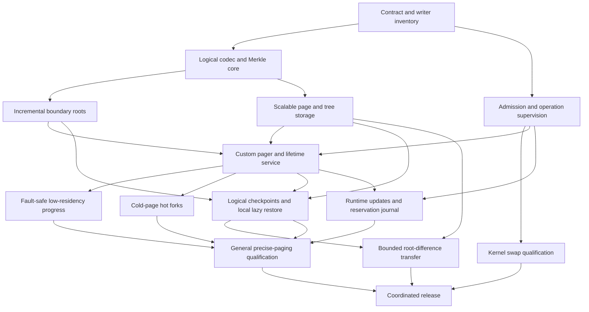

> Informative implementation plan. This preserves the initial QEMU-oriented
> work packages; it does not enable a capability. Normative release requirements
> remain in [chapter 11](../../rfcs/0021-crucible-paged-ram/11-implementation-plan.md).
> Read with the [profile roadmap](profile-roadmap.md). gem5 and KVM are specified
> future profiles, with no delivered implementation claimed here.

# Initial QEMU-SIM implementation sequence

## 1 Delivery model

This document records the initial QEMU-SIM implementation sequence. Acceptance
alone does not enable swap or advertise a new executor capability. Implementation proceeds
in reviewable work packages with explicit evidence. Staging phases are not a
backward-compatibility program: old and new incompatible contracts are never
accepted together by the deployed runtime. The final cutover is coordinated.

### Current host integration (informative)

The host implementation retains the actual Main's Source admission and node
supervisor before Source birth in both resident and controller-managed launches.
The same owner funds the fixed descriptor window and metadata overlap. Controller
endpoints, spill resources and workspace remain conditional; their absence does
not create another bank, clock or resident-only timing roster.

The current transport source contracts are:

| Surface | Current contract |
| --- | --- |
| Plugin control | Version 8; noncurrent peers are refused. |
| Shared region | ABI 33; each node slot is 768 bytes. Ordinary action return remains at offset 264; parent-Park return has a separate journal at offset 512. Constructor and clone reset paths clear both journals. The checked-in C header is emitted from the actual Rust layout. |
| Selected pre-exec Setup | Edition 6, selector `QEMU_CRUCIBLE_PREEXEC_SETUP=6`, tag `0x16`, 125-byte frame. |
| Setup descriptor roster | Eight mandatory roles: shared region, wake event, sealed plan, read-only standing publication, standing cancellation event, publisher region and distinct producer/receiver events. An optional device workspace precedes the publisher trio, making nine roles. |
| Sealed plan | `CRUCSUP9`, schema 9, retaining the `CRUCPUR8` process purpose of 2520 bytes and adding the exact 224-byte publisher purpose. |
| Native receiver declaration | The selected complete ELF contains one 40-byte `CRUCRCV1` record. Source activation and checkpoint ingress have separate edition fields. Startup checks Source activation independently; zero and unspecified positive activation editions refuse. The complete declaration and ELF digest remain bound to the installed Source. A declaration grants no execution authority. |
| Standing publication | Schema 4 with producer-retention edition 1 at byte 196 in a 1504-byte shared file: one 8-byte sequence followed by a 1496-byte observation, accessed as atomic big-endian 64-bit words. The observation binds each action's kind, cohort, and parent-Park correlation where applicable. The host alone holds the writable mapping; the transmitted file role is read-only. |
| Sealed standing corroboration | The purpose's 1520-byte tail binds the retained publication file identity/extent and its initial 1496-byte observation. Copied fields issue no authority. |
| Standing cancellation | A separate nonblocking eventfd, with kernel event identity encoded as raw ID plus one. It is distinct from the wake event and Setup amendment event. |
| Operational durations | One exact-nanosecond roster under RAM schema 11; Host operational frames use schema 4. Configured values are positive and checked; observed expiry may be zero. |

Source publication preserves the same cap, original monotonic origin and nominal
Source subject across policy revisions. Publication commits through odd/even
atomic sequence transitions; terminal invalidation cannot be replaced by a later
live sequence. Ordinary policy changes publish new revisions without signaling
terminal cancellation. Completing Setup retains these physical owners for the
Source lifetime. Only actual child wait/reap and proven physical cleanup permit
retirement; kill, copied process identifiers and local uniqueness do not.

Execution still reserves full guest RAM and evicts at paused boundaries. The
configured Main/Source ownership path and native Root observation bodies exist,
but plugin registration still ends at explicit callback-activation refusal.
Native groups remain inactive, registry binding refuses and command-receive
custody supplies neither a live publisher/action parent nor genuine peer return.
The support declaration retains activation and ingress edition zero. Actual
activation and CPU-use issuance, complete diagnostic payload funding and native
physical-return qualification remain open. Smaller initial and steady physical
peaks and CPU/elapsed-time parity remain unproved.

The latest checkpoints are summarized here; their detailed source scopes and
failed attempts appear in the dated entries below.

| Surface | Latest checkpoint | Remaining qualification |
| --- | --- | --- |
| Publisher transport | `e9784079c4` creates the once-owned physical session under the actual Source payer and installing Original, exports exact roles and sends Setup6 with plan nine. Six physical controls, five alias controls, seven startup controls, setup completion and hygiene pass. | Mandatory application compilation passes with all 5,279 committed Rust/TOML files matching the frozen source. Genuine launched transfer, command publication, peer acquisition and terminal consumption remain unqualified. |
| Host alias custody | `90f00965fa` journals each standing descriptor before the next guarded duplication. Five real-socket controls, 73 focused policy checks and five hygiene checks pass. | Mandatory application compilation passes at `yyiy0g0z5lfdkx3x563k0sgnf1i20d1c`; all 5,272 committed Rust/TOML files match its immutable source. All 211 exact supervision cases pass at `dy2jldwf5dizmsmj0icwwxnlfpf8k45a`. |
| Installing plan reads | `54caaed474` guards every plan read and retry with the same installing Source and preserves the first validation cause on failed ACK. All 24 focused setup tests, 73 policy controls and five hygiene controls pass. | Mandatory application compilation passes with all 5,274 Rust/TOML files matching the immutable source. The corrected setup gate `edb742a73f` passes 39 tests; all 218 exact supervision cases pass at `7iwxg7vg1r0gxwv39ajixz95n45jg9b4`. Genuine Native admission remains unexecuted. |
| Native integration | Signed atomic `ec33e02897` imports conventional `45e353b75a`, tree `12361245`. Independent review matches all 78,233 tracked source entries, 26,862 evidence files, twelve literal evidence links and 34 sealed artifacts. The complete Source floor is 298,798 bytes; the cumulative ledger contains 426 created files. | Ordinary-fork quiescence, nonwaiting physical custody, Setup7 parsing, Original registration posts and physical service5 compose with genuine configured links. Packaged reconstruction, Source and Native custody qualification are pending for this committed import. Semantic Module/Core issuance, populated execution, stack/profile admission and full terminal cleanup remain open. |
| Prior native build | `b69de00f81` retains signed `3376c0ee90`; all twelve independently bounded custody components pass, including final failure-evidence replay at `wxxp873qw0khc3zykvlfhgi2f6x9ff63`. | Its five fixture regressions are corrected in `83ecde0031`. Its passing component evidence does not qualify actual installed Source authority. |
| Policy and release | Latest focused checks pass all 73 policy and five hygiene controls; the fresh broad gate reports twenty paths: thirteen daemon and seven host/plugin paths. | The fresh canonical license-boundary check stops at strict controller Clippy (909 host-library and 963 host-test errors after checkpoint lock handling); its boundary assertions did not run. Lower residency, physical return, fork rearm and performance parity remain unqualified. |
| Rust publisher receiver | `c37c5a1808` borrows exact Setup6 roles, requires plan nine and retains the canonical Native service field inside the prepaid pinned Runtime. Component return follows group and workspace return. All 1,150 plugin unit tests and six new view/retention controls pass. | Mandatory application compilation passes at `7g4cs18mj0a4yhwwmdw7na1j53flhxaw`, with all 5,277 committed Rust/TOML inputs matching the frozen source. The setup gate passes 45 tests; genuine launched transfer and physical cleanup remain unexecuted. |
| Requirements | 444 bindings: 425 component and nineteen native, across 243 requirements. | 148 requirements remain uncovered and none fully qualified. |

#### Ordinary-fork and nonwaiting physical composition

The signed atomic native patch now selects `ec33e02897fe424523e1dc755ae0f3f651fdb22c`
with conventional source `45e353b75af24644b9cefc014cfc75323a8705bd`, tree
`12361245265446cff084677143e44d3394f6b8c5`. It composes the ordinary-fork RCU
registry ordering fix, nonwaiting Source/Native terminal metadata, the inline
Core resource bank, exact Setup7/plan10 parsing, completed Original registration
posts and the physical installing-service5 view. Old profile restrictions and
selected preinit refusal remain explicit. A physical bank or service does not
issue either semantic operation role.

The ordinary fork fix orders thread-registry quiescence after existing RCU
locks and releases it before child RCU worker recreation. It addresses the
actual vanished-worker lock implicated by the previous packaged Native custody
suite's discard resize-member timeout; the retained hot-fork transaction and
ordinary mutex behavior remain separate. Nonwaiting terminal sections make one
attempt and retain uncertain debt. Actual born/consumed facts precede independent
posts. Original registration now requires all independent post attempts and
returns; default zero statuses cannot establish completed registration.

The complete actual Source is 254,024 bytes. Its 31 separate genuine static
getters total 44,774 bytes, giving a 298,798-byte floor. The bank (168 bytes),
Original registration (72) and service (296) are embedded Source terms, not
extra charges. Preexec remains 212,752 bytes, with nested storage 26,640,
session 15,936 and RR metadata 232. Eighteen newly created files enter the
preserved per-file license ledger, bringing its cumulative created-file count
to 426, with no deletions.

Independent read-only verification matches every signed/working source entry,
all 26,862 indexed evidence files, twelve literal evidence links, 34 sealed
artifacts and every blob, mode and literal link in the complete source archive
(78,161 regular files and 72 links). It also authenticates both commit signatures,
the exact raw signed atomic object and the detached manifest signature.
The frozen manifest SHA-256 is
`7e873a772db0072c4e462f968a40a40a3fff9a82f7aade1fff8505d5d09385c4`;
the independent proof SHA-256 is
`6111fecafd64e8ca64ca38b3f2bc69699f5d7790fcb3fb9aad2806a15b6deac5`.
The checker's initial archive-prefix and artifact-location errors were corrected
without changing any qualified source or evidence. Raw ambient environment
captures remain local, digest-indexed only; the public projection contains
explicit build inputs. The separately authenticated 684 BSD source blobs for
SoftFloat/TestFloat remain in their corresponding-source artifact.

Qualification compiles 226 changed owning objects and 493 further consumers of
the changed public SDK, with all 3,163 initialized object outputs audited and
719 freshly changed outputs. Seventeen genuine configured links pass. Sixteen
leaf suites, six owning executables, the real service and four independent
omissions, ordinary keeper/fork/RCU controls and all 97 preexec omission
classifiers pass within their original bounds. The latter completes in
410.084/600 seconds. Two compiler lanes remain within the declared six-GiB
bound; separate PID namespaces are reported explicitly and their conservative
summed peak is 1,916,301,312 bytes. The final keeper expectation correction is
qualified separately from the recorded owning production input `d990046b5a`;
no new whole-build or normal-delivery timing is claimed.

The SDK audit preserves 443 actual previous definitions and adds four real v5
definitions. It also exposes the preexisting undefined
`qemu_plugin_crucible_advance_outcome_observe_v1` declaration, which remains an
actual missing producer rather than a counted export or accepting stub.
Packaged reconstruction, Source/Native custody, ABI and license qualification
are pending for this import. Later stack-recipient and matched-member stages
are excluded from this cohort. Genuine Module/Core issuance, selected
activation, populated reader/RR execution, sequential borrower rearm and full
nonwaiting semantic terminal cleanup remain unqualified; CPU admission retains
`ENOTSUP`.

#### Stack page geometry parity

The Host stack carrier now rejects non-power-of-two page geometry before
encoding or accepting the description, matching the independently implemented
native decoder. A new control first failed at the exact page-three decode
assertion with all other fields and arithmetic valid. Its unchanged checks now
refuse independent literal and typed records for page sizes 3, 6,144 and 12,288.
All fourteen protocol targets pass 295 cases; strict all-target/all-feature
Clippy passes. The ABI stack group now registers six cases. Actual observed
page geometry, concrete profiles and nominal owners remain adoption requirements;
these syntax checks do not grant stack or Cleanup authority.
Mandatory application compilation passes at
`vqz1n80zdnm853h9v2jmrx0dfjnpfdq9`; all 5,332 committed Rust/TOML inputs match
its frozen source (proof SHA-256
`43e0e05ef23adce19e2f3e9d0df1f35a03e929dcf8fcf4ebb5e2dc3e14f14082`).
ABI qualification is running. Strict license-boundary qualification stops at
controller Clippy (909 library and 963 test errors).

#### Reserved Host Cleanup with separate actual entry

An actual current Quantum can now reserve one deferred Cleanup control holder
in a prepaid canonical output before guest Work effects. The same supervisor
retains the nonreused operation identity and accounts for that pending record
against its existing twelve-record inventory. Reservation allocates nothing
and enters no Cleanup interval. The holder retains the actual supervisor;
entry starts its one finite Cleanup interval later without querying Work,
including after the original Work record is physically retired. The existing
authenticated containing invocation still applies. Ordinary and reserved entry
share one focused policy/capacity/identity implementation. The root's reviewed
implementation shrinks from 1,824 to 1,708 lines; no size allowance increases.

The holder saves actual born operation custody before its independent post.
Negative and interrupted posts preserve the guard and cannot authorize Current,
repeat entry or restart time. An unentered holder returns only its unspent
record reservation on Drop; an entered guard retains ordinary borrower-aware
cancellation and physical debt semantics. Dropping the reservation cannot issue
a replacement for that same Work. The actual Shared and operation layouts feed
the existing structural recipes; the holder exposes its exact inline extent
for its containing owner's admission.

Eight component controls pass, covering zero allocation, real Work record
retirement and canceled outer cap before entry, full record saturation, wrong
class/occupied output/second assignment, a negative Work post, born-negative
Cleanup expiry followed by policy extension, real lock poisoning, interruption
between birth and post, and identity exhaustion. All Host resource targets
pass (333 reported cases), as does strict all-target/all-feature Clippy.
The first all-feature compile exposed a missing private bootstrap initializer;
that constructor was corrected before final qualification. The ABI gate
registers the exact eight controls. Hygiene and ABI conformance pass
(ABI output `2g9j17i6c2cbwcisi38kgjahhq6y0159`). Mandatory application
compilation passes at `hk5f1mkn4l307kxg1g5ngc16p471874w`; all 5,332 committed
Rust/TOML inputs match its frozen source (proof SHA-256
`a1eeab5c10df42cb2b9d5420c3551a788382f768a23b835108a09d0579bab79a`).
Exact supervision qualification is running. Strict license-boundary
qualification stops at controller Clippy (909 library and 963 test errors).

This is genuine local operation-record custody, not a native deferred-entry
contract, stack loan or Module/Core authority. Actual Source ownership,
endpoint-bound publication and independently current native entry/return
producers still require their separately versioned paired implementation.
The existing schema-two already-entered Cleanup profile is unchanged and does
not impose a hidden wall-time bound on otherwise unbounded Work.

#### Explicit Main/RR stack carrier codecs

The separate pure stack namespace now encodes Setup8 (tag `0x18` with a
nonexhausted grant-set incarnation at full-frame offset 117), plan eleven
(`CRUCSU11`, 56-byte header), and the 576-byte `CRUCSTK1` section. Two fixed
256-byte Main/RR records retain original parent coordinates, distinct role
inventories, profile and cleanup observations. Checked page rounding, two real
RR guards, equal finite Main limits, zero RR limit fields, reserved bytes and
per-role/aggregate arithmetic must match exactly. The process, publisher,
setup and stack observations must agree; no earlier edition is a fallback.
The existing file cap remains 37,748,764 bytes, including the new header/tail.
Encoding allocates its final carrier once after exact extent validation; the
existing nested app/selectable allocations still require the caller's funding.

All fourteen protocol targets pass 294 cases and strict all-target/all-feature
Clippy passes. Eleven new controls cover independent literal bytes, every short
record/carrier, changed fixed and repeated coordinates, valid-but-foreign
parents, overflow, three page geometries, optional workspace, edition refusal
and real eight/nine-alias SCM_RIGHTS transfer with ordered kernel identities
and independent data flow. Refusal controls check malformed and other editions,
wrong roster counts and negative descriptors before peer bytes are available.
The ABI registration names and counts each focused group; the older nine
Quantum controls remain registered separately from the new stack child.
The initial strict check refused an unused import and the manual divisibility
predicate; both were corrected without lint suppression. Final expanded
transport controls pass. Mandatory application compilation passes at
`00r152p2sfc6v479vdnk70fgsp5p0x20`; all 5,329 committed Rust/TOML inputs match
the frozen source (proof SHA-256
`9130890e3c6f95f9faf5cc4c9032a78584df0bb88e01d5e368939b298e56195a`).
Hygiene and ABI conformance pass (ABI output
`5dbpjz6p8i70zg2qf26a9v9ml969wa4d`); strict boundary qualification stops at
controller Clippy (909 library and 963 test errors), before boundary assertions.

These are syntax and transport controls only. Unknown concrete profiles still
require refusal at actual adoption. No decoded inventory, profile digest,
RLIMIT value or copied account identity creates a nominal resource grant,
Main/RR thread, Cleanup operation or Source permission. The real once-only
native-prefix partition and authenticated recipient-specific transfer remain
open. Existing finite Cleanup does not cover otherwise unbounded Work; its
separately versioned deferred-entry producer also remains required.

#### Explicit physical exec Main stack control

The process contract now retains one optional finite Main stack selection in
its existing shared attempt binding. All duplicates observe the same once-only
choice, and the shared prelaunch latch excludes refinement and launch. Both
QEMU and image-helper child cuts install equal soft and hard RLIMIT_STACK before
exec, then independently read back the actual kernel limits even if installation
refused. Failure prevents exec. Existing contracts without a selection retain
their inherited policy. An earlier configured-process observation becomes stale
when the shared stack choice changes; equal numeric copies cannot replace it.
The actual binding layout prices its added scalar through the existing extent
recipe. The focused child uses safe fixed-storage syscall wrappers.

This is physical containment, not a stack resource issuer. The separate signed
public stack contract defines Setup8/plan eleven and real pre-entry Main/RR
subgrants, profile/TLS/control inventory and deferred Cleanup requirements.
The current control does not enable that profile, manufacture a grant or apply
an implicit Work wall-time bound. Actual retained backing and paired nominal
stack issuance remain required before activation.

Four controls cover real duplicated contracts, invalid/repeated selection,
refinement/launch exclusion, stale process observations, and an actual spawned
child reading both installed limits after exec while the parent stays unchanged.
All four focused controls pass. Running the child assertion directly without
the guarded installation refuses at the intended inherited-limit mismatch
(exit 101), so an unconfigured exec cannot satisfy the positive control.
The ABI gate registers the exact count and canonical child-probe name.
Hygiene passes; all-target, all-feature QEMU Host compilation also passes for
the signed `19d2851e02` checkpoint. Mandatory application compilation passes
at `hq7arfj2qcj8rf800z24jjm744pgvqj4`; all 5,325 committed Rust/TOML inputs match
the frozen source (proof SHA-256
`0ecebe055caa6e6ec99e05177b1749dab5d6467be184ed418632671bf8ca65da`).
ABI conformance passes at `d33s40wyhlzi1zm716cd059hppgih7dl`. Strict boundary
qualification stops at controller Clippy (909 library and 963 test errors);
its boundary assertions did not execute.

#### Sticky terminal decisions from actual lender collection

The collector now saves the actual typed operation disposition under the same
lender lock and at the same observation cut as its parent snapshot, before any
publisher callback can refuse. Both full-cohort and selected-role collection
retain observed expiry in the genuine operation record. Later budget extensions
cannot reopen that operation. The observation helper returns the typed decision
beside the wire projection; no decoded state byte becomes lender authority.
The fixed prebirth scratch recipe prices this complete returned pair.

Two causal controls first reproduced the defect independently: an authored
Cleanup bound already elapsed from its real original entry, collection observed
Expired, and a subsequent budget extension exposed Running again. Both failed
at that exact terminal-state assertion. Their unchanged controls now pass for
the full cohort and selected Cleanup. They use no synthetic clock, sleep or
intervening operation-status poll; original start and progress coordinates stay
unchanged. Every Host resource target passes (324 reported cases), as does
strict all-target, all-feature Clippy. The canonical ABI registration includes
both regressions, bringing the selected collector group to eight plus the
separate unsupported-publisher refusal. Mandatory application compilation
passes at `d9jbf03n9xb1acxmnnyfr3vm61nzsl3p`; all 5,323 committed Rust/TOML files
match its frozen source (proof SHA-256
`2171e990070c398ab14d59108c7ae87f48ad4ae1b498d560d39fcf76af199f95`).
ABI passes at `pvrpl4w09kqz4gnlswm9yp24gc4lz91x`, and hygiene passes.
Exact supervision passes at `nhic2kysj720rn4qbchwsnyd47al4zsz`. The strict license-boundary gate again
refuses at 909 Host library and 963 test Clippy errors; its boundary assertions
did not run.

This fixes actual Host lender state and does not create a Source or Native
owner. Complete paired publication, deferred independent Cleanup entry for
unbounded Work, actual execution-stack lenders and physical closure remain open.

#### Independent Host Quantum-role collection

The action collector now selects either the complete cohort or one actual
Quantum role. Work retains row zero; independently entered Cleanup retains
row one. Only that primary's registered Preparation dependency participates.
The selection validates real intrusive operation and outer memberships and the
same funded publisher allocation under all selected lender locks. Outer and
operation memberships must also retain the same publisher. Other rows remain
zero. Shared supervisors and shared Preparation dependencies retain their
original identities and use one ordered lock per actual owner.

Cleanup collection selects no Work loan and does not query the Work operation.
It enters no operation, grants no permission, renews no clock and returns no
physical debt. A separate callback receives the selected current facts while
those locks remain held; existing publishers refuse this callback by default.
The fixed collection recipe additionally prices the forwarding selector and
both reference rosters before Source birth. A separate behavior-preserving
commit first moved the original full collector without changing its body.

All Host resource targets pass 320 reported cases, including six new collector
controls and the explicit unsupported-publisher refusal. Strict all-target,
all-feature Host resource Clippy passes. The contention control holds both
ended Work locks in another thread while Cleanup completes; callback controls
check every selected state and outer lock. Separate, shared and absent
Preparation layouts, missing/extra/returned/foreign rows, mismatched outer
publishers and wrong actual classes are covered. These are component-funded
mechanism fixtures with real entered Host operations and directly seeded
memberships; they create no authenticated Source purpose or Native borrower.
The ABI gate registers the seven controls with exact counts and canonical
names. Every QEMU Host target compiles with all features. Required application
compilation passes at `r6w0ws0sbbsvj7yy608y5q380s5lmwa9`, and the registered ABI
gate passes at `xiif841kf3y0vm01a9adnkf5brm38q74`. The strict license-boundary
check refuses; its boundary assertions did not run. The corrected hygiene
check passes. The first hygiene evaluation
correctly refused the stale review digest for the parent module's changed
reexport; its unchanged 1,824-line responsibility and focused child boundary
were reviewed and the exact digest refreshed, without adding a waiver.

The active Source publisher does not yet implement the new callback. Actual
paired Source publication, independently retained Cleanup ownership, Native
role issuance and complete physical return remain open.

#### Explicit Quantum transport and plan negotiation

The separate Quantum namespace now encodes and decodes Setup7, Purpose2 and
plan ten. The exact tuple is tag `0x17`, mapping `CRUCPLM2`/schema two, sealed
`CRUCPSP2`/schema two/224 bytes and `CRUCSU10`/schema ten/48-byte header.
Purpose2 explicitly selects role-map edition one, Quantum-only variant one
and terminal contract one. Its physical storage cleanup generation remains one
and is independent of the publication's actual Cleanup loan and entry identity.

The shared body parser selects an exact outer and nested purpose edition
before interpreting sections. Original Startup, process, workspace and family
relationships retain their validators. Plan ten keeps the existing aggregate
cap and body ordering. Earlier carriers continue requiring their original
magic, schema and reserved zero bytes; there is no fallback to them. The new
observational correspondence check compares every shared lender, Source,
file and event identity across the decoded tuple. Actual sealed-file,
endpoint, mapping and nominal-lender authentication remain the constructors'
responsibility.

The separate Setup7 sender transfers the exact eight or nine borrowed aliases.
Real Unix socket controls verify received alias order, kernel identities and
independent data flow with and without a workspace. Wrong counts, negative
descriptors, malformed and mixed-edition frames refuse before any peer byte.
All fourteen protocol targets pass 283 cases and strict protocol Clippy passes.
Existing Setup6 controls still run unchanged in name and cover the same route;
their shared test helpers also exercise the new route. Three negotiation,
three plan and two new socket controls extend the prior six Quantum controls.
The canonical ABI gate now requires and runs these fourteen cases in three
explicit groups, checking registration count and canonical names before each
execution. Engineering hygiene and Nix formatting pass. Mandatory application compilation
passes at `hb96w9g6bydxay4dislq5rw7j4kmfpl4`; all 5,321 Rust/TOML files from
committed `d5363733cab74102bc14996d07a000f04ac2c12a` match its frozen source
with zero differences. The comparison record SHA-256 is
`13a2040253f7c01d595d774293e5f3d71ea71f2d581af9f8f5b37aa90655c49e`.
The canonical ABI gate passes at `pzfhrbz3fzpp1iak48wvp27gln82rgnr`, executing
the fourteen newly registered controls. The canonical license-boundary gate
still stops at 909 Host-library and 963 Host-test strict Clippy errors; its
boundary assertions did not run.

These public codecs and the sender do not select the live launch route, install
a recipient or enter Cleanup. Genuine producer/recipient construction, complete
execution-stack and Core admission, independent role Current and final physical
closure remain open. The active Setup6/plan-nine selection is unchanged.

#### Separate schema-two Quantum and Cleanup codecs

The permissive protocol crate now has a separate `publisher_subscription::quantum`
namespace for the proposed paired Work and Cleanup publication. Its header uses
`CRUCPLM2` and schema two. Schema-one and schema-two headers, publications and
return records refuse each other's bytes; active Setup negotiation still selects
schema one. No publisher, recipient, Source admission or operation is created
by these codecs.

The immutable role map requires two distinct primary operation identities:
Quantum class one and independently finite Cleanup class thirteen, with their
exact Preparation dependency masks. Only the two independent permission words
may change monotonically under the same command. Cleanup loan and entered
interval incarnations, original clocks, role map and command remain unchanged.
Return and consumption records retain separate role masks, exact loan/entry
and receiver-journal correlation, partial debt and negative first/post facts.
Their validation creates no physical-return or final ticket-transition proof.

All fourteen protocol test targets pass 275 cases, including six new syntax
controls with independent literal bytes, every truncation, reserved padding,
legacy refusal, two/no/shared Preparation layouts, immutable permission updates
and partial consumed-negative journals. Strict protocol Clippy passes without
exemptions. The first lint run found a single-match test expression, corrected
to `if let`. An added legacy-refusal fixture initially used an invalid two-primary
schema-one cohort; its corrected genuine schema-one fixture passes. Both failed
attempts remain separately retained. Engineering hygiene passes. Mandatory
application compilation passes at `nyw4b2z1289ppx2kq7p5grgpy1h5swzk`; all
5,317 Rust/TOML files from committed `a7f3c2fdb792f953438e22d2a3ad6fda7c451460`
match its frozen source with zero differences. The comparison record SHA-256
is `ee7c7a257b508ee473af50be89c9c3414c59b32bca125eab4886a597e8cc82e0`.
The initial ABI build passes at `8jcflvbv4d8v067sk8hpph5kd0ifg2zb` but only
compiles these new controls. The subsequent explicitly registered six-case
build passes at `2dpp04xj8ifhm2qgv5g1cni6lisfcyhb`, executing all six. The
canonical license-boundary build still fails at the existing 909 Host-library and 963 Host-test Clippy
errors, before boundary assertions run.
Actual independently entered Cleanup lending, complete resource admission,
paired Native role projections and terminal closure remain implementation gaps.

#### Borrowed app-random service identity

The live app-random service now owns its immutable node name independently of
its mutable decision state. Each callback borrows that same name while serving
the request. It no longer clones a temporary String before decoding, and the
preallocated logical-restore decision source no longer owns another copy.
Logical restore replaces only the mutable draw state; the service identity
retains the same allocation. Request/evidence objects and stream creation still
allocate and require complete operational funding.

All 1,177 plugin unit tests, compilation of every plugin target and engineering
hygiene pass. Existing draw, reseed, branch, continuation and live routing
controls retain their behavior; no case or binding is added. The actual layout
control now measures the containing Runtime at 18,912 bytes, alignment eight,
and inline white-box state at 9,528 bytes, each 24 bytes smaller. This is a
specific ownership/layout change, not a physical-residency or performance
qualification. Required application test-target compilation passes at
`6ijsfqijpb6k7kprbda5z36gbnwgkvza`. All 5,314 Rust/TOML files from committed
`00b0b274f17c17fc8b10de392412fca185e58ff5` match its frozen source with zero
differences; the comparison record SHA-256 is
`e1f70aa65982cd35e40d635e847d8e20ad7b475cbcbf2687414f38e5cd36ab91`.

#### Retained Native RR actor and sticky pre-exec refusal

Atomic signed DCO checkpoint `5b7be4763f681e1e0237b61b24708654a510225f`
imports conventional signed union `137ce45cb65e3ef5b5ae5c295f350d403c6171cf`.
Its tree `a152cc6c0a224af19762436e7432ea86636f9225` is byte-identical to
executed actor `d37691e8f1ade403e02515431441234f1910ba6f` and retains
`af148f6de3`, corrected `c441384d5c` and their complete source histories.
Independent review matches all 27 changed signed/working sources, 10,293 regular
actor evidence files, six literal links and seven artifacts. The comparison
record SHA-256 is
`6f49fa142673e7774bc294c7f38412a1eca1c9e46726ae07521f50af5d076708`.
The composed seal independently matches 32 local evidence files, four artifacts,
all 78,215 archived Git blobs, exact regular Git modes and 72 literal source
links. Its comparison record SHA-256 is
`3b9d6120e38618d9d635829e34186a7c3d98fb9cad37047c6b6094247fc53685`.

The Source actor retains the actual constructor, producing borrower, deferred
child, Original, Advance, Main-finish and terminal parent. It publishes its
canonical relationship before Native/Module entry, captures born outputs before
independent posts and retains consumed-negative or uncertain cleanup history.
Normal, longjmp and atomic physical unwind withdraw work Use before return.
The external terminal observer retains consumption independently of the retired
CPU/QOM object. No CPU or executor frame is read after physical QOM return.
Untouched-constructor closure requires all real fields and callback histories
to be empty; contradictory held outputs refuse. Corrected pre-exec RR access
also preserves its first failure across reinitialization, independently queries
Source first/post and records actual access-return facts without restoring a
consumed holder.

Actual Source is 253,240 bytes and 31 genuine getter extents sum to 44,750,
for a complete fixed floor of 297,990 bytes. The Source actor is 4,680 bytes,
its tail registration 120, the separately priced Native actor 408 and CPU
allocation header 888. CPUState 16,992, Core 160 and keeper 72 remain unchanged.
The cumulative license inventory contains 408 created files, including eleven
new paths and no deletions in this cut. The publisher RR documentation has an
explicit GPL-2.0-or-later marker; the actor design note uses QEMU's default.
The immutable handoff's contrary sentence is corrected by a separate preserved
note, SHA-256
`3bb3209981202933168de76ca892ba4eb4347d720ede70e9913b2cce60b8f8e3`;
the correct inventory and original seal are unchanged.

The authenticated corrected 987-object cohort passes in 391.116 seconds under
its declared 600-second outer bound, two-compiler and six-GiB address-space/tree
bounds. Later four-object semantic and two-object EOF deltas pass separately in
12.483 and 11.663 seconds; they are not relabeled as another full-cohort run.
Seventeen owning links, Source-layout and isolated preinit units, 47 physical
omissions, 40 unentered-edge and fifteen callback-history controls pass.
Twelve actual ordinary keeper cases pass in 37.312 seconds and two complete-
provider no-entry reciprocal controls pass in 8.458 seconds. Earlier compile,
link, provider, omission and reconstruction failures remain separately retained.
The isolated preinit guard does not qualify actual RR entry; that refusal uses
the genuine complete provider. No compilation or timing is attributed to the
byte-identical history merge itself.

The packaged license ledger passes at `lflmw9310swbwsz6080rp9y1d0fxx3wv`.
Raw signed reconstruction passes at `vlvcadq3w85mji9k8zxyn7n71xnjf8qq`.
The registered Source unit passes all 187 cases at
`x0bx00wnmwwi5mm8nn9r355h9zv1vyvz`. ABI conformance passes at
`95098lm92rr9q77dl89ylq7rq8hgcdnh`. The Native suite fails when the
`memory-discard-custody/resize-member-limit` omission child exceeds its unchanged
30-second bound; its containing component records 36.222 seconds and 224,358,400
peak aggregate address-space bytes. This is an investigation, not a passing
36-component qualification. The canonical license-boundary check still stops
at strict Host Clippy: 909 library and 963 test errors; boundary assertions did
not run. Actor birth remains unwired and CPU admission returns ENOTSUP.
Actual Module/Core operation issuance, full semantic RR execution, complete
return/rearm and nonwaiting terminal cleanup remain unqualified. Source and
Native blocking synchronization is an explicit remaining gap; a prepared Module
guard alone does not establish a nonwaiting route.

#### Typed actual guest-write failures

The live callback and resumed per-vCPU writers retain coordinate mismatches and
Native write refusals as typed fields. Their failure paths no longer allocate
formatted Strings. Each writer retains only the actual QEMU write function it
uses. Validation, reply consumption, guest-write ordering and complete rendered
diagnostics remain unchanged. The public guest-write error is a non-exhaustive
enum; its reporting-only `message` method now returns `Cow<str>`, borrowing
original backend diagnostics and formatting typed causes only on that explicit
call. This coordinated Rust API change does not alter either process ABI.

The existing reply-failure control still requires the original custom backend
buffer through its source chain. It additionally exercises both actual writer
implementations: coordinate mismatches make no Native call, and a refused
per-vCPU call retains the exact vCPU, address, original workspace pointer,
reservation length and resume count. The consumed ring entry remains consumed
while the pending catalog request and completion count remain unchanged.
All 1,177 plugin tests and compilation of every plugin target pass. The final
fifteen adapter controls pass after the test helpers' readability adjustment.
The 1,120-line test module has a content-bound responsibility review. The
containing Runtime remains 18,936 bytes, alignment eight, with 9,552 inline
white-box bytes. Engineering hygiene passes. Required packaged compilation passes at
`26wdprd9b4prqwnhp4pmj67vjyiyipf5`. All 5,314 committed Rust/TOML inputs at
`d2eee05595cf21362d375ef313218013cc13c6c7` match immutable source
`989f8vz8pjbw71lqf2xllxdcqfrwspxz`, with comparison record SHA-256
`436b1a42a6a0102706948dabae9b46520b614e7f4a828fc2d616c06c61282145`.
ABI conformance passes at `8ym8sksxrcvg794g3m7fqsr09q3znjqm`.
The fresh exact supervision check passes all 327 cases in nine actual groups at
`359ch72b5a47ng86h66ias1vf8l8bp45`.
No case name, binding or policy exception changes. Remaining dynamic
payloads and complete operation/resource funding remain open.

#### Typed selectable service failures

The live and combined catalog services retain their original catalog and
pending-transport errors through the standard error-source chain. An occupied
VMStop handoff and rejected translated-block exit retain fixed variants and
the original QEMU status. Both eager catalog-formatting adapters are removed.
The rendered service diagnostics and validation, request-retention and handoff
ordering are unchanged.

The Rust service error is now a non-exhaustive typed enum. Its `new` constructor
still retains the authority's original String. The reporting-only `message`
method returns `Cow<str>`: authority diagnostics remain borrowed, while typed
causes are formatted only on that explicit call. Normal Display writes directly
to the caller's formatter. This is a coordinated Rust API change; neither the
process protocol nor the shared-memory ABI changes.

Existing controls require the concrete original transport error through the
source chain, exact handoff variants/status and unchanged complete diagnostics.
The combined-service control requires the original catalog cause after actual
request completion, unchanged dynamic identifier storage through conversion,
and the original authority diagnostic buffer through `new` and `message`.
All 1,177 plugin tests and compilation of every plugin target pass. The expanded
1,016-line adapter test file has a content-bound responsibility review; the
production catalog shrinks to 1,311 implementation lines. The first hygiene run
correctly refused the missing test-file review. The corrected check passes.
Required application compilation passes at `9spq6h5a233ddh6q208gh7iyc4124f40`.
All 5,313 committed Rust/TOML inputs at
`3d18b5cb87e1d1143a8838b4f5c4f27ed0349160` match immutable source
`b77b1fxr3r93sjxp77pnxjaxzwvr1q61`, with comparison record SHA-256
`41a54d89adeb1f31e95284dc922fed87e9bd6f2b33a6c2fc5b2adf7b8cebf11e`.
ABI conformance passes at `yx01d33c46l6j6jh8dy13nbyl0491m2y`.
The fresh exact supervision check passes at `0d0wgdbgcasxjpsq1n9rbzv7f6fh5ijf`;
independent inspection confirms all nine groups and 327 cases.
The final fifteen adapter controls pass,
and the actual containing Runtime remains 18,936 bytes, alignment eight, with
9,552 inline white-box bytes. No case name or binding changes. Original
backend/catalog dynamic payloads and complete operational funding remain open.

#### Typed selectable callback and publication failures

Trap preparation and service, catalog freeze/rebind, pending projection and all
three catalog-delta publications now retain their concrete original errors.
They no longer format another String in the live adapter. Missing pending state,
reset-held restore and handoff overflow are fixed variants; a drift refusal
retains the original, actual and required retirement/tick coordinates. Display
preserves the original diagnostics and formats these fields only at reporting.
The generic selectable callback formatter is removed.

Existing controls require all six handoff coordinates and its exact diagnostic.
The live ring control additionally fills the real queue, requires the concrete
marker refusal through the error-source chain and verifies that the original
queued registration, coordinate and bytes remain intact. Missing-token controls
require their exact typed refusals. All 1,177 plugin unit tests, every plugin
target and engineering hygiene pass. The existing actual-layout control measures
the containing Runtime at 18,936 bytes with alignment eight and its inline
white-box state at 9,552 bytes. Required packaged compilation passes at
`b60cbfavhxm2krlanlmscaqhd1006ais`. All 5,313 committed Rust/TOML files at
`7b43dc43ced5b970cb128a2e6e3087623e44f504` match immutable source
`nch5aq9n42p0xh76xszqxcxhk4px0v9h`, with comparison record SHA-256
`d3ce65a32dc59c80d37e158f426875375a03d86c499dd757461c3e163bba3335`.
ABI conformance passes at `77wafcqjalp9mw5v6ccqmfcybkqjmw6y`.
The fresh exact supervision check passes at `3vq80dqrjq33l51nrxd5paa12fl9gj8y`.
Independent inspection of its actual inventory confirms nine groups and all
327 cases. No test case name, binding or policy exception is added. Backend/service-created dynamic
payloads and full operational funding remain open; this does not admit CPU work.

#### Borrowed pending transport

Deferred-profile validation and live pending publication now borrow the retained
request through `SelectablePendingTransportView`. Neither step clones its
identifier, domain or tag merely to check length or encode the ring entry.
The owned transport delegates to the same immutable view and encoder. The
existing 4,608-byte Runtime workspace still holds the canonical encoded prefix;
wire fields, complete zero-filled reply reservation and suffix behavior are
unchanged. Initial catalog admission and decoded messages still allocate and
require complete funding; this view grants no execution authority.

All three existing transport controls pass. They check borrowed request identity,
owned/borrowed byte equality, the maximum message, oversized refusal and an
unchanged caller buffer after validation or capacity failure. The existing live
catalog/ring control also requires the transport to borrow the actual retained
catalog request. All 1,177 plugin unit tests, compilation of every protocol/plugin
target and engineering hygiene pass. Mandatory application compilation passes
at `ypga59sr49h0niaw5ync41mwcv7mx6zq`. All 5,313 committed Rust/TOML files at
`a960a98b7c9f3246a232e16a990aae3a5030c9b9` match immutable source
`afp0zxpiiy1bjyjl05bm94p0plg0ld7x`, with comparison record SHA-256
`c433ca0ce871ffcba86d18b432fca4588d662b416962014a404ff53b7f908047`.
ABI conformance passes at `q8a0i5mmvs05s6fvl1dma3x70q71z4qr`.
No case name or binding is added.

#### Typed selectable reply failures

The actual reply consumer and resumed delivery path now move typed ring,
envelope and protocol refusals into the existing live error. Unexpected kind,
coordinate mismatch, early resume, sequence mismatch, reservation bounds and
peek/consume failures retain fixed fields instead of allocating formatted
Strings. A guest-write refusal retains its original typed backend cause plus
trap/resume coordinates; the existing bounded diagnostic writer formats them
only when reporting the failure. The rendered diagnostics and consume/write
ordering remain unchanged.

All 1,177 plugin unit tests pass. Existing controls now require exact typed
unexpected-kind, unsolicited, early-resume and malformed-protocol refusals.
The write-failure control requires its exact original full diagnostic, concrete
trap/resume fields and the same original backend diagnostic-buffer address
through the standard error-source chain. No new case name or binding is added.
Compilation of all plugin targets and engineering hygiene pass. Mandatory
application compilation passes at `4jizwdf0gwamjxg59ncacrnmpz6s5h2b`.
All 5,313 committed Rust/TOML files at
`c4b0e52be4016d2fe2f90173f9a6aef077a0739c` match immutable source
`fc8sn62ra322kp3nldab6q65z2jdbq6p`, with comparison record SHA-256
`5c60a93450ab8558f900178b3dbe663a9c691c64d49113766b2e39dbfce78c36`.
ABI conformance passes at `h2qgnpc33w5jkm4wz165ir8k4f0ncpmw`.
The fresh strict license check still stops before its boundary assertions with
909 host-library and 963 host-test Clippy errors. The fresh exact supervision
check passes at `d6ayhy4r1303czmxjhhswq0cqd7mqwwf`. Independent inspection of
its actual inventory confirms all nine groups and 327 cases. Backend-created
dynamic diagnostics, decoded payloads and remaining catalog service errors
still need complete funding; this is not an allocation-free execution or
Source-admission qualification.

#### Borrowed selectable resolution

The decision service and actual resumed guest-reply path now borrow the same
catalog-owned pending token through resolution and delivery. They no longer
clone its request strings, domain/tag vectors and declaration merely to clear
the token after a reply. The exclusive catalog borrow prevents replacement
during the resolver; Pending, callback refusal, wrong sequence and unwind keep
the original token in place. Existing public token completion still checks the
catalog incarnation and exact token. Repeated completions update the existing
counter entry without allocating another identifier String.

The existing retained-request control checks actual request/declaration addresses
inside resolution, Pending and negative dispositions, unwind, wrong-sequence
refusal and stable counter-key storage across two completions. The actual
combined-service control also requires its resolver to borrow the retained
request address. All 1,177 plugin tests and compilation of every plugin test
target pass. The first focused run passed 48 controls and failed the original
unsolicited-reply diagnostic check; retaining its exact text as a typed static
refusal corrects that regression. No assertion is removed or renamed.

Decoded messages, initial counter-map insertion, admission-time pending copies
and remaining diagnostic payloads still allocate. This removes repeated copies;
it does not qualify complete funding, a Core Quantum issuer or CPU admission.
Engineering hygiene and mandatory application compilation against the final
committed source pass, the latter at `wc21r06rqxsal59vh8kcrxni047zpc7g`.
All 5,313 Rust/TOML files at
`b077245bdba7c982707dcd73f1b1115fbee1bb8c` match immutable source
`66djsciyjq6gkig2d1b3ri7kv8jfiadq`, with comparison record SHA-256
`07e2ce704ca9046042eacfe43ed74067d0f10b9893a0e0cc8f4c81810597b4e4`.
An earlier compilation passes against `06nq3g8qwd5yiyrgc8sm346f9v5clr1y`,
but that precedes the final catalog whitespace/digest refresh and does not
replace the committed-source check. The initial hygiene invocation refused a stale 1,314-line digest/count record;
the final refreshed 1,315-line record passes. No source-policy exception
or test binding is added.

#### Selectable catalog deltas in the retained workspace

Registration, request and pending-transport encoding now accept caller-owned
storage with validation and capacity checks before every write. The canonical
prefix is overwritten, including the request's full zero-filled reservation;
the remaining suffix is preserved. Owned encoders allocate their final extent
once and delegate to the same writer. Pending-record construction validates
length without serializing the request. Request range validation borrows a
fixed array instead of allocating a temporary range Vec.

The actual live registration, pending and completed ring publications borrow
the containing Runtime's existing 4,608-byte reply workspace after its previous
synchronous use finishes. They create no new output or nested-request Vec.
The ring still copies only the exact canonical prefix into its existing entry;
coordinates, kinds, reservation bounds and compatibility editions are unchanged.
Decoded fields, catalog allocations and error payloads still need complete real
funding; these buffer cuts do not create a Quantum Original or CPU admission.

All 22 selected protocol controls and all 1,177 plugin unit tests pass. Existing
frozen registration/request vectors remain exact. Nonzero caller buffers cover
suffix preservation, complete zero padding, insufficient capacity, invalid
messages and the maximum 4,608-byte transport. The existing live-catalog control
also publishes each of the three real delta kinds through an actual SPSC ring,
checking its exact coordinate and bytes against the canonical owned encoder.
Engineering hygiene and compilation of all protocol/plugin test targets pass.
All 73 focused source-policy controls pass. Mandatory application compilation
passes at `bml9j24nc1jgkya364678pv6lk04a47f`. All 5,313 committed Rust/TOML
files at `f765fe354e1ce5c2e2e23ba210d65b32e57d4086` match immutable source
`qsxggcjh567dgaw25nakp115kbxp9cia`, with comparison record SHA-256
`1dd54536105d789fb29ea0d92032d316e4a8895f6f909f046c06696693cfbc76`.
ABI conformance passes at `d9dcfc7i0h6a2jczh9znkldxjg6fyps2`.
All 327 exact supervision cases in nine groups pass at
`wp33x0dzka9d65dsh6l5db9l0yx19wcf`. The fresh strict license check
fails before its boundary assertions with 909 host-library and 963 host-test
Clippy errors. No test binding is added.

#### Typed debugger-custody poison refusal

The actual retained-debugger cleanup path now returns the existing typed
`ProductionVmConstructionCleanupError::Poisoned` directly when its custody
mutex is poisoned. It no longer allocates a boundary-message String while
refusing cleanup. The original retained body remains in the same slot and the
same typed, file-owning first causes remain reachable. The existing poison
control now requires that exact error alongside its original descriptor,
identity and ownership checks. The existing closed source contract follows the
actual helper and exact assertion; it gains no classifier exception.

All six actual retained-debugger controls and engineering hygiene pass.
Mandatory application compilation passes at `p0kq5g267rps5i3aazcja58ya263y2kh`;
all 5,313 committed Rust/TOML files at
`ae3aab1ae41f604cea5b6fc76906091e2fc5058c` match immutable source
`n1p5sxrf6967wsbmihnxwf3xzc11bs40`, with comparison record SHA-256
`a26a6912bc39cf54936936bced22a0ab4227043b765396732fadf821b6baf539`.
The first focused policy run passed 72 controls and failed the old mutation
inventory's expectation of five generic refusal assertions. That inventory now
mutates each of the four generic and one exact typed-poison assertions
independently. All 73 focused controls pass after that correction; the initial
failure remains separate from the corrected run.

A fresh broad source-policy run reports twenty paths: thirteen daemon and
seven host/plugin paths. The additional findings include negative-control
function names containing `retry`; the scanner treats underscores as word
separators. This remains a failing check. No test rename, source mask or new
waiver is used to remove a finding. Complete producer funding, Source activation
and physical-return qualification remain open.

#### Exact configured-input recovery

The prior configured build's link chain ended at a removed build directory.
A separate immutable af148 snapshot recovers the actual generated inputs without
editing shared links or the previous seal. All 5,541 original GCC dependency
rows match; the retained 3,388 compile commands are rebased only to the recovered
source/build coordinates. The fresh 3,456-entry Meson inventory is recorded
separately. No owning object, provider or execution result is supplied by this
recovery.

Independent review matches 116,786 regular files, 228 literal links, sixteen
manifest records and all 5,541 dependency rows with zero differences. Its record
SHA-256 is `a5a2d785af38371253e2308020ab660338cf3b49a2f4d21925494e02fadcdc60`;
the sealed recovery manifest SHA-256 is
`7866c2f4356d4508695f2b9c88fd11a939a2a40d61d1a18324f7205e8452845f`.
Configure and generator recovery pass in 29.451/600 and 23.100/600 seconds, with
core dumps disabled, 6-GiB per-process and aggregate virtual-memory bounds and
one compiler lane. Fourteen initially different decoder outputs remain retained;
the exact original generator commands with `PYTHONHASHSEED=0` reproduce their
sealed bytes in 2.732 seconds. These are recovered inputs, not new compilation
or semantic qualification. Later owning changes retain their own build identity.

#### Permanent Core keeper and registration composition

The signed atomic union `3711dfbb6f9b4df98793dca52199ae312a61a705` imports
conventional `af148f6de3561596ec5a9d778e00843536077279`, exact tree
`1296e452a841d67ca778ed793eb27bc44d3f0f0f`. It joins the registration union
with the real permanent Core keeper. Transfer retargets the actual frame and
execution holders before independent posts. The keeper retains uncertain debt
and actual reference consumption; ordinary reuse requires completed physical
return. Caller-stack coordinates remain borrowed, and no CPU is read after
QOM unref. The public SDK, CPU admission refusal and sticky one-attempt
borrower guard remain unchanged.

Actual complete getter measurement is Source 248,440 plus 44,342 bytes from
30 separate providers: fixed floor 292,782. Core storage is frame 88 plus
keeper 72, totaling 160 bytes. Native frame/registry remain 288/10,856;
CPUState/ARMCPU/X86CPU remain 16,992/97,712/33,568. The sole new file versus
the registration union is the GPL-2.0-or-later keeper test; the cumulative
license ledger now contains 397 created files and no deleted file in this cut.

The fresh 656-object affected cohort passes in 331.095/600 seconds with two
compiler workers, core dumps disabled, per-process address space 6 GiB and
sampled aggregate virtual size bounded by 6 GiB. Its actual start is signed
`230cb9e5f2e460cbc1d94b817b5a8f8edcc96791`, with fixture-only completion
identity `f95279b14d55e1861b3446980116281d022b6b41`. All 5,541 dependency
inputs and 97 regenerated C/header inputs match the final signed candidate;
this does not relabel the executed build as starting on that later commit.
Peak process-tree virtual size is 1,825,333,248 bytes. Seventeen genuine links,
both system binaries, 104 actual provider resolutions and existing SDK exports
pass. Fresh Meson queries authenticate 280 paths among 281 inputs and 70 tests.

The whole-provider keeper suite passes all twelve cases in 41.880/1200 seconds;
the corrected Core-frame suite passes twenty in 87.290/600, and reference
return passes six in 19.389/600. Pending-deferred and Main-finish pass in
70.600/600 and 19.372/600 seconds. All sixteen composed leaf suites and 59
span variants pass within their existing 180-second bounds. All 92 preexec
controls pass in 395.287/600 seconds; 69 are selected by Meson and 23 run
separately. An earlier compound-reentry selector removed a transfer guard
instead of the begin guard and unexpectedly passed; its failed run is retained.
The corrected selector binds each omission to its exact owning definition and
requires the intended detector. Provider-unavailable aborts do not count.

Independent source review matches all 1,036 signed/working changed files and
three artifact hashes with zero mismatches; its record SHA-256 is
`33ec02b2343c34ee04356dbbf86fbfe1fb0c27cc623b044065164dc3e4ca91a4`.
Independent final evidence review matches 7,035 regular files, 156 literal
links and 44 manifest records with zero mismatches; its record SHA-256 is
`efe39e8c335379b8e49d79a5f5897a6ae550953e0cd2d8bcb4d26c978b0b24cf`.
The sealed manifest SHA-256 is
`cea97e7bb079ea81c786f2e96a29b6649142032e4e5333d1c376cfa767097cc6`.
The producer verifies complete archive contents and exact Git permission bits
for 78,204 blobs and 72 literal links. Root review hashes that archive without
independently repeating member verification. The input archive's earlier strict
POSIX-permission refusal remains distinct from its passing Git mode-class audit.

Packaged exact reconstruction passes at `l3bnfr7m9lz24c3gk03aihjldd1wzvvp`;
the updated license ledger passes at `kygblnk27v53403lnpz8mg1cw9fky8xm`.
All 187 packaged Source cases pass at
`k62njmk1rnbsv5zg54l0dwp5n2wcjz8l`. ABI conformance passes at `2zwqvs57k8a0qyna2vj5qlxgwpg8wwra`.
All 36 Native custody components pass at
`krxgnkrz9bmjw6k9vbfdv9949kbr63sk`. Independent review of the actual
component inventory confirms every component started and returned zero within
its unchanged 180-second and 6-GiB bounds. Maximum elapsed time is
81.831 seconds and maximum aggregate virtual size is 398,893,056 bytes;
the inventory SHA-256 is
`ff447ca813b11a61875eb1841ce208238e9fca75bca4fd309714ef1bf65742fe`. Strict
license-boundary checking retains 909 Host library and 963 test-target Clippy
errors; subsequent boundary assertions are not reached. The raw dirty iterator
retains its mandatory genuine lifecycle refusal: exit one in 1.901/180 seconds.
Earlier normal/full-cohort measurements retain their original source identities;
neither was rerun for this union. This creates no Module/Core Quantum Original,
independent Module cleanup guard, semantic RR actor or selected CPU admission.
Complete return, Source activation, paid producers and semantic rearm remain open.

#### Retained RR parent and wrapper-retirement composition

The signed union `7dcd9a8912f74d6b51ee97b1dcb4a13c44a2713f` imports
conventional `218291844a677c428eda57410dfa44846e0a8f07`, exact tree
`1a82444e99cbdfa32ffc2383be19cee202d812ce`. It composes the corrected
Main-side RR parent and wrapper-retirement history with the preceding reader,
deferred-return and cleanup union. Both parent registration post histories
require actual completed attempts and zero statuses. Retained wrapper history
precedes borrower consumption and preserves once-only terminal facts without
querying an ended Original or dead wrapper. Returning-only physical identities
remain nonrecursive. No Module producer, semantic RR execution or reusable
borrower is issued; the process-wide one-attempt guard and CPU `ENOTSUP` remain.

Independent import verification matches 1,031 signed changed-source hashes,
8,313 regular evidence files, 156 literal links and three artifact hashes with
zero mismatches. The source comparison record has SHA-256
`c37d3af2197df0941faf6e39a198e7cb0378cd2c592cd25b3adec5bef4a6898b`;
the evidence comparison record has SHA-256
`b9678ca9cd055dcb3aa8310d4951f1abbc56c102c908a7b3e052c676924e3fd0`.
The producer verifies all 78,199 archive blobs/modes and 72 literal source links;
the import comparison checks the archive hash without independently re-auditing
its members. Six new files bring the cumulative license ledger to 392 created
files, with no deletions. The bounded custody runner selects the two actual
standalone suites with their positional arguments, bringing its total to 34.
Exact signed patch/bundle reconstruction passes at
`166a2q7n1my039vm7nnz78qsarl0pr0g`; the complete 392-created-file license ledger
passes at `2gk9ikpjjw3yl9zw9iyxxy6ay9xmf80i`. All 187 packaged Source tests
pass at `8053hs8p2dbnp73qip9zf6c5cs6cc0mx`. All 34 bounded Native custody components pass at
`wdcck13f8myr8izm43ysszq76mv0gfqp`, with maximum elapsed time
92.33768035999674 seconds and aggregate virtual memory 398,880,768 bytes, under
each component's unchanged 180-second/6-GiB bounds. Fresh ABI conformance passes
at `7aj6hwvmkgy5m0pxg6444zn2yp4hhmpb`.

The changed 713-object configured cohort passes in 297.913030706 seconds under
its unchanged 600-second/6-GiB bound, on actual input `6318dee1de`; all 99 final
fixture compiler fragments are byte-identical. Both real system links export
the new SDK APIs. All 27 composed/previous bounded suites, 45 joined span
controls and 92 independently rebuilt preexec omission classifiers pass; the
latter take 346.519024266 seconds under the 600-second/6-GiB bound. Genuine
pending-deferred, physical Main-finish, Core and Core-reference providers pass.
The first canonical-link and foreign-output-symlink refusals remain preserved;
the corrected metadata/topology authenticates genuine exact objects.

Actual Source is 248,088 bytes plus 30 genuine external getters totalling
44,270, yielding fixed floor 292,358. RR registration/parent are 152/352;
wrapper registration/owner/history are 112/3,096/768. Native 288/10,856 and CPU
16,992, ARM 97,712 and x86 33,568 extents are unchanged. Neither normal timing
nor the full 1,918-object cohort was repeated; their preceding actual inputs
remain separately identified below. The mandatory dirty-lifecycle entry still
fails for missing genuine launched lifecycle. Selected execution, full return,
sequential rearm, stack funding and performance qualification remain open.

#### Reader, deferred return and cleanup composition

The signed union `cbcf3ee95a3d9f15dc1b13bd5479cb9a99d32379` imports
conventional `721cc10ccb37775d1f71306e59056fee8b78d6b8`, exact tree
`0c3b534fdcffa1d5c3ac1da3966fec4ef33f70af`, with sole upstream parent
`1ed046750938db278a12dc55c6a7934d5fc68c14`. Both atomic dates remain
2001-01-01; the signature, DCO, exact message and artifact hashes are checked.
This composes the retained reader with Source Original borrowing, deferred
Main-finish receipts, Core execution/cleanup journals, cleanup registration and
independent Source physical posts. The Native runner adds six self-contained
suites to the existing 26, preserving each suite's 180-second/6-GiB bound.
Whole-provider suites still require their genuine configured object closures.
Exact reconstruction passes at `6q1641k3gg6hgfgvkn0qw8489jdarafl`; the
386-created-file license inventory passes at `3a800w0v9fzdq3fz13hgyn49is3x8sx5`.
All 187 packaged Source tests pass at `12bg9s0kjac9a3hxb1da897l7nfrd1ic`.
The first fresh ABI check stopped at its stale doorbell inventory: 61 actual
registered tests versus 60 expected. The marker-entry change updates this to the
new exact 62-test set; its rerun passes at `68yqsj468pfjh4v2crw70dgak6454mj1`.
The fresh canonical license check
stops at strict controller Clippy with 909 host-library and 963 host-test errors;
its boundary assertions did not run. All 32 bounded Native components pass at
`crkbhw46pmy41jmxfqxhbkvasvkaccq3`; the longest takes 81.1963 seconds and
the largest measured aggregate address space is 398,880,768 bytes, below each
component's unchanged 180-second/6-GiB limit.

Independent signed-source and working-source verification matches all 1,025
changed files and all three integration artifacts. Its record has SHA-256
`3d02bb5d7e8e077978ca117bbd37f669cc18d1f4bde025a3230a27142c7d5431`.
The final sealed evidence rehash independently matches 13,711 regular files,
156 literal namespace links and 26 manifest entries without following links.
Its record has SHA-256
`8576fd3f1679743a8a5ea8a01def6a7a38b54083d6a304793229533edd5a6d3c`.
The complete archive's hash is checked; its producer separately verified all
78,193 Git blobs/modes and 72 source links. That archive-member verification is
not an independent host re-audit. The license ledger adds 35 files, distinguishes
explicit SPDX from QEMU defaults and now covers 386 created files, with no removals.

Actual compiled Source is 244,376 bytes. Thirty genuine external getters sum to
44,270 bytes, yielding fixed floor 288,646, including Native Main-finish 96,
Core 88 and Outcome 144. Native frame/registry remain 288/10,856; CPUState,
ARMCPU and X86CPU remain 16,992, 97,712 and 33,568. Geometry grants no issuer.

The full 1,918-object cohort began on `f6d3a6543b` and passed in
592.310875109 seconds under its unchanged 600-second/6-GiB bound with two
compilers. The Meson-only `fb72822d57` edit occurred during compilation; it is
not the executed starting source. Normal delivery first failed on `6d120f8ff2`
for a missing real Native fixture link. The first and only changed normal run
on `b9a0c0f71b` passed in 53.120025402 seconds under its unchanged
60-second/6-GiB bound. Later `721cc10ccb` standalone fixture corrections are
not a fresh whole-cohort or normal timing claim. All 97 final authenticated
compiler inputs remain byte-identical and 411 selected functions match the
actual bodies. Earlier failing inputs and their evidence remain retained.

All 47 delivery/fault/TCG causal controls, 92 preexec classifiers and four
whole-provider groups pass in the public handoff. Publisher access passes 26
scenario rows across 16 rebuilt variants in 209.857780791 seconds; per-process
limits remain 30 seconds. Mapping observations and three independent producer
omissions pass. Twenty-three direct ordinary entries pass; raw deferred linkage
still refuses, its genuine configured closure passes, and mandatory dirty
lifecycle still refuses. Intentionally unavailable or aborting providers prove
no later assertion. No installed Module Original, semantic RR, independent
Module cleanup actor, paid selected reader or CPU issuance is claimed. The
borrower retains one process-wide attempt; sequential reuse and rearm remain open.

#### Native receiver and Initial-read composition

`12fbae747e` imports signed QEMU atomic commit `f9d1c47a9d`, composing the receiver/Entry subset
with retained Native Initial-read custody. Its sole upstream base remains
`1ed0467509`; the reconstructed tree is `c10be7dbf460b809f437f43124500c64a3f07f9f`.
Independent review matches all 977 signed changed-source hashes, 15,349 regular
evidence files, 156 literal symlinks and three integration artifacts without
traversing those symlinks. The verification record has SHA-256
`b41e310beb7e0f94f579a213cb9b122ef35848b8ba42501e5455593b539bd1d9`.
The independently configured 1,918-object cohort passes under its original
600-second/6-GiB bound; first normal delivery passes in 55.286 seconds under
the unchanged 60-second/6-GiB bound. Complete fixed geometry is 277,734 bytes,
including the actual 233,888-byte Source.

Exact signed patch reconstruction passes at
`qvzfc2q1l07xv39r0nsjn74z1jb0h404`; the 338-created-file license inventory
passes at `b9ch1pz611d52sivak2f0x01c1pf9ang`. Fresh owning Source qualification
passes at `5sjrrsyjp5hkbymmwzjljyfgh62qwq9z`, and ABI conformance passes at
`gdj14hqq2pfjvlmrhrsx4mpmkjc845h1`. All sixteen prior custody suites and six
additional suites pass in the updated independent Native runner at
`wzka0awsyi1jbwa236pi53zykjpchb0i`.

The first raw reconstruction failed because the signature-header parser stopped
reading a large signed commit, causing Git SIGPIPE under pipefail. `cb6546b6ee`
drains the full object while counting signature headers only; the corrected
raw reconstruction passes with every signature/tree/DCO check retained. The
aggregate regeneration target additionally builds the full QEMU package. That
package completes 4,060 actions and still fails mandatory launched dirty capture,
passing 25/26 fixtures. The raw reconstruction result does not qualify that
package or its aggregate gate. Receiver/Command/Entry implement three of the
seven proposed observation families; Use, Outcome, CleanupUse and Tail remain
open. No actual Module Original, selected paid Source or CPU issuer is claimed.

#### Source Quantum command handoff

`2ce72df77c` connects the actual driver's existing Quantum Original and unique
live Source producer to the mapped scheduler channel. The runtime's independent
mapping must name the same backing and node slot as the actual channel. The
move-only prepared writer retains the real Quantum and Preparation memberships
before tuple commitment; the complete locked lender collector then publishes
the immutable command and recipient ticket through the paid session. Its native
ceiling includes every present end in every retained row. Raw instruction limits
preserve the actual logical calibration and round conservatively.

Publication precedes the node event and once-only scheduler wake. The same
Original post and an independent full Source post run after either a successful
or failed publication, outside the session and lender locks. Negative posts,
publication failure and notification failure revoke the born offer without
consuming its borrowers. A changed standing sequence or cohort cannot rebind
the command. Ordinary control ACKs and their old return journals explicitly
refuse Quantum membership return.

All 23 focused Source controls, 67 quantum/mapped cases and 33 driver cases
pass after the publication-failure post correction. Engineering hygiene passes.
All 5,288 committed Rust/TOML inputs match immutable application-test source
`sig08w0fs3vfzf3y3crg37bxlmkr9l4m`; the comparison record has SHA-256
`8baf8032a34710462bac4844a9840aa76629b0a88d0f5b6f020edb4da6336e45`.
Mandatory application compilation passes at `vf237hxz9r17sqy0mvfarvkq61hz81pg`;
all 269 exact supervision cases pass at `bcdf5d4w1gcphxgygmbdrrjjxnd32s3q`
in nine groups.
The earlier source snapshots and failed local
attempts remain separate. Genuine Module construction, Native execution,
producer consumption, receiver Closed and ticket reuse remain unimplemented.
The first offer therefore retains real debt through every uncertain path.

#### Bounded peer-return observation

`29c1c400f6` connects the actual Source collector to a bounded return observer
inside its retained paid publisher session. One ticket/sequence cut copies the
exact 504-byte return, then independently rechecks both atomic words. The
observer verifies the original born offer identity, reserved bytes and mask
bounds, retaining the first exact record and refusing later changes. Negative
first/post statuses, partial physical-return masks and revoked permission remain
factual observations. The observer writes no shared word, sends no notification
and consumes no real Source borrower. It cannot publish a terminal, close the
receiver or authorize ticket reuse.

All 55 local Source-supervision tests and engineering hygiene pass. Mandatory
application compilation passes at `1qmpss3i54xpxzm5g6jpvvfaf16m2c7n`.
All 5,290 committed Rust/TOML files match immutable source
`i2fjyl7d6fkaq0lkyac8mnz8c3nzmnnd`; the comparison record has SHA-256
`5b65e9dc858c2a33b65777dda5edb9f75291f753723b6fc5cac892bdfd0ce602`.
The five added controls exercise actual kernel-backed mappings and descriptors,
including independent final-cut mutations and zero allocation. Their fixture
writes do not represent a genuine paid Native peer. All 274 exact supervision
cases pass in nine groups at `s0akn0gbq17c00q5r9416ph04969l8k6`.

The fresh canonical license-boundary run retains 1,210 Host-library and 1,285
Host-test strict Clippy errors. Boundary assertions did not run. The larger
owner-bearing error representations need a funded design; these failures are
not waived by the passing component or compilation evidence.

#### Typed runtime refusals and channel storage

`7dd88492cb` moves authored channel text into the same enum alternative as typed
channel causes, eliminating their duplicate storage. Callers borrow authored
text with `message()`; this intentionally replaces the previous public channel
field. Existing owned text retains its original allocation through conversion.
The runtime error keeps its separate authored field because pause rollback
legitimately retains both the initiating typed cause and a combined diagnostic.

Actual mapped-region access failures now move into the runtime error without
formatting. Their original typed source and the same Original's independent
post remain separately queryable; display defers formatting. The new control
uses a real mapped region and canceled Original and observes zero allocations
and reallocations while constructing the combined refusal. Nine channel-error,
two runtime-error, three driver-error, eleven actual-Original, three quiescence,
six fingerprint, forty-four quantum, nine mapped integration and two control
channel tests pass alongside that new control. All Host targets compile and
engineering hygiene passes after the content-bound source review. Mandatory
application compilation passes at `4gq83s5n8ax5kh1wp3sn0lj1lzj32v6c`; all
5,290 committed Rust/TOML files match immutable source
`8sx7fal7v851gybjpa14kys1vvf13nf8`. The comparison record has SHA-256
`050ff814bb59e790d108c36b29f955f9e1c50f84bfa52e6ae11975242b11e379`.
All 276 exact supervision cases pass in nine groups at
`lf4lxnlmfr405mlz0dq73a4a8j6gra0v`. The fresh canonical license-boundary
check stops before its assertions at strict controller Clippy, with 1,188
Host-library and 1,260 Host-test errors. Complete diagnostic-owner funding and
strict controller Clippy qualification remain open.

#### Typed fault transport mapping refusals

`bc3a98338a` extends the retained mapped error to all five fault event/result
transport access sites. Their operation labels remain unchanged, while the
original mapped cause replaces eagerly allocated diagnostic text. A real mapped
runtime control exercises the index and event-drain entry points after actual
Original cancellation. Both retain the same typed mapping cause and independent
Original post with zero allocations or reallocations and no staged event.
All 64 host-runtime regression tests and engineering hygiene pass. Mandatory
application compilation passes at `qjhdzb87rilykfqpj3ffajjk1rzfw46s`; all
5,290 committed Rust/TOML files match immutable source
`hwmcm3na10y4i66nsw75a7lh2s88gasd`. The comparison record has SHA-256
`01b7784a9b65744c6d563d91376e28a5b1c6784f8c915da6d615c0a7e663ba42`.
All 277 exact supervision cases pass in nine groups at
`yml9c0hwf5pv0ziiwi326qaqs4w2dkp9`; this result is separate from the preceding
checkpoint.

#### Fixed-width Source publication words

`8196e2f1a3` uses fixed eight-byte arrays in actual standing publication,
command publication and peer-return observation. Endianness, atomic ordering,
sequence transitions and bounded payload sizes remain unchanged. All 56 local
Source-supervision tests and engineering hygiene pass. Mandatory application
compilation passes at `8a0fia46slg85f8k025l7z7kdxga96ll`; all 5,290 committed
Rust/TOML files match immutable source `xy4mqw0x9vwrqr7klydhmcs876c1bagd`.
The comparison record has SHA-256
`c06ab9fd45fdbcc94c9c0bc1a4d9e3de477253a73b904234c29926296f3ad193`.
All 277 exact supervision cases pass in nine groups at
`p9pvymbzif2q2parll6px5c0nkcr9w6z`. These changes remove five fixed-chunk Clippy findings without waiving the remaining strict
gate failures.

#### Typed control and fingerprint publication refusals

`74cbfe0cf9` retains actual node-slot and fingerprint-sample causes at five
publication/refusal sites. The causes and independent Original posts remain
separately queryable; formatting is deferred and keeps the same displayed text.
A kernel-backed runtime control seeds exhausted generations and proves that
both real publication paths refuse with zero allocations or reallocations,
unchanged mapped bytes and an untouched wake descriptor. No Native issuer is
created by those fixture bytes.

The first broad runtime run passes 63 tests and fails two assertions that still
expect eager message text. Those assertions and the paired-feature counterpart
now check the retained typed cause and deferred display. All 65 runtime tests
pass in the corrected run, including the three actual mapped-refusal controls.
Engineering hygiene and all nine paired-feature fingerprint checks pass.
Final-snapshot mandatory application compilation passes at
`90fmbp0fb2ljfys2rc64q81pvhhbv9ib`; all 5,290 committed Rust/TOML files match
immutable source `by91dypky1ndbwxcyyax01kizd9apw2c`. The comparison record has
SHA-256 `d3d186b31267c71f3c48a7b78bcbbfb104a302ca139311dbed2e6ce09563930c`.
All 278 exact supervision cases pass in nine groups at
`8m5pxppgf921jzaknh799h8fggwyhjdc`. These checks do not establish complete
error payload funding or Source activation.

#### Typed control preview refusals

`d72549bf86` retains the actual action-decode cause at both control preview
sites without formatting a diagnostic. `d946be2eec` migrates an existing
exhaustion assertion to the typed cause and deferred display. The first broad
run passes 65 cases and fails that eager-text assertion; the corrected run
passes all 66 runtime cases. The new mapped control covers final-token
exhaustion, a mismatched frontier and a mismatched pending capture. Each path
retains the same independent Original post with zero allocations/reallocations,
all shared bytes unchanged and no wake. The private-domain variant and all nine
paired-feature fingerprint tests pass. Fixture bytes issue no Native action.

Engineering hygiene passes. Final mandatory application compilation passes at
`65hsi18j9kpwdxlf8g6wyfir2j6if6p6`; all 5,290 committed Rust/TOML inputs match
immutable source `5b0zps75v5dq8lgs6y5mv309w99nfnma`. The comparison record has
SHA-256 `96a1506b28e3dca8a5e22ba9b19828e3cabf255832841548b581a1a82a8c6585`.
All 279 final-snapshot exact supervision cases pass in nine groups at
`2blmnkq8l4z2kpirk6kpsc99arfpdshl`. The checkpoint adds one component binding;
complete diagnostic funding and genuine Native admission remain unqualified.

#### Module Root read subloans

`7e8526f394` retains a real nested backing-read loan beneath the already borrowed
Root view. Its inline ledger belongs to the actual paid Runtime; prebirth
accounting uses the complete Runtime layout rather than a new scalar estimate.
The non-cloneable loan blocks Root view return, reborrow and physical retirement
through synchronous result construction and unwind. Completion does not release
the physical loan before the callback scope returns. Busy release or changed
identity retains parent debt without waiting. Local checked serials identify
custody only; every semantic query still observes the existing Source Original.

Four component regressions cover scope/unwind, changed parent, contended return
and serial exhaustion. Their opaque fixture addresses issue no Source Original
or Native custody. All twelve Original controls and all twenty-seven fingerprint
controls pass. The first broader source run passes sixteen cases and fails an
assertion expecting the former generic unavailable diagnostic. `552b160ea5`
checks the actual retained operation kind/static cause instead; all seventeen
source tests and both Runtime prebirth controls then pass. Content-bound hygiene
review is refreshed after inspecting that exact assertion change and passes.

Application test-target compilation for `7e8526f394` passes at
`z1slwb23r1n3r12pxghd9fm02qgryy2m`. All 5,291 committed Rust/TOML inputs match
immutable source `f99b0v2z37yaivrq4jmm6grygfdsn567`; the comparison record has
SHA-256 `4b724d844007c340ecdf0ec128d9b3cdbdf25dadb5ba417125aea070fe0bc29a`.
Corrected-snapshot application compilation also passes at
`mdqkrrfa1xfb123bsqc54iyhd1yn128r`; all 5,291 Rust/TOML files match
`gdbfiilk8s0g6mg4gcvflbcnvj2xcmzk`, with comparison SHA-256
`03a5e7245f638d772447fb1469de999d390c8b72043489a284ba6225e82858ea`.
All 283 corrected-snapshot exact supervision cases pass in nine groups at
`g815fg39fw3lz7j1w4mp8s0szfi1jk4g`. These four bindings do not establish registered Source read-child
callbacks, selected Native capture, physical Source return or complete funding.

Source contract review exposes a receipt-ordering gap: the next page read can
replace the Source cell before the Module observes its final consumed facts.
The registered reader implementation below retains the actual completion
handoff; returned-current alone is not final Source closure.

#### Registered Module RAM reader

`4ad17a2d6c` retains the actual reader inside the already priced, pinned Runtime.
Paging enrollment resolves the frozen Source SDK r2 and registers the exact
canonical owner fields, callback table, 128-byte Module journal and 240-byte
completion copy. Each actual Source read child retains the same non-cloneable
Root subloan before any fallible post. Backing exchanges borrow that existing
loan; they issue no second Original or clock. Physical return retains the same
loan on nonwaiting refusal and saves known consumption before later posts.

The completed callback authenticates Source's exact argument and copies both
actual journals before acknowledging them. A later independent 160-byte Source
completion observation must corroborate callback return, acknowledgment and
consumption before journal reuse or parent return. No-call birth failures keep
the prior Module journal intact. Registration closes and returns before its
containing command member, component, registration owner and callback child.
Consumed-negative replay retains the first and post failures without another
destructor. Unknown return keeps physical debt.

All fifteen Original controls, thirty fingerprint controls, seventeen source
controls, two prebirth controls and five operational read controls pass. The
three new bindings cover explicit nonwaiting read return, changed-parent debt
and literal SDK geometry; their opaque fixture addresses issue no Source
Original. Final plugin test-target compilation and content-bound engineering
hygiene pass. Mandatory application test-target compilation passes at
`47z2svj8p852c9w8dfm33lckmck8i4f1`; all 5,298 committed Rust/TOML files match
immutable source `cdbvbjpnxnl2qr8hn30kvzi3g5bdylry`. The comparison record has
SHA-256 `da55628b1c34cd6d5fd5230fabe3440078532456c315269654556f654dae5b88`.
ABI conformance passes at `3wxg0f5v6bvbhhkcjgsdhanxm5q1s4qw`;
all 287 exact supervision cases pass in nine groups at
`mh6vha4nls2xq5gz9m519s6hdsr7c11p`. The fresh
canonical license gate stops before its assertions at strict controller Clippy:
1,184 host-library and 1,255 host-test errors.

The matching public Source reader is imported as signed atomic
`8c55fe5743a4df1db55ffb25682c298e6b8bd6fe`, tree
`27234c29ba1a821c67a9b08126d7ac79611f3069`, from conventional
`0137bd538c458b0c225d86b561fb886895c5e881`. Review caught an
ordinary-parent-current cycle in the earlier signed `881048e437`: retained
reader debt incorrectly refused identity observations needed by that reader.
The correction restricts those five debt checks to actual parent return.
The original 49 and six paired omission controls pass in 39.807 seconds.
All 1,918 fresh configured objects pass in 150.398 seconds under the unchanged
600-second/6-GiB/two-compiler bound. The first and only corrected normal delivery
passes in 52.927 seconds under the original 60-second/6-GiB bound.

The final independent sweep passes 92 preexec omissions, 47 causal controls and
four late controls. Both system links and six owning executables pass. Raw
ordinary fixtures retain 23 passes, a separate incomplete direct-link failure
for control-deferred (whose configured closure passes), and the mandatory
genuine dirty-lifecycle refusal. The earlier 881 first normal pass (48.462
seconds) and interrupted sweep remain separate. None of these results qualify
genuine installed Module reads, selected activation or complete physical return.

Independent import verification matches 990 signed changed-source hashes,
10,908 regular evidence files, 156 literal links and three artifact hashes,
with zero mismatches. The comparison record has SHA-256
`d13608cee6f125423f26dd36cb65bd888bd5a894930b7138dd37e02080138610`.
The agent's complete source reconstruction records all 78,158 tracked blobs
and modes; the import comparison does not independently re-audit that archive.
The exact raw patch/bundle reconstruction passes at
`l3y4q9dpgh08dcfa5bjxpqpk74hb0nxn`; the 351-created-file license inventory passes
at `62hq7qrc96jk5b7i37sawmwgbfdvv5n9`. An initial descriptor included an extra
message newline; the failed reconstruction remains recorded and the corrected
descriptor reconstructs the exact signed subject, body and DCO. All 26 bounded
custody components pass at `3cb9frb6ydjxcv66qpjszpw98fpirl8v`. All 187 packaged Source
tests pass at `qiky21gqqq0w3c6nljllazw78ayyz3vp`; fresh ABI conformance passes
at `85lnp7g1sypbwsb3cww4j066qfidnqh4`. Canonical license checking again stops
before boundary assertions at 1,184 host-library and 1,255 host-test Clippy
errors. The immutable SDK r2 is unchanged. Actual Source 243,112 plus 27
real getter terms 43,942 gives the 287,054-byte fixed floor; reader owner 632
and child 272 are inline, and the Native RAM frame contributes 96 through its
actual getter. Module storage and execution stacks remain separate payers.

`31fe9199e9` corrects registration-return history after an earlier close
refusal. Physical cleanup can finish, but its saved first close status remains
visible on every later return. Known-consumed replay runs before any API
lookup, completion query or destructor. The return and completion methods take
only their existing plugin identity rather than an unrelated enclosing Owner.
A component regression calls the actual return method twice with retained
known-consumed history and no Source API; it preserves the close error, null
canonical fields and separate successful physical return/post facts. That local
journal supplies no Native owner or physical return authority.

All sixteen Original controls and all 31 fingerprint controls pass; all plugin
test targets compile. Engineering hygiene passes. Mandatory application
compilation passes at `aff9nd5z7nn1vny4xjf8hlhifb4kmyqh`. All 289 exact
supervision cases pass in nine groups at `pr49c7ypdq47frmv8gia4fzqp3gfmjfr`. All 5,298 committed Rust/TOML files match
immutable application source
`5ya73iji71gv4lpc8mbmgf59cjyv60ga`; the comparison record has SHA-256
`c306fd48b5f8c9e24a75d082b9fbed593435ffb2296473fd179b34df6cb74ec6`.

#### Received delivery post-refusal replay

The actual received-delivery keeper now preserves its saved Ready and payload
post refusals after known physical lifetime consumption. Repeated return calls
project retained history before any Native callback, so they cannot report a
fresh success, reclaim the delivery twice or erase the failure before parent
cleanup. The existing inline status fields carry this history; the complete
paid Runtime layout is unchanged. Unknown lifetime consumption still retains
its exact canonical field and parent debt.

The two existing local-model regressions now repeat cleanup after changing the
modeled provider's result, verify the original refusal and assert exactly one
Ready, payload and lifetime return. Their addresses and copied output facts
supply no real Native or publisher authority. All 21 command-receive tests,
all plugin target compilation and content-bound engineering hygiene pass.
Mandatory application compilation passes at
`cxj15pkm32kkg6l1shkn40j86li9a0ir`. All 5,298 committed Rust/TOML files match
immutable source `a557f0sfpnj1h8qv3382gsvnn4l457r5`; the comparison record has
SHA-256 `2b0a4701cdb050bb1a9b79a968162104e4d3c1abc0d20d6a375577725968c98a`.
All 289 exact supervision cases pass at `crd0zlsfjkqrdvwc52c6kkiycnvn7z8a`.
Full Source/Module physical return remains unqualified.

#### RR execution and terminal registration composition

The QEMU artifact now composes signed RR execution and terminal registration
with the retained reader, parent and wrapper custody implementations. Atomic
commit `91aec7e4401204c0ef9aa9be8f4cb2581b57be89` reconstructs tree
`8be2496e84c13e742adc5e56ca0cf19975dbea55` directly over the pinned upstream.
Its signed author and committer dates are both 2001-01-01 UTC. The conventional
signed head is `99f1080cb2019b3c9e99e7f8ffe49e33846ff108`.
Four new GPL-2.0-or-later files bring the license inventory to 396 paths.
The registered Native custody runner now includes both new factual suites,
for 36 components with unchanged 180-second and 6-GiB per-component bounds.

Source measures 248,440 bytes; thirty genuine getter extents total 44,270,
for a fixed floor of 292,710 bytes. Execution and terminal registration storage
(200 and 152 bytes) is already included in Source. Native frame/registry remain
288/10,856; CPUState, ARMCPU and X86CPU remain 16,992/97,712/33,568 bytes.
The public SDK changes insert registration entry points without changing
existing definitions. Copied callback metadata and completed independent
posts preserve the existing attempted/returned journals and span exclusions.

The producer freshly compiled all 713 affected configured objects in
334.029 seconds under the declared 600-second aggregate bound with two workers,
6-GiB address-space enforcement and peak aggregate VM 1,827,233,792 bytes.
Its inherited core limit was not recorded; this cohort supplies no CORE0 claim.
The 2,450 unchanged configured outputs were retained byte-exact, not rebuilt.
Both real system links, 103 owning provider bodies, 16 composed suites,
13 retained groups, three additional consumers and 59 span variants pass.
The new leaf suites cover 17 execution and 20 terminal cases. All 92 independently
rebuilt preexec controls pass in 414.706 seconds with explicit CORE0 and 6-GiB
limits. The mandatory dirty-lifecycle run still refuses with status 1 at
2.275 seconds; this is the expected component refusal, not Native admission.
Normal-delivery and full-1,918-object timings were not repeated and retain their
previous source identities.

Independent import review matched 1,035 signed/working sources and three
artifacts with zero mismatches; its record SHA-256 is
`7fc0b08aed9393d65ae4e6b60c6a204b6be575c2d763e937bc17288b00799d31`.
Independent evidence review matched 8,939 regular files, 156 literal links and
213 manifest entries with zero mismatches; its record SHA-256 is
`ff60ecf0d23703738971289e1dcd069eb53f33c01824248f8e03d6cfff596f24`.
The sealed manifest SHA-256 is
`000010e89aea5cf5cab501a1b9c0b424cd19eb1cbc107a20c5904f50ce19bb21`.
The registered 396-file license ledger passes at
`vm79d022xs6lnrhsw8cjnsnkcpsrkfmp`. Exact reconstruction passes at `g2hys8casfrhqnfj47ch9bmy221jmzs7`. All 187
packaged Source tests pass at `6x4h7x6r2ay2v08a4w5lr3c8vy2qhs2k`.
ABI conformance against the imported artifact passes at
`lrpg81g6mxq30ph6ci5maaxx6yxv4ykh`. All 36 packaged Native custody
components pass at `1h7z2d6rh01kz0w6ksfnhf4bp4ph33b9`. Independent review of
the actual component inventory confirms every component started and returned
zero within its unchanged 180-second and 6-GiB limits; the maximum elapsed time
is 86.337 seconds and maximum aggregate virtual size is 398,888,960 bytes.
Canonical license checking stops at 909 host-library and 963 host-test
Clippy errors; its boundary assertions do not run.

These are metadata registrations. They create no SourceUse, Module owner,
execution actor, cleanup guard or CPU admission. ENOTSUP and the one-process
borrow-attempt restriction remain. Genuine Module issuance, ordinary RR actor
execution, terminal return and sequential rearm remain open.

#### Permanent selectable reply workspace

The inline white-box owner now retains one fixed 4,608-byte reply workspace,
covering the exact selectable protocol maximum. Live trap and resume callbacks
borrow that same body synchronously. Both paths encode directly into the full
guest-reserved prefix, clearing it before reuse and preserving the suffix.
Neither live path allocates a separate delivery or padding Vec. The public
reader-based safe core retains its explicit owned fallback through the same
checked borrowed-input writer and codec; reply bytes and delivery rules are
unchanged.

Existing reply controls reuse a nonzero workspace for successive longer and
shorter values, comparing each canonical prefix with the owned encoder and
checking cleared padding, untouched suffixes and exact same-icount writes.
Pending service and empty resume leave it untouched; completed delivery retains
the same catalog and ring consumption behavior. All 1,177 plugin unit tests,
all plugin test-target compilation and engineering hygiene pass. The initial
compile found one direct slow-path test call missing its new workspace argument;
that refusal remains separate from the corrected passing run. Existing prebirth
geometry controls pass and measure the actual containing Runtime at 18,936 bytes,
alignment eight, with the full inline white-box body at 9,552 bytes. These Rust
allocation measurements are distinct from the Native/Source fixed-floor sum.
Mandatory application compilation passes at
`6p06q2z9zlwhqw3b078xfpb0nxn5mfp6`. All 5,313 committed Rust/TOML files at
`7c54cbb0851efc6845da829f44940443ef5ff2e0` match immutable source
`c938p7v9ica20c37ihlinhavj5m38acg`; the comparison record SHA-256 is
`b2997b7bada1e642fcacf758d545889d9e924572f8613ed8a92d0ec4e4f0d939`.
There are no new bindings.

Decoded request/reply fields, catalog storage, service decisions, diagnostics,
allocator backing and creator stack/TLS still need complete genuine funding.
The fixed workspace supplies no operation owner, cleanup guard or eligibility.

#### Inline white-box callback storage

The complete pinned callback Runtime now contains the optional white-box state
inline. Its existing before-birth `Layout::new::<OwnedCallbackRuntimeState>()`
therefore includes the full body; preparation no longer creates an unlisted
independent Box. A second preparation refuses before borrowing mapped queues
or consuming launch plans, preserving the address already handed to callbacks.
The field is initialized only after the containing Runtime is pinned and remains
beside the setup mapping. Coverage borrows its translation consumer from the
same field. Two unsafe raw-pointer conversions are removed.

All 1,177 plugin unit tests, compilation of every plugin test target and
engineering hygiene pass. The existing prebirth controls continue checking the
actual containing allocation and configured fixed/scaled rows. Mandatory
application compilation passes at `mqg27a03vk54piz2jfn6z7d9mb7bzlzs`.
All 5,313 committed Rust/TOML files at
`e1f925b1e792c387f1ab674fb4772b42f9df8d14` match immutable source
`55w2sk364ls5hwjvj98517r2n6zm8s88`; the comparison record SHA-256 is
`055e57edcc4419f0640ee7f474cac1bf83cae4873c162ae62b7672c33ac53541`. The cohesive Runtime source review
records the changed geometry and exact digest. There are no new test bindings.
Dynamic catalogs, decoded payloads, replies, diagnostics, allocator backing and
creator stack/TLS still require complete real funding. Container inclusion does
not create Source activation, a Quantum Original or Native eligibility.

#### Selectable replies in caller-owned delivery storage

Selectable reply encoding now validates its canonical length before allocating
or writing. The public `encode_into` entry writes into a caller-owned prefix,
returns the exact encoded length and preserves its suffix. Invalid replies and
insufficient destinations leave all destination bytes unchanged. The explicit
owned encoder allocates the final canonical length once and delegates to the
same writer. Wire fields, edition and golden bytes remain unchanged.

The live selectable service checks sequence and canonical length before
allocating its complete zero-filled guest reservation, then encodes directly
into that allocation. It removes the intermediate encoded reply and copy while
retaining the same full-reservation guest write. Deferred resume delivery also
validates length before allocating its final reservation once, removing its
encode-then-resize growth. Existing selected/rejected
codec controls check canonical prefixes and sentinel suffixes; existing length
controls check capacity, missing-value and oversized-value refusals without
mutation. Existing callback controls retain same-icount, padding and oversized
reply expectations. The source-size review retains the cohesive selectable ABI
module and updates its exact source digest and implementation count.

All nine selectable codec controls, all 129 white-box controls, compilation of
every protocol/plugin test target and engineering hygiene pass against the
final source. Mandatory application compilation and ABI conformance pass against the final
source; ABI output is `fw218gb29p4ibg2rskcsh0q9axzh7n3n`. The unchanged
327-case supervision gate passes at `ba0hgl556cs3p56rxcd1g2srqaplv7vm`
with nine groups and the exact inventory. Strict license-boundary checking
retains 909 Host library and 963 test-target Clippy errors; later boundary
assertions are not reached. The first hygiene snapshot preceded the
required source-review digest update and retains that refusal. Earlier checks
preceding the deferred delivery change remain separate from final-source checks.
There are no new test bindings.
All 5,313 committed Rust/TOML inputs at
`c2dc3908cc607c073e6b4a80247cebbf417413bd` match immutable application
source `2lx7h8zi1hq8xbaj2p6kamlf4jcimqz9`; mandatory application compilation
passes at `zv089iyv1yrj0bcj6iamsbfwx0cgk575`. The comparison record has SHA-256
`99a7ae9478ff58632534b9a9ce1dc30c3dd93933844ded82ecf1c20304914090`.
The one delivery buffer, decoded fields, decision records, diagnostics and
complete operation funding remain open. This creates no Native authority.

#### Selectable decoding before pending service

The selectable path now prepares the complete declaration or request from the
retained initial trap snapshot. The prepared value owns its decoded fields and
retains the immutable doorbell configuration, event and coordinate. It borrows
no encoded bytes. The dispatcher releases the native array before catalog or
selection service, including a pending request that defers VMStop. The existing
reader-based API uses the same preparation and releases its encoded buffer
before service. This removes the final selectable reread and its encoded Vec;
owned declaration/request fields and existing reply buffers remain.

The existing pending-request control drops the encoded snapshot before service,
checks that preparation performs no service/write effect, then verifies the
same pending request and unchanged reservation. Existing refusal controls add
independent mode, exact-length and coordinate precedence expectations. The
initial compile found a reference to another module's private error adapter;
preparation now uses the existing selectable live adapter. All 129 white-box
controls, compilation of every plugin test target and engineering hygiene pass.
Mandatory application compilation passes at
`9h62s6rhwp2snn03mzbqjwc8p3qrndzd`; ABI conformance passes at
`g3xdq6rmnra1cddjajj9aqa4b09p97ms`. The unchanged 327-case supervision gate
passes at `hnl9dwiyxwjj88vn802xbv3z12qz5m3q`. All 5,313 committed Rust/TOML files at
`218cbc19db0c1d5723662ec526de25bcec8418d4` match immutable application
source `wrq3kpm2zmb8cpx85z8h92l5ixwm5vvn`; the comparison record has SHA-256
`ee915a574cdf0bdcdba74b2c6d5bd2630376bfa67a03b886a7d1411e48ef2a0d`.
No new test bindings or Native authority are claimed.

Decoded request storage, reply encoding/padding, diagnostics, the initial native
array, complete callback funding and genuine Module Quantum/cleanup issuance
remain open. Snapshot preparation supplies none of those owners.

#### Ordinary marker service from the retained trap snapshot

The live ordinary marker path now decodes the retained initial guest snapshot.
It no longer repeats the guest read or creates an intermediate owned frame
payload. Explicit reader-based APIs still return the same owned marker and
use the shared borrowed decoder. Marker payload ownership, typed fields and
sink recording remain unchanged. The native read array returns after recording
and coordinate clearing, before readiness callbacks or deferred VMStop work.
Snapshot validation is shared with app-random: mode, range bounds and exact
length precede decoding or service effects.

The existing snapshot control checks that service retains the trap's coverage
value while guest memory contains a later mutation, with unchanged recorded
coordinates and one reader call. The malformed-frame control checks the live
snapshot entry against its independent typed-error and diagnostic oracle.
All 129 white-box controls, compilation of every plugin test target and
engineering hygiene pass. Mandatory application compilation passes at
`1fk9f14swimw8wyx4a6w4mqpzjkw7l9s`. All 327 exact supervision cases in nine
groups pass at `znjabz0czpyca5zq8ai6jy4rqwkyn09g`. ABI conformance passes at
`czflvr73w9gksavyhikfxjm0vn97qyxf`. All 5,312 committed Rust/TOML files at
`b2ae976781cfe7043614e1790ee4aeedf6446602` match immutable application source
`2mv8znji1i1h2n0kv91d2i74himbkg7v`; the comparison record has SHA-256
`99394a17e530ccfd4c4dc1c0b89f757ccf9daa0c26f9359f92d1c045eecde540`.

The returned marker still owns its raw payload and variable-length decoded
fields. Selectable service still rereads its request. The initial native array,
sink/transport storage, complete operation funding and Native authority remain
separate open work.

#### Borrowed app-random request service

The live app-random service now consumes the retained initial native snapshot,
removing its second guest read and the owned containing-frame payload copy.
A public borrowed marker decoder uses the existing kind/body validation;
explicit owned marker decoding delegates to that same path. Variable-length
marker fields still own their values. Setup-complete probing validates only
lifecycle bodies, avoiding construction of unrelated marker strings and vectors.

The existing service control now exercises all reply widths directly through
the production borrowed service. Existing malformed-request controls compare
owned-reader and borrowed-snapshot outcomes and verify that disabled mode,
range bounds and exact snapshot length refuse before drawing or writing.
The setup-complete control adds every truncation, malformed headers/bodies and
trailing bytes. No new case bindings or requirement qualifications are claimed.
The first compile caught two remaining test call sites passing owned frames;
those call sites now explicitly borrow the frame. All 129 white-box controls,
all codec and golden-vector integration controls, compilation of every
protocol/plugin test target and engineering hygiene pass against the corrected
source. Mandatory application compilation passes at
`k6dazcm1n34zb7fv1bqsdshkh2dbxna3`. ABI conformance passes at
`z02p20m7asw8paqp7xh9n9w1sr1svzwm`. All 327 exact supervision cases in nine
groups pass at `v0n112bv03yskirav35f0bvnh9kplc3h` against that final source.
All 5,312 committed Rust/TOML files at
`3259e4797771b3a039a56459f28a3d13f6332015` match immutable application source
`m4jih9wff12azk5vn4w9nrp9zj89ph6x`; the comparison record has SHA-256
`07342d829bfbde04090d539f05a46ad9c0453c04e9e48aa10d7b9afedced9e92`.
The initial ABI and supervision snapshots retain the same two outdated test
call-site compile refusals; their corrected-source reruns remain distinct.
Canonical license checking stops at 909 host-library and 963 host-test Clippy
errors before boundary assertions.

The GLib read allocation, owned request fields, decision records, transport
encoding, dynamic callback errors and complete operation funding remain open.
This supplies no Native execution authority or lower-residency qualification.

#### Borrowed ordinary doorbell frame inspection

The public ordinary doorbell frame view now borrows the original payload after
validating the complete header and caller bound. Explicit owned decoding uses
that same validation path and copies only after success. The live app-random
probe uses the view to inspect the kind without constructing a payload vector.
Wire bytes, protocol edition and validation priority remain unchanged.

Two exact component controls pass: the first compares independent literal bytes,
original payload addresses, owned round-trip values and an empty frame; the
second checks every truncation and overlapping magic, version, bound and length
refusals against explicit expected typed errors through both APIs. Engineering
hygiene, all 129 white-box tests and compilation of every protocol/plugin test
target pass. Mandatory application compilation passes at
`zsqaqghzjfyicmkhnn454f6sxpv791q8`; ABI conformance passes at
`g5ih403gr3d3ixgpfifd97fkc4kwh2dk`. All 5,311 committed Rust/TOML files at
`1d467f1233e550c66102e1848ce84e1bf1573499` match immutable application source
`1a57qp7wg7l2gx99ralx182h8h06cdgi`; the comparison record has SHA-256
`f2bb9b42c4b6736aa730a4733a44f323e25cab1cc0a536a03258732894d165ea`.
All 327 exact supervision cases pass at `glac900yjv19yncg14ismn272hsvd203`,
with nine actual test groups. The 444 bindings comprise
425 component cases and nineteen native cases; 148 of 243 requirements remain uncovered and none fully qualified.
This borrowed view issues no Native authority or complete operation payer.

#### Fixed app-random reply storage

App-random delivery now borrows the admitted one-to-eight-byte prefix of the
selected value's fixed little-endian array. It no longer constructs an owned
reply vector before the synchronous guest-write gate. Decision recording,
metadata validation and trap-coordinate delivery retain their ordering.
The existing service control retains its two-byte mixed-value case and now
executes every admitted width through actual request decode, decision source
and reply delivery, including the full-width maximum value.

All 129 white-box tests, compilation of every plugin test target and engineering
hygiene pass. Mandatory application compilation and the unchanged exact
325-case supervision run were collected. All 325 exact cases pass at
`dzypdrngbc2f4bhfpllvcg9k570998s6`, with nine actual test groups.
Request decoding, decision
storage, callback errors and complete operation funding remain open. Mandatory
application compilation subsequently passes at `1yiz4pkj33pixl3hzkdg29r0kv6ci9jn`.
All 5,310
committed Rust/TOML files at `64619b4aab40787ff51c4c6d8ce2ba90617dba34` match
immutable application source `n5mq2477wdifk5sfzpcfs1j5sgriw6aq`; the comparison
record has SHA-256
`40f3b85f522c66d50c5cf46febd10fcf5e1a6b526eb05ab344c1e3fac430ac21`.

#### Borrowed static guest-write diagnostics

Native introspection/app-random writes and selectable virtual-range refusals now
retain their static diagnostic text directly. The public guest-write error keeps
its existing explicitly owned constructor and message/display behavior. Its
static constructor and clone preserve borrowed storage through the actual
borrowed input-delivery error path. The existing delivery refusal control now
checks both owned and borrowed backend errors, unchanged delivery coordinates,
the original diagnostic address and its complete display context.

All 129 white-box tests, compilation of every plugin test target and engineering
hygiene pass. Mandatory application compilation and the unchanged exact
325-case supervision run were collected. All 325 exact cases pass at
`78zhc079klc2369pbvzw4n75lx3gpn1i`, with nine actual test groups.
Mandatory application compilation subsequently passes at
`z2wa8m458jrm5vzlnx1yy4fj63fsg364`.
All 5,310 committed Rust/TOML files at
`f65958fe11d6007750ab7804f5d21133b31697f6` match immutable application source
`vdsriw89sy9zgd4cq9dsz5y0x002m2hc`; the comparison record has SHA-256
`612a1dbad8f9abafe77c0c15294760c2d8673b94167c37dbb3a61c6c0708f046`.
Dynamic coordinate and native-status formatting, other service error paths and
complete operation funding remain open. This issues no Native authority.

#### Borrowed initial native trap reads

The live trap dispatcher now retains the original GLib read array and borrows
its bytes through introspection routing, replacing its initial native-to-Vec
copy. App-random, selectable and marker handlers retain their existing own-read
interfaces; their initial inspection array returns before those reads,
publications or deferred VMStop work. The setup-complete predicate is computed
before that return, so its borrowed bytes are never used after release. A focused
owner returns the native array exactly once on scope exit or read/shape refusal.
Explicit owned reader APIs still copy when their callers require owned bytes.
Buffer construction checks exact requested length, a representable slice extent
and nonnull data for nonempty reads before exposing any slice; an empty native
array returns an ordinary empty slice. Static native read failures retain
borrowed diagnostics, while the existing owned error constructor remains.

Three controls exercise the actual read/borrow/Drop adapter with instrumented
native entry points: 4,096-byte payload pointer identity and scoped release;
prebirth allocation/range refusal versus born read failure; and malformed or
empty native buffer handling. The first focused run compiled successfully and
passed ten controls; its one failed assertion incorrectly required duplicate
literal expressions in separate modules to share an address. The corrected
control compares the actual error and its clone: a retained borrowed diagnostic
preserves its address, while an owned String clone would allocate separately.
All eleven focused guest-memory controls, 129 white-box controls and every
plugin test target's compilation pass. Content-bound engineering hygiene
passes. Mandatory application compilation, ABI/license checking and the exact
325-case supervision run were collected. Mandatory application compilation
passes at `jh4w82m0d5k3g5prx2a157jrz8x6rjg5`; all 325 exact cases pass at
`nkc6mvzmxsk6yw6alwfh94lpqjlifpn7`, with nine actual test groups.
The subsequent early-return change passes mandatory application compilation at
`r6lmcgvs4rxb9yzp5k73567h941ahbg6` and all 325 exact cases at
`pnxvkgzb382hm50n9jgkipaf5rgq548m`, with nine actual test groups.
All 5,310 committed Rust/TOML
files at `6dca2ad40a4c55aad8de4f7e32e4b126a613944d` match immutable application
source `cknjvgv11vnmj2x0al64a6czfcav2rpk`; the comparison record has SHA-256
`081b5e0013afd63ad5b0fcbbf3be8734a938856936e5ee8163c68550d2bad378`.
The retained GLib allocation, explicit owned reads, other service parsing,
callback stacks and complete operation funding remain open.
This introduces no Source activation, Module permission or residency claim.

#### Typed live guest-introspection refusals

The exchange router now retains original protocol, entry and ring error values,
sequence coordinates and static invariant messages. Live frame decoding,
transport routing and guest reply delivery carry those typed causes into the
callback error instead of formatting new diagnostic Strings. Ring-full remains
an explicit retry; direction checks precede sequence overflow, response
publication precedes request lookup, and delivered requests are consumed before
the terminal request-sequence overflow refusal. Human-readable diagnostics keep
the same context and are formatted only by their consumer.

Three controls exercise actual routing refusal precedence, modeled ring failure
with its complete Error source chain, and known request consumption followed by
sequence overflow. All nine focused router tests, 126 white-box tests and every
plugin test target's compilation pass. Corrected content-bound engineering
hygiene passes. ABI conformance passes at `ayl6az368908mjim2njpvym8h1jr56hi`.
Canonical license checking stops at 909 host-library and 963 host-test Clippy
errors; boundary assertions do not run. Mandatory application compilation passes
at `9g8b6qm724w9rn9pgbnk5zcyafl78cln`. All 322 exact supervision cases
pass at `js0i8xhkshvs4wzhm7a4insw6mwcazyx`, with nine actual test groups.
All 5,308 committed
Rust/TOML files at `0b2dc41ac5e3343dfebb98d1d7ebde8a89983c6c` match immutable
application source `n48s1b82xdjclagrbz1r7z2yl2pirc77`; the comparison record has
SHA-256 `fe13ce9c055fc63f6dfe8e1b025ad09455c3dccfa512c5e775d703f5e4fcc22e`.
The first hygiene attempt rejected the stale whole-file Runtime review digest after its one-line typed-error re-export. Reviewing that
exact diff and retaining the 2,593 implementation-line count corrects the
content-bound review record; the scanner and thresholds are unchanged.
This removes callback diagnostic construction on this path; it does
not fund surrounding trap buffers, every guest-write error payload or complete
operations and supplies no Native execution authority.

#### Borrowed live guest-introspection exchanges

The live exchange handler now borrows the complete encoded response from the
original fixed guest frame, validates direction through the canonical borrowed
record decoder, and publishes its bytes directly into the fixed response entry.
Queued requests retain their encoded bytes through direction validation and
copy directly into the fixed reply. Successful exchange routing constructs no
owned record, argument String or payload Vec. Explicit owned protocol APIs
remain available to callers that request them. Error diagnostics, surrounding
trap-buffer ownership, callback stacks and complete operation funding remain
separate obligations.

A public borrowed exchange view shares all framing checks with the owned API;
its private validated fields preserve exact wire bytes and zero padding when
copied to a fixed frame. Existing owned and borrowed direction methods share
the same kind/channel policy. Existing response-before-request publication,
backpressure, sequence checks and delivery-before-consumption ordering remain.
Two protocol controls cover maximum payload/address/header equality and exact
mutation/truncation refusals. One live-router control exchanges maximum request
and response payloads and verifies deferred request consumption. Every existing
record variant compares both direction APIs. All fourteen protocol controls,
seven shared-memory controls and six live-router controls pass. All 123
white-box controls and every affected target's compilation pass. Content-bound
engineering hygiene passes. Canonical license checking stops at the unchanged
909 host-library and 963 host-test Clippy errors; its boundary assertions do
not run. ABI conformance passes at `6h6ydy3382gixqz06f52m37kn76j22lb`.
Mandatory application compilation passes at `2mna23zbrz1k9fgicnrrv0n5s1gcssws`;
all 319 exact supervision cases pass across nine groups at
`nckp7w26lkz429d69dcscivfg39vjra8`. All 5,307 committed Rust/TOML files at
`4189ebf43165ddfb08a669b6431878df8fccf72f` match immutable application source
`s6aid5fgzgh6rjgjla0y2acbyaaxw2g4`; the comparison record has SHA-256
`4621607d1c4ac8ca88ce6eafb0f68cef1801eee3782d358b8d29e5601f649dd7`.
This supplies no Native execution or cleanup authority and does not finish the RFC.

#### Borrowed guest-introspection wire validation

Shared entries now validate complete encoded records through borrowed message
fields rather than allocating an owned record and immediately discarding it.
The explicit owned decoder uses those same framing, UTF-8 and semantic checks,
then constructs owned strings and byte vectors only after complete validation.
A forged argv count cannot size an allocation before its framing and bounded
count are checked. Existing error precedence is preserved, including framing
and UTF-8 before argv count/length, and zero channel before message semantics.
Both shared-entry construction from bytes and repeated ring-entry validation
use this path. The wire edition, layout and direction rules are unchanged.

Three controls verify original payload/argv addresses, exact refusals for forged
argv counts and malformed fields, and every truncation of a canonical argv
frame. Every existing record variant also exercises borrowed validation. All twelve focused protocol controls, seven shared-memory controls, all 122
white-box controls and every affected test target's compilation pass.
Content-bound engineering hygiene passes. All 5,306 committed Rust/TOML files at
`891a6d5e44aef4fce66fde9e1f45b79b1eae9e00` match immutable application source
`a14jgf3h0iw4wqqgq3fifk46r58ki6mb`; the comparison record has SHA-256
`ed17ed3a7cccb1f95e87a45b63e6b76f62a62d04af3bf82252cb83abc4c60ab4`.
Mandatory application compilation passes at `rs5a7rhy14srbhy1z71435h01r5nifiy`;
ABI conformance passes at `7aj6hwvmkgy5m0pxg6444zn2yp4hhmpb`. Canonical license
checking stops at 909 host-library and 963 host-test Clippy errors; boundary
assertions do not run. All 316 exact supervision cases pass across nine groups
at `60qnwkv5azn8pjxn1kwqy88py6vvxq34`.
These components establish no operation payer, Native
issuer, allocation funding for requested owned decoding or full RFC completion.

#### Direct fixed-storage guest-introspection encoding

The canonical record encoder now writes directly into caller-owned slices after
validating every field, the complete length and destination capacity. The owned
Vec encoder shares the same canonical implementation. Doorbell replies encode
into their fixed frame, and live response entries encode into their fixed ring
storage without an intermediate encoded Vec or a second owned record decode.
The existing wire editions, layout, padding and sequence refusal order remain
unchanged. Decode allocations, error payloads and complete operation funding
remain open.

Four controls cover independent literal bytes, unchanged destination tails,
pre-mutation capacity and field refusals, maximum-chunk canonical entries with
zeroed padding, and zero-sequence/oversized-record refusals. Every existing
record variant also compares owned and fixed encodings. The nine focused
protocol controls, seven shared-memory controls and all 122 white-box controls
pass. Every protocol, shared-memory and plugin target compiles, and engineering
hygiene passes. All 5,305 committed Rust/TOML files at
`8f98f77f18f0c5e1d74f2ae50d34245553a2124b` match immutable application source
`l0d3xgaxgg7z7yy8jv7va11i4gs5z9gl`. The comparison record has SHA-256
`b2884edbefbdbc1372951748b7273cf17facb08e98a82feb1cea8e5798ad84c2`.
Canonical license checking stops at the unchanged strict controller Clippy
failures: 909 host-library and 963 host-test errors; boundary assertions do not
run. Mandatory application compilation passes at `5rnayzdd30h7mjvqygw79n6jq9py1wm6`;
ABI conformance passes at `a59lvvq08snpgphamh8v3xxd0k6sivbl`. All 313 exact
supervision cases pass at `qdnkjfy4md6l85ymm69gddqak7gbsvfv` across nine groups.

#### Borrowed live guest-introspection replies

The live guest-introspection callback now passes the original encoded 4,608-byte
reply directly to its synchronous guest writer. It no longer allocates and
copies a Vec solely for immediate delivery. A focused guest-input module owns
the common validation for borrowed replies and existing owned inputs: disabled
mode, matching range/length, configured capacity and exact delivery icount are
checked before the writer is entered. This does not fund the remaining decode,
record or error payloads, nor issue Native execution authority.

The fixed-frame control verifies the writer sees the original slice address,
bytes, range and delivery icount exactly once. A separate control covers all
pre-write refusals, early delivery and the original modeled writer error.
All 122 focused white-box tests and every plugin target's compilation pass.
The exact doorbell ABI inventory becomes 64. Engineering hygiene passes;
ABI conformance passes at `m9rw1vv4v7f3ck2dgmp1wmwzg60gmni7`, and mandatory
application compilation passes at `w1nhclmwm8fnmj4aicjx4bai8kd12p22`.
All 5,304 committed Rust/TOML files match immutable source
`8hmig3n6ir4633klj2w64rg2rx3lb57c`. The comparison record has SHA-256
`5ce6d28f1fc9674374b88186c29a56109600485bdd91c6086c65087e0c20347b`.
All 309 exact supervision cases pass in nine groups at
`r4ans31snsx3mqqk1s774g1zwlb4q6l0`.

#### Callback failure reporting

Live white-box failure reporting formats directly into borrowed diagnostic
fragments instead of first allocating a complete message. The writer preserves
the existing displayed error text and original owned names. Short writes retain
exact typed counts; kernel refusals retain their original I/O cause. Either
failure stops reporting without retry and still requests shutdown once. Writes
can now contain individual formatting fragments; a complete operation payer,
descriptor deadline and full diagnostic lifetime qualification remain open.

Three controls exercise exact output through a real socket, a short write and a
kernel refusal. All 54 focused live white-box tests, every plugin target's
compilation and content-bound engineering hygiene pass. Mandatory application
compilation passes at `1wsyi8v01mvr9dsh98jlayn142l75gw1`; all 5,302 committed
Rust/TOML files match immutable source `01n6dsspl7vf79qfxhm1bxsgqcr8vw6d`.
The comparison record has SHA-256
`d0e344d8b3cb15079f5858f7603be56223f9d2a1e5dd4377a526037e62f2ae01`.
All 307 exact supervision cases pass in nine groups at
`bvlj9bj30lzfx70g8bb70b2syqid9n87`. These components grant no Native Source,
executor or cleanup authority.

#### Typed marker entry validation

The live marker producer now moves the concrete shared-entry validation cause
into its sink error instead of formatting an owned String on refusal. The
focused error module keeps authored owned/static diagnostics and typed causes
in separate inline alternatives; Display preserves the original text and exact
coordinates. The error chain now exposes the original validation type. Existing
owned diagnostics retain their input allocation. This supplies neither Native
authority nor complete operation-payload funding.

The actual oversized-payload control verifies the typed length/capacity cause,
no ring publication and a subsequent valid entry. A separate control preserves
all three validation variants, maximal numeric coordinates, clone equality and
error downcasts. All 117 focused white-box tests, every plugin target's
compilation and content-bound engineering hygiene pass. Mandatory application
compilation passes at `imqiakkd1bcb95lkhz0lc3gsg58y8p3i`; all 5,301 committed
Rust/TOML files match immutable source `4rgf3chgidfa18842zv878vcc2h3nxh5`.
The comparison record has SHA-256
`ebcf1b526e64c3cebfc021842d53e047602a3a5e84a4cfb96785e7ca6c09c7a9`.
All 304 exact supervision cases pass at `igh57sscj6m38j8z22hiyp6k2j296kn6`;
corrected ABI conformance passes
at `68yqsj468pfjh4v2crw70dgak6454mj1`.
The initial ABI failure retains its exact 61-versus-60 inventory drift;
the corrected count is 62 because the new typed-diagnostic control belongs to
that same selected module test set.

#### Checkpoint component lock refusals preserve cleanup

The checkpoint component's live-compiled support now propagates Original status
failures and poisoned client/observation locks instead of panicking. QMP adapters
and runtime checks retain typed unavailable causes. Poisoned wire observations
refuse a begin reply. Final owner destruction still closes its retained aliases
without clearing poison or admitting more work. Fixed queue reads consume the
bounded prefix directly instead of relying on an unchecked pop.

Two focused controls cover typed refusal after QMP poison and real locally held
event-alias cleanup after observation poison. These peers issue no Native Source,
checkpoint receiver or Stop authority. All six focused retirement controls and
content-bound engineering hygiene pass, including the final exact test names.
Every host target compiles. Mandatory application compilation passes at
`01rri19z94sjr70b9ms3l2zb2hdfs0d0`; all 5,300 committed Rust/TOML inputs at
`c8c8014091309a994d7d14722d157b8ef8e68da4` match immutable source
`s5namavg5f88s77p5cs10gx399qxqxjb`. The comparison record has SHA-256
`e34c8f2329f1fb97b36fbdbf5bcc2cc33db9cbb5f1e5157bb7de1ba1061ca51d`.
All 302 exact supervision cases pass in nine groups at
`skfakchnr4g9hgrzfjrnp3045zswc4gm`.

#### Complete lazy resource-refusal diagnostics

Fault-result allocation, fault-event record and scenario-resource errors retained
numeric coordinates but their runtime Display fell through to the empty authored
message. Display now renders those retained fields only when requested, including
the independent Original post. An explicitly authored message keeps precedence.
The error representation, coordinates, ownership and operation behavior are
unchanged. A fixed stack-output control checks all three diagnostics before and
after a post refusal without allocating during formatting. All three focused
runtime-error controls and content-bound engineering hygiene pass. Mandatory
application compilation passes at `iddpfyqs5iqsn100mjjbjnmsn7vzgfpi`; all 5,300
committed Rust/TOML inputs at `db25f7eebcef8ee45b3d9e625de7d8eab8f08228`
match immutable source `z97lx5ybn7qhhyhyl44xwx725fs269w4`. The comparison record
has SHA-256 `4bbcf3a1026273d291263d73e404f89d048f6efaeb8f5920818f58fd5b78004f`.
All 300 exact supervision cases pass at `1mr3nqmlak3fc4453ijsdlxgdl3par93`.
This does not supply complete stderr or output-buffer funding.

#### Compact typed parent-Park QMP context

The two existing parent-Park adapter refusal sites retain their context in a
closed operation enum beside the full inline runtime error. Display preserves
the existing diagnostic text. The initiating typed cause and independent post
remain available through the original error chain, without boxing, discarded
coordinates or a lint waiver. The focused allocation/error-chain control passes
for both actual contexts and verifies that inline QMP errors stay below 128 bytes.
All 137 QMP unit controls and host target compilation pass. Engineering hygiene
passes after refreshing the content-bound review for the unchanged transport
implementation and its error re-export; the initial stale-digest failure is
retained. Mandatory application compilation passes at
`0czsv04w1aqgbq7h13f81kxfxj31sjbc`; all 5,300 committed Rust/TOML inputs at
`f4bb9a10f6c67f7412f2ef269a34b2d5190f64fb` match immutable source
`xj9vcv8alwpwvh20im90zp3dyvp798xs`. The comparison record has SHA-256
`052934c30fdce24d93e6540bc904dda73cf85ada9e9387091f58caeb2bc2a664`.
All 299 exact supervision cases pass at `81vimp7hqy94l6j816xd98xnrlh2arfy`.
The fresh canonical license check stops at strict controller Clippy with
923 host-library and 977 host-test errors, down
from 1,184 and 1,255 in the earlier reader checkpoint. Its boundary assertions
did not run. This representation change supplies no new operation or custody.

#### Borrowed fixed marker refusal diagnostics

Four existing marker publication and coordinate refusals now borrow fixed
messages. The owned-diagnostic constructor retains its existing signature and
moves an incoming String without copying. Diagnostic text and ring behavior
stay unchanged. The existing coordinate and full-ring controls now check that
clones share fixed message storage; the full ring still yields exactly its two
original entries. A malformed-capacity control exercises the real ring validator
and verifies that no entry was published. A separate diagnostic control checks
both static borrowing and preservation of the incoming owned allocation.

All 115 focused white-box controls, all plugin target compilation and content-bound
engineering hygiene pass. Mandatory application compilation passes at
`wgq36bw7g56p97xgm2a3jmvvy0xdc18j`; all 5,300 committed Rust/TOML inputs at
`908cbce844649982c54f6ef8b08efa2100133901` match immutable source
`v3jzypjkf51yv2hy5vkz0jv1lrbcivix`. The comparison record has SHA-256
`22f1361852010a8b5d460d3eec8240fde3b3f97952b0119682007c8c56e3f847`.
All 298 exact supervision cases pass at `kyprn2gnikz2s4zb8xbanvk99pkhm1w6`. These component controls
do not establish complete dynamic diagnostic funding or Native admission.

#### Typed marker callback refusals

The live observational marker path retains the actual guest-memory and safe
callback causes as typed errors. Ready-marker, campaign collision and TB-exit
refusals move the decoded event's existing name allocation into the error with
its original numeric status. Marker consumption exposes the decoded payload
without cloning it. The provider ordering and diagnostic text are preserved.
A focused child owns the marker/VMStop boundary; it grants no Source or cleanup
authority and does not resolve the underlying payload-funding obligation.

All 113 white-box controls, all plugin target compilation and content-bound
engineering hygiene pass. Mandatory application compilation passes at
`rdb5any9hajs8qxl08gflrglhbq80rmc`; all 5,300 committed Rust/TOML inputs at
`4d04e7b09987a676334ac2f419ddb5d63685e2a3` match immutable source
`m2gzhlaa26csr49v1yv1xsh6zbf01w63`. The comparison record has SHA-256
`013705a3d5fe88bc4795b7b7ed6dc8cc283919e5a07a67fd837c874ba98a6749`.
All 294 exact supervision cases pass at `7vnsvvdrhv6afh58frkyfh15fjpyba7l`.
The new controls check the original
string address, exact provider status, absence of a TB exit after ready refusal,
and retention of the actual already-deferred stop after collision. The existing
safe-decoder control also checks that consuming a marker moves its allocation.

#### Sealed Native borrower and physical Main finish awaiting composition

Signed `dacbcdbd16277d4c20b945e3f075cb709b66b7bb` implements the nominal
Source borrower of the already-entered producing Quantum. It retains the real
constructor and original cohort without starting another operation or clock.
Its Current is a one-way Source leaf. After the actual registered Module return
confirms Core-local consumption, Source saves that fact before the independent
physical-parent cut. A refused cut retains Source custody and both original
holders, marks uncertainty and permits no second Core callback or destructor.
The factual consumed observer supplies no execution or cleanup permission.

This branch passes 25 actual owning outputs, fifteen literal borrower controls
and 55 constructor controls. Nine additional dependency edges are structural
and unexecuted. Its complete configured Source/floor is 243,280/287,454 bytes;
its exact 216-byte increase is the embedded constructor reciprocal, registration
and borrower. The separate paid Module/Core journal remains unpriced here.
No genuine populated Module borrower, RR or cleanup issuer is qualified. The
borrower remains one attempt per process: known physical consumption does not
authorize clearing its retained attempt or reusing the constructor journal.
Actual parent retirement and deferred receiver closure remain unjoined.

The earlier signed Main-finish `4d354ac595` has a distinct external consumed
receipt and separate first/post history. Its first broad cohort stop and omitted
generated-directory-link failure remain recorded; the corrected immutable
1,918-object cohort and both complete system links pass under the original
bounds. Signed `1c9ce6387f` preserves physical return independently of semantic
health without changing that measured floor. Separate fixture `4866765d33`
retains the real system-main attestation while renaming only its entry symbol;
all five corrected whole-provider cases pass. Its first missing-attestation
link failure is retained.

Independent verification checks all four signed identities, changed-source
blobs, 187,932 indexed evidence rows, 87,508 literal links and 28 artifacts,
with zero differences. The record has SHA-256
`1aaacc11ba3268e4cf46b8bb4524c3c8fc8941c21903723694892aab97908c67`.
Archive bytes are rehashed; their full contents were separately audited by the
Native integrator. The combined reader/deferred/cleanup/borrower tree is still
under fresh qualification and is not the imported Native checkpoint above.

#### Typed white-box registration refusals

The actual registration path retains its doorbell and selectable-catalog
validation errors as typed sources. Static plan refusals are enum variants;
missing observation symbols and catalog-owner refusal retain their original
static symbol and numeric status. These eleven existing registration paths no
longer construct owned display strings. Their displayed text stays unchanged.
The same launch-plan check rejects absent and foreign app-random producers
before constructing producer state, without consuming branch decisions.

All 111 white-box controls pass, all plugin targets compile and content-bound
engineering hygiene passes. The new exact component binding exercises both producer
refusals and the matching-node configuration. Mandatory application compilation
passes at `iksqy0zq7dygva09m83ck3z5l19x1y9x`: all 5,298 committed Rust/TOML
inputs at `17af9ee4221577c18294228bad7c5db7dea63a2d` match immutable source
`x46gjjy0n2iycsffa5qqjvbgdzqm05d4`. The comparison record has SHA-256
`c18b360377b8d026c5d23f882f31095ef9948a3c853aeec3315c96083111769a`.
All 291 exact supervision cases pass at `shzc4c3w15lhnhhqjs6rbh0q1p1lga4n`.
The moved catalog and doorbell causes can themselves own diagnostic payloads;
this change does not establish their complete funding or Native admission.

#### Typed white-box callback refusals

Seven existing preflight, registration, restore and dispatch boundaries now
move the original `LiveWhiteboxError` into `WhiteboxCallback` rather than
allocating its display string. Standard error sources retain the typed cause;
formatting preserves the prior diagnostic text when a caller requests display.
The public error type supports the existing clone/equality contracts without
boxing the cause or adding a new allocation to these conversions. Underlying
white-box error payloads, callback output, stderr and complete stack funding
remain separate obligations.

The actual missing-symbol installation regression verifies the exact typed
capability through the three enclosing error sources, with no control traffic,
QEMU registration, time-control request or wake registration. All 110 white-box
controls and all plugin target compilation pass. Engineering hygiene passes
after refreshing the stale content digest and line count of that strengthened
existing test; its first failed check is retained. The coordinator's existing
responsibility reviews are content-bound, with unrelated formatting restored.
Mandatory application compilation passes at
`h5qfmdrrxj98ycnnp2c05bp8fv1fxfg1`. All 5,298 committed Rust/TOML inputs at
`66bb8fe701b3e681469624c5a1370f873518d0a2` match immutable source
`s000y3y08k9wxcqha4iy7p5rx5q6lqxm`; the comparison record has SHA-256
`8a32d76d7bc96ab79005ad5a8e89d0788f8125157270bc11193ce988c150b1c2`.
All 290 exact supervision cases pass at `mbhrvsp67nw5g09g5mk84gz8fws8g3if`.
This component control
grants no Native Original or activation.

#### Typed network stop refusals

`27659ae233` retains the actual network ring error or inline frame/stop
coordinates at the stop-consistency boundary. Display formatting remains lazy;
the same Original's independent post still runs after either refusal. A real
memfd-backed ring regression covers a corrupt tail, a mismatched source slot
and a mismatched instruction count. Runtime binds before publication so the
control exercises the actual unpublished frontier. All three refusals allocate
and reallocate nothing, leave the ring and wake unchanged, and retain the typed
cause. These inconsistent component snapshots grant no physical Native stop.

The initial compile exposed the actual 32-bit frame sequence; a subsequent
control setup bound Runtime after publication and therefore observed no new
frame. Both failed attempts remain recorded. After correcting those two test
assumptions, the mapped regression and all 68 runtime regressions pass. The
private-feature mapped regression and four paired fingerprint controls pass.
Content-bound engineering hygiene passes. Mandatory application target
compilation passes at `rvx6s8vrfhh0pzmwnyc3dlm8fch7vi5j`; all 5,298 committed
Rust/TOML files match immutable source `mqczf8kqqy5svsg6brg4h6202jzkpq99`.
The comparison record has SHA-256
`9abfaaeade9b42f5ef053b2b05b613d10287ca0ce13031a072d8260265fd66e5`.
All 288 exact supervision cases pass in nine groups at
`il7xpcllfdzk2dahm7ns4qsiy39ancqz`. Complete diagnostic funding, actual
Source stop custody and Native admission remain open.

#### Typed fault consumer refusals

`3a36467830` retains actual fault transport and fault event causes at inspection
and three dequeue sites. It defers diagnostic formatting while preserving the
original display and standard error source. A kernel-backed event-ring control
seeds impossible indices and a zero-filled event header; actual inspection and
dequeue refuse without allocations or reallocations, preserving all mapped
bytes, the untouched wake and the same Original's independent cancellation
post. The prepared event staging capacity is reserved before the measured cut.
Those malformed wire observations grant no Native event or consumer authority.

All five mapped-error controls and all 67 runtime regressions pass. The new
control also passes under the private measurement feature, alongside all nine
paired fingerprint regressions. Engineering hygiene and mandatory application
compilation pass. All 5,291 committed Rust/TOML files match immutable source
`wpswyr9bjhsabp1i6q5m606bp3cjy48d` for application output
`wifzdjnprlb2aal6v4hnhd3fkgliqnwg`; comparison SHA-256 is
`a3d08ac6ca4e17d4ed068d232a860686c00e1c6a3c850d5feb08ff7d17f4895e`.
All 284 exact supervision cases pass in nine groups at
`gzxikpm8axv29vmidcvm93zv4jhpq532`. Complete error payload funding and
Native admission remain open.

#### Staged Native physical publisher access

Signed `8f188d7b6531f62a284cf7a38b05f536948d3236`, tree `57172146`, remains a
public Source checkpoint awaiting cumulative integration. The persistent
nonwaiting preexec gate publishes canonical transitions before unlocked Source
reciprocals; separate physical identity reentry retains its own receipt. Actual
callback return, first status, independent identity post and consumption stay
separate. Known returned negatives can release physical access while semantic
debt remains. Unknown return or a refused physical post keeps the parent held.

The focused matrix passes 26 cases, with fourteen final owning/configured
objects rebuilt sequentially under the retained worker/resource bounds. Actual
preexec ownership grows by 9,040 bytes to 211,176, charged once by its real
prebirth layout; Source/fixed floor remain 242,328/286,262. Root verification
matches eleven signed source files and 1,093 regular evidence files, checks
GPG/DCO/tree/parent and the complete-source archive hash. Its comparison record
has SHA-256 `bc2fd90fa79aa8db34b47756aa3dda056de4bceea88517c2ef7e6397bea83322`.
The agent's 78,166-blob/mode reconstruction was not independently rerun by that
comparison. Initial component stripping failures, noncausal omissions and an
excluded diagnostic compiler overlap remain retained. These controls do not
execute genuine populated Module/deferred/RR admission or qualify a whole ELF.

Signed `02d783addb`, tree `77fd0315`, adds the Main-issued deferred lifetime
prerequisite beneath that same pending constructor. Five Source parent
reciprocals and the actual gated preexec recipient child precede Module defer
and its independent current callback; born-negative Module fields remain
retained. Main preparation supplies neither physical Main return nor RR
eligibility. All 28 affected configured owning outputs, four complete-provider
entry/refusal controls and 26 access controls pass; both configured system
ELFs link with the actual regenerated SDK export list. Source/fixed floor become
243,032/286,966 and the separate preexec owner becomes 212,120. The real Module
deferred/Core/cleanup journal and execution stack remain external prerequisites.
Independent verification matches twenty signed sources, 788 regular evidence
files and five artifact hashes, including the complete-source archive and
conventional bundle. Its record has SHA-256
`2f91636f8e07eda71d29105ebe183953a5022998733680595dd98b1441f3ee2e`;
the archive's 78,170-blob reconstruction was not independently repeated. Initial
link/export/fingerprint refusals remain retained. Review identified duplicate
Meson dependency entries for correction in the subsequent cumulative cut.

Signed `adacca21ec`, tree `192a138b`, composes that deferred lifetime with
the separately retained `43fa571778` physical executor/boundary lineage. Its
production executor files match the reviewed 43fa parent exactly; extractor
fingerprints reflect the joined Source. All 27 configured objects and 55
physical controls pass. Source/fixed floor are 243,032/287,110; the extra 144
bytes are the actual boundary journals. Independent verification matches
nineteen signed sources, 542 regular evidence files and five artifact hashes,
with record SHA-256
`4ee76f338ebf3be53d3754625378781dab451351fc2db267c7f218ce678d2014`.
The complete archive's 78,178-blob/mode reconstruction was not independently
repeated. Signed `b1663af68d` removes the three duplicate Meson dependencies;
its sole parent is adacca. Neither cut qualifies a complete matching ELF,
physical Main finish, semantic RR permission or a borrowed class-one Original.

#### Staged Native executor and cleanup prerequisites

Signed `1ea154f505` retains separate actual normal, longjmp and atomic executor
cleanup journals after execution permission is revoked. Signed `43fa571778`
joins that physical lineage and retains distinct dispatch and settled-idle
boundaries in their real RR paths. Refused diagnostics do not suppress physical
unwind or ordinary scheduling. Neither physical markers nor completed callback
status issue semantic cleanup authority or a work-unit outcome. The executor's
fifty omission controls and the boundary's 24 controls pass, alongside their
configured object and extraction cohorts. Independent boundary verification
matches ten signed source files, 1,237 regular evidence files, 72 literal source
links and four artifact hashes, with record SHA-256
`5812d13becaa53d7060dbac834edf0728f66191f56988f5d362670b7c5a8d1ab`.

Signed `28fc4cd700`, tree `c1954a38`, adds only actual installing cleanup-provider
registration on that exact 43fa base. It authenticates the real member, service
and paid Runtime before publishing the binding, then retains independent
Original and physical identity posts. It invokes no Module callback and births
no cleanup owner. Holder, epoch, 176-byte observation and separate 32-byte result
require 224 actual Runtime bytes before the complete Module journal. Unproved
Runtime backing withholds the result write and retains Source debt. The actual
192-byte Source registration raises that base's fixed floor to 286,598. All 33
configured production objects, three full extractors, complete floor omission,
fresh CPU geometry probes and 21 component omissions pass. Independent review
matches eleven signed sources, 857 evidence files, 72 literal links and four
artifact hashes, with record SHA-256
`885db0a44d83ca458d80e9bff80389f61efbabe32f91fe8b40c8e21e2880fe2b`.
The initial comparison accidentally retained the previous snapshot's literal
inventory hash; its failed record and corrected comparison remain separate.
Complete archive contents were not independently re-audited. These staged
checkpoints are not imported; genuine Module/Core cleanup preparation, actual
Main/RR/deferred ownership, persistent Outcome and selected execution remain
unexecuted. Inline storage does not price the execution stack.

#### Independent revocation and return refusals

`be75007902` runs actual physical offer revocation and bounded return observation
independently, including when either refuses. `538e23716f` retains each cut's
own first refusal alongside the unchanged session-wide first cause. Four
kernel-backed combinations prove that a negative revocation cannot skip the
return cut and a negative return cannot erase successful revocation. The
original ticket remains unconsumed and return bytes unchanged.

All 56 local Source-supervision tests and engineering hygiene pass. Mandatory
application compilation passes at `5hjsihirdn366jnk3w9d6n2frsyiqyil`.
All 5,290 committed Rust/TOML files match immutable source
`rsd7nilp1kvqlkm35h8jq8xflw03g5qq`; the comparison record has SHA-256
`9b2b0e6b701f861ef0a888cd787fa2c4bb76386d6b6b9d7f4034b92da8d6a853`.
All 275 exact supervision cases pass in nine groups at
`8303673rvih1c3mljhhplfpicidrw5fk`. Physical terminal
consumption, actual borrower return, Closed and reuse remain unimplemented.

Signed `15a7a00279`, tree `facf7b3a`, adds factual Core Current/returned
queries over the existing CPU-local normal, longjmp and atomic cleanup frames.
It authenticates the actual current CPU and retained RR parent before nominated
frame payload. Returned observes irreversible local consumption and its cleared
holder independently of a saved negative first, while the genuine CPU/QOM pin
remains required. No new Original, cleanup guard, Source owner or permission is
issued. Source/fixed floor remain 242,520/286,598 with no added record storage;
individual function stack estimates (48/80 bytes) are not a complete stack payer.

All 36 configured objects, three extractors, two preexec extractions, architecture
probes and complete floor measurements pass. The bridge's 22 independently
rebuilt omissions and retained journal/atomic/execution/Main controls pass under
their original bounds. Some inherited inner calls lack a separate timeout; the
legacy 180-second outer bound remains explicit. Independent verification matches
eleven signed sources, 1,373 regular evidence files, 72 literal source links and
four artifact hashes, with record SHA-256
`7b34bc086530376830304411d0b9be9d45b625a64c5e6c78ae1a891a323f305f`.
The agent's 78,174-blob/mode archive reconstruction was not independently
repeated. Actual QOM/RR/Module enrollment, cleanup Prepare/Enter, semantic Outcome
and selected execution remain unexecuted. This cut is staged, not imported.

#### Native pending lender and offer composition

`a6dfafc5ac` imports signed atomic commit `075832a98a`, tree
`6e6ecba6ed95a7bbbaba681be8640315359e25c8`, retaining upstream base
`1ed0467509`. The composition adds pending-command custody and nonissuing
offer observation. The independent verification matches all 984 signed changed
source files, 11,787 regular evidence files, 312 literal symlinks and three
artifacts. Its comparison record has SHA-256
`2519dc27a8fc4485d880ff530c87fbecb9ab1ecabeabff9a1625885e6adcb63a`.

The independently configured 1,918-object cohort passes in 261.582 seconds
under its unchanged 600-second/6-GiB bound. The first normal delivery attempt
on `db3a4dba7` times out at 60.021 seconds; that failure remains preserved.
The signed `d009060d57` scheduling correction uses two workers for the same
nine independently generated writers, retaining their deterministic proof order
and joining before the existing seventeen-case access sweep. The generated
inputs, commands and proof ordering match. Its first normal delivery passes in
53.514 seconds under the original 60-second/6-GiB bound. Earlier stable
qualification results are explicitly bridged, rather than relabeled as reruns.

The actual Source is 240,544 bytes. Twenty-seven separate physical getters add
43,846 bytes, for a complete fixed floor of 284,390 bytes; embedded owners are
counted once. The updated 345-created-file license inventory passes at
`x36qci0p0j02d1j58z7fdly2nzfw4mkk`. Exact raw atomic reconstruction passes at
`1axn9nmvybxzl2xrjwb9z9v4gcnvxzj6`. Fresh owning Source qualification passes
all 187 tests at `bzmc89qmgxqxgwwlxslzsl55db799n1r`. ABI conformance
passes at `x9i3502ir12did03rlxqccsvmqi0g7vh`. The twenty-four-suite
Native runner passes all twenty-four independently bounded custody suites
at `1hmlbxqk98hdd3hvczj3xn9vlzi1v6av`. The full package still fails
the genuine launched dirty-iterator lifecycle check. Neither these observations
nor the passing physical controls supply an actual Module Original, selected
execution, terminal consumption or callback activation.

#### Native pending constructor custody

`a0651364c1` imports signed atomic commit `eb298a8e1c`, tree
`d940cee896d4bc88080fa9be294fac808f7da67c`, retaining the same upstream base.
The constructor retains canonical member/lender reciprocals before the Module
callback, separately journals born negative children and independent posts, and
preserves actual attempted/consumed physical facts through returned-current
observation. No-birth and parent returns refuse unresolved constructor debt.
Current observation uses the authentic callback frame and disjoint output;
it does not issue a Module Original or authorize CPU execution.

Independent verification matches 987 signed changed source files, 10,667
regular evidence files, 156 literal symlinks and three artifacts with zero
mismatches. The comparison record has SHA-256
`428a6221a6c8dda69eda4b267738bcf809a08edf5b76bc67d6f2eb9e762e48fb`.
The complete actual Source is 242,208 bytes; twenty-seven separate physical
getters add 43,846 bytes, giving a fixed floor of 286,054 bytes. Constructor,
registration, member and lender extents are counted in that Source, not added
again. This measures the joined configured types and actual provider floor.

The fresh 1,918-object cohort passes in 193.501 seconds under 600 seconds/6 GiB.
Seventeen normal ELF links pass in 7.794 seconds with 51 genuine providers.
The first normal delivery fails in 6.257 seconds because its generated fixture
omits a newly used output helper. Signed `9e46dbbedb` selects that helper in
both delivery closures and the service fixture; its first normal delivery
passes in 55.873 seconds under the unchanged 60-second/6-GiB, two-worker bound.
The stable sweep then exposes a member-return fixture missing the constructor
closure check. Signed `065a246187` repairs its exact callee and six hash pins;
the positive and twenty-one original omissions pass in 12.957 seconds.
Normal delivery remains attributed to `9e46dbbedb`; the final bridge verifies
86 compiler inputs and 97 generated owning C files, with seven focused
fixture/hash changes. Earlier timing failures retain their own attribution.

Constructor controls rebuild 54 omissions and retain nine additional structural
guards. These controls do not execute a genuine Module issuer. An auxiliary
setup helper overwrote one initial stale-helper diagnostic with its later
success log; the retained note and original tool traceback disclose that gap.
The two failed archive audits and metadata-wrapper Git-path failure remain
recorded separately from their corrected results.

Exact raw atomic reconstruction passes at `qfg1q9dxgxkw54ypk1aqxnhg78zc854q`.
The 348-created-file license ledger passes at `2xagzn6cil3pw3jd2l5m4jlqd0f2z92m`;
all 187 owning Source tests pass at `6bi6czwabzvzrfyk29fxdqbm8rxmnv2l`.
All twenty-five bounded custody suites pass at
`jpa5vrqsrbxj1j6lw2awhwl5j6qc95zf`; ABI conformance passes at
`wn736jkph0lkgypzf97gwjlcx1wiyl3a`.
Aggregate regeneration still fails because full QEMU fails the mandatory
launched dirty-iterator lifecycle fixture. Genuine Module issuance, selected
execution, deferred RR custody and complete read/cleanup returns remain open.

#### Physical command publication and revocation

`3558879a7c` retains each exact command and its canonical encoding in the paid
session before shared effects. It publishes one physical offer and fresh ticket,
and implements one attempted withdrawal that preserves a lost acquisition race.
`9e568305c8` adds once-only revocation: the next publication sequence changes
permission while preserving the immutable command, original offer identity and
ticket phase. An uncertain CAS cannot be retried. These physical operations
alone grant no Source membership or Original and return no borrower.

Thirteen publication/withdrawal controls and the later sixteen-control publisher
cohort pass without allocation in their measured physical paths. Hygiene and
mandatory application compilation pass for both checkpoints. The latter output
is `fmi8addgh510a0hr2nrrra57654l93sq`; all 5,285 committed Rust/TOML files match
immutable source `v0yb846wswhhqmp4bkjr926x6fhzfswb`. Its comparison record has
SHA-256 `26577943bb2f53c389a1aa927a788575040226b96a9e053000af440745c92cc0`.
The publication checkpoint passes all 262 exact supervision cases at
`rnkip1vqcyggd9d6sw4hlgw7161dzsnf`. The later revocation checkpoint passes all
265 exact cases at `l78l8s375lyd3sspcb0baspsjz68v2kb`. Complete stack/error-carrier
pricing and genuine remote return remain unqualified.

#### Retained pending Quantum reports

`f8316aa139` retains the actual pending report's current and ceiling coordinates
inline through the channel and node errors. Repeated polls preserve the same
pending Quantum, tuple and wake generation without formatting or allocation.
The diagnostic text is produced only when displayed, and the typed source
survives scheduler conversion. A later genuine report completes that same
pending operation; an observation refusal grants no publication or retry
authority after its actual Original refuses.

All 63 quantum/mapped tests and nine node-error tests pass against the final
source. Engineering hygiene and mandatory application test-target compilation
pass at `nx01yx25kxphx01k84bdiarcaryp8a6i`. All 5,283 committed Rust/TOML inputs
match immutable source `by0p78szxkbvxb21xyp3l843wqi1ry5v`; the comparison record
has SHA-256 `bcd922d4e1f332df5d1cc6d49432b9ef7f56ad5e0202bddec9b421ad1628d768`.
The earlier local run was superseded after a final source-chain assertion was
added. Backend conversion still uses the shared diagnostic carrier, whose
complete prebirth funding remains unproved. This component establishes no
Native operation authority or physical-return receipt.

#### Observed scheduler command reservations

`774e1287b0` retains the actual bounded node snapshot in a move-only receipt,
reserves that exact observed scheduler generation with one CAS, and checks the
report before and after reservation and before commitment. Quantum start uses
this receipt after computing its effective ceiling once. Input preflight precedes
ring effects; tuple commitment retains its separate once-only wake. An abandoned
writer consumes its fresh generation without changing the previous tuple or wake.
Inputs already published before a later refusal remain actual caller debt.

All six physical receipt controls, 62 quantum/mapped cases, strict shared-memory
Clippy and engineering hygiene pass. Mandatory application test-target compilation
passes at `s92bz19y9f49ghr4kdnz556jp508qa5b`; all 5,283 committed Rust/TOML files
match immutable source `9pdm4gqad3ww1n784a4n56yhh76n3l96`. The comparison record
has SHA-256 `5ef090e653efb784db1c6739af38845c5b90bd945a5206c96f590a2ac104cd84`.
The initial module-path compilation failure, moved-test-input failure and stale
source-order assertion remain separate from this corrected final run. The
expanded supervision cohort passes all 254 exact cases at
`lpqbgxb5dsi2hqa6ch6zfkfcxpmcxk52`. That frozen run predates the pending-report
checkpoint above. These physical checks issue no semantic
Original, Source lender, deadline or Native execution authority, and do not replace
independent control/restore validation or actual immutable command publication.

#### Independent health and Quantum posts

`6e18b93b75` checks the same entered operation after every quantum health
return, including successful health observations and Source refusals. The
initiating Source owner and operational category remain intact; its independent
negative Original post stays inline through driver and scheduler propagation.
A runtime refusal already paired with a negative Original post returns before
later health can replace it. Ordinary Source-health priority over an unpaired
transport failure remains unchanged.

All 33 driver tests pass in both default and private-measurement configurations,
along with eleven worker-failure and nine node-error tests. Engineering hygiene
passes. Mandatory application compilation passes at
`37vd3x9nskvvh2ppjyrv6rkwz3zzf4yv`; all 5,281 committed Rust/TOML files match
immutable source `n1rqh4clizyjpr6dx6aqh3dddnjlg3a5`. The comparison record has
SHA-256 `f674716588f0c3a337b1ab44381e60e880f73987070508b9432dd4ee6e6c293e`.
All 248 exact supervision cases pass at `qs376ksdwzfk87r71pwmfpnbg7az22r2`. The helper's first/post join allocates nothing; this does not
prove complete diagnostic-carrier funding. In particular, scheduler conversion
of a worker failure with a newly retained post needs the complete paired
carrier, rather than the worker-only shared-control shortcut. Genuine Native
execution and physical return remain unqualified.

#### Bounded completion and typed channel observations

`c6ce47af32` makes the five quantum channel readers and pending-completion
observation refuse an occupied node publication after one bounded attempt.
The refusal retains its typed slot coordinates inline through channel and node
conversion. Only a changed report or occupied advance publication is retryable;
a terminal report failure cannot authorize another attempt. A pending quantum
survives observation refusal without republishing its tuple or waking again.
Compatibility readers outside these six paths still need separate review.

All 62 quantum and mapped-adapter cases, seven focused mapped-read cases and
eleven postcheck cases pass against the final source. Engineering hygiene and
mandatory application test-target compilation pass at
`r7590d54v44czcvi867ra5zdgh3scx5z`. All 5,280 committed Rust/TOML inputs match
immutable source `y4mqafwvaryc96fk21j25f1n913wgdaz`; the comparison record has
SHA-256 `fac5f7071a7943667325e0424cc5398d2e83f0d79c916fbd182ce6400650895a`.
The initial missing-match compilation failure and the test's repeated-view
log-spill allocation failure remain recorded separately from the corrected
final run. All 245 exact supervision cases pass at
`j8rnm0wb98h2xw1qr2zxw3imc0i3j3j9`. These component checks establish neither the actual publisher command join nor Native Advance
admission, complete diagnostic funding or physical return.

#### Independent channel refusal and Quantum post

`23c1def9c3` observes the same retained operation after every quantum start,
post-publication hook and completion result, including failed channel returns.
The initiating channel cause and independent negative Original post remain
inline and both survive scheduler conversion. An initiating typed operational
category takes precedence while the complete pair remains downcastable. A
retryable completion failure cannot trigger another poll after that Original
has refused; neither failure completes work or proves physical return.

All eleven focused postcheck tests and all thirty async-driver tests pass,
including the thirty-test private-measurement configuration. Engineering hygiene
and mandatory application test-target compilation pass at
`9d0j3iacz3app1icsza2gkx1n8wsmvnd`. All 5,279 committed Rust/TOML inputs match
immutable source `93shk08abmwj6jz5cd60azydg35m8w5m`; the comparison record has
SHA-256 `505fd3bb41455ee99f94dc3793844d81161988253e10db0529121556bb5ddd6a`.
The first missing-test-import failure remains recorded separately from this
final stable-source run. Five exact component bindings bring the committed
inventory to 359. The actual command producer, Native Advance and selected
physical lifecycle remain unqualified.

#### Bounded command observations and scheduler wake receipts

`a9b46e94e8` exposes the actual scheduler writer reservation, tuple commitment
and separate once-consumed wake receipt. Real slot identity and the reserved
generation remain attached to those move-only receipts. Tuple commitment can
precede the actual producer's command publication; a dropped receipt never
rings a wake, and replacement refuses another wake. These physical receipts
issue no Source, lender, deadline or execution authority. All nine focused
scheduler controls and strict shared-memory Clippy pass. Mandatory application
compilation passes at `2c4jfg9mnv2vyrc44kchnbzp21nbjjqc`, with all 5,279 committed
Rust/TOML inputs matching immutable source `gja61qxvs3mx836dfv4nngh8byssi0y4`.
The comparison record has SHA-256
`fda75e87f83858c0915af40e3067991051b62d99f02ba199100f01e66ef1d68d`.

`5403c5f04b` adds one bounded node report and scheduler-tuple observation and
uses it at the actual hot-path quantum start. An odd or changing report returns
a typed refusal rather than spinning inside a retained operation or scheduler
reservation. Compatibility readers retain their existing waiting behavior.
The real held-writer control refuses before inbox, tuple or wake effects.
All eleven scheduler controls, 36 quantum tests, strict shared-memory Clippy and
engineering hygiene pass. Mandatory application compilation passes at
`xdyyhik7xg9hid3d3ckl5cmfq351n2p5`; all 5,279 committed Rust/TOML files match
immutable source `k3k7blb7ij1nv3bmszs9pr5y094a4j21`. The comparison SHA-256 is
`279103214b73bdbec4d58945a9a9748d81dda00fc15da8c0068e34235129c9d6`.
Seven exact component bindings bring the committed inventory to 354; the
expanded 237-case supervision run passes at
`sb0s2grwrm3kgh04nn88l8y332dp483j`. Neither checkpoint integrates
the actual immutable command publisher, recipient or asynchronous Advance.

#### Paid host publisher handover and cumulative Native custody

`e9784079c4` retains the actual publisher memfd, shared mapping and two distinct
events inside the Source's prepaid once holder. The complete allocation and
scratch overlap, page-rounded backing and four-descriptor physical peak are
reserved before birth. Each born mapping, descriptor and exported alias is
journaled before its independent Original post. Uncertain physical return keeps
the complete allocation and payer; exported roles require actual launch cleanup
proof before local physical disposal. Existing single-node admission remains
in force. This physical session does not issue a Quantum command or operation.

The six new real-syscall component controls, five existing alias controls and
seven startup controls pass. Setup completion passes at
`lsgy96d0w853f2sxbm477milc6w2921i`; engineering hygiene passes at
`zcvijji792yblcv5r97p578pnwrl3izi`. Mandatory application test-target compilation
passes at `k68kwnrn96al45149r04jpway1i91mqs`. All 5,279 committed Rust/TOML files
match immutable source `i01q6vamp0b3q5ymb5k7lpyqyxmdqws6`; the comparison record
has SHA-256 `e5ae25b46977de09b3777bf8a359621ec44dec1af5606de35713007eacd5d103`.
The receiver's 224 exact supervision cases pass at
`c8chba6qq90s5rs7g64nh4aycg4wg8ld`; all 230 expanded host cases pass at
`5k9ppsxby5s1wbxpc4pc1acbp9w5i1ig`.

`3811d30684` retains atomic Native commit
`e1dde9de5750f667487389a80533020641c0b249`, exact tree
`446bedad29f0a2b646ba03c0a63da8e61413cdcd`, on the sole pinned upstream base.
Independent verification matches 8,855 sealed evidence files, 156 literal
symlink targets and all three artifact hashes. Deterministic signed
reconstruction passes at `6kks9n3b5mmydlxhnd102djcc4kkmr4k`; the complete
327-added/zero-deleted license inventory passes at
`cjd2aj9hwb94y46y3s1jaj8q7a6vhmq5`.

Its retained configured evidence includes all 1,918 affected objects, both full
system links, six owning units, 69 preexec omissions and the first and only
normal delivery entry at 51.556 seconds under the unchanged 60-second bound.
Actual Source/fixed-floor extents are 230168/274006 bytes. Runtime service
custody remains attached to the actual registered component through genuine
Source group closure; independent drain and physical-return observations retain
all eleven group owners' debts. Construction register reads require their own
actual entered producer and read children. These facts do not qualify a genuine
selected external caller. The raw deferred fixture still has its direct-link
gap despite a separately passing authenticated complete closure; the mandatory
dirty launched lifecycle still fails. Prior conflict-resolution, configuration
and output-audit failures remain in the sealed evidence.

The configured proof's seventeen standalone suites are not selected by its
owning/delivery entry. The repository custody runner now selects sixteen of
those suites, including Runtime service transfer, construction read and mapping
journals, with each suite's original independent bounds. The ordinary QMP
physical mapping observer remains separate. Fresh owning Source qualification passes at
`5bglky5igc4s7izz6nc79gvdxz51jvq6`. The full package completes all 4,060
build actions and passes 25 of 26 fixtures; mandatory launched dirty capture
remains its sole failure. All 966 changed signed source files match the kept
package build; comparison SHA-256 is
`da5f81873fa59b034b2dda67eb037152542ab91f4eec9fcfb693865fbd8ed4fa`.
All sixteen expanded custody suites pass at
`gbmn0p5dbslkg8ibccmkdcm5nwnsyba2`, retaining each independent bound. Fresh ABI
conformance passes at `kn0zhw67nvzr9frjwhvlv0qpwx3j0ylf`. Header/service custody and
these component observations do not enable Source activation, an immutable
command membership, asynchronous Advance or CPU use.

The fresh canonical license-boundary gate fails before its boundary assertions:
strict controller Clippy reports 1,189 host-library and 1,262 host-test errors,
including retained large error owners and unused unfinished ownership paths.
The prior counts were 1,177/1,250; the added host methods add twelve diagnostics.
No check or owner is removed to turn those failures into qualification.

#### Rust publisher receiver and paid Runtime custody

`c37c5a1808` adds the strict v4 process-private Setup6 receiver. It borrows the
Native-owned base and publisher roles without importing descriptor ownership,
retains the first current-view failure, and refuses mixed output or plan
editions. The actual component registration path transfers service custody into
a canonical field of the same prepaid pinned Runtime. Teardown returns actual
Source registration groups and workspace custody before the component can drain
the service; uncertain return retains the entire Runtime.

All 1,150 plugin unit tests pass, including six new ABI, real-alias and refusal
controls. The hermetic setup gate passes 45 selected tests at
`6q2bbd72gg45ixw7iw40r0111xsr5mq0`; engineering hygiene passes at
`zcvijji792yblcv5r97p578pnwrl3izi`. Mandatory application test-target compilation
passes at `7g4cs18mj0a4yhwwmdw7na1j53flhxaw`. All 5,277 committed Rust/TOML files
match immutable source `lwlbbzllsj404ymsqvx8447syi3k4mwv`; the comparison record
has SHA-256 `1d998b932d19b365999593ee7df8f1f8aa88f1ebb2404bdd3ed6a59a358dda67`.
These are component and compilation results. The paired host session and Native
artifact are retained in the later checkpoints above; actual installed service transfer,
its physical return, Source activation and command execution remain unqualified.

#### Installing plan reads and setup gate correction

`54caaed474` keeps every immutable plan `pread`, including an EINTR retry,
inside checks of the same retained installing Source. It saves the syscall
result before the independent postcut, refuses another read after a negative
observation, and preserves an initial plan-validation failure alongside a later
failure-ACK error. Six read controls use real file reads and injected refusal
boundaries; a seventh exercises the outer validation/ACK failure path. These
component controls do not construct an accepting Native Source.

All 24 narrowly selected setup tests, 73 focused policy checks and five local
hygiene checks pass. The hermetic hygiene check passes at
`zcvijji792yblcv5r97p578pnwrl3izi`. The first local hygiene attempt refused the
changed setup source's stale review digest; the final reviewed digest passes
without changing the scanner or shape limits. Mandatory application test-target
compilation passes at `hdn3j82dbk4kgckr2nk80rhij8daqccb`. All 5,274 committed
Rust/TOML files match immutable source `np2iydgssjn4ggn8g0xrb2ny180k115f` and
the then-current working tree; the retained comparison SHA-256 is
`5f47fb47b778ed908934e2c7794ab4945723ea4968fe8ad230abd575469c69eb`.
All 218 exact supervision cases pass at `7iwxg7vg1r0gxwv39ajixz95n45jg9b4`
with component-only qualification and no advertised capabilities.

The first setup-completion gate evaluation refused three stale source contracts:
a three-descriptor roster, a direct Rust-owned mapping call and the old wake
arming call. `edb742a73f` checks the actual five mandatory roles, optional sixth
workspace role, retained installing Source, corroborated backing identity and
Source-created Native mapping. The standalone Rust mapping remains confined to
component fixtures. The gate passes all 39 tests selected by its broader `setup`
filter at `b190pkxl1afi8alhddxns8sn76zrwa3x`. Its result explicitly records
component/source-contract coverage and an unexecuted genuine Native positive.

#### Earlier workspace evidence

The following historical evidence distinguishes the then-complete workspace run
from its whole-node RAM cleanup changes. Local Cargo uses the AOS toolchain with
remote builders disabled; a packaged Rust application build is not a prerequisite.
Passing historical results do not qualify the later ownership changes.

| Surface | Latest local evidence | Remaining qualification |
| --- | --- | --- |
| Workspace | All 520 test targets compile after the whole-node RAM cleanup cutover. Workspace doctests also pass after that cutover: 41 passes and 26 ignored cases. Before the cutover, the 510 non-daemon targets completed with 12,085 passes, 88 failures and 75 ignored tests. | Rerun the complete workspace after the affected integration failures are fixed. Earlier targeted tool/configuration and watcher reruns do not establish a passing workspace. |
| Affected host, daemon and test support | All 68 all-target, all-feature targets complete: 3,611 passes, eleven failures and 51 ignored tests. The daemon library passes all 1,881 active tests, including the physical 512 MiB quota case. The host library has 1,210 passes, eight guarded-helper failures and four ignored tests. | The three source-policy failures include two stale shutdown companions, subsequently repaired and rerun below. The eight helper paths still need genuine receiving and funding integration. |
| New RAM cleanup controls | All 22 cleanup controls, both registry controls and all eight whole-set teardown controls pass in the affected runtime run. The latter include actual descriptor destruction and a panicking node-field destructor that permanently refuses return. | Component success does not qualify complete native provider return, failure payload funding or lower physical peaks. |
| Source policy | All 66 specific controls pass, including the imported replay terminal route. The broad gate reports 21 paths: fourteen daemon and seven host paths, one fewer than the preceding whole-node run. An obsolete baseline entry for the relocated RAM wait was removed without a replacement waiver. | Complete the owning caller cutovers. Scanner bounds, classification and assertions remain unchanged. |
| Boundary and hygiene | All 65 unsafe/ABI/license controls pass against the current cleanup implementation. All five hygiene controls, 36 harness controls and both Rust documentation controls pass. Eight content-bound review records were refreshed after source review using the unchanged counter. | Keep original shape limits and recheck subsequent functional changes. |
| Native build | Signed source `68dd4a6b902e` completes all 3,863 C compile/link actions. Twenty-five of twenty-six standalone fixtures pass, including sixteen received-delivery lifetime, thirteen module-payload and eight Ready handoff component scenarios. Their installation, standing, module journal and Main-loop entry inputs remain explicitly modeled. The final independent causal sweep timed out at the unchanged 60-second limit on Ready absence reissue; its failed stage is unresolved and later sweeps are diagnostic. The worker inventory retains the genuinely linked RCU registration and its actual task census. | The regeneration gate fails at the unchanged mandatory launched capture lifecycle refusal. Component passes do not establish Source activation, real read/post/rearm/ACK or physical-return qualification. |
| Deferred control | The retained object has 124 private component definitions plus `main` and 28 genuine provider references. The owning runner resolves QOM support from the configured Meson build. All positive scenarios and both exact native assertion mutations pass. | Component linkage and runtime checks supply no Source activation or physical CPU-pin return evidence. |
| Native cleanup | All four changed production C units pass syntax checks; the actual generated fixture compiles and links. Ten new controls, the replacement capacity control and four independently rebuilt causal mutations pass their exact checks. | Positive RCU grace, launched capture and resource/performance qualification remain required. |
| Native Source unit | All 187 scenarios pass with matched compiled C layouts, actual worker backing charges, canonical Bridge/Child holders, RUN socket handoff, teardown semaphore entry, bounded join, control destruction and stack/storage return. The original 1 MiB budget remains an insufficient-budget negative. | Prepared-family and completion-binding enrollment remain explicitly modeled inputs. These component lifetimes qualify neither the production Rust module nor standing/Original/Source/CPU activation. Positive lifecycle qualification requires a paired normal-service flight. |
| Earlier worker and diagnostic cutovers | Before whole-node RAM changes: 2,716 passes across 43 host-resource, QEMU-host and plugin targets; campaign 448 passes; twelve owned-process diagnostic controls pass in both CLI targets. | Later host/daemon integration failures supersede the historical host-runtime pass claim. |
| Native settlement fixture | All 112 publication cases, 16 intentional waits and the control boundary pass with genuine QOM/support linkage. Exact guard deletion aborts at its blocked-count assertion. | Component success does not qualify Source or CPU activation. |

The subsequent helper-polling increment passes 1,233 QEMU host library tests,
with the same eight missing-receiver failures and four ignored probes as its
1,230-pass baseline. All host integration targets pass. Both image and setup
probe loops now borrow the actual creation Original on every iteration and cap
their sleep to its remaining slice. The receiver still saves output and the
independent post before interpreting the result. A real component child proves
successful completion under the same operation and cancellation after birth
while the live child remains owned for containment. These controls issue no
native Source, recipient or funding.

All 70 specific source-policy controls pass after that increment; the broad
gate still reports the same 21 unfinished owning paths. Its new exact contract
binds the borrowed Original through the receiver and both polling loops, and
the existing mutation runner rejects omission of those obligations or removal
of the sleep bound. All five hygiene controls, both rustdoc controls, eighteen
ABI controls and four license controls pass. This targeted run does not replace
complete workspace or native lifecycle qualification. The required application
`checks.rust.aos-test-targets` derivation also builds successfully.

The RAM gate inventory now selects the current Cargo packages from their owning
manifests. HTTP operational cases belong to `crucible-control-server`; the dense
capture case binds the current sticky original-admission control. Failed Cargo
listing and case execution print their saved diagnostics, and absent exact cases
identify the selected package, target and name. Coverage evidence paths and
component owners follow the current crate layout. The repaired store-transfer
and runtime-policy gates pass, as does the expanded supervision gate. The two
new helper controls bring the component inventory to 105 cases. The inventory
still has 149 requirements without named cases and no qualified requirements;
named cases remain distinct from native qualification.

The partial-probe increment retains stdout, stderr and observed exit status in
that same helper journal while polling. Timeout, excess output and unwind cannot
destroy an already collected prefix. The fresh-launch recipe reserves both fixed
1 MiB capture capacities before process-family sizing; the probe allocates them
before helper birth and cannot reuse that capture reservation for another probe.
The whitebox probe uses the same bound. Three new controls exercise actual probe
processes and bounded capture growth. They establish neither genuine Main funding
handoff nor native helper/Source return.

The updated host run passes 1,236 library tests with the same eight missing-receiver
failures and four ignored probes; all integration targets pass. All 70 specific
source-policy controls pass, while the broad gate retains the same 21 unfinished
paths. The moved polling removes its obsolete parent-module sleep baseline. Five
hygiene, two rustdoc, eighteen ABI and four license controls pass; the Nix hygiene
check and required application test-target compilation also pass. The expanded
supervision gate passes all ten exact cases. Coverage now binds 108 component
cases and still has 149 uncovered requirements and zero qualified requirements.
The full plugin run also passes 1,088 unit tests and every integration gate.
Native activation, complete diagnostic funding, genuine receiving ownership,
simultaneous families and CPU/wall parity remain implementation obligations.

The Main helper-funding increment moves the authentic Source host reservation to
configured-family binding, before the helper route becomes ready. Artifact
verification borrows that same retained purpose instead of reserving a second
Source window. Each helper borrows a checked control and descriptor overlap before
probe storage or process birth. The descriptor recipe includes all three stdio
pipe pairs and the pinned libstd fork/exec error-channel pair, including endpoints
that disappear before `spawn` returns. Unknown process return and unwind retain that
loan; successful image completion returns it only after observed reap. Probe
controls remain retained for their one-use capture reservation. The negative
component control verifies that an absent Main payer refuses before probe storage
or spawn. This closes the earlier ordering gap, while complete command/error
payload funding, returned-output lifetime and diagnostic allocation destruction
still require their receiving-owner cutovers.

The host funding run passes 1,237 unit tests with the same eight missing-receiver
failures and four ignored probes; every integration target passes. The new
missing-payer control passes, and all 70 specific source-policy controls pass
alongside the unchanged broad-gate refusal on 21 paths. Causal mutations cover
the Main-purpose handoff, actual control borrowing, allocation ordering and the
complete descriptor recipe. Hygiene, rustdoc, ABI and license controls, the Nix
hygiene check, and required application test-target compilation pass. Coverage
now names 109 component cases, with 149 uncovered and zero qualified requirements.
The updated hermetic supervision gate passes all eleven exact cases.

The Source control-lifetime increment replaces the weak payer facade with a
retained observer of the same authentic purpose. Its private shared-control
owner consumes every alias through `Arc::into_inner`, freeing the allocation
before dropping the extracted state and its actual Main loans. No raw Arc or
Weak observer escapes this control owner. The same recorded child reap and
returned-control checks still decide physical return; alias closure is not a
process-return oracle. The payer retains only the existing Main purpose and
adds no back-reference to the QEMU roster.

Two component controls observe actual allocator deallocation with both original
service-account charges still live, including concurrent final observers. An
independently rebuilt ordinary-Arc-drop mutation fails both controls, observing
zero original charge at deallocation instead of the retained charge. These
controls exercise the production shared owner without constructing a Native
Source. They do not qualify actual Native Source activation, every diagnostic
payload or the separate original-error controller allocation.

After that cutover, all host-resource targets pass: 258 library tests, one ignored
case and every integration target. The QEMU host again passes 1,237 library tests
with the same eight missing-receiver failures and four ignored probes; all its
integration targets pass. Seventy specific source-policy checks and the five
hygiene, two rustdoc, eighteen ABI and four license controls pass. The broad
source gate retains the same 21 unfinished paths. The hermetic supervision gate
passes all thirteen exact cases. Coverage names 111 component cases, with 149
uncovered and zero qualified requirements.

The helper receiver cutover replaces weak original-error references with the
existing Source lender's roster, slot, generation and incarnation identity.
Every resolution revalidates the active, ready and sound Source, including the
recorded process incarnation when one is bound. The helper entry point checks
that this lender resolves to the same controller before locking its journal or
performing effects. Cleanup revalidates the saved lender and actual Original;
it no longer retains a weak original-error allocation header. Nominal identity
comparison grants no helper, cleanup, funding or physical-return authority.

The negative component control exercises cloned and foreign observers without
issuing a Native Source. Missing custody cannot return either original service
loan. The original-error controller's strong allocation, diagnostic payloads
and weak roster allocation still require their own funded lifetime closure.

The nominal receiver control and all three retained-preparation daemon controls
pass, and the daemon library compiles with all features. Seventy specific
source-policy controls pass, including the updated identity and Original
omission mutations; the broad source gate retains its same 21 unfinished paths.
Hygiene, rustdoc, ABI and license controls pass. The hermetic supervision gate
passes all fourteen exact cases, and coverage names 112 component cases with
149 uncovered and zero qualified requirements. The changed Nix file passes
formatting; the whole-tree format check separately reports 405 unrelated files.

The launch controller now reserves its actual Main Source purpose and controller
loan before allocating its shared body. Family binding borrows that same purpose;
it no longer creates the controller's payer after controller birth. The roster
publishes the funded controller before its independent preparation postcheck,
retaining it and excluding slot reuse if that post refuses. Production cannot
construct an unfunded controller; mechanism-only constructors remain test-only.

Typed original-error observers and the portable lifecycle construction error use
the existing closed operational owner. The last typed or erased observer frees
that shared allocation before destroying the concrete cause and its loans. The
portable error preserves the actual concrete cause's downcast identity without
allocating a second shared control. This closes the controller allocation's
strong-observer lifetime; separately allocated diagnostics, helper first-error
controls and weak roster headers still need their own funding and closure.

Two allocator controls observe both original service charges before and after
physical deallocation, including eight concurrent typed and lifecycle observers.
Restoring ordinary Arc destruction makes the deallocation control fail: both
charges have already returned. The complete control API targets pass. The host
passes 1,238 library tests and all integration targets, retaining the same eight
missing-receiver failures and four ignored probes. Seventy specific source-policy
controls, five hygiene, two rustdoc, eighteen ABI and four license controls pass;
the broad source gate retains its same 21 unfinished paths. The hermetic
supervision gate passes sixteen exact cases. Coverage names 114 component cases,
with 149 uncovered and zero qualified requirements. All three retained-preparation
daemon controls and the required application test-target compilation pass.

Helper first-error controls now receive a distinct actual Source host loan during
controller preparation, before helper effects. The journal transfers that loan
into the closed shared first-error body before publishing independent observers.
The last observer frees that control before destroying the concrete error and
returning its loan. The public wrapper borrows the same typed cause and creates
no independent account, deadline or return authority. An unissued journal can
retain its actual local refusal without allocating a shared diagnostic.

Two paired-credit allocator controls pass, including eight concurrent observers;
they exercise the production generic cause body without issuing a Native Source.
The unfunded-journal control observes zero shared allocations, and all five
helper-journal controls pass. The complete host run passes 1,241 library tests
and every integration target, retaining the same eight missing-receiver failures
and four ignored probes. Source-policy checks bind the separate reservation,
Original verification, journal handoff and closed owner, including omission and
first-cause replacement controls. The broad gate retains the same 21 unfinished
paths. Hygiene, rustdoc, ABI and license controls pass. Coverage names 117
component cases, with 149 uncovered and zero qualified requirements. The
hermetic supervision gate passes all nineteen exact cases.

This fixed control loan does not fund an error's separately allocated payloads,
command construction, returned output storage, or weak roster headers. The final
diagnostic quarantine remains. Late helper work still needs its actual entered
Work or Restore Original and current Source incarnation; retaining the creation
Original cannot authorize that later action.

The bounded RAM-source shutdown wait now has an exact source-policy contract.
Classification requires the actual saved Cleanup, current-process check, native
join observation and independent cancellation, join and wait posts. It also
requires the real worker result, panic and uncertainty history to remain owned.
The wait is exposed again if any one of these obligations is removed, including
through the generic omission control. Nine specific mutations reject foreign
Originals, invented return, discarded history or posts, and an unbounded sleep.

All 71 specific source-policy controls pass; the broad gate reports twenty
unfinished paths, fourteen daemon and six host. Five hygiene, two rustdoc,
eighteen ABI and four license controls pass. This review changes no shutdown
behavior and proves neither native activation nor cached-stack physical return.

Successful probe output now moves both capture buffers and their existing Main
control loan into one closed receiving owner. Callers borrow the output; they
cannot detach a buffer or refund its loan independently. Both buffers are
destroyed before that loan returns. Whitebox parsing borrows UTF-8 directly,
including on invalid input, rather than moving captured bytes into an error.

Two paired-account allocator controls observe the original charges through each
actual buffer deallocation, including a receiving-thread move. Reversing the
production field destruction order makes the control fail with both charges
already returned. The host run passes 1,244 library tests and every integration
target, with the same eight missing-receiver failures and four ignored probes.
The daemon compiles all targets with all features. All 71 specific source-policy
controls pass; the broad gate retains twenty unfinished paths. Hygiene, rustdoc,
ABI and license controls pass. Coverage names 119 component cases, with 149
uncovered and zero qualified requirements. The hermetic supervision gate passes
all 21 exact cases, and required application test-target compilation passes.
This closes successful capture-buffer
funding, while separately allocated parser diagnostics, command construction,
weak roster headers and genuine native activation remain unfinished.

The module now deposits each received request payload in its complete child's
paid inline journal before the independent read postcheck. Ending the local read
does not destroy or replace that payload. A mapped ACK and later tuple cannot
replace it, and a local receiver borrows the same journal until it returns.
Post refusal preserves the received tuple; unwind poisons the journal and keeps
uncertain custody. An empty read creates no payload owner.

All 1,093 plugin unit tests and every integration target pass. Five new controls
exercise these lifetimes, and independently rebuilt deposit/reuse omissions
fail at their intended assertions. All 71 specific source-policy controls pass,
with the same twenty unfinished broad paths; hygiene, rustdoc, ABI and license
controls pass. The hermetic supervision gate passes all 26 exact cases.
Required application test-target compilation passes. Coverage
names 124 component cases, with 149 uncovered and zero qualified requirements.
This owner retains module payload bytes only. Native delivery ownership, actual
module holder transfer/return, Host publisher loans, action Originals and
callback activation remain separate unfinished cuts. There is no payload
retirement route until the genuine module/native lifetime integration exists.

The received-delivery increment retains the actual completed Native receive in
Source's prepaid inline lifetime owner. Creation records its exact output field;
transfer consumes that field into the paid pinned Runtime. A constructor's
negative result does not discard born custody. Pure identity return consumes
only the canonical field, refuses live local borrowers and permits no rebirth
from the same retained receive. The one prepaid same-thread use slot refuses
saturation; it admits no nested, worker or multi-vCPU borrowing cohort.

The Rust keeper's twelve receive/delivery controls pass, including seven new
field-consumption models. Two independently rebuilt defects fail the intended
assertions for lost born-negative transfer and premature return clearing.
Native's sixteen new lifetime scenarios execute the actual C reader and
receive/delivery bodies with real mutex/thread/runtime storage; member and
standing boundary providers remain explicit modeled inputs. Three independent
native rebuilds detect omitted use retention, copied-holder acceptance and
delivery rebirth. The hermetic supervision gate passes all 34 exact cases.
Coverage names 132 component cases and nineteen native cases,
with 149 uncovered and zero qualified requirements. These controls establish
local custody only. Module payload
transfer/return, live publisher membership, entered action Originals, real CPU
borrowers, ACK and physical peer return remain separate unfinished work.

The compiler-compatibility follow-up preserves admitted inline refusal custody
and existing shared-memory bytes. Strict all-target, all-feature Clippy passes
for the affected host-resource, shared-memory and store crates. Their complete
unit/integration runs pass, including all 693 store unit cases, all 105
shared-memory unit cases and the actual 512 MiB capture/restore/repack workloads.
This does not clear the separate unfinished controller compiler gate.

The paired v3 member now first-binds actual module payload claim and release
callbacks alongside the existing reader and Park writer. The Runtime requires
that constructor without falling back to v2. Claim records the exact stable
Source field in the actual non-Copy pending request inside the pinned complete
child. A copied field or local serial cannot replace that holder. Return holds
the real journal lock, destroys the pending request, then clears only its exact
holder. Contention, stale identity and poisoned ownership preserve custody.

Source journals callback entry, born output and its independent post separately.
The Runtime attempts payload claim even after a born-negative delivery result.
Cleanup independently attempts pure lifetime return: actual module destruction
followed by a negative Native post retains the diagnostic without resurrecting
consumed debt. A refusal that leaves the module payload retained blocks lifetime
return. The containing receive remains retained and cannot return a Host
publisher or peer merely because its local delivery closed.

All 1,110 plugin unit tests pass, including seven actual module-journal controls
and fifteen receive/delivery wrapper controls. The expanded hermetic supervision
gate passes all 45 exact cases. Required hermetic application
test-target compilation passes. Four independently rebuilt Rust defects fail the intended
assertions for copied-holder acceptance, omitted payload destruction, lost
born-negative claim and skipped lifetime consumption after a negative payload
post. Native component coverage uses its actual v3 constructor and transfer
with an explicitly modeled C module journal; this does not qualify the actual
Rust/QEMU pairing. Coverage now names 143 component cases and nineteen native
cases, with 149 uncovered and zero qualified requirements. Operational payload
use, live publisher membership, entered action Originals, actual CPU borrowers,
ACK and physical peer return still require genuine integration.

Normal roster publication now reserves the entire actual Arc allocation from
its same authenticated Main before moving native credit or allocating the
roster. This independent charge includes the funding control and its own
construction/lease storage. Closed strong and Weak wrappers retain that charge
after their Arc fields. Every actual Weak upgrade holds one common gate through
strong acquisition. Final retirement checks the physical slots and same retained
Original, then checks real strong uniqueness under the gate before sealing it.
The body dies before native credit return; its entire allocation remains paid
until the final Weak deallocation. Private/component rosters retain their prior
strong-and-weak uniqueness requirement.

All 53 original-roster controls pass, including seven new allocation controls
with real paired counters and observed Arc deallocation. All 261 active
host-resource unit cases and their integration targets pass, with one existing
ignored case. Five independently rebuilt defects fail their intended assertions
for omitted strong uniqueness, omitted sealing, early strong/Weak funding
refund and pricing only the Arc header. Strict host-resource Clippy, engineering
hygiene, and the 71 focused custody source-policy controls pass. Component
storage tests use explicit mechanism pairs and cannot authenticate a Main,
Source, native process or action. Coverage names 153
component cases and nineteen native cases; 149 requirements remain uncovered
and none qualified.

The actual Ready factual dispatch now nominates its receive at birth and retains
that delivery's canonical module payload, child/member and standing lender in
paid Source storage before independent post. Its genuine execution carrier
retains that exact handoff across normal observation return and Ready exit;
the Ready entered marker does not extend. Ready cleanup reports factual
consumption independently of its signed post result and blocks uncertain or
still-borrowed dependencies. Payload and pure lifetime returns each authenticate
actual native debt independently; a copied output grants no permission.

The Rust keeper requires this exact Native ABI. It saves factual Ready
consumption before interpreting status, preserves the first cleanup refusal,
and independently attempts both later returns. All 1,114 plugin unit cases and
the integration targets pass, including nineteen receive/delivery controls.
Three independently rebuilt Rust defects fail their intended assertions for
lost negative-post consumption, skipped independent returns and overwritten
first error. Required hermetic application test-target compilation passes for
the paired roster and Ready keeper increments. Native owning component coverage remains 187 cases; the 37
lifetime/payload/Ready scenarios use explicit modeled entry inputs. Raw ABI,
signed reconstruction and the license ledger pass. The native causal timeout
and mandatory launched Source/Root lifecycle refusal remain unresolved; this
is not full native qualification. Coverage names 157 component cases and
nineteen native cases, with 149 requirements uncovered and none qualified.
Actual Main borrowers, CPU-operation authority, entered action Originals,
activation, ACK and physical peer return remain unfinished.

The late hot-fork image-helper route now resolves the genuinely installed
Source allocation and retains its exact process generation in the helper's
cleanup recipient. It checks that binding before constructing the helper
command and independently at the actual receiving route. An unissued,
retired or replaced Source cannot promote the launch construction recipient
into a late-helper lender. All 53 roster controls, the 71 focused source-policy
controls and engineering hygiene pass. This is physical cleanup identity only:
the late helper still requires its genuine action Original instead of the
launch Preparation clock, and detached-overlay preparation is not qualified.

The paired roster/Ready hermetic supervision gate passes all 59 exact cases.
Checkpoint Original loans now use a closed strong owner: the final borrower
extracts the value only after freeing the actual shared allocation, so its
existing service credit cannot return ahead of that allocation. Cloning keeps
the same entered operation without allocating or renewing it. Twenty active
checkpoint Original controls pass, with one existing ignored case. Two new
controls observe real credit immediately before and after actual deallocation,
including unwinding after parent retirement. Focused custody source policy and
engineering hygiene pass. Required hermetic application test-target compilation
passes for both the Source-incarnation and closed checkpoint-loan increments.
Coverage names 159 component cases and nineteen native cases;
149 requirements remain uncovered and none qualified. These component controls
do not authenticate native receiving or supply a late helper's action Original.

Late detached-overlay helpers now receive a closed context constructed only
from the actual node's installed Source and its already entered checkpoint
Quiescence Original. The disk-seal transaction retains that same context through
materialization; every helper wait checks its original event, deadline and
current Source incarnation. It neither enters a replacement operation nor falls
back to launch Preparation. The paid helper journal retains this context before
birth and keeps it on uncertain physical return. Source/event and guard posts
are sampled independently and saved in distinct fields, preserving simultaneous
refusals. The actual Source cleanup recipient remains separately authenticated.

All fifteen focused helper controls, 53 roster controls and 71 focused
custody source-policy controls pass. The new event control cancels the actual
checkpoint Original after a real child is born, observes refusal in the actual
helper wait, and proves the operation identity and entry count remain unchanged.
It supplies no native Source or Main authority. Required hermetic application
compilation and all 62 exact hermetic supervision cases pass for this increment.
Coverage names 160 component cases and nineteen native cases; 149 requirements
remain uncovered and none qualified. Genuine native ingress, activation and
successful detached-overlay lifecycle qualification remain unfinished.

The actual Main control boundary now retains a distinct factual Native frame,
its genuine CONTROL descriptor/group, real QOM CPU reference and Source
allocation receipt/generation. Native records custody before its allocation
identity post; Source separately borrows the exact Ready handoff and canonical
module payload before its own delivery identity post. Core attempts Source
borrowing even after a born-negative Native result. Return closes actual QOM
and frame/descriptor dependencies before Source consumption and its independent
post, without resurrecting consumed debt. Stop admission remains separate.

The signed `ccb208cf` native candidate passes 187 owning scenarios, all 46
literal C lifetime/payload/Ready/Main component scenarios and eighteen
independently rebuilt causal defects at their intended assertions. Raw ABI,
signed sole-parent reconstruction and the unchanged 257-row license ledger pass.
All 3,863 native targets compile and 25 of 26 fixtures pass; the sole remaining
failure is the unchanged mandatory launched Source/Root lifecycle refusal.
The first Main candidate's fixture-directory failures remain failed attempts;
the earlier `68dd` causal run's unexplained 60-second timeout remains unresolved.
Installed publication, allocator observation, Main/BQL entry and the minimal
CPU class are modeled inputs. Main physical custody grants no CPU operation,
entered action Original, publisher membership, activation, ACK or peer return.

Standing Source publisher storage now has closed typed, action and weak
observers, each retaining the same actual Source allocation charge after its
pointer field. The publisher body and weak-retained value storage can close at
different times; neither refunds that charge before actual allocation free.
Its independent funding control also frees before releasing its original loan.
The actual constructor prices and reserves both shared allocations before birth,
rejects an undersized actual loan, and retains the physical mapping's separate
original controls. Publisher replacement drops displaced value/funding owners
outside the publication mutex. No raw strong or weak alias escapes this owner.

Seven allocation-only component controls pass, including exact allocator
observations, dead-value weak retention, erased standing observers, cloning,
concurrent close, measured recipe coverage and unwind. All 268 active resource
unit controls and their integration targets pass, with one existing ignored
case. Strict resource Clippy, the 71 focused source-policy controls, reviewed
boundary-export confinement and engineering hygiene pass. Four independently
rebuilt defects fail the intended assertions: strong credit before storage,
weak credit before storage, funding credit before its header, and pricing only
the publisher header. Required hermetic application compilation passes for
this increment. The protocol's existing narrow portability allowance and the
payload test's unsafe call now carry adjacent intent annotations; all 36
boundary-harness controls pass. Coverage names 167
component cases and nineteen native cases; 149 requirements remain uncovered
and none qualified. Allocation ownership supplies no Source/action membership,
entered operation, activation or physical peer-return evidence.

The complete callback child now first-binds a local payload-borrow pair through
the matched version-four member constructor. Its prepaid inline journal records
both original output-field addresses, a checked local generation and the actual
calling thread. A live record prevents canonical payload destruction. Return
authenticates the original fields and consumes the record before clearing both
outputs; a missing record cannot certify an unknown acquire attempt as absent.
No payload reference or operation permission crosses this local boundary.

All 1,127 plugin unit controls, its four integration cases across three targets,
36 boundary-harness controls and 71 focused custody-policy controls pass.
Thirteen new payload-borrow controls cover actual contention, poison, foreign
threads, stale generations, copied fields and physical consumption. Six
independently rebuilt defects fail at their intended checks: premature payload
retirement, copied-holder acceptance, foreign-thread acceptance, ignoring the
original serial field, retaining the record after reported return and clearing
only one output. The retained-record mutation initially failed through the
test's final return unwrap; an explicit return assertion then independently
reproduced the intended refusal. Production sources were restored afterward.
All twenty restored payload controls and five engineering-hygiene controls pass;
required hermetic compilation of all Rust application test targets also passes.
All 82 individually selected hermetic RAM-supervision cases pass.
Raw ABI conformance and all eighteen direct license-boundary controls pass.
The full hermetic license gate fails before its boundary-test phase because the
controller prerequisite rejects 901 host lint errors and an unused, shadowed
engine integration-test binding. Large returned errors account for 855 host
findings; the retained ownership/error representation and remaining strict lint
work stay unresolved. No lint allowance or packaging-gate bypass was added.
Coverage names 180 component cases and nineteen native cases; 149 requirements
remain uncovered and none qualified. Native Main custody and this module-local
record still supply no entered action Original, publisher membership, action
return, activation or physical peer-return qualification.

The matched native payload-borrow candidate is signed commit
`86918f82ecf10b631171e1383185c63d95c018be`, tree
`696aff90cd4eb6f29d70c01df2906987430c171a`. Its corrected owning identity
passes all 187 controls, including 58 native lifetime scenarios. Eight new
independently rebuilt defects fail their intended assertions. Raw ABI, signed
reconstruction and the unchanged 257-row license ledger pass. All 3,863 native
targets compile; 25 of 26 full fixtures pass, with the mandatory launched
Source/Root lifecycle still refusing. The first complete causal attempt stopped
at a stronger payload identity assertion after thirteen intended defects; its
corrected second attempt reached eight intended defects before the unchanged
60-second limit expired in the real fork/child prerequisite before the
`ready-delivery-dependency` mutation ran. Diagnostic stacks identify a child
blocked on a thread-registration lock inherited while the constructor RCU worker
was still registering. That causal diagnosis does not erase the failed attempt
or complete its qualification.

A fresh broad source-policy run reports 21 paths: the previous fourteen daemon
and six host paths, plus the delivery test's physical-lifetime retry name.
That component test preserves its first error through a second modeled physical
return; its exact source-policy custody companion remains to be added. The
broad gate remains failing, without a new baseline or scanner exemption.

The standing protocol now explicitly declares schema 4 and producer-retention
edition 1 in the former reserved word at byte 196, preserving its 1496-byte
payload, 1504-byte live file and 1520-byte seal. The actual publisher declares
that it retains every born action membership, including dirty and unprojected
rows. Its irreversible publication cut precedes the first request mutation;
only its assigned peer's authenticated physical return can settle a published
cohort. Earlier local abandonment requires actual unpublished custody. The
promise supplies no receiver subscription, entered operation or return receipt.

All 137 protocol unit controls and 95 integration controls pass. Literal
predecessor/mixed editions, absent or unknown promises, and invalid initial/live
promises refuse. The real prebirth request guard rejects a matching already
pending untyped request and an occupied real frontier; all eighteen publisher
controls pass. Seventeen matching module Setup controls, eighteen direct license
controls and five engineering-hygiene controls pass. The coverage inventory now
names 186 component cases and nineteen native cases; 149 requirements remain
uncovered and none qualified.

The matching native compatibility checkpoint is signed atomic commit
`39fa2c7e87f1a72959638d3c443e182aa204c4b7`, tree
`9b71f5ed899082b536b169ff81b3f4373da37f0e`. Its thirteen decoder groups and
two independently rebuilt rejection defects pass, as do the 187 owning tests,
raw ABI conformance, atomic reconstruction and unchanged 257-entry license
ledger. Both actual native compilation variants pass. The complete 3863-target
build still passes only 25 of 26 fixtures: the mandatory launched Source/Root
capture lifecycle still refuses. This compatibility declaration adds no callback
activation or operational issuer. Mandatory application test-target compilation
also passes for the matching host implementation.

The exact delivery lifetime body now has a focused source-policy companion;
changed custody assertions and extra reviewed-name attempts remain rejected.
Its first draft removed the function name together with its body in the generic
adversarial control; retaining the name and binding the complete body fixes that
control. All 71 focused policy controls pass. The broad gate again reports only
the previous fourteen daemon and six host paths, without a scanner exemption.
The duplicate engine `terminal` observation was removed; all fourteen affected
integration tests pass. This does not resolve the controller's retained-error
representation or its remaining strict lint prerequisite failures.

All 88 individually selected hermetic supervision cases now pass for the
schema-4 host checkpoint. The keeper also checks actual consumption of both its
canonical and failed-transfer creation fields after a zero native lifetime
return; the two new modeled negative controls preserve custody and all sixteen
local delivery controls pass. Exact source-policy companions now bind the six
host cleanup continuations to their complete retained-owner bodies and saved
lenders. The broad source-policy gate still fails on fourteen daemon paths;
these local contracts provide no allocation or launched-lifecycle qualification.
Mandatory application test-target compilation passes for this cleanup
checkpoint. The separate native fork-readiness checkpoint is signed atomic
`68ad0c4ef04202b246718a545b74455e2378eb78`, tree
`10805f2a26de206854a0e0a077a0648a8e8ae9dc`. A real RCU callback drain and
actual registry census establish zero starts in flight before the real fork;
the previously hanging unmutated foreign-process prerequisite now completes.
The complete independently rebuilt 26-defect causal sweep, 187 owning scenarios,
raw ABI, signed reconstruction and unchanged 257-entry ledger pass. One hundred
actual foreign-process repetitions, including thirty traced repetitions, pass;
an independently omitted start-completion fails the intended new inventory
assertion. Full regeneration still passes only 25 of 26 native fixtures, with
the same mandatory launched lifecycle refusal. Earlier failed causal attempts
remain failed observations; these passing component checks do not qualify them.

A fresh complete license-boundary attempt fails before its boundary phase:
the strict controller prerequisite reports 943 host test-target errors, including
the retained-error representation. The earlier direct license controls do not
replace this required gate.

Whole-node shutdown now keeps one continuation through process reap, RAM service
return and controller retirement. Physical closure, initiating failure and
independent boundary checks remain separate facts. Failed construction retains
the same issued child or completed node and its saved lender; terminal generation
replacement returns the old node before releasing its lease. Main joins the same
worker handles before restoring their borrowed Source entries, including unwind.
The controls include a real held TLS destructor, retained failure, unavailable
borrowers and restoration ordering. They do not prove that libc has released its
cached stack storage or that every native provider is joined.

Helper failure history still needs complete allocation funding and a receiving
Main lifetime independent of Native roster ownership. Current quarantine retains
funding rather than claiming cleanup completion. Neither detaching a Weak lender
nor relaxing the quarantine establishes a valid handoff. General lower initial
or steady resident peaks, native activation and zero-regression CPU/wall evidence
remain outstanding.

The native worker owner consumes the real Rust handle before polling, retains
EBUSY and unexpected status, and latches actual task/TLS return before the
independent postcheck. This does not prove libc has unmapped cached stacks or
thread-control storage. Diagnostic controls discover only descendants of their
owned process and verify cooperative error-path waits. The settlement component
uses private names for all modeled externals; genuine QOM/event/thread/lock
providers remain independently linked. Its owning check rejects an unprefixed
component symbol, stale mutant binary or unrelated failure.

Native metadata admission now publishes each actual receipt before its
independent postcheck, retains allocation custody in Source until transfer, and
authenticates native creator and BQL ownership before mutation. Five separately
compiled omission controls fail at their exact intended assertions while their
named baselines pass. All four native retirement sites now retain canonical
receipts across physical frees and settlement refusal. Cleanup records consumed
projections, physical return and debt settlement independently; retries never
repeat a started free or MR unref. The same two inventory rows and paid intrusive
dirty-header owners retain unresolved work, without completed-debt aggregation
or a fixed bound on outstanding dirty-header generations. The component controls
exercise real frees and QOM finalizers against disclosed modeled retained state;
they do not establish Source activation or positive RCU callback execution.

Exact resume now preserves phase, shutdown and factory-retirement failures
together before classification. It retains the original typed history inline,
removes the recursive boxed cleanup variant, and seals only after all outcomes
succeed. All eight outcome combinations and drive-only classifications are
covered. Those controls establish owning error transport, not a funded native
terminal receipt or completion of whole-RAM cleanup.

Native Park disposition now follows capture completion and physical return of
the request-owned block, async and RCU census. The same Source loan and writer
gate remain held; failed capture or physical return retains containment. This
does not yet place the actual fork and thread-registry transaction inside the
Park lifetime. Positive Native Park disposition and worker rearm remain
unqualified by the build and component results above.

The dirty-iterator fixture requires an ownership cutover, not successful stubs
for missing dependencies. Bare capture completion no longer acknowledges dirty
pages. Its exhaustive selection, bitmap-work and plane-isolation controls must
exercise shared private production primitives. Logging initialization, failed
reads, premature acknowledgement, rearm and Original-post failures, generation
races, abort, diagnostic retention and independent checkpoint obligations must
also run through actual launched-QEMU Root/Source/writer ownership. Keep that
mandatory lifecycle flight outside the QEMU package dependency chain. Neither
component selection nor the registered Source fixture replaces this native
qualification; the full package gate remains failing until its stale fixture
is repaired, and lifecycle qualification remains outstanding until executed.

### Historical integration notes

The following notes retain earlier source-specific results and investigation
findings. Their counts and intermediate defects are historical; the current
summary above supersedes their status claims. They do not qualify later source
changes or the complete runtime profile.

The private-feature QEMU test targets also compile independently of the
test-support feature. The complete private-feature QEMU library run now passes
all 1,143 tests, with four ignored probes, in 32.62 seconds. Capture, Pause,
PREPARE and fault-result component fixtures use a distinct host-control owner
through the same control loops. Their peer acknowledges mapped control and
sample publication independently of returning that owner's exact serial ticket;
the loops cannot finish before both facts hold. Production continues to use its
original Source action binding, and missing, revoked and foreign Source controls
still refuse. The component owner cannot wrap a live Source or construct native
authority. All 32 confinement lint controls also pass. These component results
do not qualify a live VM or replace native lifecycle evidence.

Memory-service occurrence admission now compares the reported byte rate,
operation rate and exact presence bits with the same issued action, alongside
its existing materialized-latency check. Matching payload hashes alone cannot
establish that configuration. The new control covers all four enabled/disabled
rate combinations and rejects twenty individual contradictions while preserving
the same action and APPLY identities and recomputing valid evidence and transport
hashes. This validates host event admission; native service timing and cold-page
fault qualification remain required.

Packed inventory, publication readback and canonical archive reads now borrow
one metadata cache from the existing physical-quota service. Its rows and index
use the same paired resident/metadata accounts as ordinary service work; they
retain no Source, operation authority, file descriptor or active pack pin.
Before admitting competing allocations, the service physically reclaims cached
storage and rechecks the actual accounts. In-flight fills remain charged until
their bodies close. Every read still authenticates its fresh configuration,
placement generation, file stamp, selected entry and complete object identity.
Each reader prepays an independent active manifest copy from its existing
operation budget before borrowing shared rows. Copying under the cache mutex
performs no allocation, filesystem work or caller callback. Subsequent reads
within the same pack use that copy and preserve fresh stamp and entry checks;
shared-cache eviction can close its own rows without invalidating the reader.
Small manifests use ordinary operation-owned storage when the cache's index
and control payload would cost more than their row storage. Ordinary single-tree
reads retain their existing dispatch; this is not a claim that every page read
uses shared metadata. The storage cost controls cover tiny, mixed and dense packs
and 32/512 MiB RAM traversals. Their integrity/resource results do not establish
VM performance parity or authorize new resource ceilings.

The complete volume fixture deliberately uses a quota guard without manifest
retention. Digest-ordered repack loses depth-first traversal locality, so that
fixture authenticates a manifest on almost every subsequent pack switch. The
separate cost control and production quota guard use the service-owned cache;
the measured switch count is the same, while authenticated manifests fall from
391,776 to 628 in the 512-MiB post-repack traversal. This identifies two guard
policies, not a demonstrated shared-cache eviction defect. The cache-disabled
integrity coverage remains required. Additional complete lifecycle controls now
use the same retained cache across capture, archive, repeated archive, repack,
reopen and GC. Their source and destination each keep the original 128-descriptor,
256-MiB fixture bank; the separate cost fixture keeps its 64-MiB bank. The quick
case and full 512-MiB case pass, the latter in 954.84 seconds. After repack, cold
restore authenticates 628 manifests over 393,216 rows; warm and reopened restores
authenticate none. Actual reclamation refunds the matching bank exactly once,
and both banks have zero descriptor and resident debt after final destruction.
The original cache-disabled lifecycle remains required and unchanged in scope.
These are integrity and accounting controls, not VM throughput measurements.

Execution runners now expose retirement through an existing supervised
operation. Routers visit both contained runners even when neither became the
active semantic route; one refusal does not suppress cleanup of its peer.
Returned diagnostics leave operational ownership in the actual factory. The
hot-fork runner also refuses retirement while it retains an unreconciled world.
Aggregate release readiness is observed without finishing or quarantining a
pending owner, so a launcher can finish before actual aggregate release.

Main now retains the actual worker bodies independently of their borrowing
threads. Worker storage and the fixed cleanup queue are priced before model
construction. Source construction retains its original factory, generation
storage, launcher and preallocated partial/complete lifecycle carrier across
refusal. Successful disposal returns the same carrier to its reserved cell.
An exact-cell receipt remains with the factory until actual body destruction
and containing-body lease closure; publication alone does not free a slot or
certify aggregate resource return. Hot-fork retirement returns the original
Source separately from its retained typed failure history. These operations use
the existing supervision origin and preserve failed ownership for bounded retry.

Source construction now preclaims its genuine Main role before logical World
admission. That role pays the existing Pending and construction-carrier Boxes;
World admission separately pays its launcher, generation storage and Source Loop.
The native boundary delivers a committed failed World and its exact controls to
the same preborn receiver before propagating the initiating or independent post
failure. Delivery and preparation are separate operations: refusal retains the
actual holders and both typed reports without entering preparation. No missing
callback or empty node ledger establishes that a World was never born. The
original role also supplies a nonissuing selection that verifies the actual Main
and exact empty epoch before future Service startup; it grants no Service cap.
All twelve reservation controls pass, including the unavailable-selection check.
The complete Linux resource library has 247 passes and one ignored probe.
Supervisor preparation now captures its original identity and both clock
coordinates before allocating shared controls. Publication consumes that same
value; delay cannot renew its cap. Ordinary construction uses the same path,
conservatively counting control allocation in its original interval. Four new
controls cover delayed and reversed publication, unchanged budget refusals and
exact roster identity. Both workspace/all-target checks and engineering hygiene
pass; the existing testing-standards classifier failure remains unchanged.
This lower-level seam alone supplies no Main or Service admission.

The whole-world transaction separates native resource effects from a private
component backend while preserving checkout, adoption, rollback and publication.
The component's carrier is charged to its existing fixture account before birth
and enters the shared constructor. A failed installation retains the same actual
body in its fixed slot while reporting its original typed cause; this performs
no canonical publication. Native operations provide no fixture carrier, and the
default backend still refuses a missing genuine Source issuer before child
effects. The cleanup-rejection control now requires both the initiating error
and the actual independent typed guard failure. The complete private daemon
library passes all 1,733 tests, with 43 ignored probes, in 318.12 seconds. Both
default and private workspace/all-target checks pass for this source. Engineering
hygiene has five passes; testing standards retains its existing operational-source
classifier failure. Genuine Target before-effects ownership, role handoff,
selected-member resource geometry and healthy retirement remain required. These
component results qualify neither native Target activation nor physical resource
floors or VM performance parity.

Lifecycle assembly now offers one borrowed preparation core. Input installation
checks the same pristine carrier before moving either the launcher or decoded
checkpoint; every refused installation preserves both inputs without allocation.
Preparation refuses failed, closed, reserved, poisoned or already-cleaned custody
before configuration copying or native effects. Owning constructors delegate to
that same core and perform the final move only after complete validation. Three
controls cover unusable carriers, retained validation failure and re-entry after
physical cleanup. The final private daemon library run passes all 1,736 tests,
with 43 ignored probes, in 358.60 seconds; both workspace/all-target checks pass.
The durable Main producer still needs to adopt this borrowed core before Source
startup, so these results do not qualify native activation or VM performance.

Worker and lifecycle retirement now checks its same saved Cleanup before and
after each worker/queue effect. A refused entry or post stops subsequent effects;
final physical observations still run and preserve independent work and post
causes. Controls use real retained files to prove a deadline cannot close the
next queued body and that an already closed body can still be destroyed outside
its containing mutex. Outer cancellation alone remains compatible with cleanup.

Attached, original and standalone Main retirement now use that guarded cleanup
path as the sole lifecycle drain. Their final queue checks only observe emptiness;
they cannot initiate a second cleanup after the saved Original has refused another
effect. Default and private workspace/all-target checks pass, and all 1,742
private daemon library tests pass with 43 ignored probes. Engineering hygiene
has five passes; testing standards retains one failure with 25 findings. The
removed duplicate standalone drain no longer trips its source classifier. The
independent no-Main component shutdown retains its explicit cleanup route.

Retained-source preparation now shares one borrowed engine for initial capture
and child promotion. It keeps the same Loop Box, captured continuation, returned
template tokens and current and prior disk owners before subsequent validation
can refuse. The original typed cause survives rollback and failure assembly.
A parent-park refusal retains the actual complete Source instead of forgetting
it. Two controls verify allocation identity, one-shot refusal and recovery of
that same owner. This seam still requires the durable Main capture integration.

Both workspace/all-target checks pass. The latest four-thread private daemon
run has 1,744 passes and 43 ignored probes in 373.10 seconds. An earlier
four-thread run failed the aggregate-release hot-fork control; its isolated
control and seven-test module subsequently passed, and the full run includes
an improved unexpected-disposition diagnostic. The concurrent failure remains
unexplained. A preceding invocation omitted the established four-thread limit
and exhausted the fixture's fixed SQLite capacity; its failures remain recorded.
No fixture capacity or assertion was relaxed. Engineering hygiene has five
passes; testing standards retains the same 25 classifier findings.

Session ownership now arms one inline loop slot before constructor validation
and keeps it in the actual Engine owned by the actor. Normal completion,
unpolled futures, cancellation and unwind consume that same slot through a
neutral retirement hook. Explicit extraction disarms it. Five controls retain
and return an actual file, including refusal before an Engine could be built;
no control issues native authority. Both workspace/all-target checks pass.
The full scheduler and session unit, integration and documentation suites pass
1,564 tests with one ignored probe, including 700 scheduler and 107 session
unit tests. Engineering hygiene passes; the same 25 testing-standards findings
remain. The production Loop override and its original Main destination belong
to the coordinated Source cutover and are not qualified by these component runs.

The coordinated Source, Service, capture, replay and observation cutover is now
assembled in the implementation worktree for compilation. Service startup uses
its original Main cell before effects, and capture retains the complete borrowed
preparation before template or disk work. Receiving-state retirement publishes
its actual maintenance inputs before returning the stopped native body. Review
found an unwind gap between native construction and installation in that grouped
owner; installation now occurs before the projected context is destroyed.
Discarding an authenticated, never-launched import destroys its decoded basis
and Transfer before acknowledging the ordinary alias receiver. Unwind preserves
unacknowledged debt rather than certifying destruction.

Combined compilation exposed a recursive error layout: an inline Service first
cause used the complete executor error, which could itself own terminal Service
history. Startup now stores only its five actual lower admission-error types.
This preserves the original causes without another heap allocation. Both the
default and private daemon library configurations now compile. Cleanup history
retains its complete terminal body in the same preborn receipt Box, whose
deallocation precedes terminal-role release. A synchronized inline guard keeps
raw history available without requiring a replacement error allocation. Unused
publication helpers and their unconstructed begin/callback fallback variants
are removed; the live installation and first-cause controls remain.
The independent harness ABI and license-boundary suites pass four and eighteen
controls, respectively, on this partial integration.

Managed sharing now keeps the original Main carrier and return destination
outside the existing Source Arc. Borrowed leases retain only that allocation;
an exclusive lease retains its actual return owner. Strong and Weak aliases
both prevent extraction, and poison retains the same allocation rather than
reconstructing an Arc. The Park gate stores the original nonissuing selector
instead of an allocation alias, with physical return tracked independently from
raw first and post errors. Its actual paid record survives Source rearm.
Six obsolete packaged candidate-leak paths now use this canonical destruction
path. The failed-rearm phase also delegates to the existing saved-Cleanup Source
retirement engine and transfers original typed causes and rollback diagnostics
into terminal history before its carrier is destroyed. The combined private
library compiles; native execution of these paths remains unqualified.

Thirteen native fixture endpoints use the real Source factory and transport
receiver. The operation-only Service fixture shares the production admission
and cleanup algorithms without constructing a Main key or native permission;
its original 32 assertions remain. Four comparison Target starts still need
their genuine producer and account for the remaining 27 daemon test compilation
diagnostics. Actual Target construction and simultaneous independently funded
sibling families remain unfinished. A Cargo test executable does not acquire
the installed campaign Main's authority. Native qualification must retain the
existing positive assertions under an authentic deployed issuer; missing
issuance is not a replacement passing result.

On the integrated Source/API snapshot, the API library passes 124 tests. The
Linux resource library passes 172 default tests and 247 private tests, with one
private probe ignored. All five engineering-hygiene checks pass after nineteen
content-bound responsibility reviews. The declaration contracts now bind the
actual postbody and return-destination types, retain the original same-owner
forwarding constraints, and reject added default bodies or foreign return types.
Testing standards has thirty passes and five failures in the remaining exact
operational source contracts. No matcher, inventory, capacity or existing
assertion is relaxed. The earlier green
workspace and packaged results above describe their historical snapshots, not
this uncommitted union. Full combined runtime, current packaged application
compilation and VM performance parity are still outstanding.

The subsequent Target constructor integration replaces the permit-only native
outcome with an owning Ready/Retained result and exact saved-Cleanup return.
Its QEMU host crate passes all test-target compilation and 1,147 library tests,
with four ignored probes. The current daemon library check stops at the one
remaining old Native permit-adapter call; factory/runtime consumers are not yet
cut over. The required owning consumer, independent simultaneous families and
promoted-parent integration are tracked in [Target ownership](target-ownership.md).
These current results supersede earlier source snapshots for the changed paths.

Checked checkpoint-slot operations use nonblocking access and distinguish busy,
poisoned and occupied storage. A refused restoration returns the same selected
root instead of overwriting another root or dropping the incoming owner. These
operations are ready for the durable producer; existing consuming callers still
need the coordinated cutover before the old slot operations can be removed.

Hot-fork reconciliation handles now share their expected node roster with the
actual reconciliation map. Cloning a child handle no longer copies the entire
roster, and membership validation compares ordered keys without building a
temporary set. Successful reconciliation removes both entries under the same
mutex, then destroys the completed child outside that lock. Three controls cover
shared membership, poison and missing child receipts. This removes redundant
metadata copies; complete Target heap funding, native activation and measured
VM performance parity remain unqualified. The combined private daemon library
passes all 1,742 tests, with 43 ignored probes, in 311.90 seconds. Default and
private workspace/all-target checks pass. Engineering hygiene has five passes;
testing standards has 34 passes and its unchanged operational-source classifier
failure. These local component checks do not complete the consuming cutover.

Replay preparation now selects the actual node for its installed issuer,
generation directories, child contract and failed-child retention. The same
node passes through the existing operational checks; no descriptor is cloned
to reconstruct that selection. The replay World control query measures its
actual selected generation storage and does not charge a nonexistent Source
launcher or Source Loop. Default and private workspace/all-target checks and
all seven focused replay library controls pass. This query is preparatory;
the durable replay producer and native execution remain unqualified.

If exact cell attachment refuses, the same inline factory slot retains the
pending body, its canonical never-born journal and its body lease. Physical destruction precedes the paired descriptor-table/window return
and ledger credit. Retry borrows the same cached World Cleanup; it does not
renew its origin or replace its deadline. Constructor, cleanup and independent
post-check errors remain separate typed history after physical closure. The
component executor's separate no-Main shutdown path closes any saved dispatcher
without requiring a native dispatcher to have been created.

Retained constructor finalization now separates physical closure from its
independent Cleanup postcheck. After the actual owner and Main controls close,
the same containing body is removed and destroyed outside its cell lock, even
when the postcheck expires. Initiating, work, control and post failures remain
typed reports. An open owner or control still retains the complete body. A late
report neither starts another Cleanup nor requires a retry before releasing
already-closed resources.

Normal World sweeps distinguish an outstanding containing-body lease from an
invalid return. They validate the exact epoch, member and descriptor custody,
and return arithmetic before reporting pending body custody. Pending bodies
retain their complete remaining debt and physical leases while independent
Worlds can use genuinely available capacity. Ledger assignment validates all
fallible arithmetic before publishing rows or advancing epochs. Admission
refusal clears temporary factory poison only when no assignment was published
and the independent preparation postcheck succeeded, or when the local World
directory was already full before preparation. Committed or uncertain claims
retain their existing poison and owners.

Concrete VM construction, runtime, checkpoint and cleanup ownership now live in
`crucible-daemon`. The API owns transport-neutral operational data and cleanup
operations; it no longer depends on the QEMU implementation. Handoff upcasts the
same preallocated backend body into its existing exact cleanup cell, without a
replacement allocation or owner. The cutover removes 112 obsolete QEMU boundary
allowances and preserves all 380 lifecycle and RAM unit-test declarations.
Independent default-feature library builds now include their own unit fixtures
without depending on workspace-wide feature unification. External fixtures
remain opt-in, and native permission requirements are unchanged.

Private native observations now retain the real Source factory in the paid Main
worker. The shared four-vCPU and block drivers borrow operation-only views; no
node, guard, mapping or channel owner is returned. Launch uses the ordinary
keyed constructor and saved supervision. Publication consumes the same owner and
cleanup receipt, and diagnostic loans remain held until physical closure. The
worker size query includes the new inline fields before construction; immutable
input paths and their shared body are admitted before allocation.

The default workspace/all-targets check and the separate private observation and
Parent feature checks pass. The focused private suite has 29 passes and one
ignored legacy native entry; all four original-retirement controls pass against
the actual retained thread table. The input alias control proves last strong-alias
closure and credit retention; its test-only Weak witness does not prove Arc
backing deallocation. Production keeps the body graph free of Weak/raw escapes
and drops that allocation before its decoder custody. The full private-feature
library run has 1,680 passes, 17 failures and 43 ignored tests. Its failed-name
set matches the preceding native integration failures. The membership cancellation
control now selects five actual traversal boundaries instead of calibrating raw
callback ordinals across independent SQLite reads. It checks the same operation,
typed cancellation, unchanged root, exactly one selected boundary and no
post-refusal callback. The positive traversal visits every boundary exactly once;
all seven membership controls pass. The full suite also passes the 512-MiB
packed unique-page traversal.

The supplemental service VM checks build the actual private controller into the
installed Main policy and retain the original guest/request vectors. Ordinary
deployment TOML values are unchanged. Deployment files now use the source-built
text helper so guest artifact derivation references are valid. Source/guest-only
backreferences to the old canonical gate have been replaced with direct owning
imports; the guest derivation is identical and the shared Cargo source retains
its required embedded scenario. The four-vCPU VM build reaches the unchanged
QEMU dirty-iterator fixture failure before execution. Neither service flight nor
VM performance is qualified by the compile and component results.

The API library has 119 passes. All eight Source history/saved-Cleanup controls,
four component shutdown regressions, three worker-custody controls, five exact
receipt controls and two status-ordering controls pass. These include 24 epochs through
one physical cleanup cell and actual body destruction before expired-operation
observation. Three constructor finalization controls pass with actual files,
mutex cells and worker storage, covering late expiry, combined typed reports and
an unclosed body. The complete QEMU result is recorded above. Component results
do not qualify deployed resource return or VM performance.

All 31 Rust ABI, licensing, crate-layer and scheduler-boundary checks pass, as do
26 gate-traceability checks, five engineering-hygiene controls, the two production
effect-matrix checks, the schema-registry control and all three daemon doctests.
The testing-standards suite has 30 passes and one failure: the broader source
classifier still requires review of operational paths. Six reviewed targets now
classify only effect-free cleanup declarations and eight exact same-owner
forwarders. Their mutation controls reject default bodies, changed receivers,
extra statements, waits and failed-test reruns. Mutation builders preserve raw
method token boundaries; whitespace compaction is used only for search needles.
Neither source inventory nor the escape matcher was relaxed. Admission
checks now bind both existing waits to the same original Setup. Shared Target
clauses bind saved Cleanup entry and physical return; dispatcher clauses retain
both fixed five-second bounds, all five polling loops, and same-control recovery.
All eleven actual dispatcher component tests pass. These file-backed mechanisms
establish no native Main/Source issuance. The retired plugin-worker contract and
two resolved admission-sleep exemptions are removed. Live guards, custody and
negative mutation controls remain required. The Nix scheduler boundary checks the
production adapter in the daemon; its separate raw source scan still incorrectly
includes CLI test-only delegation, while the Rust production-aware scan passes.

Packaged retirement now preserves component failures beside later pre-dispatch,
dispatcher and independent post failures. Attached retirement retains the
initiating service cause separately from each cleanup phase's first typed
failure in its existing Main. The finite inline report fields enter the actual
actor size query before structural admission; no report carrier or owner slot
is allocated on failure. All five new component controls pass, along with the
existing cleanup-cell controls. Workspace checking and source hygiene pass.
A temporary stable-compiler layout probe on the joined dispatcher, resource-begin
and World-return source measures the actor at 5,024 bytes, its inline attached
history at 1,728 bytes and a temporary report at 1,032 bytes. The initiating/rollback
report is 1,232 bytes; the concrete shared-Linux Source factory, pending construction
and launcher occupy 44,080, 1,704 and 8,720 bytes respectively. These inline
fields enter the actual sizeof-based admission queries. The probe is removed
and the exact source hashes are restored. These are Rust object extents, not
whole-stack, allocator-overhead, policy-fit or performance proofs.

Composed guards now distinguish active ownership, successful return and terminal
quarantine. Failed cleanup and explicit quarantine cannot become a successful
later finish; repeated calls perform no second host cleanup effect. Routing
refusals also update that same outer state. This prevents retained Source cleanup
from treating containment as physical closure. Guarded Main retirement preserves
its selected refusal alongside independently observed worker and lifecycle
reports, without changing native effect ordering or using another allocation.
Five real worker/file report controls and three new guard-state controls pass;
existing controls are retained. The joined full private-library run has exactly
the preceding 17 daemon and six QEMU failed names, with no new failures.

Generation ownership also separates successful return from retained quarantine.
Original launch containment keeps its initiating cause in the enclosing owner;
an absent local diagnostic cannot turn a later finish into successful release.
The allocation-free retained-cleanup observation preserves the existing HTTP,
campaign availability and terminal scheduling policies. Repeated calls neither
reenter guard cleanup nor reopen generation admission. All 32 selected generation
controls pass, and the fresh private-feature workspace/all-targets check passes.
The worker-custody source contract now binds its existing queue revisit to the
same Main, saved Cleanup and independent physical observations. Its full omission,
extra-call and failed-test-rerun mutation controls pass; the broader standards
gate still reports 27 findings across 26 unresolved operational paths. Neither
the inventory nor the escape matcher was relaxed.

The local packaged application unit/integration-target build has completed for
the earlier immutable World-return/replay snapshot, with remote builders disabled.
It predates the subsequent guard, associated-failure, policy and generation edits;
it does not qualify their packaged integration or any VM execution.

Hot-fork Target, primary-launcher and auxiliary guards now distinguish a local
successful return from retained quarantine. Terminal observations refuse before
borrowing the shared registry and cannot fabricate a released-node entry, a
finished-launcher journal or an inactive auxiliary lease. Successful local
receipts remain idempotent after an independent aggregate quarantine; they do
not attest aggregate closure. Unreaped-child transfer keeps the same child and
wait authority in the same backing guard and preserves the first shared cause.
The new static retained-cleanup observation stays terminal through existing
realization and promotion classifiers. Aggregate readiness, cleanup and physical
release ordering are unchanged.

The Guarded cause and complete returned report measure 616 and 832 bytes;
retained-constructor cleanup and retirement reports measure 1,032 and 1,200 bytes.
These are returned diagnostics, not newly stored actor fields. Main remains 5,024
bytes, and the concrete Source factory, pending construction and launcher retain
the extents above. These measurements establish neither whole-stack usage nor
budget fit. The broader generic finish adapter still needs its typed leaf
migration through the actual launcher, cleanup queue and scheduler boundary.

Retained Service factories now copy only their six immutable admission-policy
values and keep their explicit registry, actor and input custody. They no longer
clone the full executor configuration. The actual factory measures 928 bytes,
down from 2,200; its shared-Linux baked catalog factory and promotion worker
measure 1,320 and 1,360 bytes, down from 2,592 and 2,632. These extents exclude
removed deployment-map/path/string heap clones. Main and the measured Source
bodies remain unchanged. The existing real Service/watchdog control checks frozen
policy, factory clones, identity, budgets, watcher/quanta projection and four
late missing-policy refusals without losing actor capacity.

The existing neutral cleanup-owner, reservation and handoff traits now require
an associated failure type. Every current implementation explicitly retains its
existing scheduler-error type; owners, boxes, cells, receipts and cleanup effects
are unchanged. This prepares the same transport for backend-typed history; it
does not yet repair the generic guard's erased leaf. Exact declaration and
forwarder controls include missing/default/foreign-type mutations and pass. The
joined API and harness libraries have 119 and 18 passes. The daemon, QEMU,
resource, boundary, traceability and hygiene results above also pass their
previous successful controls, with exactly the previous runtime failed names
and 28 source-classifier findings. Both default and private all-target workspace
checks pass. The private workspace check exposed and fixed CLI error mapping
when dependency feature unification enables Parent variants independently of
CLI feature selection; IO/store typed routing and other error presentation stay
the same. These compilation and component results do not qualify a VM.

Dispatcher retirement now retains the first Cleanup admission result once and
authenticates that exact saved operation without initializing another one.
Terminal parents do not prevent same-owner worker joins; new work still requires
live authority. Actual panic payloads remain inline in the retained dispatcher,
while physical completion is observed independently from diagnostic history.
The shared factory reports its result and physical-closure fact under the same
mutex. Attached, original, guarded and component consumers require that fact
before returning their containing resources. Dispatcher and pool errors remain
two finite typed leaves; one cannot replace the other.

Resource-begin rollback now moves the initiating error and the actual independent
cleanup error into an inline report, without reboxing their existing allocations.
A private rollback record proves quarantine; absence of a selected checkpoint
claim alone proves nothing. Source construction and retained history preserve
that report separately from later cleanup and postchecks. The same raw host
cleanup helper owns both installed-guard cleanup and pre-guard rollback. The
public generic finish adapter still renders its raw cleanup failure into a
terminal message; preserving that leaf through the public API remains a separate
caller migration. Replay binding now uses the same inline rollback report to
keep its initiating and cleanup errors together, after its existing quarantine
effects. That narrow bind-error path still needs authentic service-lane coverage;
the seven new resource-begin component controls all pass. Checkpoint promotion
still has separate first-cause replacement paths. Replay's retained-service
fallback still allocates and leaks its containing owner on uncertain cleanup;
preserving diagnostics alone cannot repair that custody path. Promotion can carry distinct realization,
closure and restore causes plus multiple cleanup phases. Its follow-up needs a
finite nonrecursive history representation and an actual containing-body size
query for the promotion body; the ordinary semantic-worker cell query alone does
not fund a separate promotion body. Promotion construction now uses an unbuilt
plan. Its checked visible worker/vector/capture/path and shared-catalog geometry
joins the same once-only Main worker debit, and only then can the builder create
the map, exact-capacity vector and owned paths. Initial Source construction and
all promotion workers share that same immutable basis map. Clones retain the
original payment without copying the map; the last wrapper destroys both map
entries and the Arc allocation before returning payment. The B-tree query reuses
the existing audited node calculation. Finite input and duplicate-basis checks
bound construction to the admitted geometry.

The initial Main-funded map retains the actual purpose returned by that debit.
Runtime constructors require the existing decode account, and the component
composition explicitly charges its existing checkpoint metadata account. Missing
runtime authority refuses rather than manufacturing an unscoped account. Existing
captured checkpoint bodies remain existing inputs; their earlier allocations are
not newly attested by the producer query. Supplied thread payloads and names are
measured, but the standard library's private thread controls and whole-stack
capacity still need separate qualification. Resource ceilings remain unchanged.
Both default and private-feature workspace/all-target checks pass for this joined
source. Thirty-three focused daemon controls pass, including all new member
state, retained-child, shared-map, refusal-before-build and single-admission
controls. The new B-tree geometry/accounting control also passes. The fresh API
library and API ABI suite have 120 and six passes. Source hygiene has five passes;
the standards suite retains its one unresolved broad classifier gate.

The affected-library run completed with 1,701 daemon passes, 17 failures and 43
ignored tests. The daemon and QEMU failed-name sets are unchanged. All 239
resource controls pass, with one ignored probe; API, API ABI, harness, boundary,
traceability and hygiene controls pass. The broad standards gate remains open.
The original storage run has 685 passes and one checked-fence allocation-observer
failure: its process-wide roster observed three reallocations rather than zero.
Both 512-MiB workload cases pass. An isolated diagnostic invocation also passes,
which does not clear the original failed run. The unchanged six ordering/unwind
cases now run in one dedicated test child. The parent requires successful exit
and the real outer-fence measurement, so selecting no test cannot pass. The fresh focused
control, default/private workspace checks and hygiene pass. The fresh complete
four-thread storage suite now passes all 686 tests in 2,182.89 seconds, including
the fixed observer and both 512-MiB workloads. This replaces the pending full-suite
qualification without erasing the original failed run. Packaged target
compilation passes for the immutable member-state/promotion cohort, before the
subsequent test-only controls and World-loan return API. Packaged qualification
of the latest joined source remains due. These results do not qualify native
integration, physical resource floors or VM performance.

A new negative publication regression calls the actual constructor-failure
adapter twice with its canonical reservation whose queue is unavailable. It
preserves the same token, file-owning body and typed first cause, executes no
cleanup, and refuses diagnostic extraction while custody remains. The exact
release-mode control passes. Its local disposal returns no Main or World
resource; positive authenticated publication and deployed cleanup remain separate
requirements.

Prepared Service retention also needs an actual owning continuation before the
World claim: assignment/window changes can precede the before-effects callback.
Queue completion proves native-body destruction and containing-control closure,
not final World/window return. The same Service must survive outside that native
body until exact loan-backed World return, then watchdog join and discharge.
Replay still lacks Source's fixed retained-owner continuation. The existing World
queue role can support that design without a fourth cell, but these ownership
and caller-integration seams remain unimplemented; an empty node ledger is
insufficient evidence.

The genuine World cleanup loan now shares the canonical claim's physical-return
core. It authenticates the retained original and cached Cleanup, preserves
pending containing-body debt, and records descriptor/ledger consumption before
reporting either work or post-refusal. The original claim observes loan-driven
return and latches its existing boolean; its Drop uses the same nonblocking,
allocation-free fact. New loan issuance holds the ledger through the existing
pool alias clone and refuses an already returned epoch. Default and private
workspace/all-target checks pass. All 242 resource-library tests pass with one
ignored probe, including three new component controls and three additional real
kernel-limit cases. Independent source review found no concrete defect. These
controls exercise internal ledger/kernel cuts; authentic Main-to-public-loan
execution and the Source/Service handoff remain unqualified.

Ordinary prepared-Source retirement also has an unresolved ownership defect:
it empties the Source and leaks a newly boxed lifecycle/observer pair after
shutdown refusal. A replacement must preserve reachable cleanup custody and
exclude every work and reuse route once retirement starts. Keeping the lifecycle
alive until aggregate World return is insufficient: its existing cleanup cell
holds the containing-body lease, which returns only after actual body
destruction. Successful construction now moves the same World cleanup loan
from Pending into the concrete launcher, including restoration of the other
moved parts if that loan is absent. The loan remains inside the lifecycle body;
retirement must move it and the observer outside that body, use the existing preallocated
carrier/reservation for destruction, and observe exact World return before
service discharge. A historical error or cleanup receipt alone cannot establish
that return. The existing Source lifecycle Box is now included in its actual
prebirth request where it overlaps the launcher, shared controls and retained
carrier. A boxed handoff validates the original empty carrier before releasing
the Loop allocation; every refusal returns the same Box and its owners. Both
new identity/destruction controls and the existing value-transfer controls pass.
This supplies no new allocation or operational allowance and does not activate
the still-unimplemented Source retirement phase.
The actual cleanup producer now returns one opaque move-only bundle containing
its original reservation Box and the exact Weak queue, index and epoch. Pending
validates that same reserved cell before generation storage allocation and before
successful transfer; the launcher retains the same bundle inline. Validation
uses a nonblocking lock and rejects changed phase or epoch, occupied ownership,
handoff, missing controls, poison, contention and an unavailable queue. Neutral
publication consumes the original Box without another wrapper or strong queue
edge. The existing size queries include this inline storage before body birth.
Both new reservation controls and all nine existing module controls pass in
release mode. Default and private workspace/all-target checks pass, as do all
five hygiene controls and the publication mutation controls. This transports
cell identity only: the post-body World/observer continuation and pre-Service
reservation are still required, and receipt completion still proves only body
destruction and control closure.

Consuming demotion, restore-refusal and descendant-retirement callers must retain
the actual Source or its existing cleanup handoff across failure. Typed error
preservation is a prerequisite, not an implementation of these ownership seams.

Guard finish now transports its original realization error and independently
observed quarantine fact through generation ownership, the launcher, Loop,
canonical cleanup cell and completed receipt. Local member release uses a finite
status that cannot perform aggregate host cleanup. If rejected construction owns
two independent bodies, both cleanup attempts execute in their original order
and both raw failures remain owned after body destruction. The existing cell,
reservation, epoch and receipt are reused; no new cleanup allocation, clock or
resource ceiling is introduced. World aggregate state explicitly distinguishes
active, returned and retained, so an absent diagnostic cannot imply return.
Default and private workspace/all-target checks pass for this joined source.
All five new release-mode cleanup controls pass. That full daemon run finished
with 1,707 passes, the same 17 failed names and 43 ignored tests. The subsequent
boxed-transfer run exposed a provider-fixture assertion against a descriptor
number that another thread could reuse. The fixture now keeps its original inode
linked and compares device/inode identity before and after last-alias destruction,
while preserving its slot, Service-pin and exact capacity-return assertions.
The complete parallel rerun has 1,709 passes, the same 17 failed names and 43
ignored tests in 314.12 seconds. The run with 18 failures remains recorded; an
isolated passing rerun was not used to clear it. The standards suite now has 34
passes and its existing broad classifier
failure, with 26 findings after the exact publication declaration contract;
its negative and omission mutations pass. Two mutation targets were repaired:
the canonical unavailable constructor is selected explicitly, and deleting a
whole signature preserves its same unreviewed retry marker. No matcher,
inventory or operational requirement was weakened. Final layout
and native budget fit remain unqualified. The final Service/Flight diagnostic
boundary still consumes owning failures after formatting and needs its own
retained continuation.

World and node returns now verify their exact saved Cleanup, retained family,
kernel partition and ledger epoch rather than requiring a live preparation
parent. New work still needs live admission. The first Cleanup admission result
remains latched, and its actual allocation is priced once per finite World cell.
The descriptor-return journal records successful setrlimit before any readback;
a later verification refusal cannot cause a second subtraction and leaves the
partition sealed against new admission. The real-kernel helper deliberately
changes the soft limit after observing the successful write, then proves genuine
readback refusal, retained sealing and no repeated return. All 239 resource
controls pass, including six new ledger/operation controls and that helper case.

Returning an assignment is distinct from destroying its owning facade. Factory
closure still requires every canonical node and World entry to be removed. An
exact preexisting loan can observe an already-committed World through its same
pool and monotonic publication epoch, without claiming it was never born or
issuing new work. Authentic whole-factory recovery and native physical return
remain unqualified; the local ledger and kernel controls do not issue Main or
Source authority.

The retry-path review also identifies an unqualified debug-replay route: replay
loops can be dropped after shutdown refusal without a canonical cleanup handoff.
The actual Source launcher currently refuses independent replay worlds. Before
enabling that route, success and failure must retain the real replay owners
through their exact cleanup receipts; a source-classifier exemption cannot
establish that missing lifecycle.

Native Source activation, genuine Target preparation, owner-driven capture and
full qualification remain open. The normal-service VM evaluation reaches the
QEMU build, whose dirty-iterator fixture still fails; no VM lane was executed.
The required application-target build passes locally for the backend-cutover
snapshot, including every application's unit and integration target compilation,
with remote builders disabled. A new local packaged run covers the observation
and constructor-finalization code; it also passes, including all application
unit and integration target compilation. This immutable packaged snapshot
predates the dispatcher and typed resource-begin changes. A further local
application-target build now covers the joined World-return and replay source;
its result remains pending. The workspace, feature and full private-library
results are recorded above. The pending-aware World and dispatcher cohorts pass
normal all-target workspace checking and all 239 Linux resource tests, with one ignored probe. The World controls use actual
ledger transitions and physical resource leases, without claiming authenticated
Main issuance. ABI, license and scheduler boundary checks and engineering hygiene
also pass. The complete private QEMU library run has the unchanged six capture/fault
failures recorded above. Integrated qualification and VM performance parity
remain outstanding.

### 2026-10-21 retained semantic and publisher checkpoint

The v5 module child first-binds its actual semantic Enter/Current/Outcome/Return
callbacks. Its pinned payload borrower authenticates canonical output fields,
process/thread identity, checked local serials and the same pending request.
Callback first/post history remains independent of the actual worker's receipt
journal. Final immutable 48-byte action evidence precedes holder consumption;
a later negative post cannot resurrect physically returned custody. Worker
completion requires the actual material acknowledgement and physical children,
not callback success, a control token or a copied completion flag.

The standing publisher compares every one of its 187 atomic payload words
under its existing publisher lock. Identical complete facts preserve the actual
even publication epoch; any changed field still publishes a fresh checked
epoch. Notifications and cancellation observations remain required even for
identical bytes. This prevents periodic identical publications from invalidating
an ongoing native action without relaxing its captured-epoch check or renewing
any Original's interval.

Fresh fingerprint capture refuses an exhausted request/acknowledgement pair
before Source admission or mapped mutation. Sample publication separately
refuses generation exhaustion or an occupied writer before changing payload
words. The legacy coalescing sampler API does not supply a fresh operational
request; these results do not establish that every operational counter is fixed.

The semantic component checkpoint passes 1,137 plugin unit tests and four
integration tests. Independent actual rebuilds reject copied semantic holders,
omitted payload-borrow retention and missing final evidence. The standing
publisher passes 29 focused controls. The fingerprint-counter checkpoint passes
109 shared-memory unit controls and five focused host fingerprint controls.
The refreshed hermetic supervision gate passes all 113 exact cases at
`/nix/store/sfwwmkhyh9knpmdysczwasxysqjydkzb-crucible-gate-ram-supervision-0`.
These are component results, not Source activation or launched qualification.

The signed native publisher checkpoint is atomic commit
`529ca2ec448fa0120d328b3977a5a267ddf19b4d`, tree
`2899728ccc1905728e78ceabed2576bcfad50fed`, on the sole pinned parent
`1ed046750938db278a12dc55c6a7934d5fc68c14`. It retains the actual Ready
publisher subscription and a separate prepaid return writer through Main,
semantic and canonical payload closure. Local CRUCRET1 publication never clears
the Host's frontier hold or unlinks its producer rows. Full owning controls
pass all 187 scenarios, and all 34 independently rebuilt deliberate defects
reach their intended assertion failures with zero timeouts. The maximum combined
rebuild/run is 30.199 seconds within the unchanged 60-second limit. Raw ABI,
signed reconstruction and the 262-file license ledger pass. Full native
compilation completes all 3,863 targets; 25 of 26 fixtures pass. The mandatory
launched Source/Root/read/post/rearm/ACK/physical-return fixture still refuses.
The entered ActionOriginal assertion hooks are present but unexecuted.

Earlier failed candidates remain failed observations. In particular, candidate
`c798d104f9a5b8cbf767caf35633fb2658754db4` reaches sixteen intended causal
assertions before its malformed four-field mutation tuple prevents the next
compilation. Correcting that harness tuple does not qualify the failed attempt.
The missing extractor predicate references and stale fingerprint attempts also
remain recorded independently in the signed checkpoint's description.

The exact construction-custody cleanup forwarder now has its own source-policy
contract, bound to its complete cleanup and post-body companions. Foreign
receivers, added effects and erased failures remain visible to the unchanged
scanner. All 72 focused controls, five hygiene controls and mandatory application
test-target compilation pass. The broad gate still reports thirteen daemon
paths. The last full license-gate attempt fails at its strict controller
prerequisite with 943 host test-target lint errors; direct ABI and license-ledger
passes do not replace that gate. Eight known guarded-helper integrations remain
unresolved. The published inventory binds 211 component and nineteen native
cases to 243 requirements, with 149 uncovered and none fully qualified.
Activation, general low-residency progress, complete fork/rearm and performance
parity remain unqualified.

### 2026-10-21 control and scheduler publication checkpoint

Fresh control publication now checks the final unsigned generation before
calling its producer or touching mapped state. A producer is entered at most
once; an intervening generation change refuses the exact publication rather
than retrying against another boundary. The host independently rejects a
wrapped request and authenticates the unchanged acknowledgement tuple. These
changes pass 111 shared-memory tests, six host capture controls, nineteen
Source-action controls, two acknowledgement controls, and all 119 exact
hermetic supervision cases at
`/nix/store/px1v5wz4af7ax2zy4kpmy3x9miiq0m7q-crucible-gate-ram-supervision-0`.

Scheduler publication separately reserves one checked even-to-odd generation
before either inbox adapter enqueues frames. An occupied writer refuses
without waiting. Abandoning the reservation consumes its epoch while preserving
the prior tuple and wake value; it does not authorize replay of already-enqueued
frames. Restore publication uses its own boundary and grants no Quantum role.
All 116 shared-memory tests and 21 scheduler handoff integration tests pass.
Mandatory application unit/integration target compilation passes at
`/nix/store/6v4x5bk17ihhi1clx510a03k31wfxxxw-aos-test-targets-0.1.0`.
The matched 124-case hermetic supervision gate passes at
`/nix/store/kmxdx9dhs4szr2njbpbydwk2laajdafm-crucible-gate-ram-supervision-0`,
and raw ABI conformance passes at
`/nix/store/wi9cc5c8arhiiv00zqwdw3asp692wmyc-crucible-phase2-abi-conformance-0`.
These results precede the subsequent issued-owner restore changes.

The signed initial CPU checkpoint is atomic commit
`7db67fefae5063ec0b738404da06e86f1213ad34`, tree
`dd5d400b62ab0a9eb8f5fbc9f65968e8d0f34b43`. It retains actual class-0
construction receipts and QOM ownership through deferred FIFO callbacks and
independent postcuts. Selected SDK factories refuse missing allocation payers
before creating output. All 187 owning scenarios and the complete 34-defect
causal sweep pass under unchanged limits, as do signed reconstruction and the
264-file license ledger. Actual initial CPU assertion hooks remain unexecuted.
Full native compilation completes all 3,863 targets, with 25 of 26 fixtures
passing; the required launched lifecycle still fails.

The full license gate on the scheduler snapshot fails at its strict controller
prerequisite with 944 host test-target lint errors, before boundary checks.
Its direct ABI result is not a substitute for that failed gate. Published
coverage now binds 222 component and nineteen native cases; the 243 requirements
still have 149 uncovered and none fully qualified. Genuine Quantum issuance,
manifest allocation payers, activation, eight helper integrations, general
low-residency progress, full fork/rearm and performance remain unresolved.

### 2026-10-21 exact-restore and native catalogue custody checkpoint

Exact restore now retains the actual issued Node through paused priming,
deferred resume and final handoff. The existing Source recipient also owns a
fixed artifact cell for the actual prepared directory, verified target and
sealed inputs. Reserving that cell before preparation prevents process return
from publishing complete closure while files are still in flight. A failed
preparation returns the same artifacts to that recipient; it cannot create a
replacement controller or cleanup operation. The containing directory drops
after its sealed inputs. Actual file destruction runs outside the metadata
mutex, and an unwind or duplicate return leaves closure uncertain.

The completed-launch custody snapshot at `4ad082ed2a` passes all 160 focused
supervision tests, with two existing ignored cases, 72 source-policy controls,
five hygiene controls and five actual-file custody tests. Its mandatory
application unit/integration compilation passes at
`/nix/store/zlrgjrx2bvr41wjaybbwf2s1qwvl1kba-aos-test-targets-0.1.0`.
All 131 exact hermetic supervision cases pass at
`/nix/store/fgmkrza3h102z9q8bd2xxnk2i6jlj014-crucible-gate-ram-supervision-0`.
The earlier preparation extension at `b3135cd7cd` passes 160 focused supervision
tests, 73 source-policy controls and five hygiene controls. Its mandatory
application compilation passes at
`/nix/store/7vq9k815i6lzycrrxn96yxsr2q55ny4r-aos-test-targets-0.1.0`;
all 131 matched hermetic supervision cases pass at
`/nix/store/9bchr266rviajw1z19zz7n6jckdfhjdz-crucible-gate-ram-supervision-0`.
File and child-process component tests establish custody
ordering; they do not qualify a genuinely installed Source lifecycle.

The hardware catalogue and interrupt observation checkpoints retain actual
architecture/device facts in their existing fixed declarations. The interrupt
snapshot at `8e648ff0ef` is atomic commit
`3781e9719d792930a5dfdf5803224fcf6db9ae30`, tree
`12ef299e76a522b6ed58dc9d044aef244b38963a`. Its real owning-storage extractor,
187 owning scenarios, complete 34-defect causal sweep, signed reconstruction
and 267-file license ledger pass. Full native compilation completes all 3,863
targets; 25 of 26 fixtures pass. The required launched lifecycle still fails.
Raw ABI conformance passes at
`/nix/store/lmqjsv3rw6ccf3rvzfjk941238vpq5lf-crucible-phase2-abi-conformance-0`
against the byte-matched completed-launch Rust snapshot. That immutable result
excludes the subsequent preparation extension and cleanup API changes.

The full license-gate attempt for the completed-launch snapshot still fails
before boundary checks: strict controller checking reports 949 host test-target
and 907 host library errors, four control-API type-complexity errors and one
session test assertion lint. The broad source gate still reports thirteen
daemon paths. Published coverage binds 229 component and nineteen native cases
to 243 requirements, with 149 uncovered and none fully qualified. Native
initial-callback assertion hooks remain unexecuted; selected SDK factories
still refuse missing payers. Genuine Quantum issuance, allocation coverage,
activation, eight helper integrations, complete fork/rearm, general low-peak
progress and performance parity remain unresolved.

The subsequent cleanup API checkpoint at `262ba8203e` names the existing
boxed reservation, handoff and refusal types without changing allocation or
custody. Its strict library Clippy check, 73 source-policy controls, five
hygiene controls and both lifecycle integration tests pass. Mandatory
application unit/integration compilation passes at
`/nix/store/g4mzhjbcbnfwqkc5g3a697fjqdjchyaa-aos-test-targets-0.1.0`.
Strict all-target API checking then reaches nine existing integration-test
`unwrap()` findings. The full license gate remains unqualified.

### 2026-10-21 Quantum driver, refusal helpers and register count checkpoint

The driver-issued Quantum at `7f8f8eb777` now remains entered through initial
yield, publication, wait, finish and final yield. The successful report follows
its final cancellation check and actual completion. All twenty async-driver
controls pass, including five new cancellation and completion cases; 73 source
policy and five hygiene controls pass. Mandatory application compilation passes
at `/nix/store/4kp27kwc1918f5k1gdcdw6k6h9c6rzyw-aos-test-targets-0.1.0`.
All 136 matched exact hermetic supervision cases pass at
`/nix/store/l8f5xif6dk9nc0ivhs7xhh2qky2lsskv-crucible-gate-ram-supervision-0`.
This does not issue a genuine native Advance or CPU child. Published coverage
now binds 234 component and nineteen native cases to 243 requirements, with
149 uncovered and none fully qualified.

The cleanup-fixture checkpoint at `91be0c7406` propagates actual setup and
capacity-reservation errors instead of unwrapping them in integration helpers.
Strict all-target control API Clippy and both existing deallocation controls
pass. Mandatory application compilation passes at
`/nix/store/j8hacx08kxq6wl9chqx7p0bqfcy1kjpk-aos-test-targets-0.1.0`.
A fresh full license-gate attempt still fails in its strict controller
prerequisite: 910 host library and 952 host test-target errors. That attempt
reports none of the previous control API or session findings. It includes the
Quantum driver changes and precedes the static service-diagnostic change.

The ARM register count checkpoint at `cbc6055afd` is atomic commit
`2db28e26f017864cb54b04c00047ec42ee72f45e`, tree
`298644ae0d58539cbfbc7e21e333f71ba52e0365`. It counts eligible realized
registers without allocating the later sorted-description arrays. Its 187
owning scenarios, complete 34-defect independently rebuilt causal sweep,
signed reconstruction and 268-file license ledger pass. Full native
compilation remains 3,863 targets and 25/26 fixture drivers; the mandatory
launched lifecycle fails. Raw ABI conformance passes at
`/nix/store/0vmjwr6xnh7frqvl995fssdbfxlysspx-crucible-phase2-abi-conformance-0`
against immutable source
`/nix/store/sfnh5zgrr36b9vd8p33c4l85rkmqmfbd-crucible-workspace-src`.
All 5,257 tracked crate Rust/TOML files were byte-matched. That source includes
`b3135cd7cd`; the later cleanup aliases, Quantum driver and cleanup fixtures
are outside this ABI verdict. The caller-storage register-writer candidate is
being checked separately. Actual initial callback and lease assertions remain
unexecuted, and selected missing-payer refusal remains in force.

### 2026-10-21 caller-storage descriptions and static refusal diagnostics

The architecture description checkpoint at `837e0071ab` installs actual ARM
and x86 CPUClass caller-storage geometry, key-view and description hooks. It
checks complete capacities and disjoint spans before writing descriptions;
legacy allocating wrappers retain their features. Its atomic commit is
`b8af185116a394543b1741d926e18cb453df0301`, tree
`e28599baf218544f99baec0a169af96c1ae9abba`. All 187 owning scenarios,
the complete 34-defect rebuilt causal sweep, signed reconstruction and the
270-file license ledger pass. Full compilation remains 3,863 targets with
25/26 fixture drivers passing; the mandatory launched lifecycle still fails.
Raw ABI conformance passes at
`/nix/store/pzfw6zllyijf398cdj6c2h9djlf2dcxr-crucible-phase2-abi-conformance-0`
against immutable source
`/nix/store/xa49xnr9vqrqz4wb1cp3bfqcc1v6bwj2-crucible-workspace-src`.
All 5,258 tracked crate Rust/TOML files were byte-matched. This captures the
Quantum driver and fallible cleanup helpers; later static service diagnostics
and refusal-owner changes are outside that ABI result. Actual initial
callbacks, selected constructor payers and native physical return remain
unqualified.

The service-refusal checkpoint at `95245080b2` borrows fixed policy text while
preserving ownership of dynamic diagnostics. The real mismatched-capacity
refusal now observes zero allocations and zero reallocations. All 193
host-resource tests, 26 daemon history tests, 73 source-policy controls and
five hygiene controls pass. Mandatory application compilation passes at
`/nix/store/w8v9pbd01r1rlncjryq4nbipfdn36q0d-aos-test-targets-0.1.0`.
These results preserve the actual first cause, independent post and retained
custody. They do not establish complete diagnostic payload funding, passing
full strict lint, Source activation or smaller physical execution peaks.

The refusal-owner checkpoint at `e81c1724da` expresses the issuer's mutually
exclusive actual owner as one inline variant. The first cause, independent
post, delivery failure and receiving-stage failure remain separate. Moving the
actual World leaves the rest of that same report intact. All 193 host-resource
tests, 73 source-policy controls and five hygiene controls pass, including
causal omissions of World and dispatcher retention. Mandatory application
compilation passes at
`/nix/store/77r7jh0ji2aw7kd7gb6aiq8h3pq9igxf-aos-test-targets-0.1.0`.
The measured refusal layout shrinks from 384 to 248 bytes. This introduces no
failure allocation and claims neither a passing full strict gate nor complete
funding or native return qualification.

### 2026-10-21 register workspace custody checkpoint

The native workspace checkpoint at `f9faafee9a` is atomic commit
`3516a7359c20041332cc2d17777125f393006b6f`, tree
`a1fb4093e0f9d5bedfb2956675156460e4f15d24`. It derives checked typed spans
from actual register geometry, retains the stopped CPU cohort through actual
QOM/allocation dependencies, debits backing before mmap and retains uncertainty
through unmap and QOM-return cursors. The selected constructors remain refused.

All 187 owning scenarios pass with zero skips under the original limits. The
complete 34-defect independently rebuilt causal sweep passes, including five
new literal layout omission controls; positive execution is 52.482 seconds and
the slowest mutant is 30.358 seconds under the unchanged 60-second limit.
Signed sole-parent reconstruction and the 274-file license ledger pass. Full
native compilation completes 3,863 targets and 25/26 fixture drivers pass; the
mandatory launched lifecycle still fails.

Raw ABI conformance passes at
`/nix/store/sgkdscy7h3fj0acmxzar3zpc4ywkqn9v-crucible-phase2-abi-conformance-0`
against immutable source
`/nix/store/y4xzxjpxl482629pbgm7kf1rvhs2xmas-crucible-workspace-src`.
All 5,258 tracked crate Rust/TOML files byte-match the captured source at
`95245080b2` plus four frozen refusal-owner/source-policy paths. Later source
bytes, including formatting corrections and runtime diagnostics, are outside
that verdict. The actual installed map/unmap, QOM return and initial callback
paths remain unexecuted. These results do not qualify manifest acceptance,
Source activation, native operation issuance or physical peer return.

### 2026-10-21 typed runtime diagnostic checkpoint

Commit `1e86fbf04b` retains the actual typed host-supervision refusal without
formatting another diagnostic allocation. Display preserves explicitly authored
combined diagnostics, including the actual canceled Preparation and failed
Unix wake during Pause rollback. The real canceled Quantum allocation control
observes zero allocations and reallocations, and an existing owned message
moves without changing its pointer.

All 22 async-driver tests, 62 host-I/O controls, 73 source-policy controls and
five hygiene checks pass. Mandatory application test compilation passes at
`/nix/store/5pqyzldjwwph8xi06yynvd5csr7arbfr-aos-test-targets-0.1.0`.
The expanded 139 exact-case hermetic supervision gate passes at
`/nix/store/ssx9ldxj5w2dpjvibfxzpbbl47v8wz6z-crucible-gate-ram-supervision-0`,
including all three new bindings. The preceding 138-case snapshot passed too,
but predates the combined-diagnostic guard and rollback assertion; it does not
qualify those later bytes.

The inventory at this checkpoint has 256 bindings: 237 component and 19 native.
It still has 243 requirements, 149 uncovered requirements and zero qualified
requirements. Dynamic diagnostic payload funding, independent failure postcuts,
native Source activation and physical peer return remain unfinished.

### 2026-10-21 static runtime and fault registration checkpoints

Commit `3d768cb6b2` borrows static adapter diagnostics and moves owned dynamic
messages without copying their allocation. The actual unsupported metadata
method refuses with zero allocations and reallocations, before issuing a lease
or performing runtime waits. All 23 async-driver tests, 62 host-I/O controls,
73 source-policy controls and five hygiene checks pass. Final application
test-target compilation passes at
`/nix/store/hld69pr020dpw3ik49wqz0bbfm1fcpga-aos-test-targets-0.1.0`.
The 140-case hermetic supervision snapshot passes at
`/nix/store/z15sz7d0wz0carz3rzlnmcy8gypivk70-crucible-gate-ram-supervision-0`;
it precedes the test's unused-mutability cleanup and subsequent runtime-post
changes. Its verdict does not cover those later bytes. The inventory has
257 bindings: 238 component and 19 native, with 243 requirements, 149 uncovered
and zero qualified. Dynamic diagnostic funding remains unfinished.

Commit `3f106e543f` integrates nominal fault registration custody as atomic
commit `e12c9a8c00e894e9ef7c329210f77b951f6d7da6`, tree
`78e1212fd07321a08889bca0a0850d6960d5dcc5`. The actual permanent Node producer
owns canonical registration identity and construction intervals. Registration
checks process identity before inherited locks, preserves existing edges on
duplicate or sealed refusal, and retains actual Submit/VMState validation
identity, copied command, first/post and physical callback return. Selected
preallocation remains refused; no selected payer is supplied.

All 187 owning startup scenarios pass without skips under the unchanged
600-second build, 60-second execution and 6-GiB address-space bounds. Signed
reconstruction and the 277-file corresponding-source ledger pass. The complete
34-defect causal sweep passes at
`/nix/store/sxgx746f6lpxks2780pg7yzrqi1aqs6y-crucible-qemu-received-delivery-causal-11.1.1`:
the positive takes 59.057 seconds, the slowest defect takes 30.488 seconds,
and no run times out. Every retained command, source hash and intended assertion
was checked. Full compilation completes all 3,863 targets; 25/26 fixture drivers
pass and the mandatory launched lifecycle still fails. Preserve the earlier
misplaced-header compile failure and 24/26 full sweep. The corrected TCG fixture
uses actual empty producer/thread providers and aborts on an unexpected Source
selection query; it supplies no accepting owner.

Raw ABI passes at
`/nix/store/h5dc0w42pdcgjymyn9l7k64l96xbjd4z-crucible-phase2-abi-conformance-0`
against immutable source
`/nix/store/sv2gvdqbhl9c79ywlcpd6iz7lnfliwnc-crucible-workspace-src`.
All 5,258 tracked crate Rust/TOML files match the source captured at `f9faafee9a`
plus two frozen runtime diagnostic/test edits. Later static-message and
runtime-post bytes are excluded. The TCG-only repair changes none of that
gate's inputs. Genuine producer construction, duplicate registration,
callbacks, retirement, Source activation and physical peer return remain
unexecuted. The full license gate remains blocked at its controller lint
prerequisites. Pending-fault storage and later execution checkpoints are
separate work.

### 2026-10-21 runtime posts and prepaid worker journals

Commit `664c96bb16` observes the same entered operation after every actual
adapter return, including refusals. It retains the initiating typed error and
independent supervision post inline through Node and scheduler conversion.
Ordinary Source-health failures retain priority over consequential socket
transport failures. Cleanup remains live after outer cancellation; the initial
test that incorrectly expected Cleanup cancellation is retained as a failed
snapshot rather than qualification of the corrected implementation.

All 26 driver tests, five Node conversion tests, 62 host-I/O controls, three
actual Source-health tests, 73 source-policy checks and five hygiene checks
pass. Final mandatory application compilation passes at
`/nix/store/zza3ig7f4xs4s6z8wp1246c6q1hnrdyq-aos-test-targets-0.1.0`.
All 144 exact hermetic supervision cases pass at
`/nix/store/kx4b0938dv6dskv0kyx4dag084c03ngx-crucible-gate-ram-supervision-0`.
These snapshots precede the subsequent worker journal change. Target, channel
and health failure post retention, complete diagnostic funding and genuine
native issuance remain unfinished.

Commit `25bad78d7f` reserves and creates separate launch and worker failure
journals during Source preparation, before transferring the socket/backing or
starting a worker. The separate launch journal survives a failed thread spawn
destroying its closure and worker journal. Recording consumes the unpublished
owner and fills the same shared control without allocating. Published typed,
cloned and backend observers retain the original loan through control close.

All 27 Source tests pass, including success, unwind, retained-file custody,
conversion, zero-allocation recording and refusal before input transfer when
capacity covers only one of the two actual journals. All 73 focused policy and
five hygiene controls pass. Mandatory application compilation passes at
`/nix/store/wf9sq6b731z373pkf29di195ilbkwdgz-aos-test-targets-0.1.0`;
all 5,258 tracked crate Rust/TOML files byte-match immutable source
`/nix/store/j0vq3mlpmddzhwjwkdvqpisby8alm4yx-aos-workspace-src`.
All 146 exact hermetic supervision cases pass at
`/nix/store/682jkwszv61n251gjx3rmk3k20zsgbsx-crucible-gate-ram-supervision-0`.
Dynamic payloads,
thread-builder allocations and genuine selected Source execution remain
unqualified. The inventory has 263 bindings: 244 component and 19 native;
243 requirements, 149 uncovered requirements and zero qualified requirements.

### 2026-10-21 preborn helper and static channel diagnostics

Commit `e83b434377` creates its unpublished helper failure control when the
actual Main loan is reserved, before helper effects. Recording consumes that
journal without allocating; unused and final shared controls physically close
before their original paired credit returns. Three allocation/lifetime tests,
ten original-controller tests, 73 policy checks, five hygiene checks and final
mandatory application compilation pass. All 5,258 tracked crate Rust/TOML files
match immutable `vg53vvfxrqdgm796hiw708bgi3blxirv-aos-workspace-src`.
All 147 exact hermetic supervision cases pass at
`/nix/store/84cvvpk8hkb680cm61rj12b7n7vi6hka-crucible-gate-ram-supervision-0`.
Initial generic-bound and source-contract failures remain recorded. Genuine
Source/helper admission and dynamic error-payload funding remain unfinished.

Commit `6df9b6f2b0` borrows static channel diagnostics through actual constructors,
wrappers and Node conversion. Owned diagnostics keep their existing allocation,
with unchanged timeout, retry and channel coordinates. The actual unsupported
supervised Quit default refuses without allocating or calling its unsupervised
writer; the same entered Cleanup stays live. Seven focused cases, 213 Node cases
(one existing ignored), 26 driver tests, 62 host-I/O controls, 73 policy checks
and five hygiene checks pass. Final mandatory application compilation passes at
`/nix/store/iyk3b5g2csi8il2k588niw6pgylam81r-aos-test-targets-0.1.0`;
all 5,258 tracked crate Rust/TOML files match immutable
`j46f3yw6ycfiryiyj26slh3an53nj64q-aos-workspace-src`.
All 149 exact hermetic supervision cases pass at
`/nix/store/7nr3riljb0yqba519g32m9sjc8d8rghg-crucible-gate-ram-supervision-0`.
The initial conversion/wrapper
compile failure and stale reviewed hygiene digest failure remain recorded.
Dynamic payload funding and broader independent channel/target/health failure
history remain unfinished. The inventory has 266 bindings: 247 component and
19 native; 243 requirements, 149 uncovered and zero qualified requirements.

Commit `ef729ddf7f` replaces missing helper custody's boxed fixed-text I/O
error with an inline typed cause, preserving the displayed refusal. Both actual
missing-recipient checks allocate nothing and bind no recipient; their
pre-change control counted six allocations and failed. Eight receiver tests,
ten retained-controller tests, 73 policy checks and five hygiene checks pass.
The final assertion has only rustfmt paragraph changes after those local runs.
Final mandatory application compilation passes at
`/nix/store/2nlh4dxpjb5hlyqiaxn96nkngkwv45hy-aos-test-targets-0.1.0`;
all 5,258 tracked crate Rust/TOML files byte-match `ef729ddf7f` and immutable
`am0rrwdvwl19l794hlzvfwbwdkr7s83j-aos-workspace-src`.
All 150 corrected exact hermetic supervision cases pass at
`/nix/store/jmw24cvgcq9g6n81knf22f5xw1mv86xf-crucible-gate-ram-supervision-0`.
The first binding placed the
control in continuation rather than supervision, so that snapshot cannot
qualify 150 supervision cases. Other invalid-input I/O payloads, dynamic
funding and genuine selected helper admission remain unfinished.

### 2026-10-21 native pending-command custody

Commit `bba6cdc50a` integrates atomic
`465d47fe92e09345bb2e9e33ad83d3657292bf2f`, tree
`40790d5277a47d92d034d627d8d261c69c2ffee7`. Actual Node pending controls join
canonical registration before row/payload birth, retain callback output and
physical return before independent post, and survive queue unlink and physical
row/payload/control destruction. Actual command VMState owns staging and
nonwrapping issuance through construction, publication, commit, queue handoff
and cleanup. Selected preallocation ENOKEY and full registration-return ENOTSUP
remain; ordinary non-Node behavior stays intact.

All 187 owning scenarios, signed sole-parent reconstruction and the exact
278-file license ledger pass. The revised complete causal sweep passes all
34 independently rebuilt defects with exact intended assertions and no timeouts
at `/nix/store/00kkz4cdhzdchymi6rb8ibm1vc063cf4-crucible-qemu-received-delivery-causal-11.1.1`.
The positive takes 46.532 seconds of the unchanged 60-second limit; the slowest
defect takes 22.439 seconds. Per-call authenticated compile metadata is shared
between actual event-loop and QOM support selection, retaining every source,
compiler, output and complete-cohort check. Canonical output equivalence and
five provenance refusals pass. No cross-call cache or mutant-object sharing is
introduced. Preserve the preceding causal positive timeout and both diagnostic
timeouts; core suppression alone did not solve them.

Fresh raw ABI passes for immutable
`zmdc8ay16gqfswibs0v5canj40b0p9i3-crucible-workspace-src`: 5,257 of its 5,258
tracked crate Rust/TOML files match the helper checkpoint at comparison time;
the later helper declaration-clause test correction and subsequent channel
changes are outside that verdict. Full native compilation completes all 3,863
targets; 25/26 fixtures pass, with the mandatory launched Source/Root lifecycle
still failing. Genuine owned Node callbacks, restore/handoff and physical
retirement remain unexecuted at this artifact. No selected payer, activation,
ACK or physical peer return is qualified. The full license gate still fails
at controller lint prerequisites; the ledger does not replace it.

### 2026-10-21 static and typed shutdown diagnostics

Commit `905cdf8c32` borrows fixed shutdown messages and retains actual typed
supervision failures inline through Cleanup entry, budget waits and independent
postchecks. Owned messages move without another allocation. Actual refused
entry prevents work; entered work keeps its output or first refusal separately
from the same Original's failed post. No diagnostic formatting is required to
retain either cause, and typed errors expose their actual source on demand.

Eight focused controls, 216 Node tests (one existing ignored), seven shutdown
controls, 73 policy checks and five hygiene checks pass. Mandatory application
compilation passes at
`/nix/store/azp25i78kgl1rccwmhqa9hfvyffhvcvp-aos-test-targets-0.1.0`.
All 5,258 tracked crate Rust/TOML files match `905cdf8c32` and immutable
`p3xc865bcq6pa989n4h2crpsrjba1q29-aos-workspace-src`. All 153 expanded exact
hermetic supervision cases pass at
`/nix/store/hc6yr8hmcg5906km9j2mx0vppzmaij48-crucible-gate-ram-supervision-0`. The initial test that completed the actual guard
inside its counted effect exposed one deadline-report allocation and failed;
the corrected diagnostic-specific control amends the real budget after entry,
preserving the actual expired post without concealing that separate reporting
allocation. Dynamic diagnostics, complete cleanup funding and genuine selected
Source execution remain unfinished.

### 2026-10-21 inline deadline reporting and entered Cleanup completion

Commit `cd64c5ce24` keeps at most three tied deadline sources inline. Actual
status and completion preserve ordered progress/total/outer provenance without
a heap allocation. The codec reads the same bounded wire records directly into
that storage and retains existing count, tag, order and canonical-envelope
refusals. Snapshot admission includes the enlarged actual status extent and
keeps its previous conservative additional allowance.

All 194 host-resource tests, 24 operational codec tests, 73 policy checks and
five hygiene checks pass. The pre-change status control failed with one
allocation. Corrected actual status and completion allocate nothing across all
14 classes, and all deadline ties preserve their original ordering without
allocating. Initial stale codec review digest/count and incorrect review-marker
failures remain recorded; no threshold or rule changes. Mandatory application
compilation passes at
`/nix/store/lr8mn0qsjkffiq9s9q9ky7nragp54z6r-aos-test-targets-0.1.0`.
All 5,259 tracked crate Rust/TOML files match `cd64c5ce24` and immutable
`p0c0bgcb2hb2mnyhj9sb7z942w9pbb7p-aos-workspace-src`. All 155 expanded exact
supervision cases pass at
`/nix/store/b559qs3akbpm1127xdggdzpifw7q41ni-crucible-gate-ram-supervision-0`.

Commit `8fe4c8d231` returns to the actual Cleanup completion path that originally
exposed the allocation. Completing the real guard inside an entered rung now
allocates nothing; successful work retains its returned output, and refused
work retains its initiating cause separately from that same completed
Original's independent post. The prior actual deadline-expiry control remains.
Nine focused controls, 217 Node tests (one existing ignored), 73 policy checks
and five hygiene checks pass. Mandatory application compilation passes at
`/nix/store/45ck89h9bk4ndzrx3prr2vrsdq9ax512-aos-test-targets-0.1.0`;
all 5,259 tracked crate Rust/TOML files match `8fe4c8d231` and immutable
`mqda8wz5gmxirrl5q6gsa3r6h9h45649-aos-workspace-src`. All 156 expanded exact
supervision cases pass at
`/nix/store/22s309169ipnc6pfj6s3j6haib8l9534-crucible-gate-ram-supervision-0`.
The broad source-policy check still fails its same 13 daemon paths. No source mask, rename or exception is added. These
component controls issue no Source, selected operation or child-return receipt;
dynamic diagnostics and complete cleanup funding remain unfinished.

### 2026-10-21 setup memfd construction

Commit `09bd612efe` uses a static C string and the existing safe descriptor
interfaces for actual setup memfd creation, sizing and shrink sealing. It
preserves close-on-exec, write access, descriptor length and operation-specific
kernel errors. Oversized lengths still refuse before descriptor creation.
The primitive grants no Source, helper or child authority.

The pre-change real-descriptor control failed with one Rust heap allocation;
the corrected descriptor and oversized-length controls pass without allocating.
The existing spawn-resource test, all 73 policy checks and five hygiene checks
pass. Mandatory application test-target compilation passes at
`/nix/store/sbvfpx449kvjr5fh3609552gw8zvm5jh-aos-test-targets-0.1.0`.
All 5,260 tracked crate Rust/TOML files match `09bd612efe` and immutable
`p0vc3sid02ryp39y5lflfzgaxhi5dd4s-aos-workspace-src`. All 158 expanded exact
supervision cases pass at
`/nix/store/rpyxgnbfr5gnhp8njjxlsb2ycwn8m1fa-crucible-gate-ram-supervision-0`. Coverage binds 256 component and 19 native
cases across 243 requirements, with 149 uncovered and none fully qualified.
Dynamic process setup, diagnostics and complete cleanup funding remain unfinished.

### 2026-10-21 typed child RAM channel supervision

Commit `7bf34a303f` retains actual Preparation begin, wait, outer-cap and
completion refusals without formatting a diagnostic. Channel and Node
conversion preserve the typed cause, and the actual shutdown conversion
retains it through Cleanup. Scheduler conversion keeps its operational
classification and original cause in the existing shared backend carrier;
this does not establish funding for that carrier.

The pre-change actual canceled Preparation control measured three allocations.
The corrected begin, wait and completion conversions allocate nothing. A real
completed Cleanup refusal also survives channel cloning and shutdown conversion
without allocating. All 219 Node tests pass (one existing ignored), along with
73 policy checks and five hygiene checks. Mandatory application test-target
compilation passes at
`/nix/store/94d1nfxxcb88fx8mganvim0kmvp9p80s-aos-test-targets-0.1.0`.
All 5,260 tracked crate Rust/TOML files match `7bf34a303f` and immutable
`icw1s2xwmz910iqic7ra6bckd067rgzs-aos-workspace-src`. All 160 expanded
exact supervision cases pass at
`/nix/store/5jbz6964vj7rvphf90l9hn5qdr4i8n4l-crucible-gate-ram-supervision-0`. Coverage now binds 258 component and 19
native cases; 149 of 243 requirements remain uncovered and none fully qualified.
Dynamic diagnostics, independent failure histories at other channel boundaries,
complete payload funding and selected native admission remain unfinished.

### 2026-10-21 typed QMP supervision

Commit `43d18f6986` moves actual supervision causes through QMP admission,
shared and borrowed deadline checks, channel conversion and Node conversion.
Runtime adapter causes retain their actual independent post separately. QMP
display text, transport ordering and timeout behavior remain; typed channel
conversion retains the actual operation and scheduler classification.

The pre-change canceled command and four deadline checks measured two and
twelve allocations. Both corrected controls allocate nothing, and canceled
command admission writes no additional bytes. All 117 QMP unit tests,
37 integration tests, the saturated Unix backlog cancellation control and
both optional feature paths pass, together with 73 focused policy checks and
five hygiene checks. The first policy run's three stale-contract failures remain
recorded. Refreshing its exact typed-cause expression preserves every parent
Park operation, custody and physical-return predicate.

Final mandatory application test-target compilation passes at
`/nix/store/323s201w2mk9h29lhczicjx5xvhbf804-aos-test-targets-0.1.0`.
All 5,261 tracked crate Rust/TOML files match `43d18f6986` and immutable
`c8wy0i4dp4b8qmvik74z06ng2cqrn33m-aos-workspace-src`. All 162 expanded
exact supervision cases pass at
`/nix/store/0y6vnx0f7v2ix5c6s4758f9f458h7v4j-crucible-gate-ram-supervision-0`. Coverage binds 260 component and 19 native
cases across 243 requirements, with 149 uncovered and none fully qualified.
General QMP diagnostics, runtime-to-channel formatting, checkpoint error boxes,
complete payload funding and selected Source execution remain unfinished.

### 2026-10-21 borrowed canonical fingerprint hashing

Commit `9515ebefea` streams the unchanged execution-fingerprint recipe from
borrowed sample fields through the existing exact-length canonical hasher.
Both passes retain the original domain, UTF-8 byte length, word boundaries,
field order, lowercase digests and newline separators. Active finite decode
admission reserves hashing scratch before formatting and releases it before
return. Actual admission refusal remains typed through channel and Node
conversion; scheduler conversion retains the same cause through its existing
shared carrier.

Two engine streaming controls, the finite scratch-admission control and six
host fingerprint controls pass. They cover exact old hashes and material bytes
for one through eight vCPUs, numeric limits and UTF-8 boundaries, length changes
and formatter refusal in either pass, and real exhausted scratch admission.
The measured borrowed hash and already-refused channel/Node conversion have
zero allocations or reallocations. All 219 Node tests pass with one existing
ignored test, together with 73 focused policy checks and five hygiene checks.
The first retained-cause test's compile failure remains recorded and corrected
through the standard error-source chain.

Mandatory application test-target compilation passes at
`/nix/store/zrv3955dlphb8lkdxhylrm52vvjf2iv0-aos-test-targets-0.1.0`.
All 5,261 tracked crate Rust/TOML files match `9515ebefea` and immutable
`flc4dcb3piv8hfym8asjnaw9965l0wmq-aos-workspace-src`. All 167 expanded exact supervision cases pass at
`/nix/store/3w3p1whaz5lflxnk36ahwaqsm499s7dd-crucible-gate-ram-supervision-0`. Coverage binds 265 component and 19 native
cases across 243 requirements; 149 remain uncovered and none fully qualified.
The diagnostic event counter gates the existing owned recipe but supplies no
byte funding. Enabled diagnostic initialization and payloads, validation-error
formatting, initial refusal allocation, scheduler-carrier birth and complete
selected admission remain unqualified.

### 2026-10-21 streamed fingerprint component diagnostics

Commit `2db30b57a6` writes the existing diagnostic record directly from borrowed
sample fields. Hashing and diagnostics share the ordered component visitor;
only fixed ASCII labels, integers and lowercase digests use the quoted wrapper.
Authored node names retain standard debug escaping and a 160-character UTF-8
prefix. The event counter and record format remain unchanged.

The actual pre-change formatter measured 22 allocations and 13 reallocations.
All seven focused fingerprint controls pass. The new formatter control compares
24 full records against the independent old recipe for one through eight vCPUs,
numeric limits and Unicode/escaping boundaries, with zero allocations or
reallocations into already-reserved output. All 73 focused policy and five
hygiene checks pass. Mandatory application compilation passes at
`/nix/store/qwd7ldzj523jfgsr9q248sd5flsx060n-aos-test-targets-0.1.0`;
all 5,261 tracked crate Rust/TOML files match `2db30b57a6` and immutable
`65v7by54nizzamnjaw31jqsj55ljyryy-aos-workspace-src`. All 168 exact supervision cases pass at
`/nix/store/4kyg7nbziv8yxlwk6idzqkgab1zqhayk-crucible-gate-ram-supervision-0`. Coverage binds 266 component and 19 native cases;
243 requirements, 149 uncovered and none fully qualified remain unchanged.
Environment and stderr initialization, output funding and backpressure,
validation-error formatting and complete selected admission remain unqualified.

### 2026-10-21 typed fingerprint validation failures

Commit `b7a51163ba` retains the actual protocol failure or complete component
failure bitset inline through channel cloning and Node conversion. It preserves
validation precedence, original error-source links, exact diagnostics and the
existing scheduler classification. Static missing/incomplete evidence remains
borrowed. No error path constructs replacement diagnostic storage before the
caller elects to format the cause.

The pre-change oversized-sample path measured two allocations and two
reallocations. Nine actual invalid-sample cases now allocate nothing through
channel cloning and Node conversion, including competing failures, numeric
limits and each missing component. All 48 fingerprint controls, 219 Node tests
with one existing ignored test, 73 focused policy checks and five hygiene checks
pass. Mandatory application compilation passes at
`/nix/store/9b988hrvj00x4x8izw8sn1l3l91c67gw-aos-test-targets-0.1.0`.
All 5,261 tracked crate Rust/TOML files match `b7a51163ba` and immutable
`bxgb8489vi7fb4l7s5zpfr3pk7dmpsn5-aos-workspace-src`. All 169 exact supervision cases pass at
`/nix/store/k9gdn6imk7icpi75m5x6q520rysbfg3b-crucible-gate-ram-supervision-0`. Coverage binds 267 component and 19 native cases;
243 requirements, 149 uncovered and none fully qualified remain unchanged.
Final scheduler diagnostic storage, mapped-channel errors, enabled diagnostic
initialization and output funding, and selected admission remain unqualified.

### 2026-10-21 mapped quantum views and boundary refusals

Commit `6042516f7b` borrows the existing mapped channel configuration and
canonical ring topology instead of cloning node/router names and allocating
ring descriptor vectors for each temporary view. The setup allocator keeps its
owned vector interface; every supported topology retains its exact descriptor
order and indices, and overflowing cardinality refuses before allocation.
Behind/ahead fingerprint samples retain actual coordinates inline with the
same diagnostics and retry classification, without requesting another sample.

The pre-change actual mapped controls measured four allocations for a snapshot
and five for a stale sample. Both corrected controls allocate and reallocate
nothing. All 117 shared-memory tests, 80 quantum-related host tests, 73 policy
checks and five hygiene checks pass. The initial hygiene failure required a
reviewed mapped-adapter digest refresh; no size cap or rule changes. Mandatory
application test-target compilation passes at
`/nix/store/zxxrj4pqw2wd2p4vk7v96w2zxq16j8zp-aos-test-targets-0.1.0`.
All 5,261 tracked crate Rust/TOML files match immutable
`yfsjbh8flx0gjyjxgsqdvclp0mbnfvr1-aos-workspace-src`. Matched raw ABI passes at
`/nix/store/vq7digm3lxlmi6bb0qxvvsj9rd3dyafj-crucible-phase2-abi-conformance-0`;
all 5,261 files match `6042516f7b` and immutable
`x3wck103cim889vwqs642wnd3z0n0i65-crucible-workspace-src`. The expanded
172-case supervision gate passes at
`/nix/store/74zsbm9fcvn17w8vq8dpw63ff3jmakd7-crucible-gate-ram-supervision-0`. Coverage now binds 270
component and 19 native cases; 243 requirements, 149 uncovered and none fully
qualified remain. Reader supervision, broader diagnostic/payload funding,
Source activation and selected execution remain unfinished.

### 2026-10-21 typed mapped-region channel refusals

Commit `fd021c392d` retains the actual mapped-region access error through channel
cloning and Node conversion. The fixed adapter diagnostic, nonretryable status,
absence of timeout and existing scheduler rejection stay unchanged; topology
coordinates and error source links now survive without replacement formatting.
Both fingerprint mapping-error call sites use the same typed conversion.

The pre-change actual mapped refusal measured one allocation. Both invalid
topology controls now allocate and reallocate nothing, never enter the body,
and leave the actual producer slot unchanged. All 21 mapped tests, 219 Node
tests (one existing ignored), 73 policy checks and five hygiene checks pass.
Mandatory application test-target compilation passes at
`/nix/store/fv48451wa2g00gg8qphwanrw9y93dx2c-aos-test-targets-0.1.0`.
All 5,261 tracked crate Rust/TOML files match immutable
`1z9hpph4lch7rk00n3ja9sa1av6xhp07-aos-workspace-src`. The expanded 173-case
supervision gate passes at
`/nix/store/68ajwvymmvf7pvnrxz8s1cqc87ghpsj1-crucible-gate-ram-supervision-0`. Coverage now binds 271 component and 19 native
cases; 243 requirements, 149 uncovered and none fully qualified remain.
Complete carrier funding, final scheduler diagnostics, reader supervision and
selected Source admission remain unfinished.

### 2026-10-21 inline single-operation quantum observations

Commit `d40015bc99` retains the first operation inline for the mapped channel's
current-icount, logical calibration, virtual-timer witness and idle-state reads.
Each call creates a temporary adapter and records one operation. A second event
spills both events to growable storage, preserving the public operation slice
and complete quantum reports. No event is suppressed or truncated; report/frame
vectors and longer log allocation funding remain separate obligations.

The pre-change actual four-call control measured four allocations and zero
reallocations. Repeated corrected calls allocate and reallocate nothing,
preserve exact reports, and leave the producer slot unchanged. The owned
adapter control exceeds inline and vector capacity, then finishes a shared-slot
quantum with every earlier event retained and the exact eight-event report
sequence. Its first assertion incorrectly expected completion to be last;
actual inbound-consumption observation follows it. The corrected assertion
checks the entire existing sequence without changing execution behavior.
All 83 quantum-related controls, 73 policy checks and five hygiene checks pass.
Mandatory application test-target compilation passes at
`/nix/store/68nmi1vfk55brh90s3scn4nv9x4mg7an-aos-test-targets-0.1.0`.
All 175 exact supervision cases pass at
`/nix/store/12a0y0xxi6wjfxq2jsyh8h9wh4yncd0n-crucible-gate-ram-supervision-0`.
All 5,261 tracked crate Rust/TOML files match immutable application
source `4b49zz7l0hzh93aydjyw46dshrsj20ja-aos-workspace-src`.

Coverage binds 273 component and 19 native cases; 243 requirements, 149 uncovered
and none fully qualified remain. This narrow observation improvement establishes
neither complete quantum allocation funding, bounded reader supervision,
performance parity nor selected Source admission.

### 2026-10-21 independent native action-current post

Commit `36d012f83e` integrates atomic
`d042f43ee8ab8b4f2aa58f1d8b7e01807e37a375`, tree
`853238bffbeacbf65cf7767f059f911818f3c045`. Actual action-current callbacks
retain their exact serial, Main/member and publisher identity, recheck actual
rows after callback return, and always observe the retained lender's final
sequence independently of an earlier failure. First and post causes remain
separate; uncertain debt stays retained. Sequence equality grants no publisher
ownership or scheduler Advance authority.

The literal positive and all 14 independently rebuilt omission controls pass.
All 187 owning scenarios pass without skips (219.687 seconds build, 4.577
execution), and all 34 causal defects fail their intended assertions. The
causal positive takes 58.041 of 60 seconds; the slowest defect takes 18.770.
Assertions, deadlines and the 6-GiB address-space ceiling are unchanged.
The full sweep builds all 3,863 targets and passes 25/26 fixtures, failing only
the mandatory launched Source/Root lifecycle. Its complete matched cohort is
retained; all 907 patched sources match the signed tree. Later private-layout
changes require a newly matched build.

Signed sole-parent reconstruction, exact regeneration and the unchanged
289-file license ledger pass. Raw ABI passes against immutable
`f7qjixxkbcmdn8hy26nryk7is4p0yi0g-crucible-workspace-src`: all 5,261 tracked
crate Rust/TOML files match `6042516f7b` at capture. Retain manifest SHA256
`e09bf7c2cef991cfffb414d2a0236f38df11f69ce2544821a13263f695b9f191`.
Later host changes are outside this ABI verdict. Full license-boundary
qualification remains blocked by controller lint prerequisites. Activation,
genuine class-1 issuance and owned continuation/physical return remain
unqualified.

### 2026-10-21 Main cleanup waits for actual action closure

Commit `5a39df062d` integrates atomic
`8c726fa874350779b2e62eb48d6b0c514f779036`, tree
`aa9086e2fd7c15440157d342af4dc79f9d0617ff`. Actual Core, Source and Native
return paths retain payload, Ready borrowers, QOM and descriptor dependencies
until the real action-closed predicate succeeds. First and payload-post failures
remain separate across later attempts. A negative status cannot establish
physical closure.

Literal Main and RR positives and all 12 independently rebuilt omissions pass.
These use modeled journals and refusal-only dependencies, with no accepting
action provider. All 187 owning scenarios and all 34 causal controls pass.
The causal positive takes 57.679 of 60 seconds; its slowest defect takes 19.365.
All original assertions and resource limits remain. Full compilation completes
3,863 targets and passes 25/26 fixtures, with mandatory launched Source/Root
the sole failure. The complete matched build is retained; all 907 patched
sources match the signed tree.

Signed reconstruction, exact regeneration and the unchanged 289-file ledger
pass. Raw ABI passes at
`/nix/store/44lgvsff8chfiwcz0acwgyjqvgmf1v72-crucible-phase2-abi-conformance-0`,
using immutable `8bj8kdnq9bfplc69256qx0mm1wlx0sfp-crucible-workspace-src`.
All 5,261 tracked crate Rust/TOML files match before/current/immutable bytes at
capture; manifest SHA256 is
`4abdb9aaf634cd430d723c3636901d54ca006029fbe9e65585c759ff58dfa92e`.
Later codec and architecture checkpoints are outside this verdict. Genuine
provider-backed closure, selected construction, Quantum/Advance issuance,
activation and full license-boundary qualification remain unfinished.

### 2026-10-21 canonical publisher subscription byte codecs

Commit `35606a0cbe` adds independently implemented permissive Rust codecs for
canonical publisher headers, immutable commands, publications, receiver returns,
terminal records and six ticket phases. Exact geometry, zero padding, bounded
nonwrapping coordinates, typed outcomes and existing Action cohorts are checked.
Dirty partial projections retain all born debt; negative posts preserve actual
consumption facts. These copied byte records issue no Source or operation.

All 152 protocol unit tests and 95 protocol integration tests pass, including
fifteen new codec controls and independent literal public vectors. Strict protocol
Clippy, all 73 focused policy checks and all five hygiene checks pass. Every
application unit and integration target compiles at
`/nix/store/sna0cpwrxkmjw3ijkw09a3ngsyy9i7yh-aos-test-targets-0.1.0`.
All 5,265 tracked crate Rust/TOML files in immutable
`7j2gx6jlv6mp57c8jrg58vgw2nxkhsfb-aos-workspace-src` match committed Git blobs;
source manifest SHA256 is
`a1a26459f5b9e5fb7da519b827f71bd6769bf343f188f6813b401a88480779a3`.
All 190 exact hermetic supervision cases pass at
`/nix/store/dnbs90j4f4k86ic6qn4n8j66c7zldxqm-crucible-gate-ram-supervision-0`.

The inventory contains 307 bindings (288 component and 19 native), with 148
requirements uncovered and none qualified. Actual paid session construction,
mapping/doorbell custody, bounded atomic snapshots, ticket transitions, physical
returns and class-1 scheduler ownership remain unfinished. Current transport 8,
Setup 5 and the unavailable activation declaration are unchanged.

### 2026-10-21 standing construction under its original Setup

Commit `418fdb6c3e` enters the actual Setup before paid startup allocation and
standing publication construction. Physical construction runs only after the
same guard's first observation and actual inherited cancellation check; its
independent post retains either the constructed result or initiating failure.
Successful construction cannot bypass a refused post.

All seven startup and thirty standing controls pass, including real descriptor
construction/refusal and cancellation across this shared boundary. All 73
focused policy and five hygiene controls pass. Mandatory application targets
compile at
`/nix/store/62q9r03a7sg9ahanc6r9hzj39wy9b2bl-aos-test-targets-0.1.0`.
All 5,265 tracked crate Rust/TOML files in immutable
`jfv13k43pv4sq8463bdmfyilj2l96id9-aos-workspace-src` match committed Git blobs;
source manifest SHA256 is
`c3809ce92a2e455339610d25b27ca08638b29d2f4623a07929de576ba7675742`.
All 193 exact hermetic supervision cases pass at
`/nix/store/sab3vk1ijpffdhn2cc7rwzsbvbgzp7v6-crucible-gate-ram-supervision-0`.
Coverage at that checkpoint has 310
bindings (291 component and nineteen native), 148 uncovered requirements and
none qualified. Genuine Source issuance and complete physical cleanup remain
unfinished.

The separate native scheduling candidate `bacc4317d242` passes all 187 owning
scenarios, signed reconstruction, the 289-file ledger and scoped raw ABI at
`/nix/store/k68rgbzqllvj34636wcma775vzynkpbg-crucible-phase2-abi-conformance-0`.
That ABI capture precedes the final placement of standing construction after
the actual cancellation check; it does not qualify that placement. Full native
compilation finishes all 3,863 targets and passes 25/26 fixtures, with mandatory
launched Source/Root the sole refusal. The formal causal positive times out at
60.007 seconds under its unchanged 60-second limit, before defect execution.
An earlier 43.380-second diagnostic bypassed repeated provider metadata
loading and is not a formal timing pass. This candidate remains uncommitted;
matched integration and real metadata authentication efficiency are in progress.

### 2026-10-21 paired publisher purpose and plan-nine preparation

Commit `9d9a713dae` adds independently implemented permissive Rust preparation
for the sealed 224-byte `CRUCPSP1` publisher purpose and `CRUCSUP9` plan carrier.
It checks the publisher's account, process, capability and reservation against
the existing process purpose. Plan nine adds eight header bytes and a 224-byte
tail inside the unchanged aggregate cap; the existing encoder preserves exact
plan-eight bytes. Separate decoders refuse mixed editions and fallback.
Workspace-present and absent carriers retain their same original bindings.

All 160 protocol unit tests and 95 integration tests pass, including eight new
literal, truncation, geometry, identity, workspace and aggregate-limit controls.
Strict protocol Clippy, all 73 focused policy checks and five hygiene checks
pass. Mandatory application targets compile at
`/nix/store/v28d69s3wx8mszpjbriv1m5zym3qj559-aos-test-targets-0.1.0`.
The 201-case exact supervision gate passes at
`/nix/store/glzrlqw2db675q6q3im40m29a28sk4wh-crucible-gate-ram-supervision-0`.
All 5,269 tracked crate
Rust/TOML files in the application's
immutable `rlsg3b0cpsk22nv3qjqkw1fqwdq60hnb-aos-workspace-src` match committed
Git blobs; source manifest SHA256 is
`2726dcb90be4eae0b8904793ec4071b300444b28fbe32ed17950ecca0367ec53`.

The inventory contains 318 bindings (299 component and nineteen native), with
148 requirements uncovered and none qualified. These codecs create no funded
lender, queued alias, mapping, native session or operation. Genuine producer
construction, matched transport integration, physical returns, class-one
execution and activation remain unfinished.

### 2026-10-21 paired publisher setup transport preparation

Commit `28bc78d341` adds the preparation-only 125-byte Setup6 frame and exact
SCM_RIGHTS transport for eight roles without a workspace or nine with one.
The optional workspace remains sixth, before the publisher region and its two
distinct notification events. A literal vector preserves the old common
payload; strict codecs refuse mixed editions, truncation, padding, invalid
identities and roster mismatches. The activated control registry is unchanged.

All 165 protocol unit tests and 95 integration tests pass, together with strict
protocol Clippy, 73 focused policy checks and five hygiene checks. Real Unix
socket transfers verify every received alias identity and use each distinct
endpoint; malformed frames and rosters send no bytes. Mandatory application
compilation passes at `fgb5z0hh71l7y0sa5axdcvx3ar7sxjl8-aos-test-targets-0.1.0`;
all 206 exact supervision cases pass at
`xgxkghygzs95cp23d4pgjhmcswdi1x75-crucible-gate-ram-supervision-0`.
All 5,271 tracked crate Rust/TOML files in immutable
`dr7h3bbzvhkz3wa68vj1fg68rashf8nn-aos-workspace-src` match committed Git blobs;
source manifest SHA256 is
`740c0537c6cfa8ea64172d949e3314d380953089af002ea4baa7599429423dc2`.

The inventory contains 323 bindings (304 component and nineteen native), with
148 requirements uncovered and none qualified. This transport returns an I/O
receipt only: the actual paid host lender/session construction, matched queued
owner, native module transfer, class-one operation and activation remain
unfinished. It does not authenticate the physical role meanings or issue an
Original from matching bytes.

### 2026-10-21 per-alias pre-exec ownership journal

Commit `90f00965fa` fixes the actual standing descriptor duplication path.
Previously, both aliases were duplicated before either entered the paid owner's
journal; failure of the second duplication dropped the first outside that
journal. The issuer now lends each role from its retained funded publication,
and each duplicate enters its canonical slot before the next original check or
kernel effect. Existing final observation and uncertain-close retention remain
in force. No publisher session or new descriptor role is created.

Five real Unix-socket controls verify second-effect refusal, original refusal
between effects, first-effect refusal, occupied-slot refusal and ordered success.
They inspect actual alias identity and use the live socket peer. All five pass,
as do 73 focused policy controls and five hygiene controls. Mandatory application
test-target compilation passes at
`yyiy0g0z5lfdkx3x563k0sgnf1i20d1c-aos-test-targets-0.1.0`.
All 5,272 committed Rust/TOML files match immutable
`wh9blqs3azsix2b4zk69iy3jqinvk6ix-aos-workspace-src`; manifest SHA256 is
`cf081994390c99665b8e0b399d50163416faf7467115f40a7c12a842dc844ab4`.
All 211 exact supervision cases pass at `dy2jldwf5dizmsmj0icwwxnlfpf8k45a`. These component checks issue
no native Source or Original and leave activation disabled.

### 2026-10-21 complete native followup integration

Commit `83ecde0031` retains signed atomic
`9770a340c3237f1339c19447cbba078e401a86c0`, tree
`ca1face2c22f19d4b5c777fb27b2dda95c91a909`. It composes bounded resize/discard
registries, real RAM disposal exclusion, receiver/member lifetime, exact workspace
editions, the actual installing module service and fixture dependency corrections
with the prior complete provider chain. The existing four publisher action bodies
remain present in their actual Source translation unit; this does not connect the
new Setup6 atomic publisher to a genuine host producer.

All 955 changed source hashes and 7,946 retained evidence hashes match. The fresh
configured cohort rebuilds 1,917 dependent objects and relinks both system targets.
The actual configured delivery entry passes in 49.089 seconds under its unchanged
60-second and 6 GiB limits. Public component evidence passes 187 Source scenarios,
46 pre-exec omission classifiers, 47 original causal controls and four additional
cold/rearm controls. These scopes remain distinct from installed lifecycle proof.

Independent signed reconstruction passes at
`9vjfw0bfb51hcbxpajn899mi3bkjsghw-crucible-qemu-atomic-patch-repository-0`;
the exact 319-file license ledger passes at
`rwhg74ia69prwsh78awq2c71304nrya2-crucible-phase6-qemu-patch-license-ledger-0`.
The new publisher-member return control is GPL-2.0-or-later; the two existing
LGPL-2.1-or-later additions remain unchanged. The repository's owning Source check
passes at `9vn9ph79kp6fi4ilp8978abaksb1mihx-crucible-qemu-startup-source-unit-11.1.1`.
Fresh raw ABI passes at
`cd85rk6rdvcb3nk1nf53kl6qzcz1xzix-crucible-phase2-abi-conformance-0`.
All 5,272 committed Rust/TOML files match immutable
`da9c16hf8x9rqn5pg8frw5fr8msmxw5x-crucible-workspace-src`; manifest SHA256 is
`9f43bc401d8a9162375ff2725cbfd08c81ce2aaa41f86c467c5158c8da32c052`.
All twelve prior independent custody suites pass at
`pgp2mlwpcxl24k3df2ndfwyzpiyv75zr-crucible-qemu-native-custody-unit-11.1.1`,
with 247.524 seconds total, 44.860 seconds for the longest component and
449,417,216 bytes peak sampled aggregate address space. The expanded thirteen-suite run also passes at
`sdg49q1ywai7b0nij91wcs18nzlqwj59-crucible-qemu-native-custody-unit-11.1.1`.
It takes 250.603 seconds total, with a longest component of 36.455 seconds
and peak sampled aggregate address space of 449,413,120 bytes. The canonical license-boundary check fails before its assertions
because the controller dependency fails strict Clippy (1,177 host-library and
1,250 host-test errors).

The clean full package completes all 3,991 compile/link actions and passes 25 of
26 fixture drivers. All five prior dependency/extraction regressions are resolved.
Dirty iteration reaches its mandatory genuine launched capture lifecycle refusal;
no later Source/Root/read-post/rearm/ACK/physical-return obligation is thereby
qualified. All 955 signed changed files match the retained failed package source;
manifest SHA256 is
`4b34f0f7c480cd9a4f72bb28297ad9126691846587155ca8b1dc4fce799c7e88`.
The full package remains failing. Later header observation, anonymous mapping
journaling and runtime module transfer belong to separate implementation cuts.

### 2026-10-21 publisher-member return control execution

The independent native custody runner now executes the actual
`test-crucible-publisher-member-return.py` suite alongside the prior twelve
components. Its positive and twenty-one independently rebuilt omissions exercise
literal provider cleanup/span/installer bodies; they issue no Source or owner
admission. The runner reports its actual component count, preserving every
existing 180-second component and aggregate 6 GiB bound.

All thirteen suites pass at
`sdg49q1ywai7b0nij91wcs18nzlqwj59-crucible-qemu-native-custody-unit-11.1.1`.
The run takes 250.603 seconds total, with a longest component of 36.455 seconds
and peak sampled aggregate address space of 449,413,120 bytes. This evidence is
scoped to native `9770a340c3`; genuine module transfer and physical Runtime
parent return remain separate requirements.

### 2026-10-21 integrated native custody prerequisites

Commit `b69de00f81` retains signed atomic
`3376c0ee90df1af3f1091412cef914bf314b9022`, tree
`54e3dd7ffddc97492c2cfa59f92c7975e25a481c`. It preserves the reviewed
architecture, getter, APIC timer, clock row/callback, QObject retirement,
first-read, receiver storage and publisher-session prerequisites. The complete
configured cohort rebuilt 1,872 dependent objects and relinked both system
targets. All 954 changed source hashes and 7,488 retained evidence hashes match.
The real delivery entry, including complete provider authentication, passes in
50.057 seconds under its existing 60-second and 6 GiB limits. This supersedes
the earlier unsuccessful `bacc4317d242` candidate without discarding its evidence.

Independent signed reconstruction passes at
`0vgz34spf3i00hd02cp7ciq45z9h80s2`; the 318-file license ledger passes at
`8xv4wdg9cyhkl9nvvdgmnhxmg46zgpii`, preserving two LGPL-2.1-or-later additions.
All 187 owning Source scenarios pass at `6x50mgfykaaxh8q5nlnx4kgva8fl64ny`.
These component results issue no native Source, Initial or Original.

Clean hermetic qualification exposes additional fixture regressions. Delivery's
quantum execution helper changes directories while retaining build-relative
includes and cannot find `config-host.h`. The full package completes all 3,895
compile/link actions, then passes twenty of twenty-six fixtures. The same
delivery failure, stale TCG dependency extraction, changed fault-rule visitor
body, stopped-control rearm scalar-header pin and removed cold-clock extraction
delimiter account for five fixture regressions. Dirty iteration reaches the
explicit mandatory genuine launched lifecycle refusal. These first obstacles
must remain distinct from unexecuted later lifecycle obligations.
Neither the full package nor the causal gate passes. All 954 signed changed
files match the retained failed package source; manifest SHA256 is
`0da74700bd5f99c4d7b8fe6b54b2c78f99f32268e2113d2780e9c01b2b0b2ff0`.
Fresh raw ABI passes at
`xsw5495756h6a8n7gqgg504i9ndrq4qx-crucible-phase2-abi-conformance-0`.
All 5,271 committed Rust/TOML files match its immutable
`qpdw6w5hqan6xa40rbcq06m5mh780grj-crucible-workspace-src`; manifest SHA256 is
`2d946be943ce621b45d9d8e29a8d3d2259efe6b346bdfcd1a69d5e725f1cddfe`.
All twelve standalone custody components pass independently at
`s4zkwidb2r30asif31ayv3n6pqgsjrmg-crucible-qemu-native-custody-unit-11.1.1`.
Each retains its existing 180-second bound; the longest takes 32.019 seconds
and sampled aggregate address space peaks at 429,527,040 bytes under 6 GiB.
The owning Source unit remains separately bounded at 600 build/60 test seconds.
A final runner refinement preserves stdout, stderr and first status in the kept
build after failure, with a direct success/refusal diagnostic check passing;
its final hermetic replay passes all twelve components at
`wxxp873qw0khc3zykvlfhgi2f6x9ff63-crucible-qemu-native-custody-unit-11.1.1`.
The initial runner invocation rejected an
unsupported CLI argument after three components; the corrected invocation
preserves every component assertion and deadline. Only text/proof leaves the
check, and component success establishes no launched Source authority.
Later receiver module lifetime, workspace, bounded registry and RAM disposal
changes belong to a separate integration cut.

### 2026-10-21 independent native custody control execution

Commit `d025c341e4` adds
`checks.crucible.phase7.qemuNativeCustodyUnit`, which builds the actual registered
Source unit and its genuine QEMU support before running twelve standalone
custody suites. These cover Action post, APIC getter/error/timer storage,
clock callback/rows/return, FlatView, memory region/discard, provider metadata
and shared-memory callback return. Merely authenticating a Python file as a
source dependency did not execute it; this check makes that execution explicit.

The runner derives compiler flags from actual configured common/APIC commands,
rebases include paths for helper directory changes, and authenticates the real
provider/QOM/utility link closure. Components run sequentially in separate
process groups under their existing 180-second bounds, sampled aggregate 6 GiB
limit and unchanged internal subprocess limits. The prior owning Source test
retains its own 60-second bound. Complete source hashes are checked after every
component; emitted evidence includes commands, flags, generated sources and
outcomes, while executable/archive files remain in the build tree. Failed
invocations preserve their first status and diagnostics in the kept build.

The corrected runner passes all twelve components (173.874 seconds total),
with results scoped to signed native `3376c0ee90`. The final failure-evidence
refinement passes direct success/refusal checks and its final hermetic replay
passes all twelve at `wxxp873qw0khc3zykvlfhgi2f6x9ff63`. This final run takes
190.969 seconds across the twelve independently bounded components, with a longest
component of 37.476 seconds and peak sampled address space of
429,621,248 bytes. Engineering hygiene passes at
`zcvijji792yblcv5r97p578pnwrl3izi`.
No ordinary component grant substitutes for the missing actual installed
Source, producer operation, launched lifecycle or physical parent return.

### 2026-10-21 native rule and reservation storage custody

Commit `765ecc56c0` integrates atomic
`db7d16a91a1cfcd038776657939ca1a697e2f738`, tree
`ba4b0217a28aedbf6cd28ccc73253e6d202117cd`. Actual Node temporary state,
copied rules and event reservations retain storage membership through reference
return and payload destruction. Ordinary recursive operations serialize, and
prepaid retirement cursors survive unpublication, independent post refusal and
the real pending FREE_STATE receipt. Prepared reservation discard stays distinct
from release of live event credits. Selected preallocation ENOKEY and full
registration return ENOTSUP remain.

All 187 owning scenarios, signed sole-parent reconstruction and the exact
280-file license ledger pass. The complete causal sweep passes all 34
independently compiled controls with checked source hashes, compiler commands,
exact intended assertions and no timeouts at
`/nix/store/9p659dxrf1fqm8s0drq45pjk4123pjd9-crucible-qemu-received-delivery-causal-11.1.1`.
The positive takes 56.327 seconds of the unchanged 60-second limit; the slowest
defect takes 24.282 seconds. Ordinary real reservation controls and four rebuilt
storage defects pass, including retention of the actual free receipt after a
refused post, preventing repeated free and rebirth. The first TCG compile
failure from the missing genuine storage getter dependency remains recorded;
including the literal provider preserves all original assertions and limits.

Fresh raw ABI passes at
`/nix/store/nns0b3y83vlj6jzj766zkzigmf35r4hi-crucible-phase2-abi-conformance-0`,
bound to all 5,258 byte-matched crate Rust/TOML files in immutable
`3bs17ing422di8kmgg0ghgnhw7778vpi-crucible-workspace-src`. Later helper test
formatting and shutdown changes are outside that verdict. Full native
compilation completes all 3,863 targets and passes 25/26 fixtures; the mandatory
launched Source/Root lifecycle remains the sole refusal. Genuine owned Node
ARM, copied-rule consumer, aggregate restore and registration retirement remain
unexecuted at this artifact. No selected payer, activation, ACK or physical peer
return is qualified. The full license gate still fails at controller lint
prerequisites; the exact ledger does not replace it.

### 2026-10-21 ordinary initialized-system Node custody

Commit `e11db814fb` integrates atomic
`857b67d8204fb170e4faa5a0b232afe541e6857b`, tree
`c200db0a4c1cb28c82c069c310695a27f7292a90`. The ordinary fixture enters
through real `qemu_init` with the unchanged resident-RAM observer. It exercises
registration, duplicate impulse retention, Submit PREPARE_ONLY, upsert and remove,
observing actual child construction, callback histories, JSON reference return,
payload destruction and storage retirement. The three independently rebuilt
validation, pending and storage journal omissions fail their intended assertions.
Retained runtime inputs are byte-identical across the helper-only correction;
this equivalence is separate from a fresh runtime execution.

All 187 owning scenarios, signed reconstruction and the exact 283-file license
ledger pass. The complete causal sweep passes all 34 independently compiled
controls at
`/nix/store/5vcpljcqnipk8r95a2cc5kq1z5r05asp-crucible-qemu-received-delivery-causal-11.1.1`.
Its positive takes 47.338 seconds of the unchanged 60-second bound, and its
slowest defect takes 19.138 seconds. The preceding candidate timed out before
any defect, after registration completed and storage controls began; the exact
child and cause remain unresolved. Reusing a canonical output only when its
compile-record output and command operand are byte-identical preserves all
seven exact-value comparison cases and every genuine refusal. No assertion or
resource limit changes, and the measured helper savings do not explain the
whole-run timing difference.

Scoped raw ABI passes at
`/nix/store/wph1prfnasml2pn4653iamk1zgj1w38v-crucible-phase2-abi-conformance-0`.
All 5,260 tracked crate Rust/TOML files match immutable
`ysmhrfp57c3da6zzbp3flwpyfz2mdhbf-crucible-workspace-src`, including the typed
Preparation checkpoint and excluding later QMP edits. Full native compilation
completes all 3,863 targets and passes 25/26 fixtures. The mandatory launched
Source/Root lifecycle remains the sole failure. Selected construction and
activation remain unavailable; full registration return still refuses. Aggregate
restore, deferred consumers, CPU borrowers and selected physical return remain
unqualified. The full license gate remains blocked at controller lint
prerequisites.

### 2026-10-21 ordinary NODE_HANG event decoding

Commit `979a045a31` integrates atomic
`40ce1399fbf7eebdf501a0c238997d23d8431dba`, tree
`02c4798f3dd6c1e233bb8c6cd8016957f4d3b86c`. The real event decoder accepts
NODE_HANG's actual ARM model phase while preserving every envelope identity
check and the other command families' phase limits. Seven independently rebuilt
initialized-system runs pass: the positive, three physical-journal omissions
and three phase-predicate defects. The actual unconsumed codec stream contains
878 bytes with SHA-256
`bfb5e2bd7bd14e42f476c8a3ed5c4b0b968b2152d4ab09e3dbefe265f23e7cfc`.

All 187 owning scenarios, 34 independently compiled causal controls, signed
reconstruction and the exact 284-file license ledger pass. The causal positive
takes 47.593 seconds of the unchanged 60-second bound; all original resource
limits remain. Raw ABI passes at
`/nix/store/cgvgzs671vgb98in8vn1p4fv0biksjdx-crucible-phase2-abi-conformance-0`.
All 5,261 tracked crate Rust/TOML files match commit `43d18f6986` and immutable
`8sjrb9kdh4rw9lbqr146ms0sa5mibq5n-crucible-workspace-src`, excluding later
fingerprint changes. Complete native compilation finishes all 3,863 targets;
25/26 fixtures pass and the mandatory launched Source/Root lifecycle remains
the sole failure. Earlier predicate and timeout failures remain recorded.
Aggregate restore, full registration return, activation and selected CPU or
physical-return authority remain unqualified at this checkpoint.

### 2026-10-21 ordinary initialized aggregate restore

Commit `7de44a9d52` integrates atomic
`9b3c140c4ed0bbbd9513b69183684e83acf576c8`, tree
`9bff5ac7a2f2029229df744fe94471af866a4d18`. This adds seven test/documentation
paths without changing production code or private layouts. Actual initialized
RR genesis, drained control stop, unchanged complete save/load and all event
fields are exercised through real stage and pending journals. Nine independent
rebuilt runs pass, including stage return/handoff and the previous six
physical-journal and decoder defects. The actual 19,038-byte aggregate has
SHA-256 `f33f7f31c4e29805e2264aa01114c9c52d3c8779969ad01a48de0cf55e12b6cd`.
The unconsumed 630-byte save/load stream remains exact. Cross-run default RTC
epoch differences remain in the evidence; no normalized whole-stream identity
is claimed.

All 187 owning scenarios, all 34 independently compiled causal controls,
signed sole-parent reconstruction and the exact 287-file license ledger pass.
The causal positive takes 47.301 seconds of the unchanged 60-second bound;
all original resource and runtime limits remain. Raw ABI passes at
`/nix/store/fq7g16v4kkxbp1pwj8svw68czn61vd48-crucible-phase2-abi-conformance-0`.
All 5,261 tracked crate Rust/TOML files match `9515ebefea` and immutable
`c10ijqhaykpigfp71q0i5fhqrz4d1cnx-crucible-workspace-src`, excluding the later
diagnostic formatting change. Complete native compilation finishes 3,863
targets and passes 25/26 fixtures. Mandatory launched Source/Root remains the
sole failure. Selected activation, CPU borrowers, full handler retirement and
physical return remain unqualified. Subsequent CPUState layout changes require
a fresh complete native object cohort before executable validation.

### 2026-10-21 factual RR execution custody

Commit `4ae7067262` integrates atomic
`e043d35971c4c33132fbeb6699aa2c9af65d0f32`, tree
`776d6e49e5a7c9ee498ef6af04390c745d41c523`. The actual prepaid CPUState
retains its canonical same-process/thread, nonwrapping execution journal and
QOM reference before RR releases BQL. Physical executor entry/end, cleanup
revocation and actual QOM return remain distinct. Selected Source authenticates
its real allocation receipt and generation, then refuses ENOTSUP before unlock;
no accepting Quantum/Advance child is supplied. The literal predicate positive
and eight independent omissions exercise modeled local journal inputs only.

All 187 owning scenarios, 34 independently rebuilt causal defects, signed
reconstruction and the exact 289-file ledger pass. The causal positive takes
48.011 seconds of the unchanged 60-second bound; the slowest defect takes
17.888 seconds. Raw ABI passes at
`/nix/store/ifx3pbf5s7cxza91gvwglb70pip8j1ww-crucible-phase2-abi-conformance-0`.
All 5,261 tracked crate Rust/TOML files match captured immutable
`gj6mmrkb6a3kwgkpgfmqihsv2y4xmhjs-crucible-workspace-src`, including typed
fingerprint validation and excluding later mapped-view edits. The retained
manifest SHA-256 is
`1b2e6e4db3bc21d4df14b8ab37c20f9556e2351ea0bc4eaa088676302fd2d453`.

The first candidate built all 3,863 targets but passed only 24/26 fixtures:
prepark found duplicate ownership of an exact RR source pin. Removing only its
redundant supplemental entry preserves the primary pin and every assertion.
The corrected fresh full cohort builds all 3,863 targets and passes 25/26;
mandatory launched Source/Root remains the sole failure. All 907 patched source
files match the retained complete build. Later private-layout changes require
a new complete matched cohort. Genuine selected issuance, activation, owned
continuation and child/peer return remain unqualified; the license gate remains
unresolved at controller lint prerequisites.

### Canonical native observation gate cutover (required)

The supplemental service flights do not yet replace the canonical plugin gate.
Its complete result contract also owns trace framing, scheduler equations,
host-parallel recovery, diagnostic programs and mode-specific execution. The
cutover must preserve all existing predicates and perform these steps:

1. Use the direct source/guest imports already introduced, so composing the
   canonical gate from real service consumers cannot recurse through a borrowed
   source artifact. Retain every compiler-visible crate and embedded fixture.
2. Share the existing complete evidence validator and normalizer. Preserve the
   unique result and reference-summary frames, raw UART versus normalized copies,
   regular nonsymlink trace checks, positive bounded byte/row counts, raw and
   normalized digests, timer/RR relations and block-recovery ordering. Missing,
   duplicate or conflicting evidence must fail; deduplication cannot establish
   canonical provenance.
3. Orchestrate both real Main-backed plugin programs under their original shared
   1,800-second watchdog. Two independent 1,800-second checks are supplemental,
   not an equivalent combined bound. Preserve the existing six-CPU, 12-GiB outer
   policy, 6,000-second watchdog and disk envelopes. Authenticate each program's
   own cleanup and result before constructing canonical singleton metadata.
4. Migrate the actual two-node host-parallel/recovery assertions to genuine Main
   ownership under their separate 3,600-second bound. Four-vCPU round robin does
   not establish two-node parallelism; all 13 existing lifecycle/recovery markers
   and their causal checks remain required.
5. Deliver block-only and coarse/fine partition diagnostic selection to the real
   worker before startup. A parent-shell environment setting does not configure
   a systemd-owned worker. Retain the 2,100-second diagnostic bounds, malformed
   selector refusal, exact partition relation and trace summary.
6. Preserve raw result, transcript, rootfs dependency and executable-script
   contracts for fingerprint, scheduler, offload and campaign-mode consumers.
   Disabled-mode execution must still prove the production service/socket/command
   absent; enabling that service or relabeling an enabled-mode result is not a
   substitute. Supply a genuine observation owner compatible with that test's
   declared composition before changing its adapter.
7. Cut over the canonical gate and every consumer together, then remove the
   obsolete positive ignored entry and its sole model/worker route. Retain shared
   admission helpers only while live performance/write-oracle consumers need
   them, and migrate those consumers through their actual owners. No accepting
   component fallback is permitted.

These are pending implementation and runtime obligations. The new component
controls, source-closure equality and supplemental checks do not discharge them.

The existing trace/result normalization and complete evidence validator now
share one helper. Local Nix evaluation with import-from-derivation disabled
confirms identical rendered scripts, string contexts, resource specifications,
dependencies and VM derivations for the main gate and both diagnostics when
compared against the same final source snapshot. This extraction preserves the
old execution entry; its libtest completion marker cannot be fabricated by a
future service adapter. All 26 traceability and five hygiene controls pass after
the extraction. No native execution or canonical service cutover is implied.

The dependency graph below distinguishes foundations from separately enabled
capabilities. `A -> B` means B requires A's accepted contract and evidence.

Some code may be developed in parallel, but no gate can use another unfinished
phase as assumed proof. A generic `supports_paging` bit is insufficient:
backend, mapping mode, fork, lazy restore, strict residency, and fault-safe
reclaim capabilities must be advertised independently.

The graph's node labels describe capability dependencies, not the delivery
package letters used below. Some packages combine capabilities for review:
Package I covers cold forks and local lazy restore; Package J covers live
control and bounded transfer. That grouping does not remove their independent
qualification gates or imply an atomic cross-machine operation.

## 2 Package A: contract inventory and independent oracle

Deliver a machine-profile RAM inventory with stable region IDs, alias owners,
class/mask declarations, immutable reconstruction references, and every
supported write origin. For each writer, record the actual QEMU dirty hook,
its covered geometry, caller lifetime, and consumer epochs. Identify external
kernel reads/writes through guest pointers, device pre-save mutations, bulk
reset/restore, fault injection, and cached DMA stores.

Separate the complete RAM read-resolution inventory from writable fault-target
admission. The existing mutation mapping filter excludes readonly, ROM, and
RAM-device regions; pager lookup must cover admitted cold reads of those regions
without granting mutation rights. Include retained raw/DMA borrowers and kernel
pins even with fault rules disabled. Inventory persistent retention/rowhammer
mutations, guest-RAM hardware-reporting writes, and modeled memory-service
tickets/frozen loads/deferred stores. Reconcile the host/GPL service payload
contract, including actor fields, before claiming live service coverage.
Operational copies must not exercise simulated access opportunities or timing.

Define the new fingerprint and checkpoint editions and enumerate all consumers:
production execution, exact snapshot, harness, instruction fault state,
lifecycle preconditions/source seals, trace, and persisted canonical samples.
Create an independent full-RAM Merkle oracle that does not reuse dirty bits,
cached roots, incremental code, or the production tree builder. Instrument
tests so suppressing a required dirty notification demonstrably fails.

Exit evidence is a complete inventory with no unclassified supported writer,
a precise coverage map for all named scopes, and oracle detection of deliberate
false negatives. A source audit alone does not qualify a memory backend.

## 3 Package B: canonical logical core

Implement [chapter 02](../../rfcs/0021-crucible-paged-ram/02-logical-ram-and-merkle-format.md) in the boundary-appropriate components without acquiring
QEMU dependencies in permissive crates. Portable codecs are bounded and use
checked arithmetic. Persistent trees carry immutable ownership; page-version
and dirty-epoch state remain separate from digests. Build sparse zero trees,
batch dirty updates, reuse equal-content pages, and account for dense/padded
metadata limits.

Exit evidence includes the executable positive vectors specified in [chapter 02](../../rfcs/0021-crucible-paged-ram/02-logical-ram-and-merkle-format.md),
independently produced C/Rust results, malformed and overflowing encodings,
wrong scope/topology, partial pages, reordered pages, padding proofs, and
representation-independent roots.
Retained nodes must remain valid through concurrent root users and teardown.

Build the GPL-side C hash implementation hermetically from pinned reviewed
upstream source, recording its applicable GPL-compatible license choice and
corresponding-source obligations. The Apache-side Rust implementation remains
in its separate process. Validate the official primitive vectors, the selected
unkeyed 32-byte mode, and agreement across enabled portable/SIMD paths before
enabling the logical codec. A shared algorithm MUST NOT introduce a cross-process
QEMU library dependency or conflate logical digests with CAS object identities.

## 4 Package C: resource model and granular supervision

Refactor admission around uniquely owned source pages, private child changes,
metadata, compulsory host memory, emergency buffers, disk capacity, and I/O
capacity. Maintain attempt/executor aggregate containment and account for
original cgroup ownership of COW charges. Do not convert full-RAM accounting
to a guessed working-set number before a backend has a progress proof.

Introduce operation classes and consistent monotonic start/progress/completion
coordinates. Separate modeled deadlines from host budgets. Cover QMP, quantum,
capture, publication, restore, page-in, preservation, fork barrier/rearm,
transfer, cancellation, and reaping. Ensure the outer watchdog follows the
same explicitly authorized completion contract and cannot silently defeat an
accepted latency configuration. Reconcile QEMU-internal placement waits and
host-side deadlines. Make operational controls independently responsive while
QMP and guest execution stall.

Enforce TIME-9's finite infrastructure-phase bounds at admission and on every
live update. Implement the separate outer-cap amendment transaction, shared
watcher wakeup, original-start retention, expiry precedence, durable recovery,
bounded idempotency history, and limiting-deadline status. An updated caller
duration without rebinding every affected supervisor is not complete.

Exit evidence includes nested deadlines, in-flight updates, rollback of refused
reservations, restart recovery, prolonged legitimate progress, endless paging
without guest progress, cancellation, and quarantine that remains charged.

## 5 Package D: kernel-managed swap baseline

Add explicit host prerequisites and configurable swap limits while retaining
the existing default behavior unless the operator selects the backend. Probe
usable swap and cgroup delegation. Document that cgroup swap and memory limits
apply to an aggregate owner, including file cache and emulator overhead.
There is no precise per-VM cache guarantee from `mmap`, global swappiness,
or an attempt-level cgroup alone. Package D is a labeled measurement baseline:
operator selection permits the experiment, not authenticated-backend deployment.
Advertising a supported backend requires PAGER-22's separate integrity proof;
this edition does not silently trust swap bytes or narrow TEST-7's threat model.

Measure deterministic equality and host throughput for resident, swap-enabled,
and constrained-memory runs. These measurements supply a realistic comparison
for the custom pager. Exit evidence includes actual swap activity, multiple
nodes, source/child accounting, adverse storage latency, and host failure
classification. The test must demonstrate paging occurred rather than merely
setting a sysctl or allocating a file.

## 6 Package E: incremental observation cutover

Replace all full-RAM production observers with named roots and a shared logical
edition. Preserve coherent capture ordering, request-generation publication,
and independent dirty clients. Restores install authenticated roots or force
complete reconstruction; resets establish their specified logical contents.
Do not hash mutable RAM from an asynchronous worker after guest resume.

Exit evidence is equality with the independent oracle at every tested boundary
across every writer, including write-then-revert and unchanged cold pages.
The normal fingerprint path must demonstrably avoid faulting the complete
unchanged address space into memory. Selected-range fault digests remain
separately specified where full-state identity does not answer the predicate.

## 7 Package F: scalable durable memory storage

Define page objects, portable structural records, complete root manifests,
packing, bounded index traversal, admission limits, and retained closure
ownership. Separate logical BLAKE3-256 digests from existing representation
identities, even where both use the same hash primitive.
Replace flat assumptions that cannot handle worst-case distinct 4 KiB pages.
Make tree/page verification and retrieval bounded without eagerly loading a
complete machine's page catalog into host memory.

Exit evidence includes dense distinct pages beyond former flat limits,
small-object overhead measurements, packed-object corruption, quota failure,
crash during publication, concurrent GC, and retained source/child/transfer
leases. An ordinary spill write is not accepted as durable publication.

The original packed read view retained only the most recently used authenticated
manifest. A local 32 MiB, 8192-page diagnostic performed the same 24,575 object
lookups before and after repacking. Manifest authentication increased from 769
operations over 18,438,337 encoded bytes to 23,246 operations over 3,878,963,049
bytes. This measured excess work, not an isolated throughput comparison.

The integrated retention path uses the selected physical-quota service's paired
resident/metadata accounts for shared rows and index storage. The initiating
operation separately funds its active manifest copy. Both admissions occur
before the corresponding allocation; cache eviction destroys actual shared
storage before returning its credit. Reuse binds configuration, placement
generation, immutable pack identity, inode stamp and selected entry. Every
object retains complete authentication and EOF checks. Reservation or caller
failures propagate without falling back to an uncached read.

Inventory, publication readback and canonical archive constructors use this
path. Ordinary single-tree reads keep their existing dispatch. The 32/512 MiB
controls exercise bounded traversal, reclamation and resource return, while
balanced sequential/strided read measurements cover tiny, mixed and dense
packs. Remaining lazy-checkpoint and closure-verification joins must be checked
through their actual selected owners; these component controls do not establish
complete VM performance parity.

Resource qualification must use the actual owner topology: ordinary CLI archive
transfers borrow exclusive service owners and send roots sequentially, retaining
one source session. Their Packed service's authored metadata bank is distinct
from the catalog service's SQLite heap partition. Neither a hypothetical
concurrency count nor a successful component fixture proves that the normal
configuration fits unchanged limits.

## 8 Package G: custom pager and authority lifecycle

First implement stable mappings, missing-page service, page/version state
transitions, preserved backing, immutable authenticated reads, controlled
writeback, and paused-boundary removal. Qualify the deployed userfaultfd
features, permissions, kernel-originated faults, and mapping semantics.
Retain registration authority across companion failure until QEMU can be
stopped; closing the final authority must not expose default zero faults.

The proposed GPL-side companion owns native addresses and mapping details.
Its public storage requests use bounded portable identifiers and checked
offsets. Prove its service cannot depend on a barrier held by an accessing
QEMU thread, and reserve its minimum service resources. License and ABI
review precedes adoption of this placement.

Initial acceptance includes PAGER-23's physical-access lifetime proof for
retained DMA/raw mappings, kernel pins, aliases, and observation readers.
Reserve the sound inter-boundary peak before admitting the paused-only backend;
unsupported peak reductions are refused rather than admitted with expected
runtime failure. Cold fault-transaction preparation must secure all fragments'
versions, COW rights, and commit resources before any write, under TRACK-20.

Exit evidence includes missing/short/corrupt backing, delayed and stale I/O,
companion death, kernel fault denial, mapping removal events, cleanup races,
and preservation failure before discarding the last correct resident version.

## 9 Package H: fault-safe low-residency progress

Paused-boundary eviction is a correctness baseline, not sufficient proof of
general low-residency progress. A guest can touch more pages in one quantum
than its admitted resident peak. A blocked fault cannot wait for an exact
boundary that the fault itself prevents the guest from reaching.

The [live-eviction investigation](live-eviction.md) separates stable virtual
addresses from physical pins. It identifies a candidate synchronous
write-protect/preserve/discard path using the current bounce-buffer policy,
without requiring a new lease on every software memory access. Its bounded
progress floor and actual native lifetime integration remain unqualified;
the existing full-peak admission stays in force.

Resource suspension requires a complete stop protocol that can progress while
a vCPU or device thread is blocked in a host fault, including mutex ownership,
BQL constraints, event-loop work, pager callbacks, and any dirty re-arm work.
Qualification identifies the actual discard executor and kernel primitive,
not just an independent fetch companion. A local worker needs a closed
thread/mutex plan and child reconstruction. Operational holds cannot use ordinary
host-timed CPU kicks or semantic vmstop publication without proving unchanged
interrupt checks, RR allocation, timer/device order, and partial operation state.
Concurrent removal requires a different proof: preserving every latest write,
rejecting stale I/O, preventing stale physical references or bypass of the
qualified fault path, and covering all device/DMA lifetimes. Benchmark gains
do not replace either proof.

Exit evidence includes an unmodified guest whose single quantum touches more
distinct pages than the resident peak, without extra reservation capacity,
and equivalent scenarios during device activity and runtime target reduction.
For the general backend the run must make bounded progress with correct bytes.
For the limited baseline unsupported admission must be refused; a distinct
post-admission resource-loss adversary must terminate safely. Neither case may
deadlock, substitute zeroes, or depend accidentally on extra host RAM.

## 10 Package I: cold forks and local lazy restore

Integrate fault authority into the entire hot-fork transaction before child
reconstruction. Establish child-specific mutable epochs, private preserved
versions, fault contexts, registrations, reservations, and readiness. Strict
residency requires independent child prefault/lock establishment. Shared
immutable backing stays pinned; source residency can change without changing
its logical seal. Quarantine retains all unresolved ownership.

Replace eager sealed-RAM restore with the new authenticated local closure
contract. CPU/device and continuation reconstruction remain coherent. Verify
complete local durable availability before launch, and each page before it
is exposed. Cold reads during device restore must be serviced independently.
No remote-page server is implied.

Capture establishes CHECK-13's disposition barrier for pending pager and policy
work. Restore constructs fresh controller/registration/request namespaces and
independent consumer baselines under CHECK-14. Source I/O completions cannot
be replayed into the restored owner. Existing modeled fault/service continuation
must remain intact and resume its admitted semantic effects exactly once.

Exit evidence includes mostly cold sources, fork barrier adversaries, child
reconstruction reads, failed rearm, source death, child cancellation, descendants,
promotion, dense COW writes, and lazy restore matching exact continuation.

## 11 Package J: live control and transfer

Implement generation-bound, authenticated, revisioned, idempotent policy
updates and status. Add bounded operational history and reservation amendments.
Keep accepted, applied, effective, and converged states distinct. Reductions
release capacity only after ownership is gone; increases reserve first. Restart
reconciliation must distinguish accepted-but-not-applied from applied-but-not-
reported operations. Hard update-history capacity must not consume fault-service
emergency memory.

Implement bounded root-difference traversal, paged inventories, authenticated
destination possession, source retention, cancellation between I/O chunks,
durable progress receipts, and atomic reference publication. Resume records
must bind both the transfer incarnation and selected source roots. A transfer
of VM state includes the non-RAM checkpoint closure, not just page contents.

Exit evidence includes runtime tuning during blocked faults and forks,
idempotent retry across restart, revision conflicts, quota exhaustion, dropped
transfer sessions, corrupt destination claims, partial receipts, and publication
only after complete authenticated durable possession.

Archive transfer completes with `ClosureStored` and ordinary archive selection
retention on a storage-only destination. Maintenance additionally requires
`RestoreReady`, current execution admission, and the durable ownership transition.
Test stale readiness before handoff and independently refused later restore;
neither publication nor source lease retirement implicitly grants execution.

## 12 Coordinated release and documentation

Publish canonical operational documentation for supported backends, prerequisite
checks, resource-floor calculation, runtime controls, typed failures, cleanup,
and recovery. Keep this RFC as the historical design record. Record measured
baseline and performance budgets without inventing a prior approval: the current
campaign performance gate has a blocked/unapproved baseline at the cited source
revision. Deferred remote paging or live migration receives its own design and
qualification rather than inheriting an unsupported capability flag.
