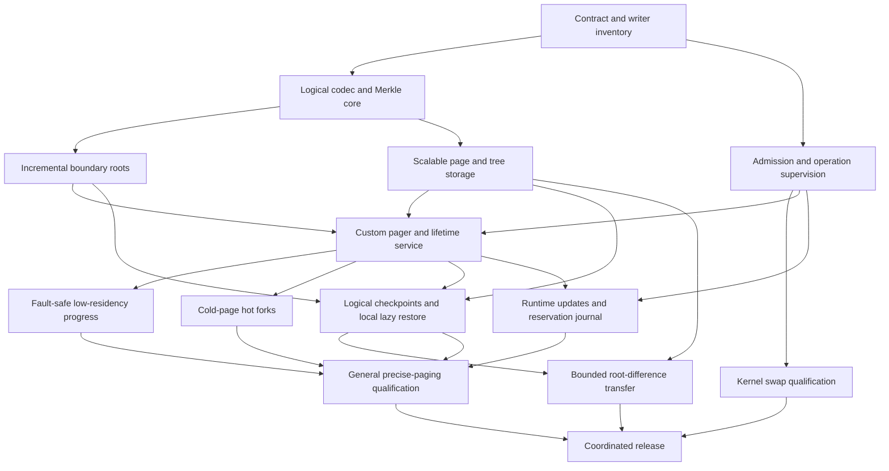

> Informative implementation plan. This preserves the initial QEMU-oriented
> work packages; it does not enable a capability. Normative release requirements
> remain in [chapter 11](../../rfcs/0021-crucible-paged-ram/11-implementation-plan.md).
> Read with the [profile roadmap](profile-roadmap.md). gem5 and KVM are specified
> future profiles, with no delivered implementation claimed here.

# Initial QEMU-SIM implementation sequence

## 1 Delivery model

This document records the initial QEMU-SIM implementation sequence. Acceptance
alone does not enable swap or advertise a new executor capability. Implementation proceeds
in reviewable work packages with explicit evidence. Staging phases are not a
backward-compatibility program: old and new incompatible contracts are never
accepted together by the deployed runtime. The final cutover is coordinated.

### Current host integration (informative)

The host implementation retains the actual Main's Source admission and node
supervisor before Source birth in both resident and controller-managed launches.
The same owner funds the fixed descriptor window and metadata overlap. Controller
endpoints, spill resources and workspace remain conditional; their absence does
not create another bank, clock or resident-only timing roster.

The current transport source contracts are:

| Surface | Current contract |
| --- | --- |
| Plugin control | Version 8; noncurrent peers are refused. |
| Shared region | ABI 33; each node slot is 768 bytes. Ordinary action return remains at offset 264; parent-Park return has a separate journal at offset 512. Constructor and clone reset paths clear both journals. The checked-in C header is emitted from the actual Rust layout. |
| Selected pre-exec Setup | Edition 5, selector `QEMU_CRUCIBLE_PREEXEC_SETUP=5`, tag `0x15`, 61-byte frame (4-byte length, 1-byte tag, 56-byte payload). |
| Setup descriptor roster | Five mandatory roles, in order: shared region, wake event, sealed plan, read-only standing publication, distinct standing cancellation event. An optional device workspace is sixth. |
| Sealed plan | `CRUCSUP8`, schema 8, containing one `CRUCPUR8` process purpose of 2520 bytes. |
| Native receiver declaration | The selected complete ELF contains one 40-byte `CRUCRCV1` record. Source activation and checkpoint ingress have separate edition fields. Startup checks Source activation independently; zero and unspecified positive activation editions refuse. The complete declaration and ELF digest remain bound to the installed Source. A declaration grants no execution authority. |
| Standing publication | Schema 3 in a 1504-byte shared file: one 8-byte sequence followed by a 1496-byte observation, accessed as atomic big-endian 64-bit words. The observation binds each action's kind, cohort, and parent-Park correlation where applicable. The host alone holds the writable mapping; the transmitted file role is read-only. |
| Sealed standing corroboration | The purpose's 1520-byte tail binds the retained publication file identity/extent and its initial 1496-byte observation. Copied fields issue no authority. |
| Standing cancellation | A separate nonblocking eventfd, with kernel event identity encoded as raw ID plus one. It is distinct from the wake event and Setup amendment event. |
| Operational durations | One exact-nanosecond roster under RAM schema 11; Host operational frames use schema 4. Configured values are positive and checked; observed expiry may be zero. |

Source publication preserves the same cap, original monotonic origin and nominal
Source subject across policy revisions. Publication commits through odd/even
atomic sequence transitions; terminal invalidation cannot be replaced by a later
live sequence. Ordinary policy changes publish new revisions without signaling
terminal cancellation. Completing Setup retains these physical owners for the
Source lifetime. Only actual child wait/reap and proven physical cleanup permit
retirement; kill, copied process identifiers and local uniqueness do not.

These are guarded host source contracts, not an enabled runtime combination.
The host receiver refuses before execution until the authentic matching native
constructor, role lender and installed-artifact proof are joined. Native kernel
and participant custody, the controller's standing-owner consumption and the
whole-Source Root adapter remain incomplete or unqualified. Source review and
local evaluation do not establish Rust integration compilation, live native or
VM behavior, physical resource floors, or CPU/elapsed-time parity. Local normal
Cargo compilation covers all 496 default workspace targets, and the daemon's
production code checks with the private measurement feature. The matching native
integration compiles and links; 25 of its 26 configured fixtures pass. The
remaining dirty-iterator fixture still assumes capture ownership that must come
from the real Root, Source and writer lifecycle. These build results do not
enable native receiver activation or qualify physical resource return. The
package exit criteria and coordinated release gates below remain required.

The private-feature QEMU test targets also compile independently of the
test-support feature. A complete private-feature QEMU library run has 1,134
passing tests, six failures and four ignored probes. Its failed-name set matches
the preceding full private-feature run. The six capture/fault
fixtures lack the genuine Source-backed control lifecycle, including paired
capture; their intended positive assertions remain required. All 32 confinement
lint tests pass, including controls that reject changed export visibility,
source placement and operation-clock formulas. These component results do not
qualify a live VM or replace the missing lifecycle evidence.

Packed inventory, publication readback and canonical archive reads now borrow
one metadata cache from the existing physical-quota service. Its rows and index
use the same paired resident/metadata accounts as ordinary service work; they
retain no Source, operation authority, file descriptor or active pack pin.
Before admitting competing allocations, the service physically reclaims cached
storage and rechecks the actual accounts. In-flight fills remain charged until
their bodies close. Every read still authenticates its fresh configuration,
placement generation, file stamp, selected entry and complete object identity.
Each reader prepays an independent active manifest copy from its existing
operation budget before borrowing shared rows. Copying under the cache mutex
performs no allocation, filesystem work or caller callback. Subsequent reads
within the same pack use that copy and preserve fresh stamp and entry checks;
shared-cache eviction can close its own rows without invalidating the reader.
Small manifests use ordinary operation-owned storage when the cache's index
and control payload would cost more than their row storage. Ordinary single-tree
reads retain their existing dispatch; this is not a claim that every page read
uses shared metadata. The storage cost controls cover tiny, mixed and dense packs
and 32/512 MiB RAM traversals. Their integrity/resource results do not establish
VM performance parity or authorize new resource ceilings.

Execution runners now expose retirement through an existing supervised
operation. Routers visit both contained runners even when neither became the
active semantic route; one refusal does not suppress cleanup of its peer.
Returned diagnostics leave operational ownership in the actual factory. The
hot-fork runner also refuses retirement while it retains an unreconciled world.
Aggregate release readiness is observed without finishing or quarantining a
pending owner, so a launcher can finish before actual aggregate release.

Main now retains the actual worker bodies independently of their borrowing
threads. Worker storage and the fixed cleanup queue are priced before model
construction. Source construction retains its original factory, generation
storage, launcher and preallocated partial/complete lifecycle carrier across
refusal. Successful disposal returns the same carrier to its reserved cell.
An exact-cell receipt remains with the factory until actual body destruction
and containing-body lease closure; publication alone does not free a slot or
certify aggregate resource return. Hot-fork retirement returns the original
Source separately from its retained typed failure history. These operations use
the existing supervision origin and preserve failed ownership for bounded retry.

If construction fails before a cleanup cell is reserved, the same inline factory
slot retains the pending body, its canonical never-born journal and its body
lease. Physical destruction precedes the paired descriptor-table/window return
and ledger credit. Retry borrows the same cached World Cleanup; it does not
renew its origin or replace its deadline. Constructor, cleanup and independent
post-check errors remain separate typed history after physical closure. The
component executor's separate no-Main shutdown path closes any saved dispatcher
without requiring a native dispatcher to have been created.

Retained constructor finalization now separates physical closure from its
independent Cleanup postcheck. After the actual owner and Main controls close,
the same containing body is removed and destroyed outside its cell lock, even
when the postcheck expires. Initiating, work, control and post failures remain
typed reports. An open owner or control still retains the complete body. A late
report neither starts another Cleanup nor requires a retry before releasing
already-closed resources.

Normal World sweeps distinguish an outstanding containing-body lease from an
invalid return. They validate the exact epoch, member and descriptor custody,
and return arithmetic before reporting pending body custody. Pending bodies
retain their complete remaining debt and physical leases while independent
Worlds can use genuinely available capacity. Ledger assignment validates all
fallible arithmetic before publishing rows or advancing epochs. Admission
refusal clears temporary factory poison only when no assignment was published
and the independent preparation postcheck succeeded, or when the local World
directory was already full before preparation. Committed or uncertain claims
retain their existing poison and owners.

Concrete VM construction, runtime, checkpoint and cleanup ownership now live in
`crucible-daemon`. The API owns transport-neutral operational data and cleanup
operations; it no longer depends on the QEMU implementation. Handoff upcasts the
same preallocated backend body into its existing exact cleanup cell, without a
replacement allocation or owner. The cutover removes 112 obsolete QEMU boundary
allowances and preserves all 380 lifecycle and RAM unit-test declarations.
Independent default-feature library builds now include their own unit fixtures
without depending on workspace-wide feature unification. External fixtures
remain opt-in, and native permission requirements are unchanged.

Private native observations now retain the real Source factory in the paid Main
worker. The shared four-vCPU and block drivers borrow operation-only views; no
node, guard, mapping or channel owner is returned. Launch uses the ordinary
keyed constructor and saved supervision. Publication consumes the same owner and
cleanup receipt, and diagnostic loans remain held until physical closure. The
worker size query includes the new inline fields before construction; immutable
input paths and their shared body are admitted before allocation.

The default workspace/all-targets check and the separate private observation and
Parent feature checks pass. The focused private suite has 29 passes and one
ignored legacy native entry; all four original-retirement controls pass against
the actual retained thread table. The input alias control proves last strong-alias
closure and credit retention; its test-only Weak witness does not prove Arc
backing deallocation. Production keeps the body graph free of Weak/raw escapes
and drops that allocation before its decoder custody. The full private-feature
library run has 1,680 passes, 17 failures and 43 ignored tests. Its failed-name
set matches the preceding native integration failures. The membership cancellation
control now selects five actual traversal boundaries instead of calibrating raw
callback ordinals across independent SQLite reads. It checks the same operation,
typed cancellation, unchanged root, exactly one selected boundary and no
post-refusal callback. The positive traversal visits every boundary exactly once;
all seven membership controls pass. The full suite also passes the 512-MiB
packed unique-page traversal.

The supplemental service VM checks build the actual private controller into the
installed Main policy and retain the original guest/request vectors. Ordinary
deployment TOML values are unchanged. Deployment files now use the source-built
text helper so guest artifact derivation references are valid. Source/guest-only
backreferences to the old canonical gate have been replaced with direct owning
imports; the guest derivation is identical and the shared Cargo source retains
its required embedded scenario. The four-vCPU VM build reaches the unchanged
QEMU dirty-iterator fixture failure before execution. Neither service flight nor
VM performance is qualified by the compile and component results.

The API library has 119 passes. All eight Source history/saved-Cleanup controls,
four component shutdown regressions, three worker-custody controls, five exact
receipt controls and two status-ordering controls pass. These include 24 epochs through
one physical cleanup cell and actual body destruction before expired-operation
observation. Three constructor finalization controls pass with actual files,
mutex cells and worker storage, covering late expiry, combined typed reports and
an unclosed body. The complete QEMU result is recorded above. Component results
do not qualify deployed resource return or VM performance.

All 31 Rust ABI, licensing, crate-layer and scheduler-boundary checks pass, as do
26 gate-traceability checks, five engineering-hygiene controls, the two production
effect-matrix checks, the schema-registry control and all three daemon doctests.
The testing-standards suite has 30 passes and one failure: the broader source
classifier still requires review of operational paths. Six reviewed targets now
classify only effect-free cleanup declarations and eight exact same-owner
forwarders. Their mutation controls reject default bodies, changed receivers,
extra statements, waits and failed-test reruns. Mutation builders preserve raw
method token boundaries; whitespace compaction is used only for search needles.
Neither source inventory nor the escape matcher was relaxed. Admission
checks now bind both existing waits to the same original Setup. Shared Target
clauses bind saved Cleanup entry and physical return; dispatcher clauses retain
both fixed five-second bounds, all five polling loops, and same-control recovery.
All eleven actual dispatcher component tests pass. These file-backed mechanisms
establish no native Main/Source issuance. The retired plugin-worker contract and
two resolved admission-sleep exemptions are removed. Live guards, custody and
negative mutation controls remain required. The Nix scheduler boundary checks the
production adapter in the daemon; its separate raw source scan still incorrectly
includes CLI test-only delegation, while the Rust production-aware scan passes.

Packaged retirement now preserves component failures beside later pre-dispatch,
dispatcher and independent post failures. Attached retirement retains the
initiating service cause separately from each cleanup phase's first typed
failure in its existing Main. The finite inline report fields enter the actual
actor size query before structural admission; no report carrier or owner slot
is allocated on failure. All five new component controls pass, along with the
existing cleanup-cell controls. Workspace checking and source hygiene pass.
A temporary stable-compiler layout probe on the joined dispatcher, resource-begin
and World-return source measures the actor at 5,024 bytes, its inline attached
history at 1,728 bytes and a temporary report at 1,032 bytes. The initiating/rollback
report is 1,232 bytes; the concrete shared-Linux Source factory, pending construction
and launcher occupy 44,080, 1,704 and 8,720 bytes respectively. These inline
fields enter the actual sizeof-based admission queries. The probe is removed
and the exact source hashes are restored. These are Rust object extents, not
whole-stack, allocator-overhead, policy-fit or performance proofs.

Composed guards now distinguish active ownership, successful return and terminal
quarantine. Failed cleanup and explicit quarantine cannot become a successful
later finish; repeated calls perform no second host cleanup effect. Routing
refusals also update that same outer state. This prevents retained Source cleanup
from treating containment as physical closure. Guarded Main retirement preserves
its selected refusal alongside independently observed worker and lifecycle
reports, without changing native effect ordering or using another allocation.
Five real worker/file report controls and three new guard-state controls pass;
existing controls are retained. The joined full private-library run has exactly
the preceding 17 daemon and six QEMU failed names, with no new failures.

The Guarded cause and complete returned report measure 616 and 832 bytes;
retained-constructor cleanup and retirement reports measure 1,032 and 1,200 bytes.
These are returned diagnostics, not newly stored actor fields. Main remains 5,024
bytes, and the concrete Source factory, pending construction and launcher retain
the extents above. These measurements establish neither whole-stack usage nor
budget fit. The broader generic finish adapter still needs its typed leaf
migration through the actual launcher, cleanup queue and scheduler boundary.

Dispatcher retirement now retains the first Cleanup admission result once and
authenticates that exact saved operation without initializing another one.
Terminal parents do not prevent same-owner worker joins; new work still requires
live authority. Actual panic payloads remain inline in the retained dispatcher,
while physical completion is observed independently from diagnostic history.
The shared factory reports its result and physical-closure fact under the same
mutex. Attached, original, guarded and component consumers require that fact
before returning their containing resources. Dispatcher and pool errors remain
two finite typed leaves; one cannot replace the other.

Resource-begin rollback now moves the initiating error and the actual independent
cleanup error into an inline report, without reboxing their existing allocations.
A private rollback record proves quarantine; absence of a selected checkpoint
claim alone proves nothing. Source construction and retained history preserve
that report separately from later cleanup and postchecks. The same raw host
cleanup helper owns both installed-guard cleanup and pre-guard rollback. The
public generic finish adapter still renders its raw cleanup failure into a
terminal message; preserving that leaf through the public API remains a separate
caller migration. Replay binding now uses the same inline rollback report to
keep its initiating and cleanup errors together, after its existing quarantine
effects. That narrow bind-error path still needs authentic service-lane coverage;
the seven new resource-begin component controls all pass. Checkpoint promotion
still has separate first-cause replacement paths. Replay's retained-service
fallback still allocates and leaks its containing owner on uncertain cleanup;
preserving diagnostics alone cannot repair that custody path. Promotion can carry distinct realization,
closure and restore causes plus multiple cleanup phases. Its follow-up needs a
finite nonrecursive history representation and an actual containing-body size
query for the promotion body; the ordinary worker-cell query alone does not
fund a separate promotion body. Resource ceilings remain unchanged.

World and node returns now verify their exact saved Cleanup, retained family,
kernel partition and ledger epoch rather than requiring a live preparation
parent. New work still needs live admission. The first Cleanup admission result
remains latched, and its actual allocation is priced once per finite World cell.
The descriptor-return journal records successful setrlimit before any readback;
a later verification refusal cannot cause a second subtraction and leaves the
partition sealed against new admission. The real-kernel helper deliberately
changes the soft limit after observing the successful write, then proves genuine
readback refusal, retained sealing and no repeated return. All 239 resource
controls pass, including six new ledger/operation controls and that helper case.

Returning an assignment is distinct from destroying its owning facade. Factory
closure still requires every canonical node and World entry to be removed. An
exact preexisting loan can observe an already-committed World through its same
pool and monotonic publication epoch, without claiming it was never born or
issuing new work. Authentic whole-factory recovery and native physical return
remain unqualified; the local ledger and kernel controls do not issue Main or
Source authority.

The retry-path review also identifies an unqualified debug-replay route: replay
loops can be dropped after shutdown refusal without a canonical cleanup handoff.
The actual Source launcher currently refuses independent replay worlds. Before
enabling that route, success and failure must retain the real replay owners
through their exact cleanup receipts; a source-classifier exemption cannot
establish that missing lifecycle.

Native Source activation, genuine Target preparation, owner-driven capture and
full qualification remain open. The normal-service VM evaluation reaches the
QEMU build, whose dirty-iterator fixture still fails; no VM lane was executed.
The required application-target build passes locally for the backend-cutover
snapshot, including every application's unit and integration target compilation,
with remote builders disabled. A new local packaged run covers the observation
and constructor-finalization code; it also passes, including all application
unit and integration target compilation. This immutable packaged snapshot
predates the dispatcher and typed resource-begin changes. A further local
application-target build now covers the joined World-return and replay source;
its result remains pending. The workspace, feature and full private-library
results are recorded above. The pending-aware World and dispatcher cohorts pass
normal all-target workspace checking and all 239 Linux resource tests, with one ignored probe. The World controls use actual
ledger transitions and physical resource leases, without claiming authenticated
Main issuance. ABI, license and scheduler boundary checks and engineering hygiene
also pass. The complete private QEMU library run has the unchanged six capture/fault
failures recorded above. Integrated qualification and VM performance parity
remain outstanding.

### Canonical native observation gate cutover (required)

The supplemental service flights do not yet replace the canonical plugin gate.
Its complete result contract also owns trace framing, scheduler equations,
host-parallel recovery, diagnostic programs and mode-specific execution. The
cutover must preserve all existing predicates and perform these steps:

1. Use the direct source/guest imports already introduced, so composing the
   canonical gate from real service consumers cannot recurse through a borrowed
   source artifact. Retain every compiler-visible crate and embedded fixture.
2. Share the existing complete evidence validator and normalizer. Preserve the
   unique result and reference-summary frames, raw UART versus normalized copies,
   regular nonsymlink trace checks, positive bounded byte/row counts, raw and
   normalized digests, timer/RR relations and block-recovery ordering. Missing,
   duplicate or conflicting evidence must fail; deduplication cannot establish
   canonical provenance.
3. Orchestrate both real Main-backed plugin programs under their original shared
   1,800-second watchdog. Two independent 1,800-second checks are supplemental,
   not an equivalent combined bound. Preserve the existing six-CPU, 12-GiB outer
   policy, 6,000-second watchdog and disk envelopes. Authenticate each program's
   own cleanup and result before constructing canonical singleton metadata.
4. Migrate the actual two-node host-parallel/recovery assertions to genuine Main
   ownership under their separate 3,600-second bound. Four-vCPU round robin does
   not establish two-node parallelism; all 13 existing lifecycle/recovery markers
   and their causal checks remain required.
5. Deliver block-only and coarse/fine partition diagnostic selection to the real
   worker before startup. A parent-shell environment setting does not configure
   a systemd-owned worker. Retain the 2,100-second diagnostic bounds, malformed
   selector refusal, exact partition relation and trace summary.
6. Preserve raw result, transcript, rootfs dependency and executable-script
   contracts for fingerprint, scheduler, offload and campaign-mode consumers.
   Disabled-mode execution must still prove the production service/socket/command
   absent; enabling that service or relabeling an enabled-mode result is not a
   substitute. Supply a genuine observation owner compatible with that test's
   declared composition before changing its adapter.
7. Cut over the canonical gate and every consumer together, then remove the
   obsolete positive ignored entry and its sole model/worker route. Retain shared
   admission helpers only while live performance/write-oracle consumers need
   them, and migrate those consumers through their actual owners. No accepting
   component fallback is permitted.

These are pending implementation and runtime obligations. The new component
controls, source-closure equality and supplemental checks do not discharge them.

The existing trace/result normalization and complete evidence validator now
share one helper. Local Nix evaluation with import-from-derivation disabled
confirms identical rendered scripts, string contexts, resource specifications,
dependencies and VM derivations for the main gate and both diagnostics when
compared against the same final source snapshot. This extraction preserves the
old execution entry; its libtest completion marker cannot be fabricated by a
future service adapter. All 26 traceability and five hygiene controls pass after
the extraction. No native execution or canonical service cutover is implied.

The dependency graph below distinguishes foundations from separately enabled
capabilities. `A -> B` means B requires A's accepted contract and evidence.

Some code may be developed in parallel, but no gate can use another unfinished
phase as assumed proof. A generic `supports_paging` bit is insufficient:
backend, mapping mode, fork, lazy restore, strict residency, and fault-safe
reclaim capabilities must be advertised independently.

The graph's node labels describe capability dependencies, not the delivery
package letters used below. Some packages combine capabilities for review:
Package I covers cold forks and local lazy restore; Package J covers live
control and bounded transfer. That grouping does not remove their independent
qualification gates or imply an atomic cross-machine operation.

## 2 Package A: contract inventory and independent oracle

Deliver a machine-profile RAM inventory with stable region IDs, alias owners,
class/mask declarations, immutable reconstruction references, and every
supported write origin. For each writer, record the actual QEMU dirty hook,
its covered geometry, caller lifetime, and consumer epochs. Identify external
kernel reads/writes through guest pointers, device pre-save mutations, bulk
reset/restore, fault injection, and cached DMA stores.

Separate the complete RAM read-resolution inventory from writable fault-target
admission. The existing mutation mapping filter excludes readonly, ROM, and
RAM-device regions; pager lookup must cover admitted cold reads of those regions
without granting mutation rights. Include retained raw/DMA borrowers and kernel
pins even with fault rules disabled. Inventory persistent retention/rowhammer
mutations, guest-RAM hardware-reporting writes, and modeled memory-service
tickets/frozen loads/deferred stores. Reconcile the host/GPL service payload
contract, including actor fields, before claiming live service coverage.
Operational copies must not exercise simulated access opportunities or timing.

Define the new fingerprint and checkpoint editions and enumerate all consumers:
production execution, exact snapshot, harness, instruction fault state,
lifecycle preconditions/source seals, trace, and persisted canonical samples.
Create an independent full-RAM Merkle oracle that does not reuse dirty bits,
cached roots, incremental code, or the production tree builder. Instrument
tests so suppressing a required dirty notification demonstrably fails.

Exit evidence is a complete inventory with no unclassified supported writer,
a precise coverage map for all named scopes, and oracle detection of deliberate
false negatives. A source audit alone does not qualify a memory backend.

## 3 Package B: canonical logical core

Implement [chapter 02](../../rfcs/0021-crucible-paged-ram/02-logical-ram-and-merkle-format.md) in the boundary-appropriate components without acquiring
QEMU dependencies in permissive crates. Portable codecs are bounded and use
checked arithmetic. Persistent trees carry immutable ownership; page-version
and dirty-epoch state remain separate from digests. Build sparse zero trees,
batch dirty updates, reuse equal-content pages, and account for dense/padded
metadata limits.

Exit evidence includes the executable positive vectors specified in [chapter 02](../../rfcs/0021-crucible-paged-ram/02-logical-ram-and-merkle-format.md),
independently produced C/Rust results, malformed and overflowing encodings,
wrong scope/topology, partial pages, reordered pages, padding proofs, and
representation-independent roots.
Retained nodes must remain valid through concurrent root users and teardown.

Build the GPL-side C hash implementation hermetically from pinned reviewed
upstream source, recording its applicable GPL-compatible license choice and
corresponding-source obligations. The Apache-side Rust implementation remains
in its separate process. Validate the official primitive vectors, the selected
unkeyed 32-byte mode, and agreement across enabled portable/SIMD paths before
enabling the logical codec. A shared algorithm MUST NOT introduce a cross-process
QEMU library dependency or conflate logical digests with CAS object identities.

## 4 Package C: resource model and granular supervision

Refactor admission around uniquely owned source pages, private child changes,
metadata, compulsory host memory, emergency buffers, disk capacity, and I/O
capacity. Maintain attempt/executor aggregate containment and account for
original cgroup ownership of COW charges. Do not convert full-RAM accounting
to a guessed working-set number before a backend has a progress proof.

Introduce operation classes and consistent monotonic start/progress/completion
coordinates. Separate modeled deadlines from host budgets. Cover QMP, quantum,
capture, publication, restore, page-in, preservation, fork barrier/rearm,
transfer, cancellation, and reaping. Ensure the outer watchdog follows the
same explicitly authorized completion contract and cannot silently defeat an
accepted latency configuration. Reconcile QEMU-internal placement waits and
host-side deadlines. Make operational controls independently responsive while
QMP and guest execution stall.

Enforce TIME-9's finite infrastructure-phase bounds at admission and on every
live update. Implement the separate outer-cap amendment transaction, shared
watcher wakeup, original-start retention, expiry precedence, durable recovery,
bounded idempotency history, and limiting-deadline status. An updated caller
duration without rebinding every affected supervisor is not complete.

Exit evidence includes nested deadlines, in-flight updates, rollback of refused
reservations, restart recovery, prolonged legitimate progress, endless paging
without guest progress, cancellation, and quarantine that remains charged.

## 5 Package D: kernel-managed swap baseline

Add explicit host prerequisites and configurable swap limits while retaining
the existing default behavior unless the operator selects the backend. Probe
usable swap and cgroup delegation. Document that cgroup swap and memory limits
apply to an aggregate owner, including file cache and emulator overhead.
There is no precise per-VM cache guarantee from `mmap`, global swappiness,
or an attempt-level cgroup alone. Package D is a labeled measurement baseline:
operator selection permits the experiment, not authenticated-backend deployment.
Advertising a supported backend requires PAGER-22's separate integrity proof;
this edition does not silently trust swap bytes or narrow TEST-7's threat model.

Measure deterministic equality and host throughput for resident, swap-enabled,
and constrained-memory runs. These measurements supply a realistic comparison
for the custom pager. Exit evidence includes actual swap activity, multiple
nodes, source/child accounting, adverse storage latency, and host failure
classification. The test must demonstrate paging occurred rather than merely
setting a sysctl or allocating a file.

## 6 Package E: incremental observation cutover

Replace all full-RAM production observers with named roots and a shared logical
edition. Preserve coherent capture ordering, request-generation publication,
and independent dirty clients. Restores install authenticated roots or force
complete reconstruction; resets establish their specified logical contents.
Do not hash mutable RAM from an asynchronous worker after guest resume.

Exit evidence is equality with the independent oracle at every tested boundary
across every writer, including write-then-revert and unchanged cold pages.
The normal fingerprint path must demonstrably avoid faulting the complete
unchanged address space into memory. Selected-range fault digests remain
separately specified where full-state identity does not answer the predicate.

## 7 Package F: scalable durable memory storage

Define page objects, portable structural records, complete root manifests,
packing, bounded index traversal, admission limits, and retained closure
ownership. Separate logical BLAKE3-256 digests from existing representation
identities, even where both use the same hash primitive.
Replace flat assumptions that cannot handle worst-case distinct 4 KiB pages.
Make tree/page verification and retrieval bounded without eagerly loading a
complete machine's page catalog into host memory.

Exit evidence includes dense distinct pages beyond former flat limits,
small-object overhead measurements, packed-object corruption, quota failure,
crash during publication, concurrent GC, and retained source/child/transfer
leases. An ordinary spill write is not accepted as durable publication.

The original packed read view retained only the most recently used authenticated
manifest. A local 32 MiB, 8192-page diagnostic performed the same 24,575 object
lookups before and after repacking. Manifest authentication increased from 769
operations over 18,438,337 encoded bytes to 23,246 operations over 3,878,963,049
bytes. This measured excess work, not an isolated throughput comparison.

The integrated retention path uses the selected physical-quota service's paired
resident/metadata accounts for shared rows and index storage. The initiating
operation separately funds its active manifest copy. Both admissions occur
before the corresponding allocation; cache eviction destroys actual shared
storage before returning its credit. Reuse binds configuration, placement
generation, immutable pack identity, inode stamp and selected entry. Every
object retains complete authentication and EOF checks. Reservation or caller
failures propagate without falling back to an uncached read.

Inventory, publication readback and canonical archive constructors use this
path. Ordinary single-tree reads keep their existing dispatch. The 32/512 MiB
controls exercise bounded traversal, reclamation and resource return, while
balanced sequential/strided read measurements cover tiny, mixed and dense
packs. Remaining lazy-checkpoint and closure-verification joins must be checked
through their actual selected owners; these component controls do not establish
complete VM performance parity.

Resource qualification must use the actual owner topology: ordinary CLI archive
transfers borrow exclusive service owners and send roots sequentially, retaining
one source session. Their Packed service's authored metadata bank is distinct
from the catalog service's SQLite heap partition. Neither a hypothetical
concurrency count nor a successful component fixture proves that the normal
configuration fits unchanged limits.

## 8 Package G: custom pager and authority lifecycle

First implement stable mappings, missing-page service, page/version state
transitions, preserved backing, immutable authenticated reads, controlled
writeback, and paused-boundary removal. Qualify the deployed userfaultfd
features, permissions, kernel-originated faults, and mapping semantics.
Retain registration authority across companion failure until QEMU can be
stopped; closing the final authority must not expose default zero faults.

The proposed GPL-side companion owns native addresses and mapping details.
Its public storage requests use bounded portable identifiers and checked
offsets. Prove its service cannot depend on a barrier held by an accessing
QEMU thread, and reserve its minimum service resources. License and ABI
review precedes adoption of this placement.

Initial acceptance includes PAGER-23's physical-access lifetime proof for
retained DMA/raw mappings, kernel pins, aliases, and observation readers.
Reserve the sound inter-boundary peak before admitting the paused-only backend;
unsupported peak reductions are refused rather than admitted with expected
runtime failure. Cold fault-transaction preparation must secure all fragments'
versions, COW rights, and commit resources before any write, under TRACK-20.

Exit evidence includes missing/short/corrupt backing, delayed and stale I/O,
companion death, kernel fault denial, mapping removal events, cleanup races,
and preservation failure before discarding the last correct resident version.

## 9 Package H: fault-safe low-residency progress

Paused-boundary eviction is a correctness baseline, not sufficient proof of
general low-residency progress. A guest can touch more pages in one quantum
than its admitted resident peak. A blocked fault cannot wait for an exact
boundary that the fault itself prevents the guest from reaching.

Resource suspension requires a complete stop protocol that can progress while
a vCPU or device thread is blocked in a host fault, including mutex ownership,
BQL constraints, event-loop work, pager callbacks, and any dirty re-arm work.
Qualification identifies the actual discard executor and kernel primitive,
not just an independent fetch companion. A local worker needs a closed
thread/mutex plan and child reconstruction. Operational holds cannot use ordinary
host-timed CPU kicks or semantic vmstop publication without proving unchanged
interrupt checks, RR allocation, timer/device order, and partial operation state.
Concurrent removal requires a different proof: preserving every latest write,
rejecting stale I/O, preventing stale physical references or bypass of the
qualified fault path, and covering all device/DMA lifetimes. Benchmark gains
do not replace either proof.

Exit evidence includes an unmodified guest whose single quantum touches more
distinct pages than the resident peak, without extra reservation capacity,
and equivalent scenarios during device activity and runtime target reduction.
For the general backend the run must make bounded progress with correct bytes.
For the limited baseline unsupported admission must be refused; a distinct
post-admission resource-loss adversary must terminate safely. Neither case may
deadlock, substitute zeroes, or depend accidentally on extra host RAM.

## 10 Package I: cold forks and local lazy restore

Integrate fault authority into the entire hot-fork transaction before child
reconstruction. Establish child-specific mutable epochs, private preserved
versions, fault contexts, registrations, reservations, and readiness. Strict
residency requires independent child prefault/lock establishment. Shared
immutable backing stays pinned; source residency can change without changing
its logical seal. Quarantine retains all unresolved ownership.

Replace eager sealed-RAM restore with the new authenticated local closure
contract. CPU/device and continuation reconstruction remain coherent. Verify
complete local durable availability before launch, and each page before it
is exposed. Cold reads during device restore must be serviced independently.
No remote-page server is implied.

Capture establishes CHECK-13's disposition barrier for pending pager and policy
work. Restore constructs fresh controller/registration/request namespaces and
independent consumer baselines under CHECK-14. Source I/O completions cannot
be replayed into the restored owner. Existing modeled fault/service continuation
must remain intact and resume its admitted semantic effects exactly once.

Exit evidence includes mostly cold sources, fork barrier adversaries, child
reconstruction reads, failed rearm, source death, child cancellation, descendants,
promotion, dense COW writes, and lazy restore matching exact continuation.

## 11 Package J: live control and transfer

Implement generation-bound, authenticated, revisioned, idempotent policy
updates and status. Add bounded operational history and reservation amendments.
Keep accepted, applied, effective, and converged states distinct. Reductions
release capacity only after ownership is gone; increases reserve first. Restart
reconciliation must distinguish accepted-but-not-applied from applied-but-not-
reported operations. Hard update-history capacity must not consume fault-service
emergency memory.

Implement bounded root-difference traversal, paged inventories, authenticated
destination possession, source retention, cancellation between I/O chunks,
durable progress receipts, and atomic reference publication. Resume records
must bind both the transfer incarnation and selected source roots. A transfer
of VM state includes the non-RAM checkpoint closure, not just page contents.

Exit evidence includes runtime tuning during blocked faults and forks,
idempotent retry across restart, revision conflicts, quota exhaustion, dropped
transfer sessions, corrupt destination claims, partial receipts, and publication
only after complete authenticated durable possession.

Archive transfer completes with `ClosureStored` and ordinary archive selection
retention on a storage-only destination. Maintenance additionally requires
`RestoreReady`, current execution admission, and the durable ownership transition.
Test stale readiness before handoff and independently refused later restore;
neither publication nor source lease retirement implicitly grants execution.

## 12 Coordinated release and documentation

Publish canonical operational documentation for supported backends, prerequisite
checks, resource-floor calculation, runtime controls, typed failures, cleanup,
and recovery. Keep this RFC as the historical design record. Record measured
baseline and performance budgets without inventing a prior approval: the current
campaign performance gate has a blocked/unapproved baseline at the cited source
revision. Deferred remote paging or live migration receives its own design and
qualification rather than inheriting an unsupported capability flag.
