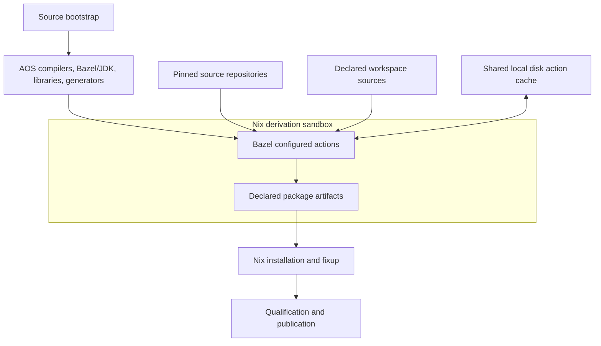

# Nix integration and shared compilation functions

## Division of responsibility

Nix owns the source bootstrap, toolchain and library derivations, immutable
external source inputs, package metadata, installed outputs, runtime closures,
system composition, and release qualification. Bazel owns the configured
first-party source graph, code generation, compilation, linking, and language
tests. A package recipe selects an exported Bazel package target rather than
reconstructing its Rust or C++ dependency graph in Nix.

The intended flow is:



The shared cache mount is explicit development-build policy. It supplies
action results, never dependency discovery or missing source files. A fresh
offline build with an empty cache remains complete.

## Shared Nix API

Implement the following proposed functions in `pkgs/build-support/_bazel/`,
exported through the existing package construction layer. Keep
`pkgs/default.nix` wiring small. Function contracts use structured attributes
and argument lists; package recipes must not concatenate raw shell flags.

| Function | Inputs | Result and responsibility |
| --- | --- | --- |
| `mkAosBazelToolchains` | Execution/target platforms, selected AOS compilers, sysroots, native libraries, generators | Immutable Bazel repositories and per-toolchain identity manifests; validates supported combinations |
| `mkAosBazelWorkspace` | Repository root, generated source/target inventory, dependency lock inventory, toolchain repositories | Pure workspace description: source selections, immutable repository inputs, profiles, package and check selectors |
| `mkAosBazelBuild` | Workspace, package/check labels, compatible configuration, cache policy | One Nix build derivation running Bazel and exporting only declared artifacts, manifests, and build evidence |
| `mkAosBazelPackage` | Workspace/build result, package label, existing package metadata | Installs the declared package outputs and applies the ordinary Nix fixup, runtime, source-retention, and qualification policy |
| `mkAosBazelCheck` | Workspace, test labels, resource and execution policy | Nix check using the same graph/toolchains, with the appropriate fresh-execution and external-resource requirements |
| `mkAosBazelShell` | Workspace, selected development profile | Lightweight environment and launcher using the same tools, repository mapping, and configuration as package builds |

`mkAosBazelPackage` can request a build or project a named package from an
already requested compatible build. Group related binaries when that avoids
recompiling the same graph, but do not group unrelated packages merely for
convenience. Separate package projections avoid retaining an entire multi-tool
build tree in each installed runtime closure.

An illustrative package recipe is:

```nix
{ mkAosBazelPackage, aosBazelWorkspace }:
mkAosBazelPackage {
  pname = "nix-eval";
  version = "0.1.0";
  workspace = aosBazelWorkspace;
  target = "//native/nix-eval:package";
}
```

The package target exports install destinations, selected files, runtime
inputs, source evidence, and platform metadata. The helper checks declared
package version and name against this recipe. A disagreement fails rather
than creating two identities for the same package. The same interface serves
Rust binaries, C++ executables, libraries, and Wasm artifacts.

Refactor reusable behavior from `mkBazelPackage`, `fetchBazelDeps`, and their
phases behind these helpers. Preserve existing upstream package behavior
through an adapter and fixtures. Upstream-specific repository surgery and
shell fragments do not become required first-party package boilerplate.

## Pure evaluation and source selection

Do not run Bazel, Cargo, or a source generator during Nix evaluation. Avoid
import-from-derivation for build graph discovery. Nix reads a checked-in,
versioned inventory generated from Bazel's graph; the BUILD files remain the
authoritative dependency definitions.

The inventory records package roots, conservative transitive source directory
sets, extra data/schema/fixture paths, required external repositories and
native input identifiers, supported configurations, and exported targets. It
also records the generator version and the relevant BUILD, `.bzl`, module,
configuration, and dependency-lock identities. Source directories include
ordinary new implementation files without requiring inventory regeneration
for every edit. New packages or changed dependency/data declarations do require
regeneration. Inventory validation detects added or removed BUILD files.

Generate a conservative union over supported configurations, including
execution-tool dependencies. An unconfigured `query deps` result alone is not
proof of a complete configured closure. Verify the inventory against configured
graphs in the metadata check. Pure Nix validation rejects stale definition
identities before selecting sources. The inventory is packaging metadata and
must not be injected as a global input to every compiler action.

Reuse the existing source filter's exclusions for Git metadata, worktrees,
development environments, output links, compiler outputs, and generated run
state; extend it for Bazel outputs. Preserve checked-in hidden inputs and
explicit fixtures. Source selection must not depend on a developer's ignored
files or local cache. Tests demonstrate that an unrelated documentation edit
does not change a package source unless that document is a declared input.

During initial infrastructure work, a conservative family-wide source set is
acceptable if explicitly reported. Precise generated selection is required
before replacing the existing workspace slicing for production consumers.
This preserves narrow Nix invalidation without making Nix reimplement Bazel.

## Offline dependency preparation

The update operation produces a reviewable inventory of source URLs, immutable
revisions, content hashes, patches, license/source metadata, and generated
Bazel repository definitions. Nix fetchers materialize those source-only
inputs; rule generators and helper executables are built with AOS tools.
Reject bundled compiler/tool binaries and replace them with source-built
providers. Carry declared patches through both identity and source evidence.

Ordinary builds get immutable local repository mappings, a fixed module lock,
and download-disabled configuration. Lock changes are errors, not opportunities
to resolve new versions. Repository/module extensions must use only supplied
inputs and declared AOS tools. Test offline startup with empty per-user caches;
an outer Nix sandbox does not make a network-using repository rule hermetic.

Keep dependency preparation keyed to dependency specifications and tools,
not every first-party implementation byte. Rebuilding a crate must not rerun
dependency resolution or repack unchanged external repositories. Reuse the
existing source-only Cargo-vendor and Bazel-fetch knowledge where applicable;
the final first-party build consumes Bazel repositories without Cargo.

## Toolchain closure and platform mapping

Map the Nix build platform to Bazel's execution platform for local builds and
the Nix host platform to Bazel's output target platform. Handle compiler
packages' additional Nix target role separately. Rust procedural macros,
build scripts, schema generators, and their native libraries run on the
execution platform; produced programs and target standard libraries use the
target platform. Cross tests must not execute a foreign binary accidentally.

The common adapter declares the compiler, support libraries, codegen backends,
linker, assembler, archiver, sysroot, SDK where applicable, and toolchain
wrappers. Register C++ and Rust toolchains explicitly and disable host discovery
and upstream toolchain downloads. Validate Linux/Darwin, x86_64/aarch64,
WebAssembly, and guest configurations according to actual supported consumers;
do not claim a platform supported merely because its constraint exists.

Expose immutable Nix files as declared toolchain inputs. Include a manifest
of the relevant reference closure in action identity, adapting accache's
compiler contract. Native libraries provide explicit include/link/run inputs.
Paths embedded in link outputs remain real immutable store references; preserve
the existing dynamic loader and rpath behavior without exporting a broad
`LD_LIBRARY_PATH` into tools that later launch Nix or Git.

Use a small allowlisted action environment: declared tools, locale, timestamp
policy, reproducible metadata, and target settings. User rc files, ambient
`RUSTFLAGS`, compiler search paths, Cargo configuration, and credential variables
cannot silently affect package builds. The launcher selects the repository
configuration explicitly. Per-user performance options must not bypass the
release profile or disappear from action identity.

## Installation and artifact contracts

An `aos_package` rule exports a versioned manifest associating a package label
with its current artifacts, logical install destinations, modes, runtime/data
closure, license domain, and source evidence. Nix validates destinations and
copies only these artifacts. Never install by globbing stale `bazel-bin` files,
assuming a platform-specific output path, or selecting whichever executable
happens to exist after a build.

Use Bazel providers/output groups and a deterministic export action to collect
artifacts. Library consumers retain their declared link dependencies; packaged
programs receive their actual runtime closure. Generate any wrapper from AOS
bash and declared tools. Debug/split-debug outputs and runfiles must be included
or intentionally separated by the package contract.

Do not archive and restore a whole Bazel output base as an immutable artifact
interface. Action caching handles cross-execution reuse. Nix can reuse a
complete compatible family build and project multiple packages, and its binary
cache can substitute completed outputs. If immutable precompiled dependency
exports are later needed for cache-free release builds, define their compiler,
feature, native-library, and import-provider compatibility explicitly before
replacing any RFC-0015 guarantee with them.

The package keeps the current platform support, dependency, qualification,
closure-audit, and corresponding-source obligations. A Bazel cache hit is not
evidence that package policy or release checks have run.

## Development and build-system bootstrap

Keep `aos-dev build package`, `aos-dev run`, and release/check selectors as the
packaged entry points. Add a proposed `aos-dev bazel` pass-through with shared
toolchain/cache setup for direct development, plus a focused `bazel-shell.nix`
analogous to the current Cargo shell. Entering the shell must not evaluate all
system outputs or build an application to obtain its compiler.

Bound setup evaluation to selected toolchain and dependency inputs. Reuse the
environment across edits. Direct builds and Nix builds use the same profile
definitions; compare their action keys rather than assuming path-independent
reuse. The new source tree is always discoverable without Cargo metadata.

Keep the bootstrap DAG acyclic. The AOS Bazel, JDK, Rust, C/C++ tools, rule
generators, and dependency updater must be obtainable before building the
first-party Bazel workspace. Upstream Cargo builders and source-built Cargo
remain available for those bootstrap edges. Accache must not be required to
build itself or Bazel; its eventual Bazel target can use the ordinary shared
disk cache directly. The initial launcher uses existing bootstrap tools rather
than requiring a freshly built AOS CLI.
